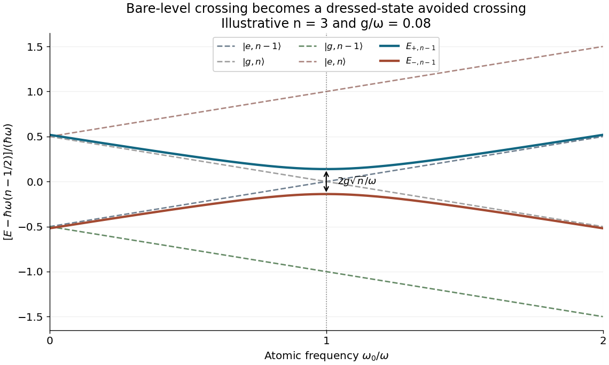

<h1 id="6/d/solution">Solution</h1>

↑ **Parent:** [D](../d.md)

The requested bare labels require $n\geq1$. Their four energies are

$$
E_{e,n-1}=\hbar\omega(n-1)+\frac{\hbar\omega_0}{2},\quad
E_{g,n-1}=\hbar\omega(n-1)-\frac{\hbar\omega_0}{2},
$$

$$
E_{e,n}=\hbar\omega n+\frac{\hbar\omega_0}{2},\quad
E_{g,n}=\hbar\omega n-\frac{\hbar\omega_0}{2}.
$$

Among these four, the pair that is fully present in one interacting sector is $|e,n-1\rangle,|g,n\rangle$. Its center is $C=\hbar\omega(n-1/2)$ and its dressed branches are

$$
\boxed{E_{\pm,n-1}=C\pm\frac\hbar2\sqrt{(\omega-\omega_0)^2+4g^2n}.}
$$

Their endpoint values at $\omega_0=0$ and $2\omega$ are the same, $C\pm\hbar\sqrt{\omega^2+4g^2n}/2$. At $\omega_0=\omega$ they are $C\pm\hbar|g|\sqrt n$. The [avoided crossing](../../../../avoided-crossing.md) therefore has resonant gap

$$
\boxed{E_{+,n-1}-E_{-,n-1}=2\hbar|g|\sqrt n.}
$$

At the three horizontal-axis landmarks, the bare energies divided by $\hbar\omega$ are respectively

$$
\begin{array}{c|ccc}
&\omega_0/\omega=0&1&2\\\hline
|e,n-1\rangle&n-1&n-1/2&n\\
|g,n-1\rangle&n-1&n-3/2&n-2\\
|e,n\rangle&n&n+1/2&n+1\\
|g,n\rangle&n&n-1/2&n-1
\end{array}
$$

which specifies the vertical-axis labeling without assigning an unstated numerical $g$. The original plot below uses illustrative $n=3$ and $g/\omega=0.08$ and shows this complete central doublet together with all four bare lines.

**[Figure 3](#6/d/image-four-bare-levels-and-the-complete-dressed-doublet-contained-among-them-in-the-jaynes-cummings-model). Four bare levels and the complete dressed doublet contained among them in the Jaynes-Cummings model**.

**Sector qualification:** the outer displayed state $|e,n\rangle$ couples to $|g,n+1\rangle$, outside the requested bare set. Likewise $|g,n-1\rangle$ couples to $|e,n-2\rangle$ if $n\geq2$; for $n=1$ it is the isolated $|g,0\rangle$. Thus the four-state set cannot be diagonalized as a closed four-dimensional block. If branches associated with these outer states are also desired, complete those neighboring sectors and use the formula in part c with indices $n$ and $n-2$.

Finally, “adjacent [dressed states](../../../../dressed-state.md)” within the shown resonant pair have the gap just boxed. Adjacent _rungs_ of the dressed ladder are not equally spaced: at resonance,

$$
\boxed{E_{\pm,n}-E_{\pm,n-1}=\hbar\omega\pm\hbar|g|(\sqrt{n+1}-\sqrt n).}
$$

When neighboring doublets remain ordered, the gap between their nearest branches is $\hbar\omega-\hbar|g|(\sqrt{n+1}+\sqrt n)$. This distinguishes the within-doublet Rabi splitting from differences between adjacent excitation sectors.

## ↑ Ancestors (12)

1. [D](../d.md)
2. [6](../../6.md)
3. [2017](../../../2017-split.md)
4. [Past exam of the laser science and quantum information processing course of the University of Oxford](../../../split.md)
5. [Laser science and quantum information processing course of the University of Oxford](../../../../laser-science-and-quantum-information-processing-course-of-the-university-of-oxford.md)
6. [Year 4 of the physics course of the University of Oxford](../../../../year-4-of-the-physics-course-of-the-university-of-oxford.md)
7. [Physics course of the University of Oxford](../../../../physics-course-of-the-university-of-oxford.md)
8. [Undergraduate course of the University of Oxford](../../../../undergraduate-course-of-the-university-of-oxford.md)
9. [Course of the University of Oxford](../../../../course-of-the-university-of-oxford.md)
10. [University of Oxford](../../../../university-of-oxford-split.md)
11. [List of universities](../../../../list-of-universities.md)
12. [Codex Wiki](../../../../split.md)
