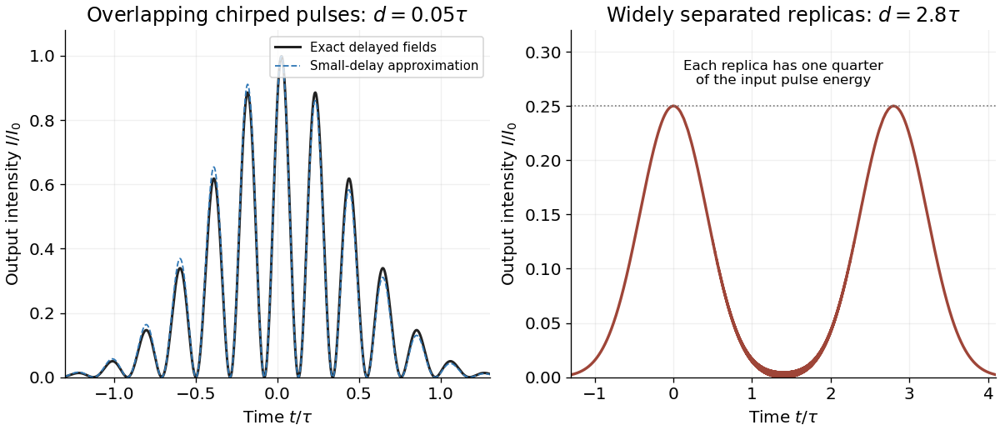

<h1 id="1/c/solution">Solution</h1>

↑ **Parent:** [C](../c.md)

Let $d=\delta t$. At the port that is bright for zero delay, the ideal 50:50 [Michelson interferometer](../../../../michelson-interferometer.md) gives

$$
E_{\mathrm{out}}(t)=\frac12[E(t)+E(t-d)].
$$

Each arm has field [amplitude](../../../../wave-amplitude.md) one half after two beam-splitter interactions. For $|d|\ll\tau$, approximate both real Gaussian envelopes by $E_0e^{-at^2}$ while retaining their rapidly varying [phases](../../../../phase-waves.md). Put $A=\omega_0t+bt^2$ and $B=\omega_0(t-d)+b(t-d)^2$. The identity $(e^{-iA}+e^{-iB})/2=e^{-i(A+B)/2}\cos[(A-B)/2]$ gives

$$
\boxed{E_{\mathrm{out}}(t)\simeq E_0e^{-at^2}\cos\!\left[bd\left(t-\frac d2+\frac{\omega_0}{2b}\right)\right]e^{-i[\omega_0t+\psi(t)]},}
$$

where

$$
\boxed{\psi(t)=bt^2-bdt+\frac{bd^2}{2}-\frac{\omega_0d}{2}.}
$$

A delay-dependent constant overall [phase](../../../../phase-waves.md) can be shifted by a port convention, but the expression above follows directly from the specified bright-port sum.

The output [intensity](../../../../intensity-physics.md) is a Gaussian envelope modulated by a squared cosine:

$$
I_{\mathrm{out}}(t)\simeq I_0e^{-2at^2}\cos^2\!\left[bd(t-d/2)+\omega_0d/2\right].
$$

The modulation maxima are separated by

$$
\boxed{\Delta t\simeq\frac{\pi}{b|d|}.}
$$

This is the spacing of resolved adjacent pulse peaks when the envelope changes little over a modulation period, requiring $b|d|\tau\gg1$. The source's assumption $|d|\ll\tau$ alone does not ensure several visible peaks: a weakly chirped pulse may show only one broad maximum. At $d=0$ the output is the original pulse and the modulation-spacing formula has no finite-peak interpretation. The figure compares the exact bright-port field sum with the small-delay approximation.

**[Figure 1](#1/c/image-temporal-interference-of-chirped-pulses-at-small-and-large-michelson-delays). Temporal interference of chirped pulses at small and large Michelson delays**.

## ↑ Ancestors (12)

1. [C](../c.md)
2. [1](../../1.md)
3. [2018](../../../2018-split.md)
4. [Past exam of the laser science and quantum information processing course of the University of Oxford](../../../split.md)
5. [Laser science and quantum information processing course of the University of Oxford](../../../../laser-science-and-quantum-information-processing-course-of-the-university-of-oxford.md)
6. [Year 4 of the physics course of the University of Oxford](../../../../year-4-of-the-physics-course-of-the-university-of-oxford.md)
7. [Physics course of the University of Oxford](../../../../physics-course-of-the-university-of-oxford.md)
8. [Undergraduate course of the University of Oxford](../../../../undergraduate-course-of-the-university-of-oxford.md)
9. [Course of the University of Oxford](../../../../course-of-the-university-of-oxford.md)
10. [University of Oxford](../../../../university-of-oxford-split.md)
11. [List of universities](../../../../list-of-universities.md)
12. [Codex Wiki](../../../../split.md)
