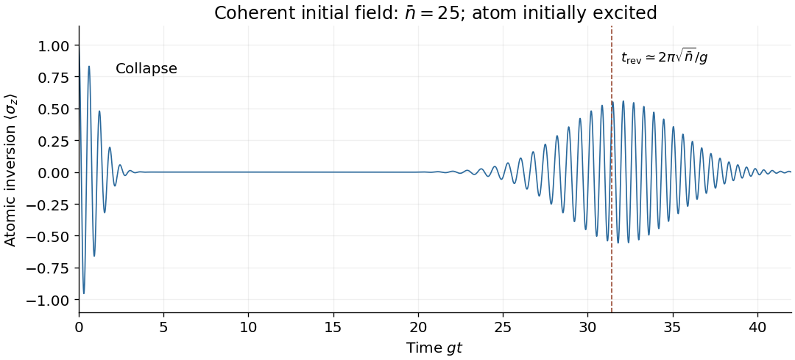

<h1 id="3/e/solution">Solution</h1>

↑ **Parent:** [E](../e.md)

For $\bar n=|z|^2\gg1$, the [Poisson distribution](../../../../poisson-distribution.md) of [photon number](../../../../photon-number.md) has width $\sqrt{\bar n}\ll\bar n$. Initially the atom therefore undergoes nearly classical [Rabi oscillations](../../../../rabi-cycle.md) at [angular frequency](../../../../angular-frequency.md) approximately $2g\sqrt{\bar n}$. However, the atomic inversion is a sum over slightly different [frequencies](../../../../frequency.md):

$$
\langle\sigma_z(t)\rangle=\sum_{n=0}^\infty e^{-\bar n}\frac{\bar n^n}{n!}\cos(2g\sqrt{n+1}\,t).
$$

The components dephase, causing collapse of the visible [Rabi oscillations](../../../../rabi-cycle.md) on a time scale of order $1/g$; a Gaussian photon-number approximation gives an initial envelope approximately $e^{-g^2t^2/2}$. Their discrete [phases](../../../../phase-waves.md) later rephase, giving revivals near

$$
\boxed{t_{\mathrm{rev}}\simeq\frac{2\pi\sqrt{\bar n}}g.}
$$

The revival estimate follows by requiring the [phase](../../../../phase-waves.md) difference of neighbouring photon-number components to advance by $2\pi$. These [Jaynes-Cummings collapse and revival](../../../../jaynes-cummings-collapse-and-revival.md) effects arise from atom-field [entanglement](../../../../entangled-state.md) and photon-number discreteness. Large [amplitude](../../../../wave-amplitude.md) makes the initial classical description accurate over many Rabi periods, but does not eliminate quantum collapse and revival at all later times.

**[Figure 2](#3/e/image-jaynes-cummings-collapse-and-revival-for-a-large-amplitude-coherent-state). Jaynes-Cummings collapse and revival for a large-amplitude coherent state**.

## ↑ Ancestors (12)

1. [E](../e.md)
2. [3](../../3.md)
3. [2018](../../../2018-split.md)
4. [Past exam of the laser science and quantum information processing course of the University of Oxford](../../../split.md)
5. [Laser science and quantum information processing course of the University of Oxford](../../../../laser-science-and-quantum-information-processing-course-of-the-university-of-oxford.md)
6. [Year 4 of the physics course of the University of Oxford](../../../../year-4-of-the-physics-course-of-the-university-of-oxford.md)
7. [Physics course of the University of Oxford](../../../../physics-course-of-the-university-of-oxford.md)
8. [Undergraduate course of the University of Oxford](../../../../undergraduate-course-of-the-university-of-oxford.md)
9. [Course of the University of Oxford](../../../../course-of-the-university-of-oxford.md)
10. [University of Oxford](../../../../university-of-oxford-split.md)
11. [List of universities](../../../../list-of-universities.md)
12. [Codex Wiki](../../../../split.md)
