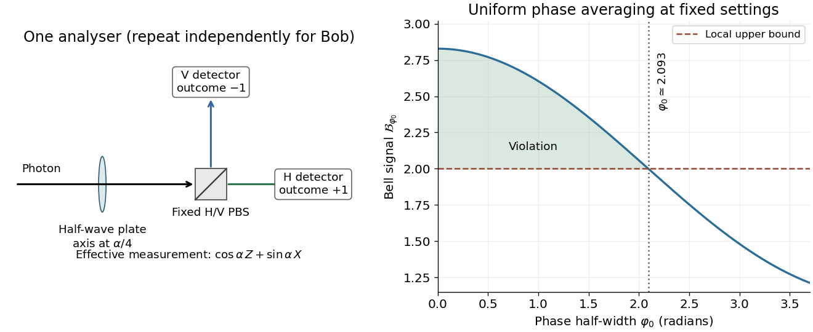

<h1 id="6/b/solution">Solution</h1>

↑ **Parent:** [B](../b.md)

Taking the [partial trace](../../../../partial-trace.md) over either photon of the pure pair state gives

$$
\boxed{\rho_A=\rho_B=\frac12I.}
$$

The two [Schmidt coefficients](../../../../schmidt-coefficient.md) are both $1/\sqrt2$, so the [entanglement entropy](../../../../entanglement-entropy.md) is one bit for every $\varphi$. A local [phase](../../../../phase-waves.md) gate on Alice maps $|\Psi^0\rangle$ to $|\Psi^\varphi\rangle$, proving local-unitary equivalence. In strict four-vector Bell-basis terminology only $\varphi=0,\pi$ give the standard $|\Psi^+\rangle,|\Psi^-\rangle$; every [phase](../../../../phase-waves.md) nevertheless gives a maximally entangled Bell-type state.

The eigenpolarizations of the requested observable are

$$
|+_\alpha\rangle=\cos\frac\alpha2|H\rangle+\sin\frac\alpha2|V\rangle,\qquad
|-_\alpha\rangle=-\sin\frac\alpha2|H\rangle+\cos\frac\alpha2|V\rangle.
$$

A [polarizing beam splitter](../../../../polarizing-beam-splitter.md) with its transmitted [polarization](../../../../polarization-waves.md) axis at angle $\alpha/2$ to horizontal separates these two orthogonal states. Assign outcome $+1$ to its first detector and $-1$ to the other. Equivalently, use a fixed horizontal/vertical splitter preceded by a [half-wave plate](../../../../half-wave-plate.md) whose fast axis is at $\alpha/4$; the diagram shows this equivalent implementation. Bob uses $\beta/2$ for his splitter axis, or $\beta/4$ for the preceding half-wave plate.

The pair correlations are $\langle Z\otimes Z\rangle=-1$, $\langle X\otimes X\rangle=\cos\varphi$, and $\langle Z\otimes X\rangle=\langle X\otimes Z\rangle=0$. Expanding the two observables therefore gives

$$
\boxed{\langle\sigma_\alpha\otimes\sigma_\beta\rangle=-\cos\alpha\cos\beta+\cos\varphi\sin\alpha\sin\beta.}
$$

The half-angle between the Bloch observable parameter and the physical linear-polarization analyser angle is essential.

**[Figure 3](#6/b/image-polarization-measurement-and-the-phase-averaged-bell-inequality-signal). Polarization measurement and the phase-averaged Bell inequality signal**.

## ↑ Ancestors (12)

1. [B](../b.md)
2. [6](../../6.md)
3. [2018](../../../2018-split.md)
4. [Past exam of the laser science and quantum information processing course of the University of Oxford](../../../split.md)
5. [Laser science and quantum information processing course of the University of Oxford](../../../../laser-science-and-quantum-information-processing-course-of-the-university-of-oxford.md)
6. [Year 4 of the physics course of the University of Oxford](../../../../year-4-of-the-physics-course-of-the-university-of-oxford.md)
7. [Physics course of the University of Oxford](../../../../physics-course-of-the-university-of-oxford.md)
8. [Undergraduate course of the University of Oxford](../../../../undergraduate-course-of-the-university-of-oxford.md)
9. [Course of the University of Oxford](../../../../course-of-the-university-of-oxford.md)
10. [University of Oxford](../../../../university-of-oxford-split.md)
11. [List of universities](../../../../list-of-universities.md)
12. [Codex Wiki](../../../../split.md)
