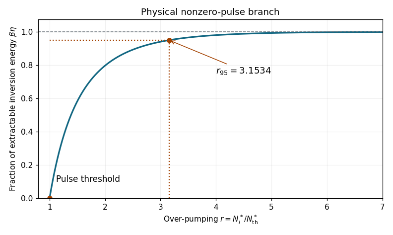
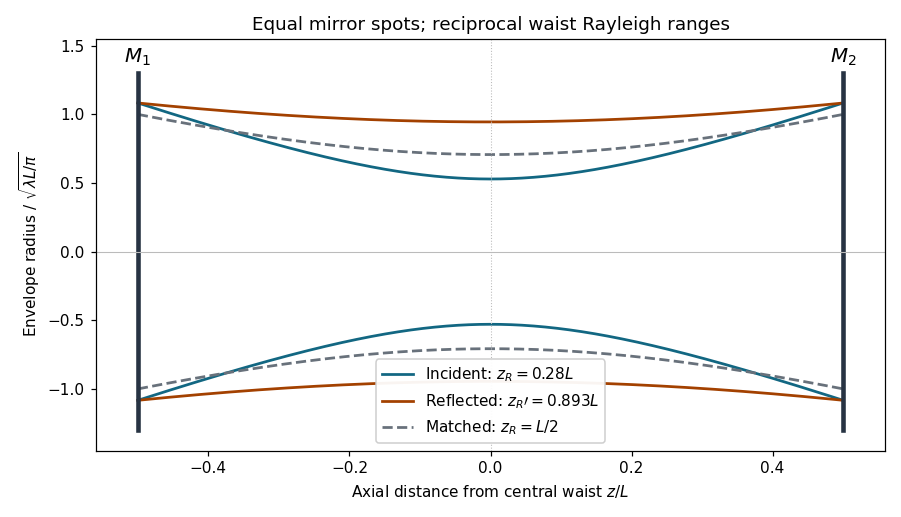
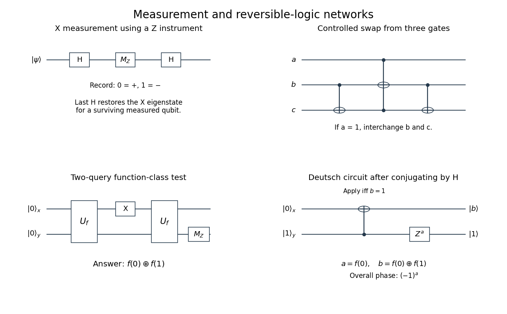
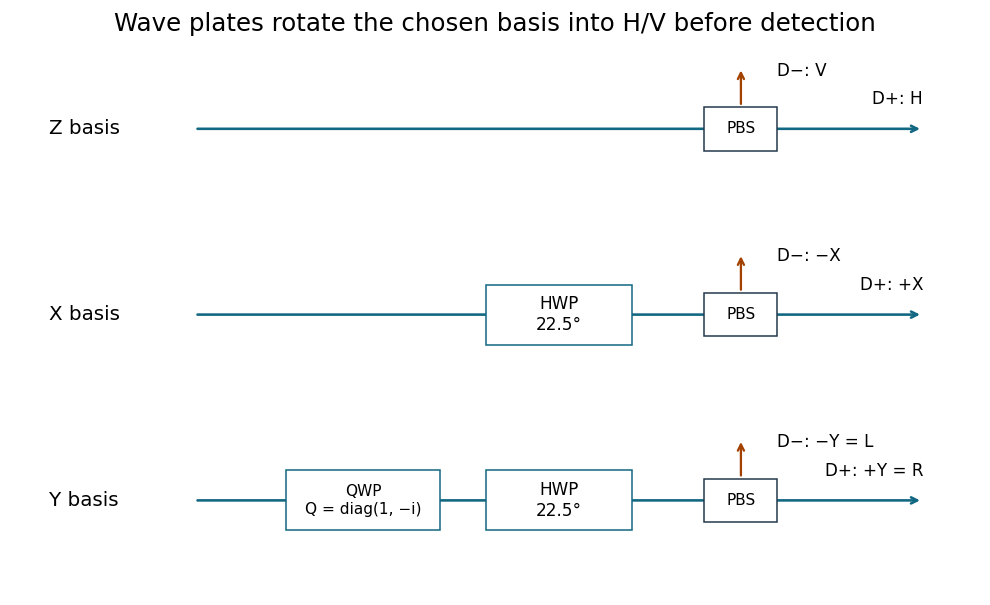
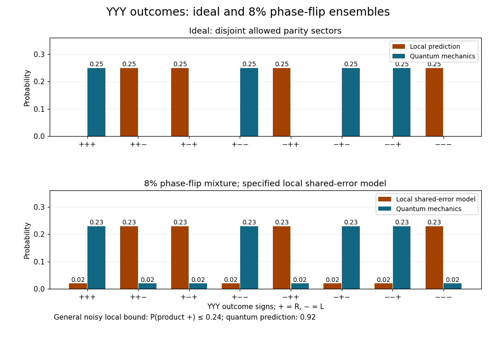

# 2019

↑ **Parent:** [Past exam of the laser science and quantum information processing course of the University of Oxford](../past-exam-of-the-laser-science-and-quantum-information-processing-course-of-the-university-of-oxford.md)

Source paper: [https://www.whatdotheyknow.com/request/oxford_physics_past_papers_2/response/2340696/attach/7/Physics%20Papers%202018.pdf?cookie_passthrough=1](https://www.whatdotheyknow.com/request/oxford_physics_past_papers_2/response/2340696/attach/7/Physics%20Papers%202018.pdf?cookie_passthrough=1)

The cover establishes Trinity Term 2019 despite the bundle's 2018 filename. All six questions are solved, including all alternatives to the requested choice of four. The symbol $\beta$ in question 1 is the supplied degeneracy factor; the amplitudes $\alpha,\beta$ in question 4 have a separate meaning.

**Table of contents**

- [1](#1)
  - [a](#1/a)
    - [Solution](#1/a/solution)
  - [b](#1/b)
    - [i](#1/b/i)
      - [Solution](#1/b/i/solution)
    - [ii](#1/b/ii)
      - [Solution](#1/b/ii/solution)
    - [iii](#1/b/iii)
      - [Solution](#1/b/iii/solution)
  - [c](#1/c)
    - [i](#1/c/i)
      - [Solution](#1/c/i/solution)
    - [ii](#1/c/ii)
      - [Solution](#1/c/ii/solution)
    - [iii](#1/c/iii)
      - [Solution](#1/c/iii/solution)
    - [iv](#1/c/iv)
      - [Solution](#1/c/iv/solution)
  - [d](#1/d)
    - [Solution](#1/d/solution)
- [2](#2)
  - [a](#2/a)
    - [Solution](#2/a/solution)
  - [b](#2/b)
    - [Solution](#2/b/solution)
  - [c](#2/c)
    - [Solution](#2/c/solution)
  - [d](#2/d)
    - [Solution](#2/d/solution)
- [3](#3)
  - [a](#3/a)
    - [Solution](#3/a/solution)
  - [b](#3/b)
    - [Solution](#3/b/solution)
  - [c](#3/c)
    - [Solution](#3/c/solution)
  - [d](#3/d)
    - [Solution](#3/d/solution)
  - [e](#3/e)
    - [Solution](#3/e/solution)
- [4](#4)
  - [a](#4/a)
    - [i](#4/a/i)
      - [Solution](#4/a/i/solution)
    - [ii](#4/a/ii)
      - [Solution](#4/a/ii/solution)
  - [b](#4/b)
    - [i](#4/b/i)
      - [Solution](#4/b/i/solution)
    - [ii](#4/b/ii)
      - [Solution](#4/b/ii/solution)
  - [c](#4/c)
    - [i](#4/c/i)
      - [Solution](#4/c/i/solution)
    - [ii](#4/c/ii)
      - [Solution](#4/c/ii/solution)
    - [iii](#4/c/iii)
      - [Solution](#4/c/iii/solution)
    - [iv](#4/c/iv)
      - [Solution](#4/c/iv/solution)
  - [d](#4/d)
    - [i](#4/d/i)
      - [Solution](#4/d/i/solution)
    - [ii](#4/d/ii)
      - [Solution](#4/d/ii/solution)
  - [e](#4/e)
    - [i](#4/e/i)
      - [Solution](#4/e/i/solution)
    - [ii](#4/e/ii)
      - [Solution](#4/e/ii/solution)
- [5](#5)
  - [a](#5/a)
    - [Solution](#5/a/solution)
  - [b](#5/b)
    - [i](#5/b/i)
      - [Solution](#5/b/i/solution)
    - [ii](#5/b/ii)
      - [Solution](#5/b/ii/solution)
  - [c](#5/c)
    - [Solution](#5/c/solution)
  - [d](#5/d)
    - [Solution](#5/d/solution)
  - [e](#5/e)
    - [Solution](#5/e/solution)
- [6](#6)
  - [a](#6/a)
    - [Solution](#6/a/solution)
  - [b](#6/b)
    - [Solution](#6/b/solution)
  - [c](#6/c)
    - [Solution](#6/c/solution)
  - [d](#6/d)
    - [Solution](#6/d/solution)

## 1

↑ **Parent:** [2019](2019.md)

<h3 id="1/a">a</h3>

↑ **Parent:** [1](#1)

<h4 id="1/a/solution">Solution</h4>

↑ **Parent:** [A](#1/a)

[Q-switching](../laser.md#q-switching) stores excitation in a pumped [laser gain medium](../laser.md#laser-gain-medium) while preventing oscillation, then rapidly changes the [optical cavity](../optical-instrument.md#optical-cavity) from high loss, or low [quality factor](../dynamical-systems.md#q-factor), to low loss, or high [quality factor](../dynamical-systems.md#q-factor). The initially suppressed stimulated field can then grow rapidly from a seed and deplete a large [population inversion](../laser.md#population-inversion) in a short pulse. The resulting peak [power](../energy.md#power) is much higher than for continuous operation at the same average pumping rate. This is [energy](../energy.md) storage and release, rather than the phase locking of many longitudinal modes used in [mode locking](../laser.md#mode-locking).

An active implementation uses a [Pockels cell](../optical-instrument.md#pockels-cell) and a [polarizer](../electromagnetic-wave.md#polarizer). An applied voltage makes the cell change the intracavity [polarization](../wave.md#polarization-waves), causing the [polarizer](../electromagnetic-wave.md#polarizer) to introduce sufficient loss to prevent lasing while pumping builds the inversion. Rapidly changing the voltage removes that loss and opens the high-Q state. The switching time should be short relative to the pulse build-up and depletion times. A [saturable absorber](../optics.md#saturable-absorber) provides an alternative passive Q switch: its absorption decreases as the intracavity intensity rises.

<h3 id="1/b">b</h3>

↑ **Parent:** [1](#1)

<h4 id="1/b/i">i</h4>

↑ **Parent:** [B](#1/b)

<h5 id="1/b/i/solution">Solution</h5>

↑ **Parent:** [I](#1/b/i)

The intended quantity is $\boxed{N_{\rm th}^*}$, the threshold [population inversion](../laser.md#population-inversion) density of the [cavity](../optical-instrument.md#optical-cavity) after switching to low loss. At this value stimulated gain exactly balances the photon-loss rate:

$$
\left.\frac{dn}{dt}\right|_{N^*=N_{\rm th}^*}=0.
$$

Above threshold a nonzero seed grows; below threshold it decays. The unstarred $N_{\rm th}$ in the subpart is shorthand for the starred threshold quantity in the displayed equations, rather than a different total atomic population. The [photon lifetime](../optical-instrument.md#photon-lifetime) $\tau_c$ fixes the [photon-density](../statistical-physics.md#photon-number-density) loss rate $n/\tau_c$.

<h4 id="1/b/ii">ii</h4>

↑ **Parent:** [B](#1/b)

<h5 id="1/b/ii/solution">Solution</h5>

↑ **Parent:** [Ii](#1/b/ii)

Write $N=N^*$, $N_i=N_i^*$ and $N_f=N_f^*$ during this derivation. Eliminating the stimulated term between the two [laser rate equations](../laser.md#laser-rate-equation) gives the [photon](../quantum-mechanics.md#photon) balance

$$
\dot n=-\frac{f_c}{\beta}\dot N-\frac n{\tau_c}.
$$

Integrate over the pulse, taking negligible initial and final stored [photon](../quantum-mechanics.md#photon) densities:

$$
\int_0^\infty\frac{n(t)}{\tau_c}\,dt
=\frac{f_c}{\beta}(N_i-N_f).
$$

The [photons](../quantum-mechanics.md#photon) lost from the [cavity](../optical-instrument.md#optical-cavity) carry total [energy](../energy.md) $\hbar\omega_LV_c\int n/\tau_c\,dt$. Since $f_cV_c=V_g$,

$$
\boxed{E=\frac{(N_i^*-N_f^*)V_g\hbar\omega_L}{\beta}
=\eta N_i^*V_g\hbar\omega_L.}
$$

This identifies the supplied [energy](../energy.md) formula under the ideal extraction convention that all [photon](../quantum-mechanics.md#photon) loss is useful output. If only a fraction $\zeta=\kappa_{\rm out}/\kappa_{\rm total}$ of the loss exits the output coupler, the measured output [energy](../energy.md) is $\zeta E$. The rate equations by themselves do not distinguish useful output from parasitic loss.

<h4 id="1/b/iii">iii</h4>

↑ **Parent:** [B](#1/b)

<h5 id="1/b/iii/solution">Solution</h5>

↑ **Parent:** [Iii](#1/b/iii)

The [Q-switched energy extraction efficiency](../laser.md#q-switched-energy-extraction-efficiency) in the ideal loss convention of [ii](#1/b/ii) is

$$
\boxed{\eta=\frac1\beta\left(1-\frac{N_f^*}{N_i^*}\right),\qquad
\eta_{\max}=\frac1\beta.}
$$

The first factor reflects the definition of inversion: one stimulated transition reduces the upper population and increases the lower population, changing $N^*=N_2-(g_2/g_1)N_1$ by $1+g_2/g_1=\beta$. Thus one emitted [photon](../quantum-mechanics.md#photon) consumes $\beta$ units of inversion. The second factor accounts for the inversion left after the pulse; finite pumping above threshold does not generally extract all the initially stored inversion. This $\eta$ is not the wall-plug efficiency and does not include the [energy](../energy.md) cost of pumping or the factor $\zeta$ for imperfect output extraction.

<h3 id="1/c">c</h3>

↑ **Parent:** [1](#1)

<h4 id="1/c/i">i</h4>

↑ **Parent:** [C](#1/c)

<h5 id="1/c/i/solution">Solution</h5>

↑ **Parent:** [I](#1/c/i)

For a nonzero [photon density](../statistical-physics.md#photon-number-density), divide the [laser rate equations](../laser.md#laser-rate-equation) to remove time:

$$
\frac{dn}{dN^*}=-\frac{f_c}{\beta}\left(1-\frac{N_{\rm th}^*}{N^*}\right).
$$

Integrating from the initial inversion and retaining a small seed density $n_i$ gives

$$
n-n_i=\frac{f_c}{\beta}\left[N_i^*-N^*
+N_{\rm th}^*\ln\frac{N^*}{N_i^*}\right].
$$

The source's pulse approximation neglects $n_i$ compared with the macroscopic pulse density, giving

$$
\boxed{n(t)=\frac{f_c}{\beta}\left[
N_{\rm th}^*\ln\frac{N^*(t)}{N_i^*}+N_i^*-N^*(t)\right].}
$$

A positive seed, or a spontaneous-emission source omitted from these equations, is nevertheless needed to start the pulse. Setting $n(0)=0$ exactly in the unforced equations gives the counterexample $n(t)=0$, $N^*(t)=N_i^*$ for all time, even above threshold. The displayed formula is therefore used in the negligible-seed limit, rather than as an assertion that a pulse starts from an identically zero field.

<h4 id="1/c/ii">ii</h4>

↑ **Parent:** [C](#1/c)

<h5 id="1/c/ii/solution">Solution</h5>

↑ **Parent:** [Ii](#1/c/ii)

At the end of the pulse, the [photon density](../statistical-physics.md#photon-number-density) returns to negligible size. Put $u=N_f^*/N_i^*$ and $r=N_i^*/N_{\rm th}^*$. The result of [i](#1/c/i) gives

$$
0=\ln u+r(1-u).
$$

Using $x=\beta\eta=1-u$, the nonzero-pulse solution obeys

$$
\boxed{rx=-\ln(1-x),\qquad
x=1-e^{-rx},\qquad x=\beta\eta.}
$$

For $r>1$, select $0<x<1$, corresponding to depletion below threshold. The root $x=0$ is also an algebraic solution for every $r$ but represents no macroscopic pulse. A positive nonzero root exists only above threshold.

<h4 id="1/c/iii">iii</h4>

↑ **Parent:** [C](#1/c)

<h5 id="1/c/iii/solution">Solution</h5>

↑ **Parent:** [Iii](#1/c/iii)

The physical branch can be plotted without a nonlinear solver by parameterizing

$$
r(x)=\frac{-\ln(1-x)}x,\qquad 0<x<1.
$$

It begins at $(r,x)=(1,0)$ and increases monotonically to $x=1$ as $r\to\infty$. Expanding near threshold gives $r=1+x/2+O(x^2)$, so $x\simeq2(r-1)$. For strong over-pumping the residual inversion fraction is exponentially small, $1-x\simeq e^{-r}$. Thus the curve saturates at the upper bound $\beta\eta=1$.

**[Figure 1](#1/c/iii/image-ideal-q-switched-inversion-extraction-versus-over-pumping). Ideal Q-switched inversion extraction versus over-pumping**. The nonzero pulse branch is plotted using $r=-\ln(1-x)/x$, where $x=\beta\eta$. The threshold and the 95 percent extraction point are marked.

<h4 id="1/c/iv">iv</h4>

↑ **Parent:** [C](#1/c)

<h5 id="1/c/iv/solution">Solution</h5>

↑ **Parent:** [Iv](#1/c/iv)

Extracting 95 percent of the maximum available inversion [energy](../energy.md) means $\eta=0.95/\beta$, or $x=\beta\eta=0.95$. Substitution in [ii](#1/c/ii) gives

$$
\boxed{r=\frac{-\ln(0.05)}{0.95}=3.1534\ldots.}
$$

The degeneracy factor cancels because the target is a fraction of the maximum [energy](../energy.md) $N_i^*V_g\hbar\omega_L/\beta$, rather than a fraction of $N_i^*V_g\hbar\omega_L$ without that factor.

<h3 id="1/d">d</h3>

↑ **Parent:** [1](#1)

<h4 id="1/d/solution">Solution</h4>

↑ **Parent:** [D](#1/d)

During the pulse, the [photon density](../statistical-physics.md#photon-number-density) reaches its maximum when $\dot n=0$ with $n>0$, so $N^*=N_{\rm th}^*$. Evaluating [i](#1/c/i) at this inversion gives

$$
n_{\max}=\frac{f_cN_i^*}{\beta}\left[1-\frac{1+\ln r}{r}\right].
$$

The ideal instantaneous output [power](../energy.md#power) is $P(t)=V_c\hbar\omega_Ln(t)/\tau_c$. Therefore

$$
\boxed{P_{\max}=\frac{N_i^*V_g\hbar\omega_L}{\beta\tau_c}
\frac{r-1-\ln r}{r}.}
$$

For $r\gg1$, almost all the extractable [energy](../energy.md) is stored briefly as intracavity [photons](../quantum-mechanics.md#photon), and $P_{\max}\simeq E_{\max}/\tau_c$. The leading rise while the inversion remains near its initial value is $n\propto e^{(r-1)t/\tau_c}$, with short growth time $\tau_c/(r-1)$. Depletion then takes the inversion below threshold. At late times $N^*\simeq N_f^*$ and

$$
n(t)\propto\exp\left[-\left(1-\frac{N_f^*}{N_{\rm th}^*}\right)\frac{t}{\tau_c}\right],
$$

which approaches a tail with decay time $\tau_c$ at large $r$. The pulse is consequently asymmetric, with a rapid rise and a slower approximately exponential trailing edge. The negligible-seed build-up delay depends on the seed strength. The pumping and spontaneous population decay have been neglected over the short pulse; parasitic [cavity](../optical-instrument.md#optical-cavity) loss multiplies useful [power](../energy.md#power) by the output fraction described in [ii](#1/b/ii).

## 2

↑ **Parent:** [2019](2019.md)

<h3 id="2/a">a</h3>

↑ **Parent:** [2](#2)

<h4 id="2/a/solution">Solution</h4>

↑ **Parent:** [A](#2/a)

For a [paraxial](../partial-differential-equation.md#paraxial-approximation) [Gaussian beam](../physical-optics.md#gaussian-beam), choose the [complex beam parameter](../physical-optics.md#complex-beam-parameter) with

$$
\frac1q=\frac1{R_b}-i\frac{\lambda}{\pi w^2},\qquad
q=z+iz_R,\quad z_R>0.
$$

Here $R_b$ is the wavefront radius and $w$ the intensity $1/e^2$ radius. The [ABCD law](../physical-optics.md#abcd-law-for-gaussian-beams) is

$$
\boxed{q_{\rm out}=\frac{Aq_{\rm in}+B}{Cq_{\rm in}+D}.}
$$

For a real, lossless round-trip [ray transfer matrix](../geometrical-optics.md#ray-transfer-matrix-analysis) $M$ in free space, $AD-BC=1$. A reproducing [cavity](../optical-instrument.md#optical-cavity) mode requires $q=(Aq+B)/(Cq+D)$, hence

$$
Cq^2+(D-A)q-B=0,\qquad
(D-A)^2+4BC=(A+D)^2-4.
$$

Except for a [scalar identity matrix](../linear-algebra.md#scalar-matrix), a finite physical solution requires a [complex-conjugate](../complex-analysis.md#complex-conjugate) root pair, one with positive imaginary part. The generic strict stability condition is therefore

$$
\boxed{-2<A+D<2.}
$$

Equivalently, the ray [eigenvalues](../linear-operator-theory.md#eigenvalue) are distinct unit-modulus numbers $e^{\pm i\mu}$, so repeated round trips do not cause unbounded ray excursions. Adequate [mirror](../optical-instrument.md#mirror) apertures and longitudinal resonance are also needed for a low-loss resonant mode.

**The strict inequality has a degenerate exception relevant to this paper.** If $M=-I$, then $q'=q$ for every physical $q$ even though $A+D=-2$. A symmetric [confocal resonator](../optical-instrument.md#confocal-optical-resonator) has exactly this [matrix](../vector-space.md#matrix) and supports Gaussian modes; it is not excluded as a physical [cavity](../optical-instrument.md#optical-cavity). Thus the printed strict condition should be understood as the generic, nondegenerate stability criterion, not a universal necessary condition covering the confocal case in [c](#2/c).

<h3 id="2/b">b</h3>

↑ **Parent:** [2](#2)

<h4 id="2/b/solution">Solution</h4>

↑ **Parent:** [B](#2/b)

Use the unfolded propagation convention after reflection. Free-space propagation and a [concave spherical mirror](../optical-instrument.md#concave-spherical-mirror) have [matrices](../vector-space.md#matrix)

$$
T(d)=\begin{pmatrix}1&d\\0&1\end{pmatrix},\qquad
F(R)=\begin{pmatrix}1&0\\-2/R&1\end{pmatrix}.
$$

The [mirror](../optical-instrument.md#mirror) is equivalent in this [paraxial](../partial-differential-equation.md#paraxial-approximation) convention to a [thin lens](../geometrical-optics.md#thin-lens) of [focal length](../geometrical-optics.md#focal-length) $R/2$. The excursion from the reference plane to [mirror](../optical-instrument.md#mirror) 1 and back is

$$
\boxed{S_1=T(L_1)F(R_1)T(L_1)
=\begin{pmatrix}
1-2L_1/R_1&2L_1-2L_1^2/R_1\\
-2/R_1&1-2L_1/R_1
\end{pmatrix}.}
$$

Likewise $S_2=T(L-L_1)F(R_2)T(L-L_1)$. Multiplying $S_2S_1$, or using cyclic invariance of the [trace](../linear-algebra.md#matrix-trace) to move the reference plane, gives

$$
\operatorname{tr}M=2-\frac{4L}{R_1}-\frac{4L}{R_2}
+\frac{4L^2}{R_1R_2}
=4g_1g_2-2,
\qquad g_j=1-\frac L{R_j}.
$$

Consequently the strict criterion of [a](#2/a) is

$$
\boxed{0<g_1g_2<1,\qquad g_1=1-L/R_1,\quad g_2=1-L/R_2.}
$$

The [trace](../linear-algebra.md#matrix-trace) is independent of $L_1$, as a change of reference plane only conjugates the [round-trip matrix](../geometrical-optics.md#ray-transfer-matrix-analysis). For the concrete confocal counterexample $R_1=R_2=L$, $L_1=L/2$, each excursion is $\begin{pmatrix}0&L/2\\-2/L&0\end{pmatrix}$ and its square is $-I$. This gives $g_1g_2=0$ and the degenerate boundary exception already explained.

<h3 id="2/c">c</h3>

↑ **Parent:** [2](#2)

<h4 id="2/c/solution">Solution</h4>

↑ **Parent:** [C](#2/c)

Let $a=L/2$, so each [mirror](../optical-instrument.md#mirror) in the symmetric [confocal optical resonator](../optical-instrument.md#confocal-optical-resonator) has radius $R=L=2a$. At [mirror](../optical-instrument.md#mirror) 1, an incident beam whose [waist](../physical-optics.md#beam-waist) is at the centre has $q_{\rm in}=a+iz_R$, with distances measured along its incoming direction. Reflection gives

$$
q_{\rm refl}=\frac{q_{\rm in}}{1-q_{\rm in}/a}
=-a+i\frac{a^2}{z_R}.
$$

After propagating the distance $a$ back to the centre, its parameter is purely imaginary. Thus the reflected [waist](../physical-optics.md#beam-waist) is also at the [cavity](../optical-instrument.md#optical-cavity) centre and

$$
\boxed{z_R'=\frac{a^2}{z_R},\qquad z_Rz_R'=\left(\frac L2\right)^2.}
$$

The incident and reflected [waist](../physical-optics.md#beam-waist) radii need not agree. With axial position $z$ measured from the centre, their radii obey

$$
w^2(z)=\frac\lambda\pi\left(z_R+\frac{z^2}{z_R}\right),\qquad
w'^2(z)=\frac\lambda\pi\left(\frac{a^2}{z_R}+\frac{z^2z_R}{a^2}\right).
$$

At either [mirror](../optical-instrument.md#mirror), $z^2=a^2$ and the two [spot sizes](../physical-optics.md#gaussian-beam-radius) agree, as reflection requires. Between the [mirrors](../optical-instrument.md#mirror) they generally have different waists while still reproducing themselves after a full round trip.

**[Figure 2](#2/c/image-incident-and-reflected-gaussian-envelopes-in-a-symmetric-confocal-resonator). Incident and reflected Gaussian envelopes in a symmetric confocal resonator**. Two unequal waist radii at the same central plane have reciprocal Rayleigh ranges $z_Rz_R'=(L/2)^2$. The envelopes meet at both mirrors. The matched fundamental mode is included for comparison.

<h3 id="2/d">d</h3>

↑ **Parent:** [2](#2)

<h4 id="2/d/solution">Solution</h4>

↑ **Parent:** [D](#2/d)

Equal [waist](../physical-optics.md#beam-waist) sizes imply equal positive [Rayleigh ranges](../physical-optics.md#rayleigh-length), so [c](#2/c) gives $z_R=z_R'=L/2$. Since $z_R=\pi w_0^2/\lambda$, the matched radii are

$$
\boxed{w_0=\sqrt{\frac{\lambda L}{2\pi}},\qquad
w_{M_1}=w_{M_2}=\sqrt2\,w_0=\sqrt{\frac{\lambda L}\pi}.}
$$

These are radii; the corresponding spot diameters are twice these values. One practical disadvantage is the transverse-mode degeneracy of the exact confocal geometry: mode frequencies coincide in families, making clean selection of a single transverse mode more difficult. Its $M=-I$ condition also lies at the strict-stability boundary. For example, perturbing the two radii in opposite directions, $R_1=L(1+\delta)$ and $R_2=L(1-\delta)$, gives $g_1g_2=-\delta^2/(1-\delta^2)<0$ for $0<|\delta|<1$, an unstable perturbation. This does not mean that all perturbations, or the ideal [confocal resonator](../optical-instrument.md#confocal-optical-resonator) itself, are unstable.

## 3

↑ **Parent:** [2019](2019.md)

<h3 id="3/a">a</h3>

↑ **Parent:** [3](#3)

<h4 id="3/a/solution">Solution</h4>

↑ **Parent:** [A](#3/a)

Let $|g\rangle,|e\rangle$ be the atomic levels, $\sigma_+=|e\rangle\langle g|$, and $a$ the [annihilation operator](../quantum-harmonic-oscillator.md#annihilation-operator) of the single field mode. Choose the joint ground [energy](../energy.md) to be zero. The resonant [Jaynes-Cummings model](../tensor-product-of-quantum-systems.md#jaynes-cummings-model) is

$$
\boxed{H=\hbar\omega a^\dagger a+\hbar\omega|e\rangle\langle e|
+\hbar g(a\sigma_++a^\dagger\sigma_-).}
$$

The first term counts field [photons](../quantum-mechanics.md#photon), the second the atomic excitation, and the interaction exchanges one [photon](../quantum-mechanics.md#photon) for one atomic excitation. A phase redefinition makes $g$ real and positive. Resonance means $\omega=\omega_{eg}$; the total excitation $\mathcal N=a^\dagger a+|e\rangle\langle e|$ is conserved. Adding an overall constant gives the equivalent convention using $\sigma_z/2$ and a zero-point field term.

The model follows from the [electric-dipole interaction](../quantum-mechanics.md#electric-dipole-approximation) and the [rotating-wave approximation](../quantum-mechanics.md#rotating-wave-approximation), retaining the energy-conserving terms while dropping $a\sigma_-$ and $a^\dagger\sigma_+$. We assume a single quantized monochromatic mode and negligible [cavity](../optical-instrument.md#optical-cavity) leakage and atomic relaxation over the time considered. With this convention, the resonant population [Rabi angular frequency](../quantum-system.md#rabi-frequency) in the one-excitation subspace is $2g$.

<h3 id="3/b">b</h3>

↑ **Parent:** [3](#3)

<h4 id="3/b/solution">Solution</h4>

↑ **Parent:** [B](#3/b)

Conservation of $\mathcal N$ confines evolution from $|e,0\rangle$ to $|e,0\rangle,|g,1\rangle$. On this subspace,

$$
H=\hbar\omega I+\hbar g\begin{pmatrix}0&1\\1&0\end{pmatrix}.
$$

The interaction [matrix](../vector-space.md#matrix) squares to the identity, so its exponential separates into cosine and sine terms. The state is

$$
\boxed{|\Psi(t)\rangle=e^{-i\omega t}
\left[\cos(gt)|e,0\rangle-i\sin(gt)|g,1\rangle\right].}
$$

The overall phase can be discarded or removed by the [interaction picture](../quantum-system.md#interaction-picture). The [relative phase](../quantum-system.md#relative-quantum-phase) $-i$ follows from [Schrödinger evolution](../mathematical-physics.md#schrodinger-equation) with the positive coupling in [a](#3/a). The [atom](../physics.md#atom-physics) and field are generally [entangled](../bell-state.md#entangled-state); complete excitation transfer occurs at $gt=\pi/2$.

<h3 id="3/c">c</h3>

↑ **Parent:** [3](#3)

<h4 id="3/c/solution">Solution</h4>

↑ **Parent:** [C](#3/c)

From [b](#3/b), the excited-state [probability](../probability-theory.md#probability) is

$$
\boxed{P_e(t)=\cos^2(gt).}
$$

For a single short [measurement](../quantum-measurement.md) interval $\Delta t$ beginning in $|e,0\rangle$, requiring $P_e>0.9$ before the first departure from unity gives

$$
\boxed{\Delta t<\frac{\arccos\sqrt{0.9}}g
=\frac{0.32175\ldots}{g}.}
$$

A zero-photon outcome resets the conditional state to $|e,0\rangle$. After $n=T/\Delta t$ such tests, the [probability](../probability-theory.md#probability) of the all-zero-photon record is

$$
P_{\rm surv}(T)=[\cos^2(g\Delta t)]^n
\simeq e^{-g^2T\Delta t}.
$$

Thus a 90 percent survival requirement over a specified total duration $T$ is stronger than the single-interval condition: approximately $\Delta t<-\ln(0.9)/(g^2T)$ in the short-interval limit. The limiting preservation as $\Delta t\to0$ is the [quantum Zeno effect](../quantum-measurement.md#quantum-zeno-effect).

The [measurement](../quantum-measurement.md) instrument matters. If [photons](../quantum-mechanics.md#photon) are absorbed and their first detection removes the excitation, this survival [probability](../probability-theory.md#probability) also equals the unconditional excited population. For ideal nondestructive [photon-number](../quantum-harmonic-oscillator.md#photon-number) [measurements](../quantum-measurement.md), excitation can transfer back after a one-photon result; the unconditional result after $n$ equal intervals is instead $P_e^{(n)}=[1+\cos^n(2g\Delta t)]/2$. It also tends to one for fixed $T$ as the intervals shrink. Neither interpretation guarantees indefinite 90 percent survival merely by imposing a 90 percent bound on each separate interval.

<h3 id="3/d">d</h3>

↑ **Parent:** [3](#3)

<h4 id="3/d/solution">Solution</h4>

↑ **Parent:** [D](#3/d)

There is at most one field [photon](../quantum-mechanics.md#photon) in [b](#3/b). Projection onto its one-photon sector gives

$$
\boxed{P(n=1;t)=\sin^2(gt),\qquad
\rho_{\rm atom\mid n=1}=|g\rangle\langle g|.}
$$

Before detector absorption, the normalized conditional joint state is $|g,1\rangle$ up to an overall phase. A destructive [photon](../quantum-mechanics.md#photon) count changes the field to its [vacuum](../quantum-field-theory.md#vacuum-state) but leaves the [atom](../physics.md#atom-physics) in $|g\rangle$. This conditional state is meaningful whenever the one-photon outcome has nonzero [probability](../probability-theory.md#probability).

<h3 id="3/e">e</h3>

↑ **Parent:** [3](#3)

<h4 id="3/e/solution">Solution</h4>

↑ **Parent:** [E](#3/e)

Discarding the [photon-number](../quantum-harmonic-oscillator.md#photon-number) result gives a classical mixture of the two outcome branches. The atomic state, in the basis $(|e\rangle,|g\rangle)$, is

$$
\boxed{\rho_A(t)=\cos^2(gt)|e\rangle\langle e|
+\sin^2(gt)|g\rangle\langle g|
=\begin{pmatrix}\cos^2(gt)&0\\0&\sin^2(gt)\end{pmatrix}.}
$$

It is also the reduced state before measuring the field; a nonselective operation on the field does not change the atomic [reduced density matrix](../bell-state.md#reduced-density-matrix). The [atom](../physics.md#atom-physics) is not in a [coherent superposition](../quantum-system.md#quantum-superposition) with these populations.

For an atomic [energy](../energy.md) gap $\hbar\omega$, the thermal population ratio is $p_e/p_g=e^{-\hbar\omega/(k_BT)}$. Matching it gives

$$
\boxed{T_{\rm eff}(t)=\frac{\hbar\omega}{k_B\ln[\tan^2(gt)]}.}
$$

A finite positive [temperature](../temperature.md) exists when $0<p_e<p_g$, with $T\to0^+$ at $p_e=0$ and $T\to+\infty$ as $p_e\to1/2$ from below. Equal populations correspond to zero inverse [temperature](../temperature.md). If $p_e>1/2$, the expression is a negative effective [temperature](../temperature.md) for a bounded [two-level system](../canonical-ensemble.md#two-level-system), not an equilibrium state at any ordinary positive [temperature](../temperature.md). For a concrete counterexample to an unrestricted positive-temperature interpretation, at $t=0$ the [atom](../physics.md#atom-physics) is certainly excited, whereas every positive-temperature [Gibbs distribution](../canonical-ensemble.md#quantum-gibbs-state) has $p_e\leq1/2$. The fully excited endpoint is the formal limit $T\to0^-$. Matching one [density matrix](../density-matrix.md) does not establish genuine [thermalization](../statistical-physics.md#thermalization) with a bath.

## 4

↑ **Parent:** [2019](2019.md)

<h3 id="4/a">a</h3>

↑ **Parent:** [4](#4)

<h4 id="4/a/i">i</h4>

↑ **Parent:** [A](#4/a)

<h5 id="4/a/i/solution">Solution</h5>

↑ **Parent:** [I](#4/a/i)

Alice conditions on her observed [computational-basis](../quantum-theory.md#computational-basis) result. For outcome $0$, occurring with [probability](../probability-theory.md#probability) $|\alpha|^2$, her post-measurement [density matrix](../density-matrix.md) is $|0\rangle\langle0|$; for outcome $1$, occurring with [probability](../probability-theory.md#probability) $|\beta|^2$, it is $|1\rangle\langle1|$. Explicitly,

$$
\boxed{\rho_{A\mid0}=\begin{pmatrix}1&0\\0&0\end{pmatrix},\qquad
\rho_{A\mid1}=\begin{pmatrix}0&0\\0&1\end{pmatrix}.}
$$

These are the conditional [Lüders rule](../quantum-measurement.md#luders-rule) updates for the two rank-one [projectors](../vector-space.md#projection-linear-algebra). They assume the corresponding outcome has nonzero [probability](../probability-theory.md#probability) and Alice knows which one occurred.

<h4 id="4/a/ii">ii</h4>

↑ **Parent:** [A](#4/a)

<h5 id="4/a/ii/solution">Solution</h5>

↑ **Parent:** [Ii](#4/a/ii)

Bob knows the initial amplitudes and the [measurement](../quantum-measurement.md) basis but not its result, so he averages the two conditional states:

$$
\boxed{\rho_B=|\alpha|^2|0\rangle\langle0|+|\beta|^2|1\rangle\langle1|
=\begin{pmatrix}|\alpha|^2&0\\0&|\beta|^2\end{pmatrix}.}
$$

The initial [matrix](../vector-space.md#matrix) had off-diagonal entries $\alpha\beta^*$ and $\alpha^*\beta$, which the unread [measurement](../quantum-measurement.md) removes. Alice's description is conditioned on an available record; Bob's is the [nonselective projective measurement](../quantum-measurement.md#nonselective-projective-measurement) mixture. Averaging Alice's records gives exactly Bob's predictions, and communicating the result lets him make the same conditional update. This is a difference of conditioning information, not two inconsistent physical state assignments.

<h3 id="4/b">b</h3>

↑ **Parent:** [4](#4)

<h4 id="4/b/i">i</h4>

↑ **Parent:** [B](#4/b)

<h5 id="4/b/i/solution">Solution</h5>

↑ **Parent:** [I](#4/b/i)

Apply a [Hadamard gate](../quantum-theory.md#hadamard-gate) before a Z-basis [measurement](../quantum-measurement.md): $H|+\rangle=|0\rangle$ and $H|-\rangle=|1\rangle$. The result [probabilities](../probability-theory.md#probability) are

$$
\boxed{p_+=\frac{|\alpha+\beta|^2}{2},\qquad
p_-=\frac{|\alpha-\beta|^2}{2}.}
$$

For [measurement](../quantum-measurement.md) statistics the network is $H$ followed by $M_Z$. If the measured [qubit](../quantum-system.md#qubit) survives and should be left in the original X [eigenstate](../energy-eigenvalue.md#eigenstate), append a second $H$ after the nondestructive $M_Z$. The resulting instrument has [Kraus operators](../quantum-information-theory.md#kraus-operator) $HP_0H=|+\rangle\langle+|$ and $HP_1H=|-\rangle\langle-|$, not Z-eigenstate outputs.

**[Figure 3](#4/b/i/image-original-networks-for-x-measurement-a-controlled-swap-two-query-parity-testing-and-the-simplified-deutsch-circuit). Original networks for X measurement, a controlled swap, two-query parity testing, and the simplified Deutsch circuit**. Time runs left to right. Filled controls and circled targets denote computational-basis controlled-NOT operations. In the last network $a=f(0)$ and $b=f(0)\oplus f(1)$; powers zero omit a gate.

<h4 id="4/b/ii">ii</h4>

↑ **Parent:** [B](#4/b)

<h5 id="4/b/ii/solution">Solution</h5>

↑ **Parent:** [Ii](#4/b/ii)

Bob must discard both results. An unread X [measurement](../quantum-measurement.md) gives $\rho_X=p_+|+\rangle\langle+|+p_-|-\rangle\langle-|$. Each of these two X [eigenstates](../energy-eigenvalue.md#eigenstate) gives Z outcomes with [probabilities](../probability-theory.md#probability) $1/2,1/2$. The final unread Z [measurement](../quantum-measurement.md) therefore gives

$$
\boxed{\rho_{B,\rm final}=\frac12|0\rangle\langle0|+\frac12|1\rangle\langle1|=I/2.}
$$

Equivalently, in the [Bloch-vector](../density-matrix.md#bloch-vector) description the first [measurement](../quantum-measurement.md) retains only the X component, and the second retains only the Z component, leaving none. The final state is independent of the original $\alpha,\beta$.

<h3 id="4/c">c</h3>

↑ **Parent:** [4](#4)

<h4 id="4/c/i">i</h4>

↑ **Parent:** [C](#4/c)

<h5 id="4/c/i/solution">Solution</h5>

↑ **Parent:** [I](#4/c/i)

Use the [fidelity](../quantum-information-theory.md#fidelity-of-quantum-states) between the original [pure state](../quantum-theory.md#pure-state) and the [measurement](../quantum-measurement.md) output averaged over Calvin's results. Put $p=|\alpha|^2$, so $1-p=|\beta|^2$. The output is $\rho_Z=\operatorname{diag}(p,1-p)$, and

$$
\boxed{F=\langle\psi|\rho_Z|\psi\rangle
=p^2+(1-p)^2=\frac{1+r_z^2}{2}.}
$$

Here $r_z=2p-1$ is the input Bloch component. If a particular result is specified instead, the conditional fidelities are $F_0=p$ and $F_1=1-p$; their outcome-weighted mean is precisely the displayed $F$. This distinction fixes what is meant by the [fidelity](../quantum-information-theory.md#fidelity-of-quantum-states) of the [measurement](../quantum-measurement.md) procedure.

<h4 id="4/c/ii">ii</h4>

↑ **Parent:** [C](#4/c)

<h5 id="4/c/ii/solution">Solution</h5>

↑ **Parent:** [Ii](#4/c/ii)

Since $F=1-2p(1-p)$ with $0\leq p\leq1$, its maximum occurs at $p=0$ or $p=1$:

$$
\boxed{F_{\max}=1,\qquad |\psi\rangle=|0\rangle\ \text{or}\ |1\rangle}
$$

up to a [global phase](../quantum-system.md#global-phase). These are the [eigenstates](../energy-eigenvalue.md#eigenstate) of the measured observable, so their ideal [measurement](../quantum-measurement.md) does not disturb them.

<h4 id="4/c/iii">iii</h4>

↑ **Parent:** [C](#4/c)

<h5 id="4/c/iii/solution">Solution</h5>

↑ **Parent:** [Iii](#4/c/iii)

Complete the square: $F=2(p-1/2)^2+1/2$. Therefore

$$
\boxed{F_{\min}=\frac12,\qquad
|\psi\rangle=\frac{|0\rangle+e^{i\varphi}|1\rangle}{\sqrt2}.}
$$

Every equatorial Bloch-sphere state attains the minimum, not just $|+\rangle$ and $|-\rangle$. Its unread Z [measurement](../quantum-measurement.md) gives $I/2$, having removed all information contained in its [relative phase](../quantum-system.md#relative-quantum-phase).

<h4 id="4/c/iv">iv</h4>

↑ **Parent:** [C](#4/c)

<h5 id="4/c/iv/solution">Solution</h5>

↑ **Parent:** [Iv](#4/c/iv)

For a uniformly distributed pure [qubit](../quantum-system.md#qubit) on the [Bloch sphere](../density-matrix.md#bloch-sphere), rotational symmetry gives $\langle r_z^2\rangle=1/3$. Thus

$$
\boxed{\overline F=\frac12\left(1+\frac13\right)=\frac23.}
$$

Equivalently, $p=|\alpha|^2$ is uniform on $[0,1]$ under this measure and $\int_0^1[p^2+(1-p)^2]dp=2/3$. The three positive coordinate-axis states mentioned in the source give $F_Z=1$, $F_X=F_Y=1/2$, whose average is the same because this [fidelity](../quantum-information-theory.md#fidelity-of-quantum-states) depends only on the quadratic component $r_z^2$. This is a specified uniform-state average, not a statement about every possible prior ensemble.

<h3 id="4/d">d</h3>

↑ **Parent:** [4](#4)

<h4 id="4/d/i">i</h4>

↑ **Parent:** [D](#4/d)

<h5 id="4/d/i/solution">Solution</h5>

↑ **Parent:** [I](#4/d/i)

Assume Alice independently chooses X or Z with equal [probabilities](../probability-theory.md#probability) and that bit labels $0,1$ identify the corresponding positive and negative [eigenstates](../energy-eigenvalue.md#eigenstate). If Daisy measures Z, she reads a Z-encoded bit correctly with [probability](../probability-theory.md#probability) one and an X-encoded bit correctly with [probability](../probability-theory.md#probability) one half. Therefore

$$
\boxed{P(\text{correct bit}\mid M_Z)=\frac12\cdot1+\frac12\cdot\frac12=\frac34.}
$$

The [probability](../probability-theory.md#probability) to read the entire independently encoded $n$-bit check number correctly by this strategy is $(3/4)^n$.

<h4 id="4/d/ii">ii</h4>

↑ **Parent:** [D](#4/d)

<h5 id="4/d/ii/solution">Solution</h5>

↑ **Parent:** [Ii](#4/d/ii)

Daisy's random choice of X or Z agrees with Alice's independent random basis with [probability](../probability-theory.md#probability) $1/2$. Agreement gives the correct label with certainty and disagreement gives it with [probability](../probability-theory.md#probability) $1/2$. Hence

$$
\boxed{P(\text{correct bit}\mid\text{random X/Z})=\frac34,}
$$

the same result as a fixed Z [measurement](../quantum-measurement.md). Randomizing her basis does not supply the missing information about Alice's choice. These are the [probabilities](../probability-theory.md#probability) for the two specified strategies, rather than an assertion that they are optimal among all possible quantum [measurements](../quantum-measurement.md).

<h3 id="4/e">e</h3>

↑ **Parent:** [4](#4)

<h4 id="4/e/i">i</h4>

↑ **Parent:** [E](#4/e)

<h5 id="4/e/i/solution">Solution</h5>

↑ **Parent:** [I](#4/e/i)

Alice verifies each submitted [qubit](../quantum-system.md#qubit) in her recorded secret basis and checks its bit against the revealed number. For a forger who chooses X or Z at random and prepares the corresponding known-bit [eigenstate](../energy-eigenvalue.md#eigenstate), each bit passes with [probability](../probability-theory.md#probability) $3/4$. With independent basis choices,

$$
\boxed{P_{\rm detect}^{\rm random}=1-\left(\frac34\right)^{24}
=0.9989966\ldots.}
$$

**The detection [probability](../probability-theory.md#probability) depends on Daisy's preparation strategy.** The question does not restrict her to legitimate X/Z [eigenstates](../energy-eigenvalue.md#eigenstate). Once the bit is known, for bit zero the averaged acceptance operator is

$$
A_0=\frac12\left(|0\rangle\langle0|+|+\rangle\langle+|\right)
=\frac I2+\frac{X+Z}{4}.
$$

For bit one it is $A_1=I-A_0$. Both have largest [eigenvalue](../linear-operator-theory.md#eigenvalue) $p_{\rm opt}=(1+1/\sqrt2)/2$. Preparing the corresponding [eigenstate](../energy-eigenvalue.md#eigenstate), a [Bloch-vector](../density-matrix.md#bloch-vector) bisector of the two candidate encodings, achieves this value; for bit zero it is $\cos(\pi/8)|0\rangle+\sin(\pi/8)|1\rangle$.

The acceptance operator for the whole known check number is $\bigotimes_jA_{b_j}$, whose largest [eigenvalue](../linear-operator-theory.md#eigenvalue) is $p_{\rm opt}^{24}$, so [entangled](../bell-state.md#entangled-state) preparation cannot improve this no-original-note optimum. Therefore unrestricted preparation instead gives

$$
\boxed{P_{\rm detect}^{\rm optimal}=1-\left(\frac{1+1/\sqrt2}{2}\right)^{24}
=0.9776367\ldots.}
$$

The random-basis value is the elementary protocol calculation; the second value states the best forging strategy allowed by arbitrary state preparation and no access to the original quantum note.

<h4 id="4/e/ii">ii</h4>

↑ **Parent:** [E](#4/e)

<h5 id="4/e/ii/solution">Solution</h5>

↑ **Parent:** [Ii](#4/e/ii)

Yes, access to the original [qubits](../quantum-system.md#qubit) can supply information about the secret encoding basis once the bit is known. For bit zero the possibilities are $|0\rangle$ and $|+\rangle$, whose overlap is $1/\sqrt2$; for bit one they are $|1\rangle$ and $|-\rangle$ with the same overlap magnitude. A [Helstrom measurement for two pure states](../quantum-theory.md#helstrom-measurement-for-two-pure-states) can identify which candidate was supplied more reliably than a blind basis guess. Measuring and preparing a state based on that evidence can improve an additional [counterfeit](../computer-science.md#known-bit-quantum-money-forgery), although the discrimination is not perfect and the [measurement](../quantum-measurement.md) can disturb the original.

The [no-cloning theorem](../quantum-theory.md#no-cloning-theorem) rules out a deterministic perfect extra copy of both nonorthogonal candidates; it does not imply that access gives no advantage. The task of producing an additional accepted note should also be distinguished from simply returning the unaltered original, which already passes Alice's test. Requiring both the original and the extra note to survive imposes a further information-disturbance tradeoff.

## 5

↑ **Parent:** [2019](2019.md)

<h3 id="5/a">a</h3>

↑ **Parent:** [5](#5)

<h4 id="5/a/solution">Solution</h4>

↑ **Parent:** [A](#5/a)

Allow clean workspace bits, as in standard [reversible computation](../theoretical-computer-science.md#reversible-computation). [Boolean algebra](../mathematical-logic.md#boolean-algebra) expresses any [Boolean function](../analysis-of-boolean-functions.md#boolean-function) as XORs of ANDs and constants. A [Toffoli gate](../quantum-theory.md#toffoli-gate) maps $(a,b,c)$ to $(a,b,c\oplus ab)$, so an initially zero target computes an [AND](../mathematical-logic.md#logical-conjunction) without erasing the inputs. A [CNOT gate](../quantum-theory.md#controlled-not-gate) accumulates XORs, and a [NOT gate](../quantum-theory.md#pauli-x-gate) supplies complemented bits or constants. Intermediate products can be computed into workspace, XORed into an output, and then [uncomputed](../quantum-theory.md#uncomputation) by reversing the workspace computation. This realizes the reversible embedding $(x,y)\mapsto(x,y\oplus f(x))$ for any [Boolean function](../analysis-of-boolean-functions.md#boolean-function) and, with reversible clean-up, universal reversible classical computation.

The [Fredkin](../quantum-theory.md#fredkin-gate) transformation has control $a$ and targets $b,c$. A network of three gates, shown in [i](#4/b/i), is

$$
\boxed{\operatorname{CNOT}_{b\to c}\ ;\quad
\operatorname{Toffoli}_{a,c\to b}\ ;\quad
\operatorname{CNOT}_{b\to c},}
$$

where the sequence is executed left to right. After the first gate $c_1=c\oplus b$; after the second $b_1=b\oplus a(c\oplus b)$; and the last gives $c_2=c\oplus b\oplus b_1$. If $a=0$, $(b_1,c_2)=(b,c)$; if $a=1$, $(b_1,c_2)=(c,b)$. Thus the circuit is exactly a [Fredkin gate](../quantum-theory.md#fredkin-gate).

The workspace qualification matters for the unrestricted universality claim. On four or more wires, every embedded NOT, [CNOT](../quantum-theory.md#controlled-not-gate) and [Toffoli gate](../quantum-theory.md#toffoli-gate) is an even permutation of all computational states. Without [ancillary wires](../quantum-information-theory.md#quantum-ancilla) they cannot implement, for example, a permutation swapping just $0000$ and $0001$ while fixing the other four-bit strings. Clean [ancillas](../quantum-information-theory.md#quantum-ancilla) remove this obstruction on the designated input subspace.

<h3 id="5/b">b</h3>

↑ **Parent:** [5](#5)

<h4 id="5/b/i">i</h4>

↑ **Parent:** [B](#5/b)

<h5 id="5/b/i/solution">Solution</h5>

↑ **Parent:** [I](#5/b/i)

There are four one-bit [Boolean functions](../analysis-of-boolean-functions.md#boolean-function), fully specified by the ordered pair $(f(0),f(1))$:

- $(0,0)$: $f(x)=0$, constant.
- $(1,1)$: $f(x)=1$, constant.
- $(0,1)$: $f(x)=x$, balanced.
- $(1,0)$: $f(x)=1\oplus x$, balanced.

Writing $a=f(0)$ and $b=f(0)\oplus f(1)$ gives $f(x)=a\oplus bx$. Constant functions have $b=0$ and balanced functions have $b=1$.

<h4 id="5/b/ii">ii</h4>

↑ **Parent:** [B](#5/b)

<h5 id="5/b/ii/solution">Solution</h5>

↑ **Parent:** [Ii](#5/b/ii)

A two-query network begins in $|0\rangle_x|0\rangle_y$, calls $U_f$, flips the input with $X_x$, calls $U_f$ again, and measures the answer wire in Z. The successive states are

$$
|0,0\rangle\longmapsto|0,f(0)\rangle
\longmapsto|1,f(0)\rangle
\longmapsto|1,f(0)\oplus f(1)\rangle.
$$

The measured answer is zero for constant functions and one for balanced functions. The circuit is drawn in [i](#4/b/i).

Explicit [oracle](../quantum-theory.md#boolean-quantum-oracle) circuits follow from the form $f(x)=a\oplus bx$:

$$
\boxed{U_f=(I\otimes X^a)\operatorname{CNOT}_{x\to y}^{\,b}.}
$$

Thus the four circuits, respectively for the truth tables in [i](#5/b/i), are the identity on both wires; a NOT on the answer wire; a [CNOT](../quantum-theory.md#controlled-not-gate) from input to answer; and a [CNOT](../quantum-theory.md#controlled-not-gate) together with an answer NOT. The latter commute, so their order is immaterial. These circuits leave the input wire unchanged and [XOR](../theoretical-computer-science.md#exclusive-or) precisely $f(x)$ into the answer.

<h3 id="5/c">c</h3>

↑ **Parent:** [5](#5)

<h4 id="5/c/solution">Solution</h4>

↑ **Parent:** [C](#5/c)

Let $a,b$ be as in [i](#5/b/i). Insert the explicit [oracle](../quantum-theory.md#boolean-quantum-oracle) from [ii](#5/b/ii) between the two pairs of [Hadamard gates](../quantum-theory.md#hadamard-gate). The network identities

$$
HXH=Z,\qquad
(H\otimes H)\operatorname{CNOT}_{x\to y}(H\otimes H)
=\operatorname{CNOT}_{y\to x}
$$

turn the entire network into

$$
U_D=(I\otimes Z^a)\operatorname{CNOT}_{y\to x}^{\,b}.
$$

This is the last simplified circuit in [i](#4/b/i). On the designated input $|0\rangle_x|1\rangle_y$, its reversed control is certainly one, so

$$
\boxed{U_D|0,1\rangle=(-1)^a|b,1\rangle
=(-1)^{f(0)}|f(0)\oplus f(1),1\rangle.}
$$

The [global phase](../quantum-system.md#global-phase) is unobservable. Measuring the first wire therefore determines the function class with certainty after one [oracle](../quantum-theory.md#boolean-quantum-oracle) query, while the second wire returns to $|1\rangle$. These circuit identities are the network form of [quantum phase kickback](../quantum-theory.md#phase-kickback): the answer state between the Hadamards is the $X$ [eigenstate](../energy-eigenvalue.md#eigenstate) $|-\rangle$, on which an [XOR](../theoretical-computer-science.md#exclusive-or) acts as a phase.

<h3 id="5/d">d</h3>

↑ **Parent:** [5](#5)

<h4 id="5/d/solution">Solution</h4>

↑ **Parent:** [D](#5/d)

In a small [trapped-ion quantum computer](../atomic-physics.md#trapped-ion-quantum-computer), use two long-lived internal states of each [ion](../chemistry.md#ion), for example a pair of [hyperfine](../quantum-mechanics.md#hyperfine-structure) ground states or a narrow optical transition, as $|0\rangle,|1\rangle$. Electric trapping fields confine a short [ion](../chemistry.md#ion) string, [laser cooling](../atomic-physics.md#laser-cooling) reduces its motion, and [optical pumping](../atomic-physics.md#optical-pumping) initializes the internal states. State-dependent [fluorescence](../fluorescence.md) supplies readout: one [qubit](../quantum-system.md#qubit) level participates in a bright cycling transition and the other is dark.

A resonant microwave, Raman or optical drive performs a single-qubit [Rabi rotation](../quantum-system.md#rabi-cycle). The drive phase fixes a rotation axis in the Bloch equatorial plane and its pulse area fixes the angle; detuning or phase-frame control supplies Z rotations. Individual spatial or [frequency](../wave.md#frequency) addressing selects the intended [ion](../chemistry.md#ion).

For a two-qubit gate, couple internal states to shared quantized vibrational modes. Resolved [motional sidebands](../atomic-physics.md#motional-sideband) let one [ion](../chemistry.md#ion)'s spin influence the collective oscillator and then the second [ion](../chemistry.md#ion)'s spin. For example, bichromatic red- and blue-sideband drives produce a spin-dependent force; a closed motional phase-space trajectory returns the oscillator to its initial state while accumulating an [entangling](../bell-state.md#entangled-state) interaction proportional to $X_iX_j$. Together with single-qubit rotations this implements a [CNOT](../quantum-theory.md#controlled-not-gate). The short chain has well-separated [normal-mode frequencies](../wave-equation.md#normal-mode), and [sideband cooling](../atomic-physics.md#resolved-sideband-cooling) and the [Lamb-Dicke regime](../atomic-physics.md#lamb-dicke-regime) suppress unwanted motion and make coherent bus control practical.

<h3 id="5/e">e</h3>

↑ **Parent:** [5](#5)

<h4 id="5/e/solution">Solution</h4>

↑ **Parent:** [E](#5/e)

As a single trapped-ion chain grows, it has more collective vibrational modes with increasingly crowded frequencies. A drive intended to address one [motional sideband](../atomic-physics.md#motional-sideband) can excite nearby modes, leaving unwanted spin-motion entanglement and crosstalk. Resolving the modes requires longer or more carefully shaped gates, while heating and [frequency](../wave.md#frequency) drift become more consequential. Thus the shared motional bus that is simple for a few [ions](../chemistry.md#ion) becomes difficult to isolate and return cleanly to its initial state for large registers. This is a control and scaling limitation, rather than a failure of [qubits](../quantum-system.md#qubit) or gates to exist.

## 6

↑ **Parent:** [2019](2019.md)

<h3 id="6/a">a</h3>

↑ **Parent:** [6](#6)

<h4 id="6/a/solution">Solution</h4>

↑ **Parent:** [A](#6/a)

Use $Z|H\rangle=|H\rangle$, $Z|V\rangle=-|V\rangle$. Choose the [eigenstate](../energy-eigenvalue.md#eigenstate) phases

$$
\boxed{|H'\rangle=|+\rangle_X=\frac{|H\rangle+|V\rangle}{\sqrt2},\quad
|V'\rangle=|-\rangle_X=\frac{|H\rangle-|V\rangle}{\sqrt2},}
$$

$$
\boxed{|R\rangle=|+\rangle_Y=\frac{|H\rangle+i|V\rangle}{\sqrt2},\quad
|L\rangle=|-\rangle_Y=\frac{|H\rangle-i|V\rangle}{\sqrt2}.}
$$

The inverse relations are $|H\rangle=(|H'\rangle+|V'\rangle)/\sqrt2=(|R\rangle+|L\rangle)/\sqrt2$ and $|V\rangle=(|H'\rangle-|V'\rangle)/\sqrt2=-i(|R\rangle-|L\rangle)/\sqrt2$. The X states are [linearly polarized](../electromagnetic-wave.md#linear-polarization) at $+45^\circ$ and $-45^\circ$ to horizontal, while the Y states have equal orthogonal amplitudes in quadrature and hence opposite [circular polarizations](../electromagnetic-wave.md#circular-polarization). We define R as the $+Y$ state; descriptions as clockwise or anticlockwise must specify the observation direction and time convention.

A [polarizing beam splitter](../optical-instrument.md#polarizing-beam-splitter) and two [single-photon detectors](../quantum-optics.md#photon-counting) directly measure Z, routing H and V to separate detectors. For X, place a [half-wave plate](../maxwell-equations.md#half-wave-plate) with its axis at $22.5^\circ$ before that splitter; it implements a Hadamard transformation up to a [global phase](../quantum-system.md#global-phase). For Y, first apply a [quarter-wave](../maxwell-equations.md#quarter-wave-plate) retardance $Q=\operatorname{diag}(1,-i)$ in the H/V axes and then the same [half-wave plate](../maxwell-equations.md#half-wave-plate). The total analyzer transformation is $HQ$, with $HQ|R\rangle=|H\rangle$ and $HQ|L\rangle=|V\rangle$. The physical fast/slow-axis assignment is selected to realize this stated retardance.

**[Figure 4](#6/a/image-single-photon-analyzers-for-the-z-x-and-y-eigenbases). Single-photon analyzers for the Z, X and Y eigenbases**. Each polarizing beam splitter routes horizontal and vertical output components to separate photon detectors. The X analyzer uses a half-wave plate at 22.5 degrees; the Y analyzer first uses $Q=\operatorname{diag}(1,-i)$.

<h3 id="6/b">b</h3>

↑ **Parent:** [6](#6)

<h4 id="6/b/solution">Solution</h4>

↑ **Parent:** [B](#6/b)

In ZZZ order, the only nonzero amplitudes are those of HHH and VVV. Thus

$$
\boxed{P(HHH)=P(VVV)=\frac12,\qquad
P(HHV)=P(HVH)=P(VHH)=P(HVV)=P(VHV)=P(VVH)=0.}
$$

For an equatorial outcome $a=\pm1$, use the X and Y [eigenvectors](../linear-operator-theory.md#eigenvector) in [a](#6/a). For a product basis containing $k$ Y [measurements](../quantum-measurement.md), the bra acting on VVV contributes $(-i)^kabc/\sqrt8$, while that acting on HHH contributes $1/\sqrt8$. Hence the amplitude of outcome $(a,b,c)$ in the supplied state is

$$
\mathcal A_k(a,b,c)=\frac14[1+(-i)^{k+1}abc].
$$

Each of XXY, XYX and YXX has $k=1$, giving $\mathcal A=(1-abc)/4$. In each of the three respective product bases,

$$
\boxed{|\mathrm{GHZ}\rangle=\frac12\left(
|++-\rangle+|+-+\rangle+|-++\rangle+|---\rangle\right).}
$$

The [eigenvector](../linear-operator-theory.md#eigenvector) in each position belongs to the observable named in that position. All four outcomes with product $abc=-1$ have [probability](../probability-theory.md#probability) $1/4$; the four with $abc=+1$ have [probability](../probability-theory.md#probability) zero. This also specifies all eight [probabilities](../probability-theory.md#probability) in all three bases, and all single-site equatorial marginals are unbiased.

<h3 id="6/c">c</h3>

↑ **Parent:** [6](#6)

<h4 id="6/c/solution">Solution</h4>

↑ **Parent:** [C](#6/c)

In a [local hidden-variable](../foundations-of-quantum-mechanics.md#local-hidden-variable-theory) description, assign predetermined values $X_j,Y_j\in\{+1,-1\}$ to the two possible [measurements](../quantum-measurement.md) at [photon](../quantum-mechanics.md#photon) $j$. The perfect correlations of [b](#6/b) require

$$
X_1X_2Y_3=-1,\qquad X_1Y_2X_3=-1,\qquad Y_1X_2X_3=-1.
$$

Multiplying these identities cancels each squared X value and gives $\boxed{Y_1Y_2Y_3=-1}$. Thus [local realism](../foundations-of-quantum-mechanics.md#local-hidden-variable-theory) predicts only the YYY outcomes $++-,$ $+-+,$ $-++,$ and $---$. Combining this parity rule with the measured unbiased single-Y marginals forces all four frequencies to be $1/4$: four weights subject to [normalization](../mathematics.md#normalization) and the three zero-mean conditions are uniquely uniform.

Quantum mechanics instead has $k=3$ in the amplitude formula of [b](#6/b), giving $\mathcal A_3=(1+abc)/4$. Therefore

$$
\boxed{|\mathrm{GHZ}\rangle_{YYY}=\frac12\left(
|+++\rangle+|+--\rangle+|-+-\rangle+|--+\rangle\right).}
$$

Quantum mechanics predicts each positive-product outcome with [probability](../probability-theory.md#probability) $1/4$ and every negative-product outcome with [probability](../probability-theory.md#probability) zero. The local and quantum allowed sets are disjoint.

This is the [GHZ theorem](../quantum-theory.md#ghz-theorem): in the ideal case the contradiction follows from deterministic product constraints, an all-versus-nothing argument. A usual two-party [Bell-state](../bell-state.md) test instead violates a statistical [Bell inequality](../foundations-of-quantum-mechanics.md#bell-inequality) assembled from several settings. Both require appropriate locality and measurement-choice assumptions and careful treatment of experimental imperfections; the distinction is the deterministic form of the ideal three-party argument.

<h3 id="6/d">d</h3>

↑ **Parent:** [6](#6)

<h4 id="6/d/solution">Solution</h4>

↑ **Parent:** [D](#6/d)

Write $\epsilon=0.08$ and $v=1-2\epsilon=0.84$. The ensemble is the mixture $(1-\epsilon)|\mathrm{GHZ}\rangle\langle\mathrm{GHZ}|+\epsilon|\mathrm{GHZ}'\rangle\langle\mathrm{GHZ}'|$, rather than a [coherent superposition](../quantum-system.md#quantum-superposition) of the two phases. The ZZZ [probabilities](../probability-theory.md#probability) stay unchanged. Reversing the [relative phase](../quantum-system.md#relative-quantum-phase) interchanges the allowed parity sector in every equatorial basis, so for XXY, XYX and YXX,

$$
\boxed{P(a,b,c)=\frac{1-vabc}{8}
=\begin{cases}0.23,&abc=-1,\\0.02,&abc=+1.\end{cases}}
$$

In YYY the quantum prediction is the opposite:

$$
\boxed{P_{\rm QM}^{YYY}(a,b,c)=\frac{1+vabc}{8}
=\begin{cases}0.23,&abc=+1,\\0.02,&abc=-1.\end{cases}}
$$

For a concrete continuation of the ideal local analysis, apply the same [phase-flip](../quantum-theory.md#pauli-z-gate) event to a predetermined local assignment: it reverses X and Y at the affected [photon](../quantum-mechanics.md#photon). All three mixed-basis products and the YYY product then reverse together. With unbiased marginals in each parity sector this shared-error local model predicts negative-product YYY outcomes at $0.23$ each and positive-product outcomes at $0.02$ each. The histograms compare this specified model with the quantum result.

**[Figure 5](#6/d/image-yyy-outcome-histograms-for-ideal-and-phase-flipped-ghz-correlations). YYY outcome histograms for ideal and phase-flipped GHZ correlations**. The ideal local prediction has negative parity, while quantum mechanics has positive parity. The noisy local bars use the explicitly stated shared phase-flip model; general noisy local models are constrained by a bound rather than by a unique histogram.

Imperfect mixed-basis statistics alone do not force that particular local histogram. A model-independent constraint follows because a positive YYY product requires at least one of the three ideal mixed-product constraints to fail. Each fails with [probability](../probability-theory.md#probability) $\epsilon$, so the [union bound](../probability-inequality.md#boole-s-inequality) gives

$$
\boxed{P_{\rm LR}(Y_1Y_2Y_3=+1)\leq3\epsilon=0.24,
\qquad P_{\rm QM}(Y_1Y_2Y_3=+1)=0.92.}
$$

Equivalently, local assignments satisfy $|\langle XXY\rangle+\langle XYX\rangle+\langle YXX\rangle-\langle YYY\rangle|\leq2$, whereas this noisy [quantum state](../quantum-system.md#quantum-state) gives $4v=3.36$. Thus the violation survives the specified phase error without assuming a unique noisy local histogram or independent errors in the three [measurement](../quantum-measurement.md) contexts.

## ↑ Ancestors (9)

1. [Past exam of the laser science and quantum information processing course of the University of Oxford](../past-exam-of-the-laser-science-and-quantum-information-processing-course-of-the-university-of-oxford.md)
2. [Laser science and quantum information processing course of the University of Oxford](../university-of-oxford.md#laser-science-and-quantum-information-processing-course-of-the-university-of-oxford)
3. [Year 4 of the physics course of the University of Oxford](../university-of-oxford.md#year-4-of-the-physics-course-of-the-university-of-oxford)
4. [Physics course of the University of Oxford](../university-of-oxford.md#physics-course-of-the-university-of-oxford)
5. [Undergraduate course of the University of Oxford](../university-of-oxford.md#undergraduate-course-of-the-university-of-oxford)
6. [Course of the University of Oxford](../university-of-oxford.md#course-of-the-university-of-oxford)
7. [University of Oxford](../university-of-oxford.md)
8. [List of universities](../README.md#list-of-universities)
9. [Codex Wiki](../README.md)
