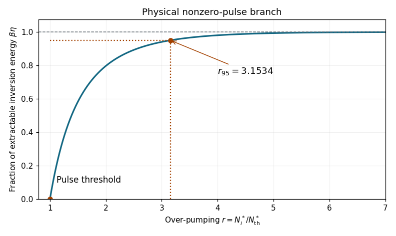

<h1 id="1/c/iii/solution">Solution</h1>

↑ **Parent:** [Iii](../iii.md)

The physical branch can be plotted without a nonlinear solver by parameterizing

$$
r(x)=\frac{-\ln(1-x)}x,\qquad 0<x<1.
$$

It begins at $(r,x)=(1,0)$ and increases monotonically to $x=1$ as $r\to\infty$. Expanding near threshold gives $r=1+x/2+O(x^2)$, so $x\simeq2(r-1)$. For strong over-pumping the residual inversion fraction is exponentially small, $1-x\simeq e^{-r}$. Thus the curve saturates at the upper bound $\beta\eta=1$.

**[Figure 1](#1/c/iii/image-ideal-q-switched-inversion-extraction-versus-over-pumping). Ideal Q-switched inversion extraction versus over-pumping**. The nonzero pulse branch is plotted using $r=-\ln(1-x)/x$, where $x=\beta\eta$. The threshold and the 95 percent extraction point are marked.

## ↑ Ancestors (13)

1. [Iii](../iii.md)
2. [C](../../c.md)
3. [1](../../../1.md)
4. [2019](../../../../2019-split.md)
5. [Past exam of the laser science and quantum information processing course of the University of Oxford](../../../../split.md)
6. [Laser science and quantum information processing course of the University of Oxford](../../../../../laser-science-and-quantum-information-processing-course-of-the-university-of-oxford.md)
7. [Year 4 of the physics course of the University of Oxford](../../../../../year-4-of-the-physics-course-of-the-university-of-oxford.md)
8. [Physics course of the University of Oxford](../../../../../physics-course-of-the-university-of-oxford.md)
9. [Undergraduate course of the University of Oxford](../../../../../undergraduate-course-of-the-university-of-oxford.md)
10. [Course of the University of Oxford](../../../../../course-of-the-university-of-oxford.md)
11. [University of Oxford](../../../../../university-of-oxford-split.md)
12. [List of universities](../../../../../list-of-universities.md)
13. [Codex Wiki](../../../../../split.md)
