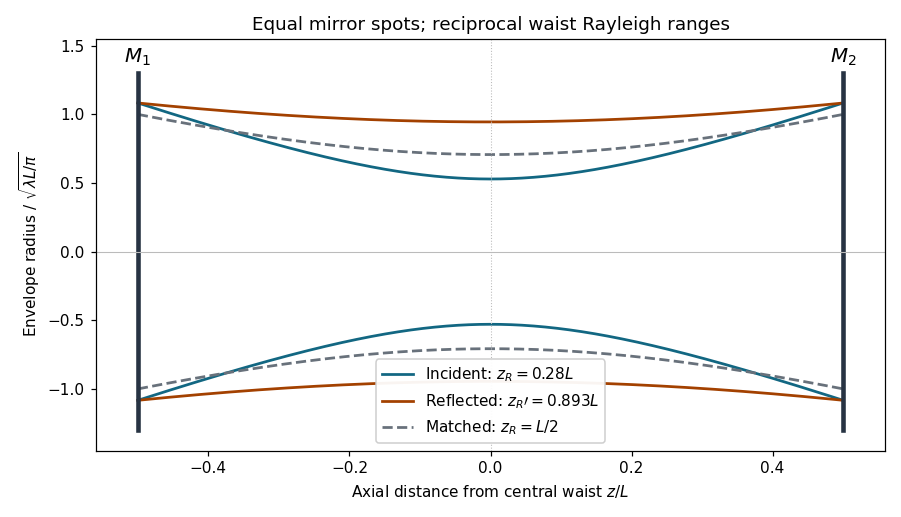

<h1 id="2/c/solution">Solution</h1>

↑ **Parent:** [C](../c.md)

Let $a=L/2$, so each [mirror](../../../../mirror.md) in the symmetric [confocal optical resonator](../../../../confocal-optical-resonator.md) has radius $R=L=2a$. At [mirror](../../../../mirror.md) 1, an incident beam whose [waist](../../../../beam-waist.md) is at the centre has $q_{\rm in}=a+iz_R$, with distances measured along its incoming direction. Reflection gives

$$
q_{\rm refl}=\frac{q_{\rm in}}{1-q_{\rm in}/a}
=-a+i\frac{a^2}{z_R}.
$$

After propagating the distance $a$ back to the centre, its parameter is purely imaginary. Thus the reflected [waist](../../../../beam-waist.md) is also at the [cavity](../../../../optical-cavity.md) centre and

$$
\boxed{z_R'=\frac{a^2}{z_R},\qquad z_Rz_R'=\left(\frac L2\right)^2.}
$$

The incident and reflected [waist](../../../../beam-waist.md) radii need not agree. With axial position $z$ measured from the centre, their radii obey

$$
w^2(z)=\frac\lambda\pi\left(z_R+\frac{z^2}{z_R}\right),\qquad
w'^2(z)=\frac\lambda\pi\left(\frac{a^2}{z_R}+\frac{z^2z_R}{a^2}\right).
$$

At either [mirror](../../../../mirror.md), $z^2=a^2$ and the two [spot sizes](../../../../gaussian-beam-radius.md) agree, as reflection requires. Between the [mirrors](../../../../mirror.md) they generally have different waists while still reproducing themselves after a full round trip.

**[Figure 2](#2/c/image-incident-and-reflected-gaussian-envelopes-in-a-symmetric-confocal-resonator). Incident and reflected Gaussian envelopes in a symmetric confocal resonator**. Two unequal waist radii at the same central plane have reciprocal Rayleigh ranges $z_Rz_R'=(L/2)^2$. The envelopes meet at both mirrors. The matched fundamental mode is included for comparison.

## ↑ Ancestors (12)

1. [C](../c.md)
2. [2](../../2.md)
3. [2019](../../../2019-split.md)
4. [Past exam of the laser science and quantum information processing course of the University of Oxford](../../../split.md)
5. [Laser science and quantum information processing course of the University of Oxford](../../../../laser-science-and-quantum-information-processing-course-of-the-university-of-oxford.md)
6. [Year 4 of the physics course of the University of Oxford](../../../../year-4-of-the-physics-course-of-the-university-of-oxford.md)
7. [Physics course of the University of Oxford](../../../../physics-course-of-the-university-of-oxford.md)
8. [Undergraduate course of the University of Oxford](../../../../undergraduate-course-of-the-university-of-oxford.md)
9. [Course of the University of Oxford](../../../../course-of-the-university-of-oxford.md)
10. [University of Oxford](../../../../university-of-oxford-split.md)
11. [List of universities](../../../../list-of-universities.md)
12. [Codex Wiki](../../../../split.md)
