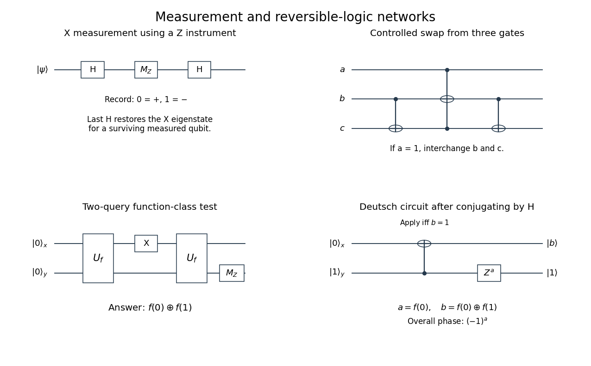

<h1 id="4/b/i/solution">Solution</h1>

↑ **Parent:** [I](../i.md)

Apply a [Hadamard gate](../../../../../hadamard-gate.md) before a Z-basis [measurement](../../../../../quantum-measurement-split.md): $H|+\rangle=|0\rangle$ and $H|-\rangle=|1\rangle$. The result [probabilities](../../../../../probability.md) are

$$
\boxed{p_+=\frac{|\alpha+\beta|^2}{2},\qquad
p_-=\frac{|\alpha-\beta|^2}{2}.}
$$

For [measurement](../../../../../quantum-measurement-split.md) statistics the network is $H$ followed by $M_Z$. If the measured [qubit](../../../../../qubit.md) survives and should be left in the original X [eigenstate](../../../../../eigenstate.md), append a second $H$ after the nondestructive $M_Z$. The resulting instrument has [Kraus operators](../../../../../kraus-operator.md) $HP_0H=|+\rangle\langle+|$ and $HP_1H=|-\rangle\langle-|$, not Z-eigenstate outputs.

**[Figure 3](#4/b/i/image-original-networks-for-x-measurement-a-controlled-swap-two-query-parity-testing-and-the-simplified-deutsch-circuit). Original networks for X measurement, a controlled swap, two-query parity testing, and the simplified Deutsch circuit**. Time runs left to right. Filled controls and circled targets denote computational-basis controlled-NOT operations. In the last network $a=f(0)$ and $b=f(0)\oplus f(1)$; powers zero omit a gate.

## ↑ Ancestors (13)

1. [I](../i.md)
2. [B](../../b.md)
3. [4](../../../4.md)
4. [2019](../../../../2019-split.md)
5. [Past exam of the laser science and quantum information processing course of the University of Oxford](../../../../split.md)
6. [Laser science and quantum information processing course of the University of Oxford](../../../../../laser-science-and-quantum-information-processing-course-of-the-university-of-oxford.md)
7. [Year 4 of the physics course of the University of Oxford](../../../../../year-4-of-the-physics-course-of-the-university-of-oxford.md)
8. [Physics course of the University of Oxford](../../../../../physics-course-of-the-university-of-oxford.md)
9. [Undergraduate course of the University of Oxford](../../../../../undergraduate-course-of-the-university-of-oxford.md)
10. [Course of the University of Oxford](../../../../../course-of-the-university-of-oxford.md)
11. [University of Oxford](../../../../../university-of-oxford-split.md)
12. [List of universities](../../../../../list-of-universities.md)
13. [Codex Wiki](../../../../../split.md)
