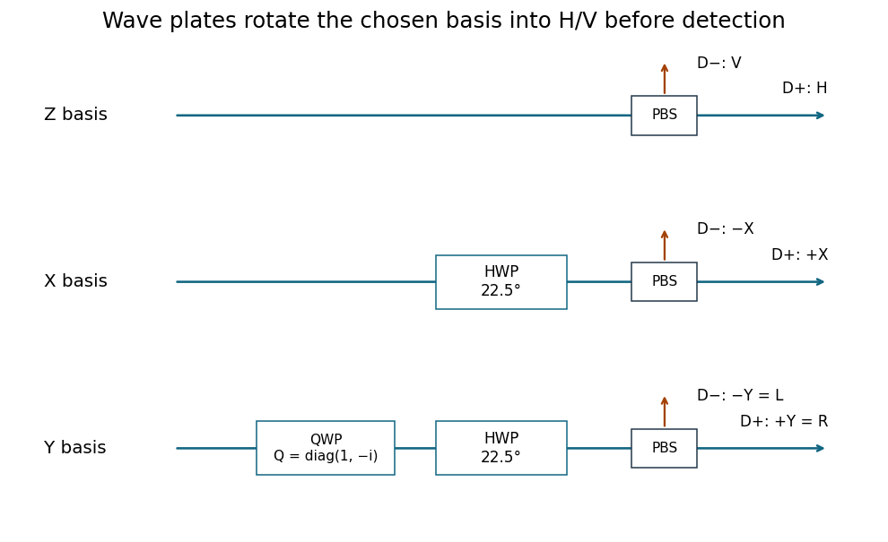

<h1 id="6/a/solution">Solution</h1>

↑ **Parent:** [A](../a.md)

Use $Z|H\rangle=|H\rangle$, $Z|V\rangle=-|V\rangle$. Choose the [eigenstate](../../../../eigenstate.md) phases

$$
\boxed{|H'\rangle=|+\rangle_X=\frac{|H\rangle+|V\rangle}{\sqrt2},\quad
|V'\rangle=|-\rangle_X=\frac{|H\rangle-|V\rangle}{\sqrt2},}
$$

$$
\boxed{|R\rangle=|+\rangle_Y=\frac{|H\rangle+i|V\rangle}{\sqrt2},\quad
|L\rangle=|-\rangle_Y=\frac{|H\rangle-i|V\rangle}{\sqrt2}.}
$$

The inverse relations are $|H\rangle=(|H'\rangle+|V'\rangle)/\sqrt2=(|R\rangle+|L\rangle)/\sqrt2$ and $|V\rangle=(|H'\rangle-|V'\rangle)/\sqrt2=-i(|R\rangle-|L\rangle)/\sqrt2$. The X states are [linearly polarized](../../../../linear-polarization.md) at $+45^\circ$ and $-45^\circ$ to horizontal, while the Y states have equal orthogonal amplitudes in quadrature and hence opposite [circular polarizations](../../../../circular-polarization.md). We define R as the $+Y$ state; descriptions as clockwise or anticlockwise must specify the observation direction and time convention.

A [polarizing beam splitter](../../../../polarizing-beam-splitter.md) and two [single-photon detectors](../../../../photon-counting.md) directly measure Z, routing H and V to separate detectors. For X, place a [half-wave plate](../../../../half-wave-plate.md) with its axis at $22.5^\circ$ before that splitter; it implements a Hadamard transformation up to a [global phase](../../../../global-phase.md). For Y, first apply a [quarter-wave](../../../../quarter-wave-plate.md) retardance $Q=\operatorname{diag}(1,-i)$ in the H/V axes and then the same [half-wave plate](../../../../half-wave-plate.md). The total analyzer transformation is $HQ$, with $HQ|R\rangle=|H\rangle$ and $HQ|L\rangle=|V\rangle$. The physical fast/slow-axis assignment is selected to realize this stated retardance.

**[Figure 4](#6/a/image-single-photon-analyzers-for-the-z-x-and-y-eigenbases). Single-photon analyzers for the Z, X and Y eigenbases**. Each polarizing beam splitter routes horizontal and vertical output components to separate photon detectors. The X analyzer uses a half-wave plate at 22.5 degrees; the Y analyzer first uses $Q=\operatorname{diag}(1,-i)$.

## ↑ Ancestors (12)

1. [A](../a.md)
2. [6](../../6.md)
3. [2019](../../../2019-split.md)
4. [Past exam of the laser science and quantum information processing course of the University of Oxford](../../../split.md)
5. [Laser science and quantum information processing course of the University of Oxford](../../../../laser-science-and-quantum-information-processing-course-of-the-university-of-oxford.md)
6. [Year 4 of the physics course of the University of Oxford](../../../../year-4-of-the-physics-course-of-the-university-of-oxford.md)
7. [Physics course of the University of Oxford](../../../../physics-course-of-the-university-of-oxford.md)
8. [Undergraduate course of the University of Oxford](../../../../undergraduate-course-of-the-university-of-oxford.md)
9. [Course of the University of Oxford](../../../../course-of-the-university-of-oxford.md)
10. [University of Oxford](../../../../university-of-oxford-split.md)
11. [List of universities](../../../../list-of-universities.md)
12. [Codex Wiki](../../../../split.md)
