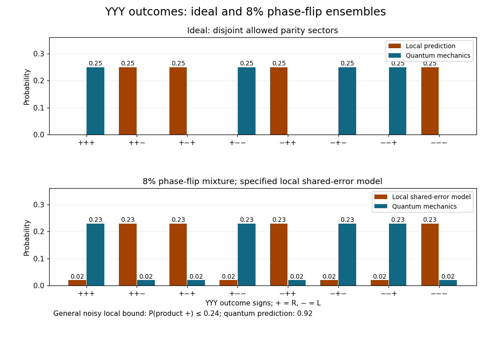

<h1 id="6/d/solution">Solution</h1>

↑ **Parent:** [D](../d.md)

Write $\epsilon=0.08$ and $v=1-2\epsilon=0.84$. The ensemble is the mixture $(1-\epsilon)|\mathrm{GHZ}\rangle\langle\mathrm{GHZ}|+\epsilon|\mathrm{GHZ}'\rangle\langle\mathrm{GHZ}'|$, rather than a [coherent superposition](../../../../quantum-superposition.md) of the two phases. The ZZZ [probabilities](../../../../probability.md) stay unchanged. Reversing the [relative phase](../../../../relative-quantum-phase.md) interchanges the allowed parity sector in every equatorial basis, so for XXY, XYX and YXX,

$$
\boxed{P(a,b,c)=\frac{1-vabc}{8}
=\begin{cases}0.23,&abc=-1,\\0.02,&abc=+1.\end{cases}}
$$

In YYY the quantum prediction is the opposite:

$$
\boxed{P_{\rm QM}^{YYY}(a,b,c)=\frac{1+vabc}{8}
=\begin{cases}0.23,&abc=+1,\\0.02,&abc=-1.\end{cases}}
$$

For a concrete continuation of the ideal local analysis, apply the same [phase-flip](../../../../pauli-z-gate.md) event to a predetermined local assignment: it reverses X and Y at the affected [photon](../../../../photon.md). All three mixed-basis products and the YYY product then reverse together. With unbiased marginals in each parity sector this shared-error local model predicts negative-product YYY outcomes at $0.23$ each and positive-product outcomes at $0.02$ each. The histograms compare this specified model with the quantum result.

**[Figure 5](#6/d/image-yyy-outcome-histograms-for-ideal-and-phase-flipped-ghz-correlations). YYY outcome histograms for ideal and phase-flipped GHZ correlations**. The ideal local prediction has negative parity, while quantum mechanics has positive parity. The noisy local bars use the explicitly stated shared phase-flip model; general noisy local models are constrained by a bound rather than by a unique histogram.

Imperfect mixed-basis statistics alone do not force that particular local histogram. A model-independent constraint follows because a positive YYY product requires at least one of the three ideal mixed-product constraints to fail. Each fails with [probability](../../../../probability.md) $\epsilon$, so the [union bound](../../../../boole-s-inequality.md) gives

$$
\boxed{P_{\rm LR}(Y_1Y_2Y_3=+1)\leq3\epsilon=0.24,
\qquad P_{\rm QM}(Y_1Y_2Y_3=+1)=0.92.}
$$

Equivalently, local assignments satisfy $|\langle XXY\rangle+\langle XYX\rangle+\langle YXX\rangle-\langle YYY\rangle|\leq2$, whereas this noisy [quantum state](../../../../quantum-state.md) gives $4v=3.36$. Thus the violation survives the specified phase error without assuming a unique noisy local histogram or independent errors in the three [measurement](../../../../quantum-measurement-split.md) contexts.

## ↑ Ancestors (12)

1. [D](../d.md)
2. [6](../../6.md)
3. [2019](../../../2019-split.md)
4. [Past exam of the laser science and quantum information processing course of the University of Oxford](../../../split.md)
5. [Laser science and quantum information processing course of the University of Oxford](../../../../laser-science-and-quantum-information-processing-course-of-the-university-of-oxford.md)
6. [Year 4 of the physics course of the University of Oxford](../../../../year-4-of-the-physics-course-of-the-university-of-oxford.md)
7. [Physics course of the University of Oxford](../../../../physics-course-of-the-university-of-oxford.md)
8. [Undergraduate course of the University of Oxford](../../../../undergraduate-course-of-the-university-of-oxford.md)
9. [Course of the University of Oxford](../../../../course-of-the-university-of-oxford.md)
10. [University of Oxford](../../../../university-of-oxford-split.md)
11. [List of universities](../../../../list-of-universities.md)
12. [Codex Wiki](../../../../split.md)
