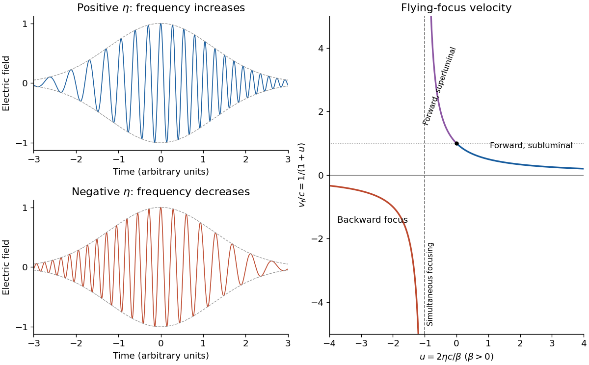
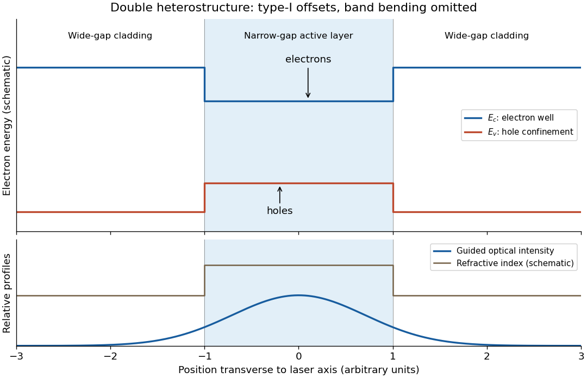
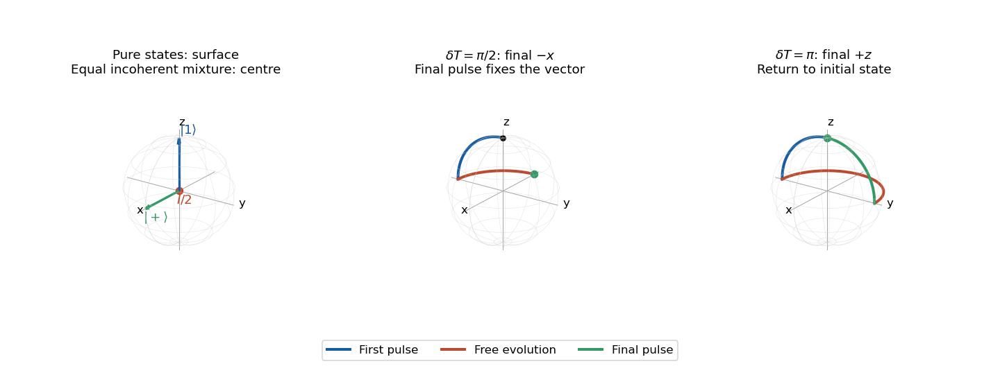
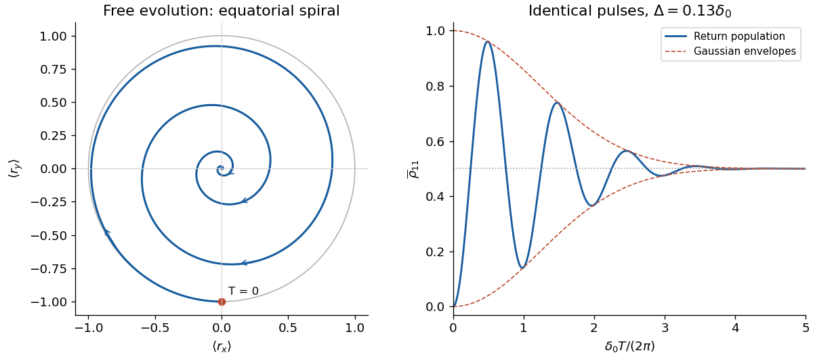
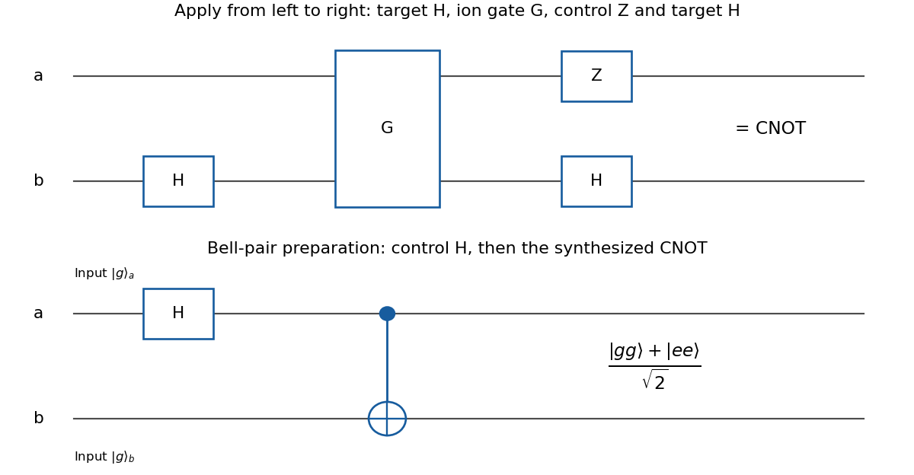

# 2021

↑ **Parent:** [Past exam of the laser science and quantum information processing course of the University of Oxford](../past-exam-of-the-laser-science-and-quantum-information-processing-course-of-the-university-of-oxford.md)

Source paper: [https://www.whatdotheyknow.com/request/oxford_physics_past_papers_2/response/2340696/attach/9/Physics%20Papers%202020.pdf?cookie_passthrough=1](https://www.whatdotheyknow.com/request/oxford_physics_past_papers_2/response/2340696/attach/9/Physics%20Papers%202020.pdf?cookie_passthrough=1)

The cover dates this examination to 11 June 2021; the public bundle's filename is not the examination year. Source bundle pages 28–33. Solutions use the original conventions, with the Ramsey population-sign inconsistency identified explicitly in part 3(c).

**Table of contents**

- [1](#1)
  - [a](#1/a)
    - [Solution](#1/a/solution)
  - [b](#1/b)
    - [Solution](#1/b/solution)
  - [c](#1/c)
    - [Solution](#1/c/solution)
  - [d](#1/d)
    - [Solution](#1/d/solution)
- [2](#2)
  - [a](#2/a)
    - [Solution](#2/a/solution)
  - [b](#2/b)
    - [Solution](#2/b/solution)
  - [c](#2/c)
    - [Solution](#2/c/solution)
  - [d](#2/d)
    - [Solution](#2/d/solution)
- [3](#3)
  - [a](#3/a)
    - [Solution](#3/a/solution)
  - [b](#3/b)
    - [i](#3/b/i)
      - [Solution](#3/b/i/solution)
    - [ii](#3/b/ii)
      - [Solution](#3/b/ii/solution)
    - [iii](#3/b/iii)
      - [Solution](#3/b/iii/solution)
  - [c](#3/c)
    - [Solution](#3/c/solution)
  - [d](#3/d)
    - [Solution](#3/d/solution)
  - [e](#3/e)
    - [Solution](#3/e/solution)
- [4](#4)
  - [a](#4/a)
    - [Solution](#4/a/solution)
  - [b](#4/b)
    - [Solution](#4/b/solution)
  - [c](#4/c)
    - [Solution](#4/c/solution)
  - [d](#4/d)
    - [Solution](#4/d/solution)
  - [e](#4/e)
    - [Solution](#4/e/solution)
  - [f](#4/f)
    - [Solution](#4/f/solution)
- [5](#5)
  - [a](#5/a)
    - [Solution](#5/a/solution)
  - [b](#5/b)
    - [Solution](#5/b/solution)
  - [c](#5/c)
    - [Solution](#5/c/solution)
  - [d](#5/d)
    - [Solution](#5/d/solution)
- [6](#6)
  - [a](#6/a)
    - [Solution](#6/a/solution)
  - [b](#6/b)
    - [Solution](#6/b/solution)
  - [c](#6/c)
    - [Solution](#6/c/solution)
  - [d](#6/d)
    - [Solution](#6/d/solution)
  - [e](#6/e)
    - [Solution](#6/e/solution)

## 1

↑ **Parent:** [2021](2021.md)

<h3 id="1/a">a</h3>

↑ **Parent:** [1](#1)

<h4 id="1/a/solution">Solution</h4>

↑ **Parent:** [A](#1/a)

Put $s=z-z_0$. In the source's [complex beam parameter](../physical-optics.md#complex-beam-parameter) convention,

$$
\frac1q=\frac{s+iz_R}{s^2+z_R^2}
=\frac1{R(z)}+i\frac{2}{kw(z)^2}.
$$

Substitution separates the transverse [wave amplitude](../wave.md#wave-amplitude) and [phase](../wave.md#phase-waves):

$$
U=\frac{U_0e^{i(kz-\omega t)}}{s-iz_R}
\exp\!\left[-\frac{\rho^2}{w(z)^2}\right]
\exp\!\left[i\frac{k\rho^2}{2R(z)}\right].
$$

Thus the [Gaussian beam](../physical-optics.md#gaussian-beam) is circularly symmetric, has a [Gaussian function](../calculus.md#gaussian-function) transverse [light intensity](../wave.md#light-intensity), and narrows to a [beam waist](../physical-optics.md#beam-waist) at $z_0$ before spreading by [diffraction](../quantum-scattering.md#diffraction). Its [wavefront](../physical-optics.md#wavefront) is planar at the [beam waist](../physical-optics.md#beam-waist), converging before it and diverging after it. The quadratic transverse [phase](../wave.md#phase-waves) identifies the signed [radius of curvature](../differential-geometry.md#radius-of-curvature):

$$
\boxed{R(z)=s+\frac{z_R^2}{s},\qquad R(z_0)=\infty.}
$$

Define spot size as the [wave amplitude](../wave.md#wave-amplitude) $1/e$ [radius](../topology.md#radius), equivalently the [light intensity](../wave.md#light-intensity) $1/e^2$ [radius](../topology.md#radius). Then

$$
\boxed{w(z)^2=\frac{2(s^2+z_R^2)}{kz_R}
=w_0^2\left(1+\frac{s^2}{z_R^2}\right),\qquad
w_0^2=\frac{2z_R}{k}=\frac{\lambda z_R}{\pi}.}
$$

The [Rayleigh range](../physical-optics.md#rayleigh-length) is where $w=\sqrt2w_0$; the far-field [beam divergence](../physical-optics.md#beam-divergence) half-angle is $\lambda/(\pi w_0)$. The factor $1/q$ also produces a longitudinal [phase](../wave.md#phase-waves) shift relative to a [plane wave](../wave-function.md#plane-wave), changing by $\pi$ across the [beam waist](../physical-optics.md#beam-waist); its sign here follows the given $e^{i(kz-\omega t)}$ convention. The on-axis [light intensity](../wave.md#light-intensity) decreases as $1/(s^2+z_R^2)$ while transverse integration leaves the [power](../energy.md#power) constant. These are scalar [paraxial approximation](../partial-differential-equation.md#paraxial-approximation) results.

<h3 id="1/b">b</h3>

↑ **Parent:** [1](#1)

<h4 id="1/b/solution">Solution</h4>

↑ **Parent:** [B](#1/b)

A [thin lens](../geometrical-optics.md#thin-lens) has [ray transfer matrix](../geometrical-optics.md#ray-transfer-matrix-analysis)

$$
M=\begin{pmatrix}1&0\\-1/f&1\end{pmatrix}.
$$

The [complex beam parameter](../physical-optics.md#complex-beam-parameter) transformation gives $q_2=q_1/(1-q_1/f)$, hence

$$
\boxed{\frac1{q_1}-\frac1{q_2}=\frac1f.}
$$

The sign is also obtained by multiplying the incident [wave amplitude](../wave.md#wave-amplitude) by the [thin lens](../geometrical-optics.md#thin-lens) [phase](../wave.md#phase-waves) $\exp[-ik\rho^2/(2f)]$.

Choose the [thin lens](../geometrical-optics.md#thin-lens) plane as $z=0$ and put $a=\pi w_0^2/\lambda$, the incident [Rayleigh range](../physical-optics.md#rayleigh-length). Since the incident [beam waist](../physical-optics.md#beam-waist) lies there, $q_1=-ia$. Immediately after the [thin lens](../geometrical-optics.md#thin-lens),

$$
q_2=\frac{-ia}{1+ia/f}
=-\frac{fa^2}{f^2+a^2}-i\frac{f^2a}{f^2+a^2}.
$$

Subsequent free propagation adds $z$, so write $q(z)=z-z_f-iz_R'$. Comparing real and imaginary parts gives

$$
\boxed{z_f=\frac{fa^2}{f^2+a^2},\qquad
z_R'=\frac{f^2a}{f^2+a^2},\qquad
w_f^2=\frac{\lambda z_R'}\pi.}
$$

For a positive [focal length](../geometrical-optics.md#focal-length), the new [beam waist](../physical-optics.md#beam-waist) lies downstream but closer than the geometrical focus. At fixed $f,\lambda$, as $w_0\to\infty$,

$$
\boxed{z_f\to f,\quad z_R'\sim\frac{f^2\lambda}{\pi w_0^2}\to0,
\quad w_f\sim\frac{f\lambda}{\pi w_0}.}
$$

This is the formal unbounded-[aperture](../optics.md#aperture) scalar limit; eventually finite [aperture](../optics.md#aperture) and the [paraxial approximation](../partial-differential-equation.md#paraxial-approximation) limit the extrapolation.

<h3 id="1/c">c</h3>

↑ **Parent:** [1](#1)

<h4 id="1/c/solution">Solution</h4>

↑ **Parent:** [C](#1/c)

A [chirp](../wave.md#chirp) is variation of the instantaneous [frequency](../wave.md#frequency) through a signal. Here the [group delay](../physical-optics.md#group-delay) relative to the pulse centre at the [optical lens](../geometrical-optics.md#lens-optics) is

$$
t_{\rm in}(\omega)=\frac{d\psi}{d\omega}=2\eta(\omega-\omega_0).
$$

Consequently $\eta>0$ orders lower [frequencies](../wave.md#frequency) before higher [frequencies](../wave.md#frequency); $\eta<0$ reverses that ordering. A representative strongly chirped [optical pulse](../optics.md#optical-pulse) is

$$
E(t)=A(t)\cos\!\left(\omega_0t+\frac{t^2}{4\eta}+\phi_0\right),
\qquad \omega_{\rm inst}(t)=\omega_0+\frac{t}{2\eta},
$$

with a smooth localized envelope $A(t)$. The carrier oscillations become closer together towards later times for positive $\eta$ and farther apart for negative $\eta$.

The relation between the [spectral phase](../physical-optics.md#spectral-phase) and a locally assigned instantaneous [frequency](../wave.md#frequency) is a [stationary phase method](../analysis.md#stationary-phase-method), not an exact reconstruction from [spectral phase](../physical-optics.md#spectral-phase) alone: the spectral [wave amplitude](../wave.md#wave-amplitude) also matters. For example, if the spectral envelope is $e^{-(\omega-\omega_0)^2/(2\sigma^2)}$, a [Fourier transform of a Gaussian](../fourier-analysis.md#fourier-transform-of-a-gaussian) gives the exact real-field [phase](../wave.md#phase-waves) $\omega_0t+\eta t^2/(4|a|^2)$ up to a constant, where $a=1/(2\sigma^2)-i\eta$. The slope retains the sign of $\eta$ and approaches $1/(2\eta)$ for $|\eta|\sigma^2\gg1$.

**[Figure 1](#1/c/image-opposite-chirps-and-the-velocity-branches-of-a-flying-focus). Opposite chirps and the velocity branches of a flying focus**.

<h3 id="1/d">d</h3>

↑ **Parent:** [1](#1)

<h4 id="1/d/solution">Solution</h4>

↑ **Parent:** [D](#1/d)

Place the [optical lens](../geometrical-optics.md#lens-optics) at $z=0$. For a sufficiently broad incident [Gaussian beam](../physical-optics.md#gaussian-beam), the [beam waist](../physical-optics.md#beam-waist) positions approach the [focal lengths](../geometrical-optics.md#focal-length) frequency by frequency:

$$
z_\omega\simeq f_0+\beta(\omega-\omega_0).
$$

Add the [group delay](../physical-optics.md#group-delay) at the [optical lens](../geometrical-optics.md#lens-optics) to propagation through [vacuum](../physics.md#vacuum):

$$
\boxed{t_\omega=2\eta(\omega-\omega_0)+\frac{z_\omega}{c}
=\frac{f_0}{c}+\left(2\eta+\frac\beta c\right)(\omega-\omega_0).}
$$

Here an arbitrary common time origin has been omitted. Differentiating both equations with respect to [angular frequency](../lagrangian-mechanics.md#angular-frequency) yields

$$
\boxed{\frac{v_f}{c}=\frac{\beta}{\beta+2\eta c}
=\left(1+\frac{2\eta c}{\beta}\right)^{-1}.}
$$

For $\beta>0$, define $u=2\eta c/\beta$. The velocity graph in the preceding figure has horizontal asymptote zero and a vertical asymptote at $u=-1$. For $\eta>0$, $0<v_f<c$: the higher-[frequency](../wave.md#frequency) components both enter later and travel farther. At $\eta=0$, $v_f=c$. For $-\beta/(2c)<\eta<0$, $v_f>c$: the farther-focusing components leave earlier, partly compensating their extra travel. At $\eta=-\beta/(2c)$ every component focuses at the same time, so the trajectory is not a finite-velocity function of time. For $\eta<-\beta/(2c)$ the farther positions focus first, giving $v_f<0$; it tends to zero from below as $\eta\to-\infty$.

A [flying focus](../optics.md#flying-focus) is a moving pattern assembled from different portions of an [optical pulse](../optics.md#optical-pulse). Each portion propagates causally at $c$ in this model. The superluminal or backward motion of the focus therefore does not describe a material object or information overtaking [light](../optics.md#light). The calculation assumes negligible additional frequency-dependent [group delay](../physical-optics.md#group-delay) from the [optical lens](../geometrical-optics.md#lens-optics); any such delay must be included in $\psi$.

## 2

↑ **Parent:** [2021](2021.md)

<h3 id="2/a">a</h3>

↑ **Parent:** [2](#2)

<h4 id="2/a/solution">Solution</h4>

↑ **Parent:** [A](#2/a)

In a [direct band gap](../bloch-s-theorem.md#direct-band-gap) [semiconductor](../semiconductor.md), the small [photon momentum](../quantum-mechanics.md#photon-momentum) makes optical transitions approximately vertical in [wave vector](../elasticity-physics.md#wavevector). Their [energy](../energy.md) is

$$
\mathcal E(k)=E_c(k)-E_v(k)=E_g+\frac{\hbar^2k^2}{2m_r},
\qquad \boxed{\frac1{m_r}=\frac1{m_c^*}+\frac1{m_v^*}}.
$$

The [joint density of states](../quantum-ideal-gas-statistics.md#joint-density-of-states) per unit volume per transition [energy](../energy.md), including the supplied spin counting, is

$$
D_J(\mathcal E)=\frac{k^2}{\pi^2}\frac{dk}{d\mathcal E}
=\frac{m_r k}{\pi^2\hbar^2}
=\frac{\sqrt2\,m_r^{3/2}}{\pi^2\hbar^3}\sqrt{\mathcal E-E_g},\qquad \mathcal E>E_g.
$$

For an upper [electron](../physics.md#electron) state of occupation $f_c$ and a lower [electron](../physics.md#electron) state of occupation $f_v$, [stimulated emission](../laser.md#stimulated-emission) has occupation factor $f_c(1-f_v)$; [absorption](../radiometry.md#absorption-electromagnetic-radiation) has factor $f_v(1-f_c)$. Their difference is exactly $f_c-f_v$. Multiplication by the [joint density of states](../quantum-ideal-gas-statistics.md#joint-density-of-states) therefore gives

$$
\boxed{g(\omega)\ \propto\ m_r^{3/2}\sqrt{\hbar\omega-E_g}\,[f_c(E_2)-f_v(E_1)].}
$$

The proportionality suppresses the optical transition [matrix element](../vector-space.md#matrix-element) and other smoothly varying optical prefactors. It assumes parabolic isotropic [energy bands](../bloch-s-theorem.md#energy-band), an allowed direct transition, and negligible linewidth and many-body corrections. Here $f_v$ counts [electrons](../physics.md#electron), not [electron holes](../quantum-mechanics.md#electron-hole).

<h3 id="2/b">b</h3>

↑ **Parent:** [2](#2)

<h4 id="2/b/solution">Solution</h4>

↑ **Parent:** [B](#2/b)

A [quasi-Fermi level](../chemical-potential.md#quasi-fermi-level) is the [chemical potential](../chemical-potential.md) parameter of an approximately thermalized carrier population within one [energy band](../bloch-s-theorem.md#energy-band). Rapid intraband scattering can establish a [Fermi-Dirac distribution](../quantum-ideal-gas-statistics.md#fermi-dirac-distribution) in each [energy band](../bloch-s-theorem.md#energy-band) before slower interband recombination equilibrates their populations. Thus separate $E_{\rm Fc}$ and $E_{\rm Fv}$ describe a pumped [population inversion](../laser.md#population-inversion) even though the entire [semiconductor](../semiconductor.md) is far from [thermal equilibrium](../thermal-equilibrium.md).

At a common positive [temperature](../temperature.md), the [Fermi-Dirac distribution](../quantum-ideal-gas-statistics.md#fermi-dirac-distribution) is strictly decreasing in $E-E_F$. Consequently

$$
\begin{aligned}
f_c(E_2)>f_v(E_1)
&\iff E_2-E_{\rm Fc}<E_1-E_{\rm Fv}\\
&\iff \hbar\omega<E_{\rm Fc}-E_{\rm Fv}.
\end{aligned}
$$

The [joint density of states](../quantum-ideal-gas-statistics.md#joint-density-of-states) is nonzero only above the [band gap](../bloch-s-theorem.md#band-gap), so

$$
\boxed{E_g<\hbar\omega<E_{\rm Fc}-E_{\rm Fv}.}
$$

In particular the [quasi-Fermi-level splitting](../chemical-potential.md#quasi-fermi-level-splitting) must exceed $E_g$. The upper boundary is transparency, where [stimulated emission](../laser.md#stimulated-emission) balances [absorption](../radiometry.md#absorption-electromagnetic-radiation); the lower boundary has zero [joint density of states](../quantum-ideal-gas-statistics.md#joint-density-of-states) in this ideal three-dimensional parabolic model. The strict occupation comparison uses $T>0$; at exactly zero [temperature](../temperature.md) occupations become step functions, and their supports should be checked explicitly, as in the next part.

<h3 id="2/c">c</h3>

↑ **Parent:** [2](#2)

<h4 id="2/c/solution">Solution</h4>

↑ **Parent:** [C](#2/c)

Assume equal excess [electron](../physics.md#electron) and [electron hole](../quantum-mechanics.md#electron-hole) [number densities](../statistical-physics.md#number-density) $N_t$, with no additional doping imbalance. At zero [temperature](../temperature.md), both occupied carrier spheres have the same [Fermi wavevector](../quantum-ideal-gas-statistics.md#fermi-wavevector) $k_F$ because their spin counting is the same:

$$
N_t=\int_0^{k_F}\frac{k^2}{\pi^2}\,dk
=\frac{k_F^3}{3\pi^2},\qquad k_F=(3\pi^2N_t)^{1/3}.
$$

For $k<k_F$, the [conduction band](../quantum-mechanics.md#conduction-band) is occupied and the [valence band](../quantum-mechanics.md#valence-band) has [electron holes](../quantum-mechanics.md#electron-hole), so $f_c-f_v=1$. Beyond $k_F$ the occupations reverse and the medium absorbs. Thus the upper edge of the positive-[optical gain](../laser.md#optical-gain) interval is the supremum

$$
\boxed{\hbar\omega_{\max}=E_g+\frac{\hbar^2}{2m_r}(3\pi^2N_t)^{2/3},\qquad
\beta=1+\frac{\hbar^2(3\pi^2N_t)^{2/3}}{2m_rE_g}.}
$$

Equivalently $E_{\rm Fc}=E_g+\hbar^2k_F^2/(2m_c^*)$ and $E_{\rm Fv}=-\hbar^2k_F^2/(2m_v^*)$. With the supplied [effective masses](../bloch-s-theorem.md#band-effective-mass),

$$
\begin{aligned}
m_r&=0.0587934\,m_e,\quad k_F=3.09367\times10^8\,\mathrm{m}^{-1},\\
\hbar\omega_{\max}-E_g&\simeq0.0620214\,\mathrm{eV},\\
&\boxed{\beta\simeq1.04368,\qquad \hbar\omega_{\max}\simeq1.48202\,\mathrm{eV}.}
\end{aligned}
$$

Using the [vacuum](../physics.md#vacuum) [wavelength](../wave-equation.md#wavelength) $\lambda=hc/(\hbar\omega)$ reverses the endpoints:

$$
\boxed{836.59\,\mathrm{nm}<\lambda<873.13\,\mathrm{nm}.}
$$

These boundaries are idealized and open: the lower-[energy](../energy.md) edge has zero [joint density of states](../quantum-ideal-gas-statistics.md#joint-density-of-states), and the upper edge is the zero-[temperature](../temperature.md) occupation discontinuity, not a finite-width gain peak. The calculation gives positive material [optical gain](../laser.md#optical-gain), not the stronger requirement of exceeding the losses at [laser threshold](../laser.md#laser-threshold).

<h3 id="2/d">d</h3>

↑ **Parent:** [2](#2)

<h4 id="2/d/solution">Solution</h4>

↑ **Parent:** [D](#2/d)

A [double heterostructure laser](../semiconductor.md#double-heterostructure-laser) sandwiches a narrow-[band gap](../bloch-s-theorem.md#band-gap) active layer between wider-[band gap](../bloch-s-theorem.md#band-gap) cladding layers. In a [type-I band alignment](../semiconductor.md#type-i-band-alignment), the [conduction band](../quantum-mechanics.md#conduction-band) edge is lower and the [valence band](../quantum-mechanics.md#valence-band) edge higher in the active layer. [Electrons](../physics.md#electron) therefore see an [energy](../energy.md) well, and [electron holes](../quantum-mechanics.md#electron-hole) also see a well because their excitation [energy](../energy.md) increases when the [valence band](../quantum-mechanics.md#valence-band) edge decreases. Both carrier populations remain concentrated where [stimulated emission](../laser.md#stimulated-emission) occurs.

**[Figure 2](#2/d/image-carrier-and-optical-confinement-in-a-schematic-double-heterostructure-laser). Carrier and optical confinement in a schematic double heterostructure laser**.

The active layer also normally has the higher [refractive index](../electromagnetic-wave.md#refractive-index), forming an [optical waveguide](../electromagnetic-wave.md#optical-waveguide). The optical [normal mode](../wave-equation.md#normal-mode) overlaps the injected carriers strongly, and the wider-[band gap](../bloch-s-theorem.md#band-gap) cladding has less interband [absorption](../radiometry.md#absorption-electromagnetic-radiation) at the emitted [photon energy](../quantum-mechanics.md#photon-energy). Carrier confinement reduces leakage, while optical confinement reduces the required pump current and hence heating.

Writing $\Gamma$ for the fraction of the optical [normal mode](../wave-equation.md#normal-mode) overlapping the active layer, the threshold condition is $\Gamma g=\alpha_i+\alpha_m$, with internal and mirror losses $\alpha_i,\alpha_m$. A larger overlap and a higher carrier [number density](../statistical-physics.md#number-density) at a given current both lower the threshold current. The figure shows composition-induced offsets; a working junction also has [band bending](../semiconductor.md#band-bending) under bias, which is omitted to make the confinement mechanism visible.

## 3

↑ **Parent:** [2021](2021.md)

<h3 id="3/a">a</h3>

↑ **Parent:** [3](#3)

<h4 id="3/a/solution">Solution</h4>

↑ **Parent:** [A](#3/a)

Use the source's north-pole assignment $|1\rangle\leftrightarrow(0,0,1)$. Fix the ordered [basis](../vector-space.md#basis) as $(|1\rangle,|0\rangle)$ and use the standard [Pauli matrices](../algebra.md#pauli-matrices) in that order, so

$$
\rho=\tfrac12(I+\mathbf r\cdot\boldsymbol\sigma),\qquad
\rho_{11}=\tfrac12(1+r_z).
$$

A [pure state](../quantum-theory.md#pure-state) has $|\mathbf r|=1$: examples are $|1\rangle$ at the north pole and $(|1\rangle+|0\rangle)/\sqrt2$ at $(1,0,0)$. An incoherent [mixed state](../density-matrix.md#mixed-state)

$$
\rho=p|1\rangle\langle1|+(1-p)|0\rangle\langle0|
$$

has $\mathbf r=(0,0,2p-1)$ inside the [Bloch sphere](../density-matrix.md#bloch-sphere). At $p=1/2$ it is the origin, distinct from an equatorial [pure state](../quantum-theory.md#pure-state) despite equal populations. The distinction is the off-diagonal [quantum coherence](../density-matrix.md#quantum-coherence-in-a-specified-basis) of the [density matrix](../density-matrix.md).

**[Figure 3](#3/a/image-pure-states-an-incoherent-mixed-state-and-two-complete-ramsey-interferometry-trajectories). Pure states, an incoherent mixed state, and two complete Ramsey interferometry trajectories**.

<h3 id="3/b">b</h3>

↑ **Parent:** [3](#3)

<h4 id="3/b/i">i</h4>

↑ **Parent:** [B](#3/b)

<h5 id="3/b/i/solution">Solution</h5>

↑ **Parent:** [I](#3/b/i)

For the stated [Hamiltonian operator](../quantum-system.md#hamiltonian-quantum-mechanics), put $\boldsymbol\Omega=(V,0,-\delta)$ and $\Omega=\sqrt{V^2+\delta^2}$. The [Bloch vector](../density-matrix.md#bloch-vector) obeys

$$
\dot{\mathbf r}=\boldsymbol\Omega\mathbin\times\mathbf r,\qquad
U(t)=\cos\frac{\Omega t}{2}\,I-i\sin\frac{\Omega t}{2}\,
\frac{V\sigma_x-\delta\sigma_z}{\Omega}.
$$

Thus it rotates right-handedly about the fixed axis $\boldsymbol\Omega$, preserving its length and its projection on that axis. For example, on [resonance](../dynamical-systems.md#resonance) $\delta=0$, a north-pole [Bloch vector](../density-matrix.md#bloch-vector) follows $(0,-\sin Vt,\cos Vt)$ and reaches the south pole at $t=\pi/V$.

Take $V>0$, with the field [phase](../wave.md#phase-waves) chosen accordingly. The [Hadamard gate](../quantum-theory.md#hadamard-gate) is $H=(\sigma_x+\sigma_z)/\sqrt2$. Align the axis with $(1,0,1)$ and rotate through $\pi$:

$$
\boxed{\delta=-V,\qquad \tau=\frac{\pi}{\sqrt2V},\qquad U(\tau)=-iH.}
$$

The factor $-i$ is an irrelevant common [global phase](../quantum-system.md#global-phase). This realizes the whole [quantum gate](../quantum-circuit.md#quantum-logic-gate), rather than merely its action on one input [quantum state](../quantum-system.md#quantum-state).

There is a [basis](../vector-space.md#basis)-ordering convention to make explicit: this $H$ is the [Hadamard gate](../quantum-theory.md#hadamard-gate) matrix in the ordered [basis](../vector-space.md#basis) $(|1\rangle,|0\rangle)$ chosen in part (a). If instead its definition is the usual ket rules $H_{01}|0\rangle=(|0\rangle+|1\rangle)/\sqrt2$ and $H_{01}|1\rangle=(|0\rangle-|1\rangle)/\sqrt2$, its matrix in our order is $(\sigma_x-\sigma_z)/\sqrt2$. For that definition choose $\boxed{\delta=+V,\ \tau=\pi/(\sqrt2V)}$. Both conventions use the same pulse duration; the sign of the [Rabi detuning](../quantum-system.md#rabi-detuning) selects the desired axis.

<h4 id="3/b/ii">ii</h4>

↑ **Parent:** [B](#3/b)

<h5 id="3/b/ii/solution">Solution</h5>

↑ **Parent:** [Ii](#3/b/ii)

At [resonance](../dynamical-systems.md#resonance), the [Hamiltonian operator](../quantum-system.md#hamiltonian-quantum-mechanics) becomes $\hbar V\sigma_x/2$. Therefore

$$
U(\tau)=e^{-iV\tau\sigma_x/2}=R_x(V\tau),\qquad
\boxed{\delta=0,\qquad \tau=\frac{\pi}{2V}.}
$$

It gives the requested positive [rotation about the x-axis](../quantum-circuit.md#rotation-about-the-x-axis). In the ordered [basis](../vector-space.md#basis) $(|1\rangle,|0\rangle)$, $|1\rangle$ becomes $(|1\rangle-i|0\rangle)/\sqrt2$, whose [Bloch vector](../density-matrix.md#bloch-vector) is $(0,-1,0)$.

<h4 id="3/b/iii">iii</h4>

↑ **Parent:** [B](#3/b)

<h5 id="3/b/iii/solution">Solution</h5>

↑ **Parent:** [Iii](#3/b/iii)

A resonant [Rabi pi pulse](../quantum-system.md#rabi-pi-pulse) gives

$$
\boxed{\delta=0,\qquad \tau=\frac{\pi}{V},\qquad U(\tau)=-i\sigma_x.}
$$

It swaps $|0\rangle$ and $|1\rangle$ with a common [global phase](../quantum-system.md#global-phase), implementing the [Pauli gate](../quantum-circuit.md#pauli-gate) $X$, or NOT. Its [Bloch sphere](../density-matrix.md#bloch-sphere) action is a half-turn about the $x$-axis.

<h3 id="3/c">c</h3>

↑ **Parent:** [3](#3)

<h4 id="3/c/solution">Solution</h4>

↑ **Parent:** [C](#3/c)

Keep the [Pauli matrix](../algebra.md#pauli-matrices) and north-pole conventions of part (a), and neglect [Rabi detuning](../quantum-system.md#rabi-detuning) during each short pulse. Write $P=R_x(\pi/2)$ and $\phi=\delta T$. During the first pulse the [Bloch vector](../density-matrix.md#bloch-vector) is $(0,-\sin\theta,\cos\theta)$ for $0\leq\theta\leq\pi/2$. During free evolution,

$$
\mathbf r(t)=(-\sin\delta t,-\cos\delta t,0),\qquad 0\leq t\leq T,
$$

because the [Hamiltonian operator](../quantum-system.md#hamiltonian-quantum-mechanics) generates $R_z(-\delta t)$. During the final pulse it is

$$
\mathbf r_{\rm last}(\theta)=(-\sin\phi,-\cos\phi\cos\theta,-\cos\phi\sin\theta),
\quad 0\leq\theta\leq\pi/2.
$$

These formulas specify every arc in the two [Bloch sphere](../density-matrix.md#bloch-sphere) sketches. For $T=\pi/(2\delta)$ the path is north $\to-y\to-x$, and the last pulse leaves $-x$ fixed. For $T=\pi/\delta$ the path is north $\to-y\to+y\to$ north.

To test the complete [quantum gate](../quantum-circuit.md#quantum-logic-gate), multiply its [unitary operators](../vector-space.md#unitary-operator):

$$
\begin{aligned}
U_R&=P e^{i\phi\sigma_z/2}P\\
&=-i\left[\cos(\phi/2)\sigma_x-\sin(\phi/2)\sigma_z\right].
\end{aligned}
$$

It is proportional to the [Hadamard gate](../quantum-theory.md#hadamard-gate) when $\cos(\phi/2)=-\sin(\phi/2)$, hence the shortest positive waiting time is

$$
\boxed{T_H=\frac{3\pi}{2\delta},\qquad U_R(T_H)=iH.}
$$

More generally $\delta T=-\pi/2\pmod{2\pi}$. With the alternative conventional ket definition $H_{01}$ specified in part (b)(i), the required matrix is $(\sigma_x-\sigma_z)/\sqrt2$, so $\boxed{T_{H_{01}}=\pi/(2\delta)}$ and $U_R=-iH_{01}$. The distinction concerns which [basis](../vector-space.md#basis) order defines the named [Hadamard gate](../quantum-theory.md#hadamard-gate); the evolution and the return population do not depend on that naming choice. Finally $r_z=-\cos\phi$, so the actual return population is

$$
\boxed{\rho_{11}(T)=\frac{1-\cos(\delta T)}2=\sin^2(\delta T/2).}
$$

**The printed plus sign is inconsistent with the two identical pulses.** At $T=0$, $U_R=P^2=-i\sigma_x$, so $|1\rangle$ becomes $|0\rangle$ and $\rho_{11}(0)=0$; the printed expression gives one. This counterexample is independent of [Bloch sphere](../density-matrix.md#bloch-sphere) labeling. A plus sign would describe the complementary population $\rho_{00}$, or the return population with an opposite-sign final pulse. That changed sequence also changes the gate question and must not be silently substituted.

<h3 id="3/d">d</h3>

↑ **Parent:** [3](#3)

<h4 id="3/d/solution">Solution</h4>

↑ **Parent:** [D](#3/d)

Interpret the unspecified Gaussian width $\Delta$ as the [standard deviation](../variance.md#standard-deviation), so

$$
p(\delta)=\frac1{\sqrt{2\pi}\Delta}
\exp\!\left[-\frac{(\delta-\delta_0)^2}{2\Delta^2}\right].
$$

The [characteristic function](../characteristic-function.md) of this [Gaussian distribution](../probability-distribution.md#normal-distribution) is

$$
\langle e^{i\delta T}\rangle=e^{i\delta_0T}e^{-\Delta^2T^2/2}.
$$

Average the free-evolution [Bloch vectors](../density-matrix.md#bloch-vector) from part (c):

$$
\boxed{\langle\mathbf r(T)\rangle
=e^{-\Delta^2T^2/2}(-\sin\delta_0T,-\cos\delta_0T,0).}
$$

It starts at $-y$ and spirals towards the origin in the equatorial plane, with period $2\pi/\delta_0$ and shrinking length $e^{-\Delta^2T^2/2}$. Individual [pure states](../quantum-theory.md#pure-state) retain unit-length [Bloch vectors](../density-matrix.md#bloch-vector); only ensemble averaging produces the apparent loss of [quantum coherence](../density-matrix.md#quantum-coherence-in-a-specified-basis).

After the final pulse, the corrected return population is

$$
\boxed{\overline{\rho}_{11}(T)=\frac12\left[1-e^{-\Delta^2T^2/2}\cos(\delta_0T)\right].}
$$

The oscillations lie between $[1\pm e^{-\Delta^2T^2/2}]/2$, start at zero, and tend to $1/2$. The upper envelope has no implication of exponential energy relaxation: this is static inhomogeneous [dephasing](../quantum-information-theory.md#dephasing-channel). If instead the intended Gaussian convention was $p\propto e^{-(\delta-\delta_0)^2/\Delta^2}$, every envelope above becomes $e^{-\Delta^2T^2/4}$. The printed-plus-sign convention would give the complementary fringe.

**[Figure 4](#3/d/image-ensemble-dephasing-and-the-corrected-ramsey-interferometry-return-fringe-with-delta-a-standard-deviation). Ensemble dephasing and the corrected Ramsey interferometry return fringe, with $\Delta$ a standard deviation**.

<h3 id="3/e">e</h3>

↑ **Parent:** [3](#3)

<h4 id="3/e/solution">Solution</h4>

↑ **Parent:** [E](#3/e)

An ideal instantaneous NOT about $x$ reverses each atom's accumulated [phase](../wave.md#phase-waves) relative to its subsequent free precession. Algebraically, $X\sigma_zX=-\sigma_z$, so for a static [Rabi detuning](../quantum-system.md#rabi-detuning) and $F=e^{i\delta T\sigma_z/4}$,

$$
FXF=X.
$$

The entire [Ramsey interferometry](../quantum-system.md#ramsey-interferometry) sequence is consequently $PXP=-iI$, up to the additional common [global phase](../quantum-system.md#global-phase) if NOT is implemented as $-iX$. Thus

$$
\boxed{\rho_{11}(T)=1\quad\hbox{for every }T.}
$$

This [spin echo](../nuclear-magnetic-resonance.md#spin-echo) restores the initial population even for the distribution of static [Rabi detunings](../quantum-system.md#rabi-detuning) in part (d). It removes reversible inhomogeneous [dephasing](../quantum-information-theory.md#dephasing-channel); fluctuating [Rabi detuning](../quantum-system.md#rabi-detuning), finite pulse errors and irreversible loss of [quantum coherence](../density-matrix.md#quantum-coherence-in-a-specified-basis) need not refocus. With an opposite final pulse, the return population would instead be zero; this distinguishes that alternative from the sequence actually specified.

## 4

↑ **Parent:** [2021](2021.md)

<h3 id="4/a">a</h3>

↑ **Parent:** [4](#4)

<h4 id="4/a/solution">Solution</h4>

↑ **Parent:** [A](#4/a)

A [universal quantum gate set](../quantum-circuit.md#universal-quantum-gate-set) can approximate any finite-register [unitary operator](../vector-space.md#unitary-operator) to arbitrary accuracy, disregarding a common [global phase](../quantum-system.md#global-phase). A finite example is the [Hadamard gate](../quantum-theory.md#hadamard-gate), [T gate](../quantum-theory.md#t-gate) and [CNOT gate](../quantum-theory.md#controlled-not-gate). In the ordered one-[qubit](../quantum-system.md#qubit) [basis](../vector-space.md#basis) $(|g\rangle,|e\rangle)$,

$$
H=\frac1{\sqrt2}\begin{pmatrix}1&1\\1&-1\end{pmatrix},\qquad
T=\begin{pmatrix}1&0\\0&e^{i\pi/4}\end{pmatrix}.
$$

In the ordered two-[qubit](../quantum-system.md#qubit) [basis](../vector-space.md#basis) $(|gg\rangle,|ge\rangle,|eg\rangle,|ee\rangle)$, with the first [qubit](../quantum-system.md#qubit) the control,

$$
\boxed{C_X=\begin{pmatrix}1&0&0&0\\0&1&0&0\\0&0&0&1\\0&0&1&0\end{pmatrix}.}
$$

The one-[qubit](../quantum-system.md#qubit) gates generate a dense set of one-[qubit](../quantum-system.md#qubit) [unitary operators](../vector-space.md#unitary-operator), and [CNOT gates](../quantum-theory.md#controlled-not-gate) supply entangling operations. Approximate universality is the appropriate qualification for a finite discrete set: its finite circuits cannot exactly equal every member of a continuous uncountable [unitary group](../topological-group.md#unitary-group).

<h3 id="4/b">b</h3>

↑ **Parent:** [4](#4)

<h4 id="4/b/solution">Solution</h4>

↑ **Parent:** [B](#4/b)

Without interaction, the two-[qubit](../quantum-system.md#qubit) [Hamiltonian operator](../quantum-system.md#hamiltonian-quantum-mechanics) is $H_a\otimes I+I\otimes H_b$, so its evolution factors as $U_a\otimes U_b$. It maps each [product state](../bell-state.md#product-state) to another [product state](../bell-state.md#product-state), and cannot implement an entangling [two-qubit gate](../quantum-circuit.md#two-qubit-gate) such as a [CNOT gate](../quantum-theory.md#controlled-not-gate).

In an [ion trap](../atomic-physics.md#ion-trap), the [Coulomb interaction](../electrostatics.md#coulomb-interaction) couples the ions' displacements into collective vibrational [normal modes](../wave-equation.md#normal-mode). The [qubit](../quantum-system.md#qubit) states are internal atomic states; lasers coupling internal excitation to creation or annihilation of a shared vibrational quantum allow that motion to carry conditional information between ions. Thus the physical mediator is a collective motional [normal mode](../wave-equation.md#normal-mode) of the [Coulomb](../physics.md#coulomb)-coupled chain, rather than a direct resonant exchange between isolated internal [qubit](../quantum-system.md#qubit) transitions. Ground-state cooling and resolved motional sidebands support the ideal pulse model used here.

<h3 id="4/c">c</h3>

↑ **Parent:** [4](#4)

<h4 id="4/c/solution">Solution</h4>

↑ **Parent:** [C](#4/c)

Track the $-i$ factors only when the corresponding transition is addressed. They are common within the addressed two-state subspace, but become physically relevant relative [phases](../wave.md#phase-waves) between computational [basis](../vector-space.md#basis) states. Using a semicolon to separate the shared motional [number state](../quantum-harmonic-oscillator.md#number-state), the complete paths are

$$
\begin{aligned}
|gg;0\rangle&\longrightarrow|gg;0\rangle\longrightarrow|gg;0\rangle\longrightarrow|gg;0\rangle,\\
|ge;0\rangle&\longrightarrow|ge;0\rangle\longrightarrow|ge;0\rangle\longrightarrow|ge;0\rangle,\\
|eg;0\rangle&\longrightarrow-i|gg;1\rangle\longrightarrow-i|gg;1\rangle\longrightarrow-|eg;0\rangle,\\
|ee;0\rangle&\longrightarrow-i|ge;1\rangle\longrightarrow+i|ge;1\rangle\longrightarrow|ee;0\rangle.
\end{aligned}
$$

The middle arrow comprises both Y pulses. In the last row those individual steps are $-i|ge;1\rangle\to-|gf;0\rangle\to+i|ge;1\rangle$. The two X pulses contribute $(-i)^2=-1$ for either initially excited control; the Y pair supplies a second minus sign only when the second ion is also excited.

The shared motion returns to its [ground state](../quantum-mechanics.md#ground-state) for all four inputs, and the auxiliary internal state is empty. [Quantum superposition](../quantum-system.md#quantum-superposition) therefore gives the [two-qubit gate](../quantum-circuit.md#two-qubit-gate)

$$
\boxed{G=\operatorname{diag}(1,1,-1,1)=Z_a C_Z,\qquad
C_Z=\operatorname{diag}(1,1,1,-1).}
$$

Discarding the X-pulse factors would incorrectly identify $G$ with a [Controlled-Z gate](../quantum-theory.md#controlled-z-gate) itself.

<h3 id="4/d">d</h3>

↑ **Parent:** [4](#4)

<h4 id="4/d/solution">Solution</h4>

↑ **Parent:** [D](#4/d)

The extra [Pauli gate](../quantum-circuit.md#pauli-gate) on the control is removed by $Z_aG=C_Z$. Conjugating the target by a [Hadamard gate](../quantum-theory.md#hadamard-gate) then gives

$$
\boxed{C_X=(I\otimes H)(Z\otimes I)G(I\otimes H).}
$$

Thus, from left to right in the network, apply $H_b$, then $G$, then $Z_a$ and $H_b$; the last two gates commute.

**[Figure 5](#4/d/image-synthesis-of-a-cnot-gate-from-the-ion-gate-g-and-preparation-of-a-bell-pair). Synthesis of a CNOT gate from the ion gate $G$, and preparation of a Bell pair**.

For a direct proof, the control-zero block of $G$ is $I_b$ and its control-one block is $-Z_b$. Multiplication by $Z_a$ changes the latter into $Z_b$. Since $H_bI_bH_b=I_b$ and $H_bZ_bH_b=X_b$, the result is

$$
|g\rangle\langle g|_a\otimes I_b+|e\rangle\langle e|_a\otimes X_b,
$$

which is exactly the [CNOT gate](../quantum-theory.md#controlled-not-gate) on all inputs, including [quantum superpositions](../quantum-system.md#quantum-superposition).

<h3 id="4/e">e</h3>

↑ **Parent:** [4](#4)

<h4 id="4/e/solution">Solution</h4>

↑ **Parent:** [E](#4/e)

A bipartite [pure state](../quantum-theory.md#pure-state) is entangled when it cannot be written $|\alpha\rangle_a\otimes|\beta\rangle_b$. For [mixed states](../density-matrix.md#mixed-state), the corresponding definition excludes every convex mixture of [product states](../bell-state.md#product-state), not just a single [product state](../bell-state.md#product-state).

Apply a [Hadamard gate](../quantum-theory.md#hadamard-gate) to ion $a$, followed by the [CNOT gate](../quantum-theory.md#controlled-not-gate) of part (d):

$$
|gg\rangle\xrightarrow{H_a}\frac{|gg\rangle+|eg\rangle}{\sqrt2}
\xrightarrow{C_X}\boxed{\frac{|gg\rangle+|ee\rangle}{\sqrt2}.}
$$

The lower network in the figure shows this [Bell pair](../bell-state.md#bell-pair) preparation. Either ion alone has [reduced density matrix](../bell-state.md#reduced-density-matrix) $I/2$, whereas the joint [quantum state](../quantum-system.md#quantum-state) is pure; hence the joint [quantum state](../quantum-system.md#quantum-state) cannot be a [product state](../bell-state.md#product-state). The entangling operation can be expanded into $H_b,G,Z_a,H_b$ exactly as above.

<h3 id="4/f">f</h3>

↑ **Parent:** [4](#4)

<h4 id="4/f/solution">Solution</h4>

↑ **Parent:** [F](#4/f)

An [AND gate](../mathematical-logic.md#and-gate) maps four possible pairs to one bit and loses information, so it is not reversible. A reversible embedding retains both inputs and uses a target bit:

$$
\boxed{(a,b,c)\longmapsto(a,b,c\oplus ab).}
$$

This is the [Toffoli gate](../quantum-theory.md#toffoli-gate); initializing $c=0$ computes $ab$ while preserving enough information to invert the operation.

Classical reversible gates on one or two bits alone cannot synthesize every such operation. Every permutation of two bits is an invertible affine map over the [finite field](../algebra.md#finite-field) $\mathbb F_2$: there are $4\cdot|\mathrm{GL}(2,2)|=4\cdot6=24$ of them, exactly the $4!$ permutations. Their extensions to a larger register and their compositions remain affine. The nonlinear term $ab$ in the [Toffoli gate](../quantum-theory.md#toffoli-gate) therefore cannot be generated. Three-bit reversible gates remove this obstruction, with ancillary bits initialized appropriately.

There is no conflict with quantum universality: one- and two-[qubit](../quantum-system.md#qubit) gates may pass through [quantum superpositions](../quantum-system.md#quantum-superposition) and use relative [phases](../wave.md#phase-waves) at intermediate steps. They are not restricted to permutations of computational [basis](../vector-space.md#basis) states at every step. For example the [Hadamard gate](../quantum-theory.md#hadamard-gate), [T gate](../quantum-theory.md#t-gate) and [CNOT gate](../quantum-theory.md#controlled-not-gate) can decompose a [Toffoli gate](../quantum-theory.md#toffoli-gate) exactly. Thus the classical affine obstruction does not apply to their intermediate [unitary operators](../vector-space.md#unitary-operator).

## 5

↑ **Parent:** [2021](2021.md)

<h3 id="5/a">a</h3>

↑ **Parent:** [5](#5)

<h4 id="5/a/solution">Solution</h4>

↑ **Parent:** [A](#5/a)

Use the ordered polarization [basis](../vector-space.md#basis) $(|H\rangle,|V\rangle)$ and define the [Bell states](../bell-state.md)

$$
|\Phi^\pm\rangle=\frac{|HH\rangle\pm|VV\rangle}{\sqrt2},\qquad
|\Psi^\pm\rangle=\frac{|HV\rangle\pm|VH\rangle}{\sqrt2}.
$$

Regrouping the four-[photon](../quantum-mechanics.md#photon) [quantum state](../quantum-system.md#quantum-state) by channel pairs $(1,4)$ and $(2,3)$ gives

$$
\begin{aligned}
|\Phi^+\rangle_{12}|\Phi^+\rangle_{34}=\frac12\big(&|\Phi^+\rangle_{14}|\Phi^+\rangle_{23}
+|\Phi^-\rangle_{14}|\Phi^-\rangle_{23}\\
&+|\Psi^+\rangle_{14}|\Psi^+\rangle_{23}
+|\Psi^-\rangle_{14}|\Psi^-\rangle_{23}\big).
\end{aligned}
$$

For instance, projecting channels 2 and 3 on $\langle\Psi^-|$ retains the two original terms with inner polarizations $HV$ and $VH$, with opposite signs, leaving $(|HV\rangle-|VH\rangle)_{14}/(2\sqrt2)$. Its squared norm is $1/4$.

By the same [orthonormality](../inner-product.md#orthonormal-set) argument, each [Bell-basis measurement](../bell-state.md#bell-basis-measurement) outcome prepares the identically named [Bell state](../bell-state.md) in channels 1 and 4, with

$$
\boxed{P(\Phi^+)=P(\Phi^-)=P(\Psi^+)=P(\Psi^-)=\frac14.}
$$

Before communication of the outcome, Alice and Bob's [density matrix](../density-matrix.md) is $I_4/4$; the usable conditional [entanglement](../bell-state.md#entangled-state) is established by the announced [Bell-basis measurement](../bell-state.md#bell-basis-measurement) result. This assumes an ideal complete [Bell-basis measurement](../bell-state.md#bell-basis-measurement); ordinary passive linear optics alone does not deterministically distinguish all four polarization [Bell states](../bell-state.md).

<h3 id="5/b">b</h3>

↑ **Parent:** [5](#5)

<h4 id="5/b/solution">Solution</h4>

↑ **Parent:** [B](#5/b)

On Bob's polarization [qubit](../quantum-system.md#qubit), take

$$
X=\begin{pmatrix}0&1\\1&0\end{pmatrix},\qquad
Z=\begin{pmatrix}1&0\\0&-1\end{pmatrix},\qquad
XZ=\begin{pmatrix}0&-1\\1&0\end{pmatrix}=-iY.
$$

Suitable conditional [unitary operators](../vector-space.md#unitary-operator) are

$$
\boxed{U_{\Phi^+}=XZ,\quad U_{\Phi^-}=X,\quad
U_{\Psi^+}=Z,\quad U_{\Psi^-}=I.}
$$

Indeed $(I\otimes XZ)|\Phi^+\rangle=|\Psi^-\rangle$, $(I\otimes X)|\Phi^-\rangle=|\Psi^-\rangle$, and $(I\otimes Z)|\Psi^+\rangle=-|\Psi^-\rangle$. The last minus sign is a harmless [global phase](../quantum-system.md#global-phase).

For an ideal [half-wave plate](../maxwell-equations.md#half-wave-plate) whose fast axis makes [angle](../geometry-and-topology.md#angle) $\theta$ with horizontal polarization, discard the common [phase](../wave.md#phase-waves) and use the [Jones matrix](../wave.md#jones-matrix)

$$
W(\theta)=\begin{pmatrix}\cos2\theta&\sin2\theta\\\sin2\theta&-\cos2\theta\end{pmatrix}.
$$

It implements $Z$ at $0^\circ$ and $X$ at $45^\circ$. Thus for outcome $\Phi^+$ use two [half-wave plates](../maxwell-equations.md#half-wave-plate), first $0^\circ$ then $45^\circ$ in the propagation direction; for $\Phi^-$ use one at $45^\circ$; for $\Psi^+$ one at $0^\circ$; for $\Psi^-$ use no plate. Ideal retardance is assumed at the [photon](../quantum-mechanics.md#photon) [wavelength](../wave-equation.md#wavelength), and the setting is chosen after receiving the detector's classical result.

<h3 id="5/c">c</h3>

↑ **Parent:** [5](#5)

<h4 id="5/c/solution">Solution</h4>

↑ **Parent:** [C](#5/c)

Each source has [density matrix](../density-matrix.md)

$$
\rho_s=p|\Phi^+\rangle\langle\Phi^+|+(1-p)\frac{I_4}{4}.
$$

Assume the two sources and the detector's random choices are independent. In the $p^2$ branch both resources are ideal. If either resource is $I_4/4$, the remote pair remains $I_4/4$ after any specified [Bell-basis measurement](../bell-state.md#bell-basis-measurement) outcome. An ideal detector and the correction of part (b) therefore yield

$$
\rho_{\rm ideal\ detector}=p^2|\Psi^-\rangle\langle\Psi^-|+(1-p^2)\frac{I_4}{4}.
$$

When the detector instead reports an independent uniformly random label, the corresponding four [Pauli gates](../quantum-circuit.md#pauli-gate) average the conditional pair to $I_4/4$. Thus

$$
\boxed{\rho_{14}=v|\Psi^-\rangle\langle\Psi^-|+(1-v)\frac{I_4}{4},\qquad v=p^2q.}
$$

Here $q$ is the probability of the reliable-detector branch, not its total chance of being correct: that chance is $q+(1-q)/4$.

For the usual two-setting [CHSH inequality](../foundations-of-quantum-mechanics.md#chsh-inequality), the [spin singlet state](../bell-state.md#spin-singlet-state) has correlation $-\mathbf a\cdot\mathbf b$ and the white-noise part has zero correlation, so $E(\mathbf a,\mathbf b)=-v\mathbf a\cdot\mathbf b$. With Alice's axes $z,x$ and Bob's axes $(z+x)/\sqrt2,(z-x)/\sqrt2$, the absolute [CHSH inequality](../foundations-of-quantum-mechanics.md#chsh-inequality) combination is $2\sqrt2v$. These settings are optimal for an isotropic correlation tensor, giving

$$
\boxed{S_{\max}=2\sqrt2p^2q>2
\iff p^2q>\frac1{\sqrt2}.}
$$

This is the threshold for the standard [CHSH inequality](../foundations-of-quantum-mechanics.md#chsh-inequality) with optimized projective polarization measurements. The unqualified phrase “the Bell inequality” needs this choice of test; [entanglement](../bell-state.md#entangled-state) alone is a weaker requirement, and no claim about every possible [Bell inequality](../foundations-of-quantum-mechanics.md#bell-inequality) is needed for this calculation.

<h3 id="5/d">d</h3>

↑ **Parent:** [5](#5)

<h4 id="5/d/solution">Solution</h4>

↑ **Parent:** [D](#5/d)

After the first [Bell-basis measurement](../bell-state.md#bell-basis-measurement) and the announced correction, the shared [Werner state](../quantum-information-theory.md#werner-state) has visibility $v=p^2q$. Ideal [quantum teleportation](../bell-state.md#quantum-teleportation) through that resource is the [depolarizing channel](../quantum-information-theory.md#quantum-depolarizing-channel)

$$
\mathcal D_v(\rho)=v\rho+(1-v)\frac{I_2}{2}.
$$

One way to see this is to separate the singlet branch, which teleports perfectly with the appropriate known correction convention, from $I_4/4$, which has no correlations and yields $I_2/2$.

The additional [Bell-basis measurement](../bell-state.md#bell-basis-measurement) at Alice's station has its own independent reliable branch of probability $q$. In its random-label branch the correction averages the four [Pauli gates](../quantum-circuit.md#pauli-gate), again giving $I_2/2$. Hence the actual teleported [density matrix](../density-matrix.md) is

$$
\boxed{\rho_{\rm out}=p^2q^2\rho_{\rm in}+(1-p^2q^2)\frac{I_2}{2}.}
$$

On sifted [BB84](../quantum-theory.md#bb84) rounds, Bob measures in Alice's preparation [basis](../vector-space.md#basis). The preserved component gives the correct bit with certainty; the maximally mixed component gives an error with probability $1/2$. Therefore

$$
\boxed{\mathrm{QBER}=\frac{1-p^2q^2}{2}.}
$$

For $p=q=1$ it vanishes; if either parameter is zero it is $1/2$. The result presumes successful full [Bell-basis measurement](../bell-state.md#bell-basis-measurement) outcomes and independent stated imperfections, without extra loss, polarization drift or dark counts.

## 6

↑ **Parent:** [2021](2021.md)

<h3 id="6/a">a</h3>

↑ **Parent:** [6](#6)

<h4 id="6/a/solution">Solution</h4>

↑ **Parent:** [A](#6/a)

Quantize a single electromagnetic [normal mode](../wave-equation.md#normal-mode) of [angular frequency](../lagrangian-mechanics.md#angular-frequency) $\omega_c$ and represent one isolated atomic transition as a [two-level system](../canonical-ensemble.md#two-level-system) with raising operator $\sigma_+=|e\rangle\langle g|$. The bare [Hamiltonian operator](../quantum-system.md#hamiltonian-quantum-mechanics) is

$$
H_0=\hbar\omega_c a^\dagger a+\frac{\hbar\omega_a}{2}\sigma_z.
$$

The first main approximation is the [electric-dipole approximation](../quantum-mechanics.md#electric-dipole-approximation): the field varies negligibly across an atom, $ka_{\rm atom}\ll1$, and the leading coupling is $H_d=-\mathbf d\cdot\mathbf E(\mathbf r_0)$. For states of definite opposite parity, the relevant dipole part is off-diagonal. After choosing operator [phases](../wave.md#phase-waves), this gives $H_d=\hbar g(a+a^\dagger)(\sigma_++\sigma_-)$, with $g$ fixed by the transition dipole and the one-[photon](../quantum-mechanics.md#photon) field [wave amplitude](../wave.md#wave-amplitude).

In the [interaction picture](../quantum-system.md#interaction-picture), $a\sigma_+$ and $a^\dagger\sigma_-$ oscillate at the difference $\omega_a-\omega_c$, whereas $a\sigma_-$ and $a^\dagger\sigma_+$ oscillate at the sum $\omega_a+\omega_c$. The second main approximation is the [rotating-wave approximation](../quantum-mechanics.md#rotating-wave-approximation): near [resonance](../dynamical-systems.md#resonance) and for $g\sqrt{n+1}\ll\omega_a+\omega_c$, the latter terms average away on the interaction time scale. The resulting [Jaynes-Cummings model](../tensor-product-of-quantum-systems.md#jaynes-cummings-model) has

$$
\boxed{H_I=\hbar g(a\sigma_++a^\dagger\sigma_-).}
$$

The [two-level system](../canonical-ensemble.md#two-level-system) and single-[normal mode](../wave-equation.md#normal-mode) truncations are additional assumptions: other atomic transitions and optical [normal modes](../wave-equation.md#normal-mode) must be sufficiently far off [resonance](../dynamical-systems.md#resonance) or weakly coupled. Dissipation is neglected over the interaction time. The retained terms exchange one atomic excitation for one [photon](../quantum-mechanics.md#photon), conserving $a^\dagger a+\sigma_+\sigma_-$.

<h3 id="6/b">b</h3>

↑ **Parent:** [6](#6)

<h4 id="6/b/solution">Solution</h4>

↑ **Parent:** [B](#6/b)

Use the resonant [interaction picture](../quantum-system.md#interaction-picture) and define $g>0$ by the one-atom [Jaynes-Cummings model](../tensor-product-of-quantum-systems.md#jaynes-cummings-model) in part (a). Equal coupling to both atoms gives the [Tavis-Cummings model](../tensor-product-of-quantum-systems.md#tavis-cummings-model)

$$
H_I=\hbar g\left[a(\sigma_+^{(1)}+\sigma_+^{(2)})
+a^\dagger(\sigma_-^{(1)}+\sigma_-^{(2)})\right].
$$

The initial state has two excitations and is symmetric under atom exchange. Excitation conservation and this symmetry confine the evolution to

$$
|A\rangle=|ee;0\rangle,\quad
|B\rangle=\frac{|eg\rangle+|ge\rangle}{\sqrt2}\otimes|1\rangle,\quad
|C\rangle=|gg;2\rangle.
$$

The antisymmetric atomic [spin singlet state](../bell-state.md#spin-singlet-state) is uncoupled and unpopulated. Applying the [annihilation operator](../quantum-harmonic-oscillator.md#annihilation-operator) and [creation operator](../quantum-harmonic-oscillator.md#creation-operator) gives

$$
\frac{H_I}{\hbar}=g
\begin{pmatrix}0&\sqrt2&0\\\sqrt2&0&2\\0&2&0\end{pmatrix}.
$$

The first off-diagonal entry combines two indistinguishable atomic emission paths; the second also includes the $\sqrt2$ enhancement for creating the second [photon](../quantum-mechanics.md#photon). Its [eigenvalues](../linear-operator-theory.md#eigenvalue) are $0,\pm\sqrt6g$. Put $\Omega=\sqrt6g$ and $K=H_I/\hbar$, so $K^3=\Omega^2K$. Its exponential is

$$
e^{-iKt}=I-\frac{i\sin\Omega t}{\Omega}K
+\frac{\cos\Omega t-1}{\Omega^2}K^2.
$$

Applying this to $|A\rangle$ yields

$$
\boxed{\begin{aligned}
|\psi(t)\rangle={}&\frac{2+\cos\Omega t}{3}|ee;0\rangle\\
&-\frac{i}{\sqrt3}\sin\Omega t\,
\frac{|eg\rangle+|ge\rangle}{\sqrt2}\otimes|1\rangle\\
&+\frac{\sqrt2}{3}(\cos\Omega t-1)|gg;2\rangle.
\end{aligned}}
$$

All three states have the same bare [energy](../energy.md) on [resonance](../dynamical-systems.md#resonance), so restoring the free Schrödinger-picture evolution adds only a common [global phase](../quantum-system.md#global-phase). The expression starts at $|ee;0\rangle$, has initial derivative $-i\sqrt2g|B\rangle$, and its three squared [probability amplitudes](../wave-function.md#probability-amplitude) sum to one.

<h3 id="6/c">c</h3>

↑ **Parent:** [6](#6)

<h4 id="6/c/solution">Solution</h4>

↑ **Parent:** [C](#6/c)

An ideal [projective measurement](../quantum-measurement.md#projective-measurement) of the field's [photon number](../quantum-harmonic-oscillator.md#photon-number) selects the coefficient of $|1\rangle$. Therefore

$$
\boxed{P_1(t)=\frac13\sin^2(\sqrt6gt).}
$$

Whenever this probability is nonzero, normalization of the projected joint [quantum state](../quantum-system.md#quantum-state) gives the atomic [Bell state](../bell-state.md)

$$
\boxed{|\psi_{\rm atoms}\rangle=\frac{|eg\rangle+|ge\rangle}{\sqrt2},}
$$

up to a common [global phase](../quantum-system.md#global-phase). The maximum heralding probability is $1/3$, attained at $\sqrt6gt=\pi/2+n\pi$. At a time with $P_1=0$, that conditioning event is impossible, so a conditional state is not defined there. The interpretation is a [photon number](../quantum-harmonic-oscillator.md#photon-number) measurement at the selected time; continuous monitoring of escaping [photons](../quantum-mechanics.md#photon) would instead change the dynamics and require a different model.

<h3 id="6/d">d</h3>

↑ **Parent:** [6](#6)

<h4 id="6/d/solution">Solution</h4>

↑ **Parent:** [D](#6/d)

Suppose the conditional atomic [pure state](../quantum-theory.md#pure-state) were a [product state](../bell-state.md#product-state)

$$
(\alpha|e\rangle+\beta|g\rangle)\otimes(\gamma|e\rangle+\delta|g\rangle).
$$

Comparing its four [probability amplitudes](../wave-function.md#probability-amplitude) with $(|eg\rangle+|ge\rangle)/\sqrt2$ gives

$$
\alpha\gamma=0,\quad \beta\delta=0,\quad
\alpha\delta=\frac1{\sqrt2},\quad\beta\gamma=\frac1{\sqrt2}.
$$

The last two equations make all four factors nonzero, contradicting either of the first two. Equivalently, the coefficient [matrix](../vector-space.md#matrix) has [determinant](../multilinear-algebra.md#determinant) $-1/2$, while a [product state](../bell-state.md#product-state) has a rank-one coefficient [matrix](../vector-space.md#matrix) and zero [determinant](../multilinear-algebra.md#determinant). Thus the atoms are entangled; indeed each [reduced density matrix](../bell-state.md#reduced-density-matrix) is $I/2$, making the conditional state maximally entangled.

<h3 id="6/e">e</h3>

↑ **Parent:** [6](#6)

<h4 id="6/e/solution">Solution</h4>

↑ **Parent:** [E](#6/e)

An ideal zero-[photon number](../quantum-harmonic-oscillator.md#photon-number) result projects onto the first term in part (b). Consequently

$$
\boxed{|\psi_{\rm atoms}\rangle=|ee\rangle,\qquad
P_0(t)=\frac{[2+\cos(\sqrt6gt)]^2}{9}.}
$$

This is a [product state](../bell-state.md#product-state), not an entangled success. The remaining ideal outcome has

$$
P_2(t)=\frac29[1-\cos(\sqrt6gt)]^2
$$

and leaves $|gg\rangle$. In particular, simply discarding the field outcome does not reproduce the pure heralded [Bell state](../bell-state.md).

The practical requirements are strong coherent coupling of both atoms to the same optical [normal mode](../wave-equation.md#normal-mode) with stable relative coupling [phases](../wave.md#phase-waves), preparation of $|ee;0\rangle$, and interaction timing on the scale $g^{-1}$ before spontaneous emission or cavity loss destroys [quantum coherence](../density-matrix.md#quantum-coherence-in-a-specified-basis). The field must then be measured or extracted after halting the coherent exchange, with enough [photon number](../quantum-harmonic-oscillator.md#photon-number) resolution to distinguish one from two. Otherwise an inefficient detector can mistake a two-[photon](../quantum-mechanics.md#photon) event for the desired herald. Even ideally the one-[photon](../quantum-mechanics.md#photon) success probability is at most $1/3$, so trials must be repeated.

“No photons detected” implies $|ee\rangle$ only for the ideal zero-number projection specified above. With loss or finite detector efficiency, no click also includes missed one- and two-[photon](../quantum-mechanics.md#photon) events and generally leaves a conditional [mixed state](../density-matrix.md#mixed-state). Detecting a leaking [photon](../quantum-mechanics.md#photon) during the interaction is also a different measurement protocol from the end-time [projective measurement](../quantum-measurement.md#projective-measurement) analyzed here.

## ↑ Ancestors (9)

1. [Past exam of the laser science and quantum information processing course of the University of Oxford](../past-exam-of-the-laser-science-and-quantum-information-processing-course-of-the-university-of-oxford.md)
2. [Laser science and quantum information processing course of the University of Oxford](../university-of-oxford.md#laser-science-and-quantum-information-processing-course-of-the-university-of-oxford)
3. [Year 4 of the physics course of the University of Oxford](../university-of-oxford.md#year-4-of-the-physics-course-of-the-university-of-oxford)
4. [Physics course of the University of Oxford](../university-of-oxford.md#physics-course-of-the-university-of-oxford)
5. [Undergraduate course of the University of Oxford](../university-of-oxford.md#undergraduate-course-of-the-university-of-oxford)
6. [Course of the University of Oxford](../university-of-oxford.md#course-of-the-university-of-oxford)
7. [University of Oxford](../university-of-oxford.md)
8. [List of universities](../README.md#list-of-universities)
9. [Codex Wiki](../README.md)
