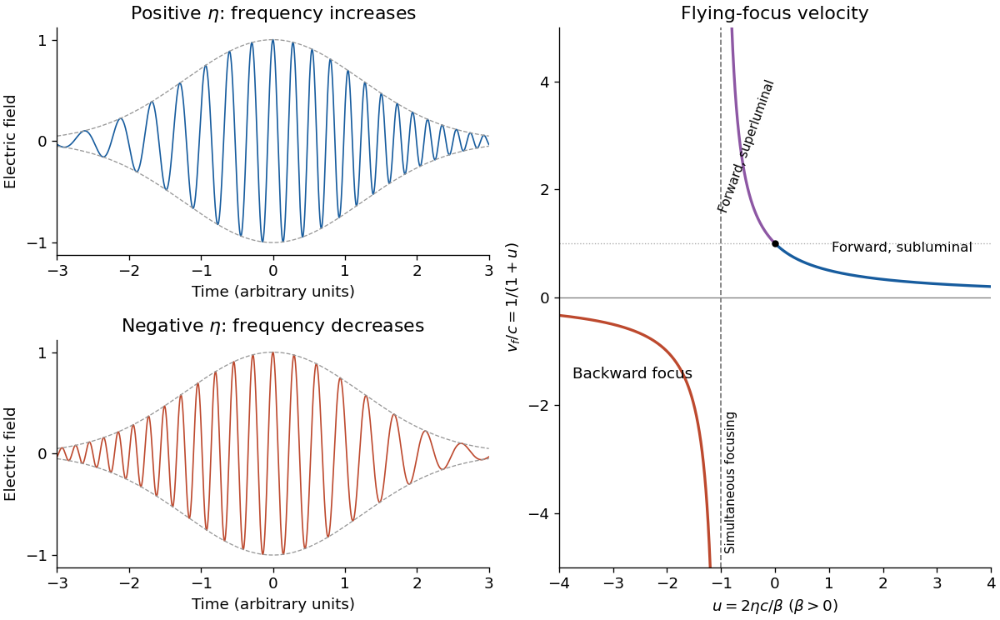

<h1 id="1/c/solution">Solution</h1>

↑ **Parent:** [C](../c.md)

A [chirp](../../../../chirp.md) is variation of the instantaneous [frequency](../../../../frequency.md) through a signal. Here the [group delay](../../../../group-delay.md) relative to the pulse centre at the [optical lens](../../../../lens-optics.md) is

$$
t_{\rm in}(\omega)=\frac{d\psi}{d\omega}=2\eta(\omega-\omega_0).
$$

Consequently $\eta>0$ orders lower [frequencies](../../../../frequency.md) before higher [frequencies](../../../../frequency.md); $\eta<0$ reverses that ordering. A representative strongly chirped [optical pulse](../../../../optical-pulse.md) is

$$
E(t)=A(t)\cos\!\left(\omega_0t+\frac{t^2}{4\eta}+\phi_0\right),
\qquad \omega_{\rm inst}(t)=\omega_0+\frac{t}{2\eta},
$$

with a smooth localized envelope $A(t)$. The carrier oscillations become closer together towards later times for positive $\eta$ and farther apart for negative $\eta$.

The relation between the [spectral phase](../../../../spectral-phase.md) and a locally assigned instantaneous [frequency](../../../../frequency.md) is a [stationary phase method](../../../../stationary-phase-method.md), not an exact reconstruction from [spectral phase](../../../../spectral-phase.md) alone: the spectral [wave amplitude](../../../../wave-amplitude.md) also matters. For example, if the spectral envelope is $e^{-(\omega-\omega_0)^2/(2\sigma^2)}$, a [Fourier transform of a Gaussian](../../../../fourier-transform-of-a-gaussian.md) gives the exact real-field [phase](../../../../phase-waves.md) $\omega_0t+\eta t^2/(4|a|^2)$ up to a constant, where $a=1/(2\sigma^2)-i\eta$. The slope retains the sign of $\eta$ and approaches $1/(2\eta)$ for $|\eta|\sigma^2\gg1$.

**[Figure 1](#1/c/image-opposite-chirps-and-the-velocity-branches-of-a-flying-focus). Opposite chirps and the velocity branches of a flying focus**.

## ↑ Ancestors (12)

1. [C](../c.md)
2. [1](../../1.md)
3. [2021](../../../2021-split.md)
4. [Past exam of the laser science and quantum information processing course of the University of Oxford](../../../split.md)
5. [Laser science and quantum information processing course of the University of Oxford](../../../../laser-science-and-quantum-information-processing-course-of-the-university-of-oxford.md)
6. [Year 4 of the physics course of the University of Oxford](../../../../year-4-of-the-physics-course-of-the-university-of-oxford.md)
7. [Physics course of the University of Oxford](../../../../physics-course-of-the-university-of-oxford.md)
8. [Undergraduate course of the University of Oxford](../../../../undergraduate-course-of-the-university-of-oxford.md)
9. [Course of the University of Oxford](../../../../course-of-the-university-of-oxford.md)
10. [University of Oxford](../../../../university-of-oxford-split.md)
11. [List of universities](../../../../list-of-universities.md)
12. [Codex Wiki](../../../../split.md)
