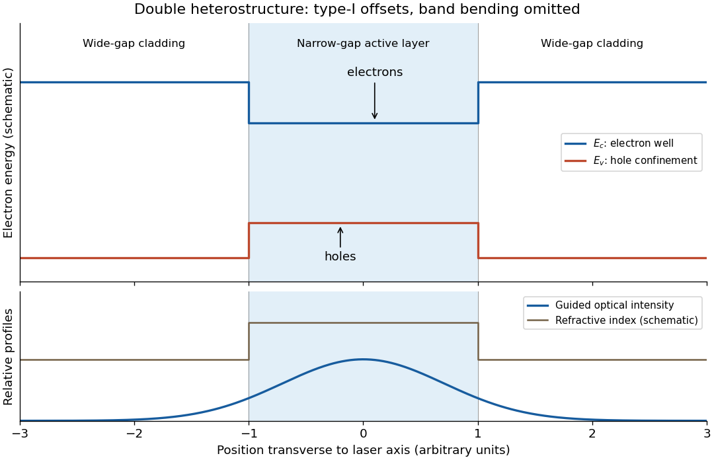

<h1 id="2/d/solution">Solution</h1>

↑ **Parent:** [D](../d.md)

A [double heterostructure laser](../../../../double-heterostructure-laser.md) sandwiches a narrow-[band gap](../../../../band-gap.md) active layer between wider-[band gap](../../../../band-gap.md) cladding layers. In a [type-I band alignment](../../../../type-i-band-alignment.md), the [conduction band](../../../../conduction-band.md) edge is lower and the [valence band](../../../../valence-band.md) edge higher in the active layer. [Electrons](../../../../electron.md) therefore see an [energy](../../../../energy-split.md) well, and [electron holes](../../../../electron-hole.md) also see a well because their excitation [energy](../../../../energy-split.md) increases when the [valence band](../../../../valence-band.md) edge decreases. Both carrier populations remain concentrated where [stimulated emission](../../../../stimulated-emission.md) occurs.

**[Figure 2](#2/d/image-carrier-and-optical-confinement-in-a-schematic-double-heterostructure-laser). Carrier and optical confinement in a schematic double heterostructure laser**.

The active layer also normally has the higher [refractive index](../../../../refractive-index.md), forming an [optical waveguide](../../../../optical-waveguide.md). The optical [normal mode](../../../../normal-mode.md) overlaps the injected carriers strongly, and the wider-[band gap](../../../../band-gap.md) cladding has less interband [absorption](../../../../absorption-electromagnetic-radiation.md) at the emitted [photon energy](../../../../photon-energy.md). Carrier confinement reduces leakage, while optical confinement reduces the required pump current and hence heating.

Writing $\Gamma$ for the fraction of the optical [normal mode](../../../../normal-mode.md) overlapping the active layer, the threshold condition is $\Gamma g=\alpha_i+\alpha_m$, with internal and mirror losses $\alpha_i,\alpha_m$. A larger overlap and a higher carrier [number density](../../../../number-density.md) at a given current both lower the threshold current. The figure shows composition-induced offsets; a working junction also has [band bending](../../../../band-bending.md) under bias, which is omitted to make the confinement mechanism visible.

## ↑ Ancestors (12)

1. [D](../d.md)
2. [2](../../2.md)
3. [2021](../../../2021-split.md)
4. [Past exam of the laser science and quantum information processing course of the University of Oxford](../../../split.md)
5. [Laser science and quantum information processing course of the University of Oxford](../../../../laser-science-and-quantum-information-processing-course-of-the-university-of-oxford.md)
6. [Year 4 of the physics course of the University of Oxford](../../../../year-4-of-the-physics-course-of-the-university-of-oxford.md)
7. [Physics course of the University of Oxford](../../../../physics-course-of-the-university-of-oxford.md)
8. [Undergraduate course of the University of Oxford](../../../../undergraduate-course-of-the-university-of-oxford.md)
9. [Course of the University of Oxford](../../../../course-of-the-university-of-oxford.md)
10. [University of Oxford](../../../../university-of-oxford-split.md)
11. [List of universities](../../../../list-of-universities.md)
12. [Codex Wiki](../../../../split.md)
