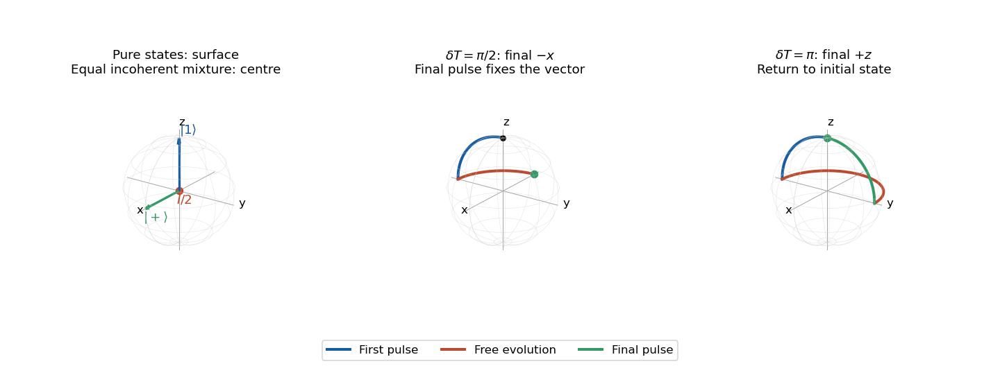

<h1 id="3/a/solution">Solution</h1>

↑ **Parent:** [A](../a.md)

Use the source's north-pole assignment $|1\rangle\leftrightarrow(0,0,1)$. Fix the ordered [basis](../../../../basis.md) as $(|1\rangle,|0\rangle)$ and use the standard [Pauli matrices](../../../../pauli-matrices.md) in that order, so

$$
\rho=\tfrac12(I+\mathbf r\cdot\boldsymbol\sigma),\qquad
\rho_{11}=\tfrac12(1+r_z).
$$

A [pure state](../../../../pure-state.md) has $|\mathbf r|=1$: examples are $|1\rangle$ at the north pole and $(|1\rangle+|0\rangle)/\sqrt2$ at $(1,0,0)$. An incoherent [mixed state](../../../../mixed-state.md)

$$
\rho=p|1\rangle\langle1|+(1-p)|0\rangle\langle0|
$$

has $\mathbf r=(0,0,2p-1)$ inside the [Bloch sphere](../../../../bloch-sphere.md). At $p=1/2$ it is the origin, distinct from an equatorial [pure state](../../../../pure-state.md) despite equal populations. The distinction is the off-diagonal [quantum coherence](../../../../quantum-coherence-in-a-specified-basis.md) of the [density matrix](../../../../density-matrix-split.md).

**[Figure 3](#3/a/image-pure-states-an-incoherent-mixed-state-and-two-complete-ramsey-interferometry-trajectories). Pure states, an incoherent mixed state, and two complete Ramsey interferometry trajectories**.

## ↑ Ancestors (12)

1. [A](../a.md)
2. [3](../../3.md)
3. [2021](../../../2021-split.md)
4. [Past exam of the laser science and quantum information processing course of the University of Oxford](../../../split.md)
5. [Laser science and quantum information processing course of the University of Oxford](../../../../laser-science-and-quantum-information-processing-course-of-the-university-of-oxford.md)
6. [Year 4 of the physics course of the University of Oxford](../../../../year-4-of-the-physics-course-of-the-university-of-oxford.md)
7. [Physics course of the University of Oxford](../../../../physics-course-of-the-university-of-oxford.md)
8. [Undergraduate course of the University of Oxford](../../../../undergraduate-course-of-the-university-of-oxford.md)
9. [Course of the University of Oxford](../../../../course-of-the-university-of-oxford.md)
10. [University of Oxford](../../../../university-of-oxford-split.md)
11. [List of universities](../../../../list-of-universities.md)
12. [Codex Wiki](../../../../split.md)
