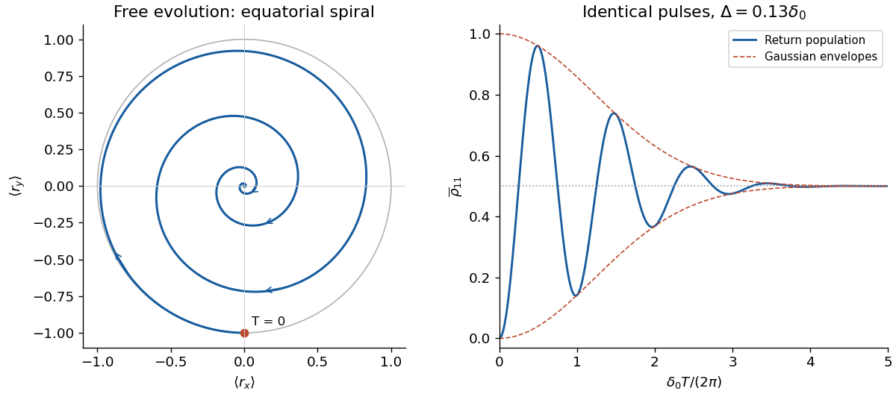

<h1 id="3/d/solution">Solution</h1>

↑ **Parent:** [D](../d.md)

Interpret the unspecified Gaussian width $\Delta$ as the [standard deviation](../../../../standard-deviation.md), so

$$
p(\delta)=\frac1{\sqrt{2\pi}\Delta}
\exp\!\left[-\frac{(\delta-\delta_0)^2}{2\Delta^2}\right].
$$

The [characteristic function](../../../../characteristic-function-split.md) of this [Gaussian distribution](../../../../normal-distribution.md) is

$$
\langle e^{i\delta T}\rangle=e^{i\delta_0T}e^{-\Delta^2T^2/2}.
$$

Average the free-evolution [Bloch vectors](../../../../bloch-vector.md) from part (c):

$$
\boxed{\langle\mathbf r(T)\rangle
=e^{-\Delta^2T^2/2}(-\sin\delta_0T,-\cos\delta_0T,0).}
$$

It starts at $-y$ and spirals towards the origin in the equatorial plane, with period $2\pi/\delta_0$ and shrinking length $e^{-\Delta^2T^2/2}$. Individual [pure states](../../../../pure-state.md) retain unit-length [Bloch vectors](../../../../bloch-vector.md); only ensemble averaging produces the apparent loss of [quantum coherence](../../../../quantum-coherence-in-a-specified-basis.md).

After the final pulse, the corrected return population is

$$
\boxed{\overline{\rho}_{11}(T)=\frac12\left[1-e^{-\Delta^2T^2/2}\cos(\delta_0T)\right].}
$$

The oscillations lie between $[1\pm e^{-\Delta^2T^2/2}]/2$, start at zero, and tend to $1/2$. The upper envelope has no implication of exponential energy relaxation: this is static inhomogeneous [dephasing](../../../../dephasing-channel.md). If instead the intended Gaussian convention was $p\propto e^{-(\delta-\delta_0)^2/\Delta^2}$, every envelope above becomes $e^{-\Delta^2T^2/4}$. The printed-plus-sign convention would give the complementary fringe.

**[Figure 4](#3/d/image-ensemble-dephasing-and-the-corrected-ramsey-interferometry-return-fringe-with-delta-a-standard-deviation). Ensemble dephasing and the corrected Ramsey interferometry return fringe, with $\Delta$ a standard deviation**.

## ↑ Ancestors (12)

1. [D](../d.md)
2. [3](../../3.md)
3. [2021](../../../2021-split.md)
4. [Past exam of the laser science and quantum information processing course of the University of Oxford](../../../split.md)
5. [Laser science and quantum information processing course of the University of Oxford](../../../../laser-science-and-quantum-information-processing-course-of-the-university-of-oxford.md)
6. [Year 4 of the physics course of the University of Oxford](../../../../year-4-of-the-physics-course-of-the-university-of-oxford.md)
7. [Physics course of the University of Oxford](../../../../physics-course-of-the-university-of-oxford.md)
8. [Undergraduate course of the University of Oxford](../../../../undergraduate-course-of-the-university-of-oxford.md)
9. [Course of the University of Oxford](../../../../course-of-the-university-of-oxford.md)
10. [University of Oxford](../../../../university-of-oxford-split.md)
11. [List of universities](../../../../list-of-universities.md)
12. [Codex Wiki](../../../../split.md)
