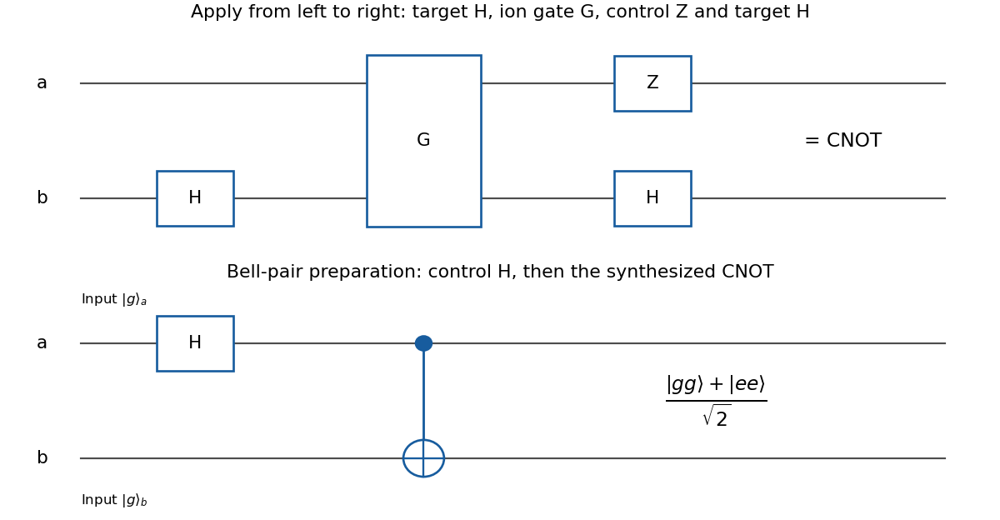

<h1 id="4/d/solution">Solution</h1>

↑ **Parent:** [D](../d.md)

The extra [Pauli gate](../../../../pauli-gate.md) on the control is removed by $Z_aG=C_Z$. Conjugating the target by a [Hadamard gate](../../../../hadamard-gate.md) then gives

$$
\boxed{C_X=(I\otimes H)(Z\otimes I)G(I\otimes H).}
$$

Thus, from left to right in the network, apply $H_b$, then $G$, then $Z_a$ and $H_b$; the last two gates commute.

**[Figure 5](#4/d/image-synthesis-of-a-cnot-gate-from-the-ion-gate-g-and-preparation-of-a-bell-pair). Synthesis of a CNOT gate from the ion gate $G$, and preparation of a Bell pair**.

For a direct proof, the control-zero block of $G$ is $I_b$ and its control-one block is $-Z_b$. Multiplication by $Z_a$ changes the latter into $Z_b$. Since $H_bI_bH_b=I_b$ and $H_bZ_bH_b=X_b$, the result is

$$
|g\rangle\langle g|_a\otimes I_b+|e\rangle\langle e|_a\otimes X_b,
$$

which is exactly the [CNOT gate](../../../../controlled-not-gate.md) on all inputs, including [quantum superpositions](../../../../quantum-superposition.md).

## ↑ Ancestors (12)

1. [D](../d.md)
2. [4](../../4.md)
3. [2021](../../../2021-split.md)
4. [Past exam of the laser science and quantum information processing course of the University of Oxford](../../../split.md)
5. [Laser science and quantum information processing course of the University of Oxford](../../../../laser-science-and-quantum-information-processing-course-of-the-university-of-oxford.md)
6. [Year 4 of the physics course of the University of Oxford](../../../../year-4-of-the-physics-course-of-the-university-of-oxford.md)
7. [Physics course of the University of Oxford](../../../../physics-course-of-the-university-of-oxford.md)
8. [Undergraduate course of the University of Oxford](../../../../undergraduate-course-of-the-university-of-oxford.md)
9. [Course of the University of Oxford](../../../../course-of-the-university-of-oxford.md)
10. [University of Oxford](../../../../university-of-oxford-split.md)
11. [List of universities](../../../../list-of-universities.md)
12. [Codex Wiki](../../../../split.md)
