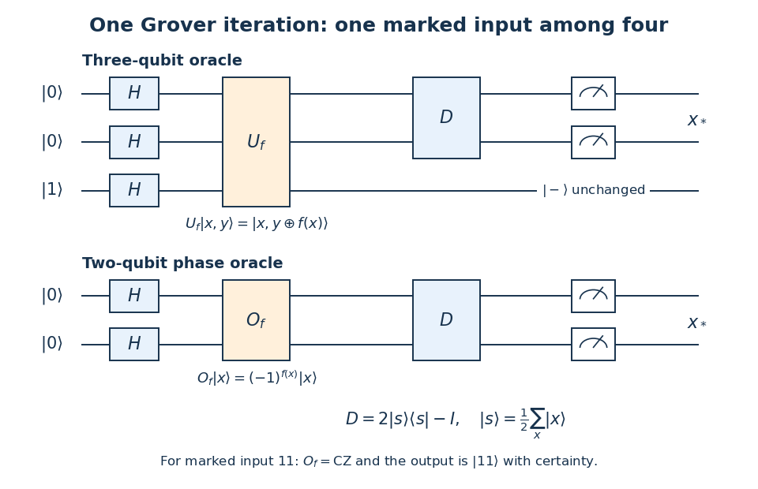

# 2022

↑ **Parent:** [Past exam of the laser science and quantum information processing course of the University of Oxford](../past-exam-of-the-laser-science-and-quantum-information-processing-course-of-the-university-of-oxford.md)

Source: [https://www.whatdotheyknow.com/request/oxford_physics_past_papers_2/response/2340696/attach/10/Physics%20Papers%202021.pdf?cookie_passthrough=1](https://www.whatdotheyknow.com/request/oxford_physics_past_papers_2/response/2340696/attach/10/Physics%20Papers%202021.pdf?cookie_passthrough=1)

Source bundle pages 25–30. The cover establishes 2022 despite the attachment filename. The solutions use the original PDF's port labels and distinguish signed carrier-phase conventions.

**Table of contents**

- [1](#1)
  - [a](#1/a)
    - [i](#1/a/i)
      - [Solution](#1/a/i/solution)
    - [ii](#1/a/ii)
      - [Solution](#1/a/ii/solution)
  - [b](#1/b)
    - [Solution](#1/b/solution)
  - [c](#1/c)
    - [Solution](#1/c/solution)
  - [d](#1/d)
    - [Solution](#1/d/solution)
- [2](#2)
  - [a](#2/a)
    - [Solution](#2/a/solution)
  - [b](#2/b)
    - [Solution](#2/b/solution)
  - [c](#2/c)
    - [Solution](#2/c/solution)
  - [d](#2/d)
    - [Solution](#2/d/solution)
- [3](#3)
  - [a](#3/a)
    - [Solution](#3/a/solution)
  - [b](#3/b)
    - [Solution](#3/b/solution)
  - [c](#3/c)
    - [Solution](#3/c/solution)
  - [d](#3/d)
    - [Solution](#3/d/solution)
  - [e](#3/e)
    - [Solution](#3/e/solution)
- [4](#4)
  - [a](#4/a)
    - [Solution](#4/a/solution)
  - [b](#4/b)
    - [Solution](#4/b/solution)
  - [c](#4/c)
    - [Solution](#4/c/solution)
- [5](#5)
  - [a](#5/a)
    - [Solution](#5/a/solution)
  - [b](#5/b)
    - [Solution](#5/b/solution)
  - [c](#5/c)
    - [Solution](#5/c/solution)
  - [d](#5/d)
    - [Solution](#5/d/solution)
  - [e](#5/e)
    - [Solution](#5/e/solution)
- [6](#6)
  - [a](#6/a)
    - [Solution](#6/a/solution)
  - [b](#6/b)
    - [Solution](#6/b/solution)
  - [c](#6/c)
    - [Solution](#6/c/solution)
  - [d](#6/d)
    - [Solution](#6/d/solution)

## 1

↑ **Parent:** [2022](2022.md)

<h3 id="1/a">a</h3>

↑ **Parent:** [1](#1)

<h4 id="1/a/i">i</h4>

↑ **Parent:** [A](#1/a)

<h5 id="1/a/i/solution">Solution</h5>

↑ **Parent:** [I](#1/a/i)

In [Q-switching](../laser.md#q-switching), hold the [optical resonator](../optical-instrument.md#optical-cavity)'s [quality factor](../dynamical-systems.md#q-factor) low while pumping builds [population inversion](../laser.md#population-inversion), then rapidly reduce the loss. The stored excitation produces a large [optical gain](../laser.md#optical-gain), the intracavity [light intensity](../wave.md#light-intensity) grows, and [stimulated emission](../laser.md#stimulated-emission) depletes the [population inversion](../laser.md#population-inversion) until the [optical gain](../laser.md#optical-gain) falls below the [laser threshold](../laser.md#laser-threshold). The resulting [optical pulse](../optics.md#optical-pulse) is a transient discharge of stored excitation.

Its duration depends on the high-[quality factor](../dynamical-systems.md#q-factor) [photon lifetime](../optical-instrument.md#photon-lifetime), initial [population inversion](../laser.md#population-inversion), saturation dynamics and switching time. For example, a simple [laser rate equation](../laser.md#laser-rate-equation) model is

$$
\dot S=(g(N)-\tau_c^{-1})S,\qquad
\dot N=R_p-N/\tau_u-g(N)S,
$$

where $S$ is intracavity [photon number](../quantum-harmonic-oscillator.md#photon-number), $N$ is the available inversion in compatible units, $R_p$ is the pump rate and $\tau_c$ is the [photon lifetime](../optical-instrument.md#photon-lifetime). During the short discharge, pumping and upper-state decay can often be neglected. The build-up and depletion rates determine the width; there is no universal equality between the width and $\tau_c$. The initially stored [energy](../energy.md) and the output coupling also matter. Typical [Q-switching](../laser.md#q-switching) produces nanosecond-scale [optical pulses](../optics.md#optical-pulse).

<h4 id="1/a/ii">ii</h4>

↑ **Parent:** [A](#1/a)

<h5 id="1/a/ii/solution">Solution</h5>

↑ **Parent:** [Ii](#1/a/ii)

In [mode locking](../laser.md#mode-locking), fixed relative [phases](../wave.md#phase-waves) between many longitudinal [normal modes](../wave-equation.md#normal-mode) produce constructive [interference](../physical-optics.md#interference-wave-propagation) during a short part of each [optical resonator](../optical-instrument.md#optical-cavity) round trip. The round-trip time sets the repetition period. The available coherent [gain bandwidth](../laser.md#gain-bandwidth), the number of locked [normal modes](../wave-equation.md#normal-mode), the [spectral phase](../physical-optics.md#spectral-phase), and residual [group velocity dispersion](../dispersion-relation.md#group-velocity-dispersion) determine the [optical pulse](../optics.md#optical-pulse) duration.

For $M$ consecutive equally weighted [normal modes](../wave-equation.md#normal-mode) of [angular frequency](../lagrangian-mechanics.md#angular-frequency) spacing $\Delta\omega$, their [wave amplitude](../wave.md#wave-amplitude) sum is proportional to

$$
\frac{\sin(M\Delta\omega t/2)}{\sin(\Delta\omega t/2)}.
$$

Its central peak has width of order $1/(M\Delta\omega)$, while its repetition period is $2\pi/\Delta\omega$. A [transform-limited pulse](../optics.md#transform-limited-pulse) therefore becomes shorter as more coherent [gain bandwidth](../laser.md#gain-bandwidth) is used. This mechanism can give picosecond or femtosecond [optical pulses](../optics.md#optical-pulse): it does not require depletion of the whole stored [population inversion](../laser.md#population-inversion) during each peak, as [Q-switching](../laser.md#q-switching) does. [Mode locking](../laser.md#mode-locking) generally accesses a much shorter [time-bandwidth product](../optics.md#time-bandwidth-product) scale than the gain-discharge time of [Q-switching](../laser.md#q-switching).

<h3 id="1/b">b</h3>

↑ **Parent:** [1](#1)

<h4 id="1/b/solution">Solution</h4>

↑ **Parent:** [B](#1/b)

Use the complex [electric field](../electric-field.md) convention $e^{-i\omega t}$ and take the locked [wave amplitudes](../wave.md#wave-amplitude) $a(\omega_p)$ to be real and nonnegative after extracting their common [phase](../wave.md#phase-waves). Linear [superposition](../vector-space.md#superposition-principle) gives

$$
E(t)=\sum_p a(\omega_p)e^{-i\omega_pt+i\phi_0}
=e^{-i(\omega_{\rm ce}t-\phi_0)}\sum_p a(\omega_p)e^{-ip\Delta\omega t}.
$$

The leading factor has unit modulus, so it does not change the [light intensity](../wave.md#light-intensity). The [triangle inequality](../topological-analysis.md#triangle-inequality) bounds the remaining modulus by $\sum_pa(\omega_p)$. Consecutive occupied [normal modes](../wave-equation.md#normal-mode) attain this bound together at

$$
\boxed{t_m=mT,\qquad T=\frac{2\pi}{\Delta\omega},\qquad m=1,2,\ldots.}
$$

There is also a peak at $t=0$. The [electric field](../electric-field.md) obeys $E(t+T)=e^{-i\omega_{\rm ce}T}E(t)$, although the [light intensity](../wave.md#light-intensity) is periodic.

The [carrier-envelope phase](../optics.md#carrier-envelope-phase) specifies where the carrier oscillation lies relative to the maximum of an [optical pulse](../optics.md#optical-pulse)'s envelope. With $s=t-t_m$ and $E=F(s)e^{-i\omega_0s+i\psi_m}$, the signed complex-field [phase](../wave.md#phase-waves) at the envelope maximum is $\psi_m$. Consequently,

$$
\boxed{\psi_{m+1}-\psi_m=-\omega_{\rm ce}T
=-\frac{2\pi\omega_{\rm ce}}{\Delta\omega}\pmod{2\pi}.}
$$

If instead the real [electric field](../electric-field.md) is written $F(s)\cos(\omega_0s+\phi_{{\rm CE},m})$, then $\phi_{{\rm CE},m}=-\psi_m$ and the conventionally quoted slip is $\phi_{\rm slip}=+2\pi\omega_{\rm ce}/\Delta\omega$. These are the same physical shift with opposite phase definitions.

The [carrier-envelope phase](../optics.md#carrier-envelope-phase) matters for few-cycle [optical pulses](../optics.md#optical-pulse), when the largest instantaneous [electric field](../electric-field.md) affects strong-field dynamics, for [high harmonic generation](../laser.md#high-harmonic-generation), and for stabilizing an [optical frequency comb](../laser.md#optical-frequency-comb). An ordinary cycle-averaged [light intensity](../wave.md#light-intensity) measurement does not determine it.

<h3 id="1/c">c</h3>

↑ **Parent:** [1](#1)

<h4 id="1/c/solution">Solution</h4>

↑ **Parent:** [C](#1/c)

Put $b=\Delta\omega_b>0$ and $s=t-t_m$. At the peak time, $e^{-ip\Delta\omega t_m}=1$, so the exact comb sum becomes

$$
E(t_m+s)=Ae^{i\phi_0-i\omega_{\rm ce}t_m}
\sum_p e^{-[(\omega_p-\omega_0)/b]^2}e^{-i\omega_ps}.
$$

For many occupied [normal modes](../wave-equation.md#normal-mode), $b\gg\Delta\omega$, replace the sum by an [integral](../integral.md) with density $1/\Delta\omega$. Setting $x=\omega-\omega_0$ and evaluating the [Fourier transform of a Gaussian](../fourier-analysis.md#fourier-transform-of-a-gaussian) gives

$$
\begin{aligned}
E(t_m+s)&\simeq\frac{A}{\Delta\omega}e^{i\phi_0-i\omega_{\rm ce}t_m}
\int_{-\infty}^{\infty}e^{-[(\omega-\omega_0)/b]^2}e^{-i\omega s}\,d\omega\\
&=\frac{A\sqrt\pi b}{\Delta\omega}
 e^{-b^2s^2/4}e^{-i\omega_0s}e^{i\phi_0-i\omega_{\rm ce}t_m}.
\end{aligned}
$$

Thus the isolated-[optical pulse](../optics.md#optical-pulse) approximation has

$$
\boxed{F(s)=\frac{A\sqrt\pi\,\Delta\omega_b}{\Delta\omega}
 e^{-(\Delta\omega_b s/2)^2},\qquad
\psi_m=\phi_0-\omega_{\rm ce}t_m.}
$$

The [optical pulse](../optics.md#optical-pulse) has a [Gaussian function](../calculus.md#gaussian-function) envelope and no [chirp](../wave.md#chirp). Its carrier [angular frequency](../lagrangian-mechanics.md#angular-frequency) is $\omega_0$, and its [light intensity](../wave.md#light-intensity) [full width at half maximum](../analysis.md#full-width-at-half-maximum) is $2\sqrt{2\ln2}/b$. Successive envelope maxima have different [carrier-envelope phases](../optics.md#carrier-envelope-phase), consistent with [b](#1/b).

**Approximation in the printed assertion.** A discrete [optical frequency comb](../laser.md#optical-frequency-comb) gives a train, not one exact isolated [Gaussian pulse](../optics.md#gaussian-pulse). Applying the [Poisson summation formula](../fourier-analysis.md#poisson-summation-formula) to the ideal sum over all [integers](../integer.md) instead gives

$$
E(t)=\frac{A\sqrt\pi b}{\Delta\omega}
\sum_{j\in\mathbb Z}e^{-b^2(t-jT)^2/4}
 e^{-i\omega_0(t-jT)}e^{i\phi_0-i\omega_{\rm ce}jT}.
$$

Near $t_m$, the $j=m$ term dominates when $bT\gg1$. The other terms are exponentially small but not identically zero. A single [Gaussian function](../calculus.md#gaussian-function) used globally would decay between $0$ and $T$, whereas the exact [light intensity](../wave.md#light-intensity) has equal maxima there; this supplies a concrete reason the isolated form cannot be an exact global identity. The extension to negative [frequencies](../wave.md#frequency) is the usual narrow-positive-band analytic-field approximation when $\omega_0\gg b$.

<h3 id="1/d">d</h3>

↑ **Parent:** [1](#1)

<h4 id="1/d/solution">Solution</h4>

↑ **Parent:** [D](#1/d)

In [second-harmonic generation](../optics.md#second-harmonic-generation), the quadratic [nonlinear polarization](../optics.md#nonlinear-polarization) contains products of pairs of comb components. Their [angular frequencies](../lagrangian-mechanics.md#angular-frequency) are

$$
\omega_p+\omega_q=2\omega_{\rm ce}+(p+q)\Delta\omega,
$$

including $2\omega_p$ when $p=q$. Original comb components have [angular frequencies](../lagrangian-mechanics.md#angular-frequency) $\omega_r=\omega_{\rm ce}+r\Delta\omega$, hence

$$
(\omega_p+\omega_q)-\omega_r
=\omega_{\rm ce}+(p+q-r)\Delta\omega.
$$

When the doubled low-[frequency](../wave.md#frequency) region overlaps the original high-[frequency](../wave.md#frequency) region, choosing $r=p+q$ gives the [beat](../physical-optics.md#beat) at $|\omega_{\rm ce}|$. More generally the nearest positive [beat](../physical-optics.md#beat) has [angular frequency](../lagrangian-mechanics.md#angular-frequency)

$$
\boxed{\omega_{\rm beat,min}
=\min_{k\in\mathbb Z}|\omega_{\rm ce}+k\Delta\omega|,}
$$

which is $|\omega_{\rm ce}|$ for the stipulated small offset. For $0\leq\omega_{\rm ce}<\Delta\omega$ it is $\min(\omega_{\rm ce},\Delta\omega-\omega_{\rm ce})$, provided the corresponding teeth are in the overlap.

In [comb self-referencing](../laser.md#comb-self-referencing), overlap the doubled red part and the original blue part on a [photodiode](../optical-instrument.md#photodiode). The [beat](../physical-optics.md#beat) measures the [carrier-envelope offset frequency](../laser.md#carrier-envelope-offset-frequency). Feedback on an intracavity dispersion control or pump setting can set $\omega_{\rm ce}=0$ modulo $\Delta\omega$, giving $\boxed{\phi_{\rm slip}=0\pmod{2\pi}}$. A phase-sensitive lock or calibrated approach to zero resolves the sign ambiguity of an unsigned [beat](../physical-optics.md#beat) measurement.[2000, comb self-referencing and stabilization of the pulse-to-pulse carrier phase](../physics-bibliography.md#carrier-envelope-phase-control-of-femtosecond-mode-locked-lasers-and-direct-optical-frequency-synthesis-by-david-j-jones-and-others)

The coherent [optical spectrum](../optics.md#optical-spectrum) must span an octave, $\omega_{\max}\gtrsim2\omega_{\min}$, with sufficient overlapping spectral strength after [second-harmonic generation](../optics.md#second-harmonic-generation). This calls for very short broadband [optical pulses](../optics.md#optical-pulse), or coherent external spectral broadening. The two branches must preserve [optical coherence](../physical-optics.md#optical-coherence), overlap in time and [polarization](../wave.md#polarization-waves), and have adequate [phase matching](../physical-optics.md#phase-matching); bandwidth alone does not guarantee a detectable [beat](../physical-optics.md#beat).

## 2

↑ **Parent:** [2022](2022.md)

<h3 id="2/a">a</h3>

↑ **Parent:** [2](#2)

<h4 id="2/a/solution">Solution</h4>

↑ **Parent:** [A](#2/a)

Use the [complex beam parameter](../physical-optics.md#complex-beam-parameter) convention

$$
\frac1q=\frac1{R_b}-i\frac{\lambda}{\pi w^2},\qquad q_{\rm waist}=iz_R.
$$

Here $R_b$ is the [wavefront](../physical-optics.md#wavefront) curvature, distinguished from the mirror curvature $R$. In an unfolded propagation coordinate, a concave mirror has the [ray transfer matrix](../geometrical-optics.md#ray-transfer-matrix-analysis) $\left(\begin{smallmatrix}1&0\\-2/R&1\end{smallmatrix}\right)$: a ray at height $x$ changes direction by $-2x/R$. The return to the original plane is therefore

$$
M=\begin{pmatrix}1&L\\0&1\end{pmatrix}
\begin{pmatrix}1&0\\-2/R&1\end{pmatrix}
\begin{pmatrix}1&L\\0&1\end{pmatrix}
=\begin{pmatrix}1-2L/R&2L(1-L/R)\\-2/R&1-2L/R\end{pmatrix}.
$$

The [Gaussian beam](../physical-optics.md#gaussian-beam) transformation $q'=(Aq+B)/(Cq+D)$ gives

$$
\boxed{q'=\frac{(1-2L/R)iz_R+2L(1-L/R)}{1-2L/R-2iz_R/R}.}
$$

For $R=2L$, $M=\left(\begin{smallmatrix}0&L\\-1/L&0\end{smallmatrix}\right)$ and $q'=-L^2/q=iL^2/z_R$. The returning [Gaussian beam](../physical-optics.md#gaussian-beam) consequently has a [beam waist](../physical-optics.md#beam-waist) at the same plane, with

$$
\boxed{z_R'=L^2/z_R.}
$$

This alone does not make it the same [Gaussian beam](../physical-optics.md#gaussian-beam); equal [Rayleigh ranges](../physical-optics.md#rayleigh-length) require $z_R=L$.

Adding the plane mirror requires a self-consistent [optical resonator](../optical-instrument.md#optical-cavity) [normal mode](../wave-equation.md#normal-mode), $q'=q=iz_R$. Since $A=D$, the fixed-point equation reduces to $Cq^2=B$, giving

$$
\boxed{z_R=\sqrt{L(R-L)}=\sqrt{LR(1-L/R)}.}
$$

For a finite stable [Gaussian beam](../physical-optics.md#gaussian-beam), $0<L<R$. The same formula remains valid at $R=2L$, where self-consistency selects $z_R=L$. At the geometrical hemispherical limit $R=L$ it predicts $z_R=0$; that marginal boundary has no finite-width stable fundamental [Gaussian beam](../physical-optics.md#gaussian-beam). Thus the source's word “hemispherical” is used for the plano-concave family, including the near-hemispherical case below.

<h3 id="2/b">b</h3>

↑ **Parent:** [2](#2)

<h4 id="2/b/solution">Solution</h4>

↑ **Parent:** [B](#2/b)

Propagate from one [beam waist](../physical-optics.md#beam-waist) to the other, using the [optical lens](../geometrical-optics.md#lens-optics) [ray transfer matrix](../geometrical-optics.md#ray-transfer-matrix-analysis):

$$
M=P(v)L(f)P(u)
=\begin{pmatrix}1-v/f&u+v-uv/f\\-1/f&1-u/f\end{pmatrix}.
$$

[Optical mode matching](../optical-instrument.md#optical-mode-matching) requires $q_A=iz_A$ to transform to $q_B=iz_B$. Multiplying the denominator across gives

$$
iz_B(1-u/f-iz_A/f)=(1-v/f)iz_A+u+v-uv/f.
$$

Equating real and imaginary parts and multiplying by $f$ yields

$$
\boxed{v(u-f)+z_Az_B=uf,\qquad
vz_A-z_B(u-f)=z_Af.}
$$

Set $\delta=u-f$. The second equation gives $v=f+(z_B/z_A)\delta$. Substituting this into the first cancels the terms $f\delta$:

$$
\frac{z_B}{z_A}\delta^2+z_Az_B=f^2.
$$

Consequently the two algebraic branches are

$$
\boxed{\delta=\pm\sqrt{\frac{z_A}{z_B}f^2-z_A^2},\qquad
u=f\pm z_A\sqrt{\frac{f^2}{z_Az_B}-1},\qquad
v=f\pm z_B\sqrt{\frac{f^2}{z_Az_B}-1}.}
$$

Equivalently, $u=f+\delta$. The signs in $u$ and $v$ are the same. Real solutions require $\boxed{f^2\geq z_Az_B}$; a converging [optical lens](../geometrical-optics.md#lens-optics) therefore needs $f\geq\sqrt{z_Az_B}$. At equality $u=v=f$. For the stated arrangement, additionally require $u,v\geq0$ and that the chosen [optical lens](../geometrical-optics.md#lens-optics) position is accessible outside both [optical resonators](../optical-instrument.md#optical-cavity). A negative $v$ is an algebraic virtual-waist solution, not a downstream [beam waist](../physical-optics.md#beam-waist).

<h3 id="2/c">c</h3>

↑ **Parent:** [2](#2)

<h4 id="2/c/solution">Solution</h4>

↑ **Parent:** [C](#2/c)

The source [optical resonator](../optical-instrument.md#optical-cavity) has [Rayleigh range](../physical-optics.md#rayleigh-length)

$$
z_A=\sqrt{L_1(R_1-L_1)}=\sqrt{1\times0.010}\,\mathrm m=0.100\,\mathrm m.
$$

The symmetric target [optical resonator](../optical-instrument.md#optical-cavity) has its fundamental [Gaussian beam](../physical-optics.md#gaussian-beam) [beam waist](../physical-optics.md#beam-waist) halfway between the mirrors. At distance $\ell=L_2/2$ from that [beam waist](../physical-optics.md#beam-waist), [wavefront](../physical-optics.md#wavefront) curvature is $R_2=\ell+z_B^2/\ell$. Thus

$$
z_B=\sqrt{\frac{L_2}{2}\left(R_2-\frac{L_2}{2}\right)}
=\sqrt{75}\,\mathrm m\simeq8.66025\,\mathrm m.
$$

Here $f^2=2.25\,\mathrm{m^2}>z_Az_B=0.866025\,\mathrm{m^2}$, so [b](#2/b) gives two real branches:

$$
\boxed{(u,v)\simeq(1.62642,12.44786)\,\mathrm m
\quad\hbox{or}\quad(1.37358,-9.44786)\,\mathrm m.}
$$

Only the first branch has the target [beam waist](../physical-optics.md#beam-waist) downstream of the [optical lens](../geometrical-optics.md#lens-optics). It is also geometrically accessible: the [optical lens](../geometrical-optics.md#lens-optics) is $u-L_1\simeq0.62642\,\mathrm m$ beyond the source output mirror, and the target input mirror is $v-L_2/2\simeq7.44786\,\mathrm m$ beyond the [optical lens](../geometrical-optics.md#lens-optics). The total separation between [beam waists](../physical-optics.md#beam-waist) is $u+v\simeq14.07428\,\mathrm m$.

<h3 id="2/d">d</h3>

↑ **Parent:** [2](#2)

<h4 id="2/d/solution">Solution</h4>

↑ **Parent:** [D](#2/d)

For a symmetric [confocal optical resonator](../optical-instrument.md#confocal-optical-resonator), the mirror separation equals either mirror's curvature, $R_2=L_2$, so its symmetric fundamental [Gaussian beam](../physical-optics.md#gaussian-beam) has

$$
\boxed{z_B=L_2/2.}
$$

The same [optical mode matching](../optical-instrument.md#optical-mode-matching) calculation applies, now with $f_{\min}=\sqrt{z_AL_2/2}$. Keeping the example's $L_2=10\,\mathrm m$ gives $z_B=5\,\mathrm m$ and $f_{\min}=0.707107\,\mathrm m$, compared with $0.930605\,\mathrm m$ for the nonconfocal target. With $f=1.5\,\mathrm m$, the two branches become

$$
\boxed{(u,v)\simeq(1.68708,10.85414)\,\mathrm m
\quad\hbox{or}\quad(1.31292,-7.85414)\,\mathrm m.}
$$

Again only the positive-$v$ branch fits the stated downstream geometry. The confocal target's smaller [Rayleigh range](../physical-optics.md#rayleigh-length) means a smaller fundamental [beam waist](../physical-optics.md#beam-waist) at the same [wavelength](../wave-equation.md#wavelength) and a less stringent minimum $f$.

A [confocal optical resonator](../optical-instrument.md#confocal-optical-resonator) also has transverse [normal mode](../wave-equation.md#normal-mode) degeneracies: in the ideal paraxial spectrum, increasing transverse order by two shifts the resonance by one longitudinal spacing. Such a cavity can transmit combinations of higher transverse [normal modes](../wave-equation.md#normal-mode) at a fundamental resonance, so transmitted [power](../energy.md#power) alone is a weaker diagnostic of pure fundamental [optical mode matching](../optical-instrument.md#optical-mode-matching). The degeneracy does not remove the [complex beam parameter](../physical-optics.md#complex-beam-parameter) matching requirement if the objective is specifically the symmetric fundamental [Gaussian beam](../physical-optics.md#gaussian-beam).

## 3

↑ **Parent:** [2022](2022.md)

<h3 id="3/a">a</h3>

↑ **Parent:** [3](#3)

<h4 id="3/a/solution">Solution</h4>

↑ **Parent:** [A](#3/a)

For one electromagnetic [normal mode](../wave-equation.md#normal-mode), $a$ and $a^\dagger$ are the [annihilation operator](../quantum-harmonic-oscillator.md#annihilation-operator) and [creation operator](../quantum-harmonic-oscillator.md#creation-operator), with [commutator](../lie-algebra.md#commutator) $[a,a^\dagger]=I$. Their action on normalized [number states](../quantum-harmonic-oscillator.md#number-state) is

$$
a|n\rangle=\sqrt n\,|n-1\rangle,\qquad
a^\dagger|n\rangle=\sqrt{n+1}\,|n+1\rangle.
$$

They remove or add one [photon](../quantum-mechanics.md#photon), whose [energy](../energy.md) is $\hbar\omega$. The [vacuum state](../quantum-field-theory.md#vacuum-state) $|0\rangle$ is normalized and obeys $a|0\rangle=0$. It has no [photons](../quantum-mechanics.md#photon), but retains [zero-point energy](../quantum-harmonic-oscillator.md#zero-point-energy) $\hbar\omega/2$ for the [quantum harmonic oscillator](../quantum-harmonic-oscillator.md) [Hamiltonian](../hamiltonian-mechanics.md#hamiltonian) $H=\hbar\omega(a^\dagger a+1/2)$. The [coherent state](../quantum-theory.md#coherent-state) $|\alpha\rangle=D(\alpha)|0\rangle$ is a displaced [vacuum state](../quantum-field-theory.md#vacuum-state).

<h3 id="3/b">b</h3>

↑ **Parent:** [3](#3)

<h4 id="3/b/solution">Solution</h4>

↑ **Parent:** [B](#3/b)

Set $A=\alpha a^\dagger$ and $B=-\alpha^*a$. Their [commutator](../lie-algebra.md#commutator) is

$$
[A,B]=- |\alpha|^2[a^\dagger,a]=|\alpha|^2I.
$$

It commutes with both operators, so the stated [Baker--Campbell--Hausdorff formula](../linear-operator-theory.md#baker-campbell-hausdorff-formula) terminates:

$$
\boxed{D(\alpha)=e^{-|\alpha|^2/2}e^{\alpha a^\dagger}e^{-\alpha^*a}.}
$$

In particular $e^{-\alpha^*a}|0\rangle=|0\rangle$. Expanding the remaining exponential and using $(a^\dagger)^n|0\rangle=\sqrt{n!}|n\rangle$ gives the [number state](../quantum-harmonic-oscillator.md#number-state) expansion

$$
\boxed{|\alpha\rangle=e^{-|\alpha|^2/2}\sum_{n=0}^\infty\frac{\alpha^n}{\sqrt{n!}}|n\rangle.}
$$

The orthonormality of the [number states](../quantum-harmonic-oscillator.md#number-state) gives

$$
\boxed{P_n=e^{-|\alpha|^2}\frac{|\alpha|^{2n}}{n!}.}
$$

This is a [Poisson distribution](../discrete-probability-distribution.md#poisson-distribution) with parameter $\mu=|\alpha|^2$. Its probabilities sum to $e^{-\mu}e^\mu=1$. The phase of $\alpha$ affects the [coherent state](../quantum-theory.md#coherent-state)'s relative [probability amplitudes](../wave-function.md#probability-amplitude) but not its [photon number](../quantum-harmonic-oscillator.md#photon-number) probabilities. At $\alpha=0$ the distribution is concentrated at $n=0$.

<h3 id="3/c">c</h3>

↑ **Parent:** [3](#3)

<h4 id="3/c/solution">Solution</h4>

↑ **Parent:** [C](#3/c)

The [number operator](../quantum-harmonic-oscillator.md#number-operator) is $\hat N=a^\dagger a$. The [number state](../quantum-harmonic-oscillator.md#number-state) expansion gives $a|\alpha\rangle=\alpha|\alpha\rangle$ by shifting the summation index; taking the adjoint gives $\langle\alpha|a^\dagger=\alpha^*\langle\alpha|$. Thus the [expectation value](../quantum-system.md#expectation-value) is

$$
\overline N=\langle a^\dagger a\rangle=|\alpha|^2=\mu.
$$

For the second moment, use $aa^\dagger=a^\dagger a+I$:

$$
\hat N^2=a^\dagger aa^\dagger a=(a^\dagger)^2a^2+a^\dagger a.
$$

Its [expectation value](../quantum-system.md#expectation-value) in the [coherent state](../quantum-theory.md#coherent-state) is $\langle\hat N^2\rangle=|\alpha|^4+|\alpha|^2$. Therefore

$$
\boxed{\overline N=|\alpha|^2,\qquad
\operatorname{Var}(N)=\langle\hat N^2\rangle-\overline N^2=|\alpha|^2,\qquad
\sigma_N=|\alpha|.}
$$

The [variance](../variance.md) equals the mean, exactly as for the [Poisson distribution](../discrete-probability-distribution.md#poisson-distribution) found in [b](#3/b). For $\mu>0$ the fractional [standard deviation](../variance.md#standard-deviation) is $1/\sqrt\mu$, the usual [photon shot noise](../optical-instrument.md#photon-shot-noise) scaling. For the [vacuum state](../quantum-field-theory.md#vacuum-state), both the mean [photon number](../quantum-harmonic-oscillator.md#photon-number) and its [variance](../variance.md) vanish; this does not imply zero [optical quadrature](../quantum-optics.md#optical-quadrature) fluctuations. At $\mu=0$ the fractional fluctuation is undefined.

<h3 id="3/d">d</h3>

↑ **Parent:** [3](#3)

<h4 id="3/d/solution">Solution</h4>

↑ **Parent:** [D](#3/d)

For the normalized [coherent state](../quantum-theory.md#coherent-state), $\langle a\rangle=\alpha$ and $\langle a^\dagger\rangle=\alpha^*$. The dimensionless [electric field](../electric-field.md) and [magnetic field](../magnetic-field.md) [optical quadratures](../quantum-optics.md#optical-quadrature) consequently have [expectation values](../quantum-system.md#expectation-value)

$$
\boxed{\langle\mathcal E\rangle=\alpha+\alpha^*=2\operatorname{Re}\alpha,\qquad
\langle\mathcal B\rangle=-i(\alpha-\alpha^*)=2\operatorname{Im}\alpha.}
$$

The physical [electric field](../electric-field.md) and [magnetic field](../magnetic-field.md) strengths have the corresponding proportionality factors and mode functions. In free evolution replace $\alpha$ by $\alpha e^{-i\omega t}$ to recover the classical oscillation.

Expanding the squared operators cancels the $a^2$ and $(a^\dagger)^2$ terms:

$$
\mathcal E^2+\mathcal B^2=2(aa^\dagger+a^\dagger a)=4\hat N+2I.
$$

On the other hand, $(\alpha+\alpha^*)^2+[-i(\alpha-\alpha^*)]^2=4|\alpha|^2$. Hence

$$
\boxed{\langle\mathcal E^2+\mathcal B^2\rangle=4|\alpha|^2+2,\qquad
\langle\mathcal E\rangle^2+\langle\mathcal B\rangle^2=4|\alpha|^2.}
$$

The difference is the sum of the [variances](../variance.md), not an extra mean field. Indeed $\operatorname{Var}(\mathcal E)=\operatorname{Var}(\mathcal B)=1$, independent of $\alpha$. The [commutator](../lie-algebra.md#commutator) $[\mathcal E,\mathcal B]=2iI$ requires $\sigma_{\mathcal E}\sigma_{\mathcal B}\geq1$, and the [coherent state](../quantum-theory.md#coherent-state) attains equality. The residual two units are the [vacuum fluctuations](../quantum-theory.md#vacuum-fluctuation) of the two [optical quadratures](../quantum-optics.md#optical-quadrature).

<h3 id="3/e">e</h3>

↑ **Parent:** [3](#3)

<h4 id="3/e/solution">Solution</h4>

↑ **Parent:** [E](#3/e)

[Zero-point fields](../quantum-theory.md#vacuum-fluctuation) are the irreducible [electromagnetic field](../electromagnetism.md#electromagnetic-field) fluctuations in the [vacuum state](../quantum-field-theory.md#vacuum-state). Each [normal mode](../wave-equation.md#normal-mode) has ground [energy](../energy.md) $\hbar\omega/2$. Although $\langle\mathcal E\rangle=\langle\mathcal B\rangle=0$ in the [vacuum state](../quantum-field-theory.md#vacuum-state), [d](#3/d) gives $\langle\mathcal E^2\rangle=\langle\mathcal B^2\rangle=1$. These are quantum fluctuations, not a classical random coherent field with a known instantaneous value.

Two consequences are the [Lamb shift](../atomic-physics.md#lamb-shift), where coupling to the quantized [electromagnetic field](../electromagnetism.md#electromagnetic-field) changes atomic [energy levels](../quantum-mechanics.md#energy-level), and [spontaneous emission](../atomic-physics.md#spontaneous-emission), where an excited [chemical atom](../physics.md#atom-physics) can emit a [photon](../quantum-mechanics.md#photon) into an initially empty [normal mode](../wave-equation.md#normal-mode). In the latter process the [creation operator](../quantum-harmonic-oscillator.md#creation-operator) has a nonzero [matrix element](../vector-space.md#matrix-element) $\langle1|a^\dagger|0\rangle=1$; stimulated-plus-spontaneous factors have the form $n+1$, which does not vanish at $n=0$. Descriptions splitting [spontaneous emission](../atomic-physics.md#spontaneous-emission) into [vacuum fluctuations](../quantum-theory.md#vacuum-fluctuation) and radiation reaction depend on operator-ordering conventions; the measurable total rate does not. [Zero-point fields](../quantum-theory.md#vacuum-fluctuation) do not mean that the [vacuum state](../quantum-field-theory.md#vacuum-state) contains a nonzero mean [photon number](../quantum-harmonic-oscillator.md#photon-number).

## 4

↑ **Parent:** [2022](2022.md)

<h3 id="4/a">a</h3>

↑ **Parent:** [4](#4)

<h4 id="4/a/solution">Solution</h4>

↑ **Parent:** [A](#4/a)

The five [DiVincenzo criteria](../computer-science.md#divincenzo-criteria) are: a scalable collection of well-characterized [qubits](../quantum-system.md#qubit); preparation in a known fiducial [quantum state](../quantum-system.md#quantum-state); relevant coherence times long compared with [quantum gate](../quantum-circuit.md#quantum-logic-gate) times; a [universal quantum gate set](../quantum-circuit.md#universal-quantum-gate-set); and qubit-specific [quantum measurement](../quantum-measurement.md). The criterion is useful control of the whole computation, including errors, rather than merely observing two resolved levels.[Section III, numbered requirements 1–5; Section IV's two communication requirements are additional](../physics-bibliography.md#the-physical-implementation-of-quantum-computation-by-david-p-divincenzo)

For **trapped ions**, the implementation is:

- **Scalable characterized [qubits](../quantum-system.md#qubit).** Two long-lived [hyperfine structure](../quantum-mechanics.md#hyperfine-structure) levels or an optical ground/metastable pair in each [ion](../chemistry.md#ion) encode $|0\rangle,|1\rangle$. An [ion trap](../atomic-physics.md#ion-trap) confines individually addressed [ions](../chemistry.md#ion). Extending a chain adds [qubits](../quantum-system.md#qubit), but increasing motional complexity, addressing errors and heating limit straightforward scaling; segmented traps and transport can help.
- **Initialization.** [Optical pumping](../atomic-physics.md#optical-pumping) prepares the internal [quantum state](../quantum-system.md#quantum-state). [Doppler cooling](../atomic-physics.md#doppler-cooling) and, where required, [resolved sideband cooling](../atomic-physics.md#resolved-sideband-cooling) prepare the shared motion used for [quantum gates](../quantum-circuit.md#quantum-logic-gate).
- **Coherence.** Long-lived internal levels give coherence much longer than controlled pulse times. Magnetic noise, laser noise, scattering and motional heating cause [quantum decoherence](../quantum-theory.md#quantum-decoherence); suitable clock-state encodings and control reduce these errors.
- **Universal control.** Resonant optical, microwave or [Raman transitions](../atomic-physics.md#raman-transition) give arbitrary one-[qubit](../quantum-system.md#qubit) rotations. Shared motional [normal modes](../wave-equation.md#normal-mode), coupled through the [Coulomb force](../electrostatics.md#coulomb-force), mediate entangling [two-qubit gates](../quantum-circuit.md#two-qubit-gate). Together these supply a [universal quantum gate set](../quantum-circuit.md#universal-quantum-gate-set).
- **Readout.** State-selective cycling [fluorescence](../fluorescence.md), often with [electron shelving](../atomic-physics.md#electron-shelving), produces a bright/dark signal resolved for individual [ions](../chemistry.md#ion).

For **trapped neutral atoms**, the corresponding implementation is:

- **Scalable characterized [qubits](../quantum-system.md#qubit).** Long-lived ground-state [hyperfine structure](../quantum-mechanics.md#hyperfine-structure) levels encode [qubits](../quantum-system.md#qubit) in an [optical lattice](../optics.md#optical-lattice) or an array of [optical tweezers](../optics.md#optical-tweezers). Large arrays are feasible, but random loading, vacancies, atom loss and individual addressing must be controlled.
- **Initialization.** Cooling plus [optical pumping](../atomic-physics.md#optical-pumping) prepares the internal [quantum state](../quantum-system.md#quantum-state). Filling or rearranging traps prepares a usable register; motional cooling is needed when the chosen [quantum gate](../quantum-circuit.md#quantum-logic-gate) depends on motion.
- **Coherence.** Weak environmental coupling of neutral ground-state [chemical atoms](../physics.md#atom-physics) allows long coherence. Trap-light scattering, differential light shifts and magnetic noise limit it; switching traps or choosing suitable encodings can reduce these effects.
- **Universal control.** Microwave or [Raman transitions](../atomic-physics.md#raman-transition) implement one-[qubit](../quantum-system.md#qubit) rotations. Ground-state [chemical atoms](../physics.md#atom-physics) do not have the ions' long-range [Coulomb force](../electrostatics.md#coulomb-force), so that motional-bus construction cannot simply be copied. Controlled collisions or [Rydberg blockade](../atomic-physics.md#rydberg-blockade) can nevertheless supply entangling [two-qubit gates](../quantum-circuit.md#two-qubit-gate).
- **Readout.** State-dependent [fluorescence](../fluorescence.md) or state-selective removal followed by imaging identifies a chosen [qubit](../quantum-system.md#qubit). Optical resolution, cross-talk and atom loss constrain repeated measurements.

Thus neither platform is forbidden from meeting a criterion in principle. Weak neutral-ground-state interactions make entangling control harder, but claiming that trapped neutral atoms cannot implement a [universal quantum gate set](../quantum-circuit.md#universal-quantum-gate-set) would be false. Gate-model [quantum algorithms](../algorithm.md#quantum-algorithm) using [Rydberg blockade](../atomic-physics.md#rydberg-blockade) had already been demonstrated in a programmable neutral-atom processor by 2022.[Nature 604, 457–462 (2022), abstract and controlled-phase gate implementation](../physics-bibliography.md#multi-qubit-entanglement-and-algorithms-on-a-neutral-atom-quantum-computer-by-t-m-graham-and-others)

<h3 id="4/b">b</h3>

↑ **Parent:** [4](#4)

<h4 id="4/b/solution">Solution</h4>

↑ **Parent:** [B](#4/b)

Let $x\in\{00,01,10,11\}$ and let $f(x)$ be one only at the marked input. A three-[qubit](../quantum-system.md#qubit) implementation of [Grover's algorithm](../quantum-theory.md#grover-s-algorithm) starts with $|00\rangle|1\rangle$, applies a [Hadamard gate](../quantum-theory.md#hadamard-gate) to each [qubit](../quantum-system.md#qubit), queries the reversible [quantum oracle](../theoretical-computer-science.md#quantum-oracle) $U_f:|x,y\rangle\mapsto|x,y\mathbin\oplus f(x)\rangle$, applies the [Grover diffusion operator](../quantum-theory.md#grover-diffusion-operator) $D=2|s\rangle\langle s|-I$ to the first two [qubits](../quantum-system.md#qubit), and measures those two [qubits](../quantum-system.md#qubit) in the [computational basis](../quantum-theory.md#computational-basis). Here $|s\rangle=\tfrac12\sum_x|x\rangle$. The full three-wire [quantum circuit](../quantum-circuit.md) is the composition

$$
\boxed{|00\rangle|1\rangle
\xrightarrow{H^{\otimes3}}|s\rangle|-\rangle
\xrightarrow{U_f}(O_f|s\rangle)|-\rangle
\xrightarrow{D\otimes I}|x_*\rangle|-\rangle
\xrightarrow{\text{measure first two}}x_*.}
$$

**[Figure 1](#4/b/image-three-and-two-qubit-implementations-of-grover-s-algorithm-for-four-inputs). Three- and two-qubit implementations of Grover's algorithm for four inputs**.

Here $|-\rangle=(|0\rangle-|1\rangle)/\sqrt2$. Since $X|-\rangle=-|-\rangle$, [phase kickback](../quantum-theory.md#phase-kickback) gives $U_f(|x\rangle|-\rangle)=(-1)^{f(x)}|x\rangle|-\rangle$. The third [qubit](../quantum-system.md#qubit) remains separable and unchanged. A direct [marked-state phase oracle](../quantum-theory.md#marked-state-phase-oracle) $O_f|x\rangle=(-1)^{f(x)}|x\rangle$ therefore replaces the three-[qubit](../quantum-system.md#qubit) query using only two [qubits](../quantum-system.md#qubit):

$$
\boxed{|00\rangle\xrightarrow{H\otimes H}|s\rangle
\xrightarrow{O_f}O_f|s\rangle\xrightarrow{D}|x_*\rangle
\xrightarrow{\text{measure}}x_*.}
$$

For the explicit choice $f(x)=1$ only at $x=11$, $O_f$ is a [Controlled-Z gate](../quantum-theory.md#controlled-z-gate). Immediately after it,

$$
O_f|s\rangle=\tfrac12(|00\rangle+|01\rangle+|10\rangle-|11\rangle).
$$

The mean of these four [probability amplitudes](../wave-function.md#probability-amplitude) is $\overline a=1/4$. The [Grover diffusion operator](../quantum-theory.md#grover-diffusion-operator) maps each [probability amplitude](../wave-function.md#probability-amplitude) $a_x$ to $2\overline a-a_x$. The three unmarked [probability amplitudes](../wave-function.md#probability-amplitude) become zero and the marked one becomes one. A single query consequently finds $11$ with [probability](../probability-theory.md#probability) one.

A gate-level implementation of $D$ is $H^{\otimes2}(2|00\rangle\langle00|-I)H^{\otimes2}$. Up to an irrelevant [global phase](../quantum-system.md#global-phase), it is $H^{\otimes2}X^{\otimes2}\,\mathrm{CZ}\,X^{\otimes2}H^{\otimes2}$. For any other chosen marked word, conjugate the [Controlled-Z gate](../quantum-theory.md#controlled-z-gate) by [Pauli X gates](../quantum-theory.md#pauli-x-gate) on precisely the positions where the marked word has a zero.

<h3 id="4/c">c</h3>

↑ **Parent:** [4](#4)

<h4 id="4/c/solution">Solution</h4>

↑ **Parent:** [C](#4/c)

In [liquid-state NMR quantum computing](../computer-science.md#liquid-state-nmr-quantum-computing), use two distinguishable spin-$1/2$ [atomic nuclei](../atomic-nucleus.md) in one molecule as the two [qubits](../quantum-system.md#qubit). Their different resonance [frequencies](../wave.md#frequency) permit selective radiofrequency pulses for one-[qubit](../quantum-system.md#qubit) rotations. In a suitable rotating frame, refocusing removes unwanted one-spin terms while the [NMR scalar coupling](../nuclear-magnetic-resonance.md#nmr-scalar-coupling) supplies

$$
H_J=2\pi\hbar J I_zS_z=\frac{\pi\hbar J}{2}Z_1Z_2.
$$

Assuming $J>0$, free evolution for $t=1/(2J)$ implements $U_J=e^{-i\pi Z_1Z_2/4}$. Define $R_z(\theta)=e^{-i\theta Z/2}$. Then

$$
\boxed{\mathrm{CZ}=e^{-i\pi/4}
[R_z(-\pi/2)\otimes R_z(-\pi/2)]U_J.}
$$

This equality follows directly by evaluating the four diagonal entries: the first three are $+1$ and the $11$ entry is $-1$. Negative $J$ can be handled by refocusing or reversing the effective interaction sign. The [global phase](../quantum-system.md#global-phase) can be ignored.

Thus the [marked-state phase oracle](../quantum-theory.md#marked-state-phase-oracle) for $11$ requires scalar-coupling evolution and calibrated one-spin rotations. For a marked word $b_1b_2$, conjugate by $X_1^{1-b_1}X_2^{1-b_2}$, realized as selective $\pi$ pulses. The [Grover diffusion operator](../quantum-theory.md#grover-diffusion-operator) uses the same entangling operation with additional one-[qubit](../quantum-system.md#qubit) pulses. [Liquid-state NMR quantum computing](../computer-science.md#liquid-state-nmr-quantum-computing) usually reads an ensemble signal and often prepares an effective pseudo-pure deviation from a large mixed background; that reproduces this small [quantum algorithm](../algorithm.md#quantum-algorithm)'s signal without providing a scalable source of pure initialized [qubits](../quantum-system.md#qubit).

## 5

↑ **Parent:** [2022](2022.md)

<h3 id="5/a">a</h3>

↑ **Parent:** [5](#5)

<h4 id="5/a/solution">Solution</h4>

↑ **Parent:** [A](#5/a)

Assume $|\alpha|^2+|\beta|^2=1$. Let Alice's first recorded [quantum measurement](../quantum-measurement.md) outcome be $a\in\{0,1\}$. Immediately afterward she assigns the conditional [pure quantum state](../quantum-theory.md#pure-state) $|a\rangle$, with probabilities $p_0=|\alpha|^2$, $p_1=|\beta|^2$. Bob, who has no record, assigns the [density operator](../density-matrix.md)

$$
\boxed{\rho_{B,1}=|\alpha|^2|0\rangle\langle0|+|\beta|^2|1\rangle\langle1|.}
$$

This is a [nonselective quantum measurement](../quantum-measurement.md#nonselective-quantum-measurement), which removes the initial [computational basis](../quantum-theory.md#computational-basis) coherence. It is not generally the original [pure quantum state](../quantum-theory.md#pure-state).

After the [Hadamard gate](../quantum-theory.md#hadamard-gate), Alice assigns $H|a\rangle=|+\rangle$ for $a=0$, or $|-\rangle$ for $a=1$. Bob assigns

$$
H\rho_{B,1}H=|\alpha|^2|+\rangle\langle+|+|\beta|^2|-\rangle\langle-|.
$$

Both $|+\rangle$ and $|-\rangle$ give either final [computational basis](../quantum-theory.md#computational-basis) outcome with [probability](../probability-theory.md#probability) $1/2$. Thus, after Alice records the second outcome $b$, she assigns $|b\rangle$, whereas Bob assigns

$$
\boxed{\rho_{B,2}=\tfrac12|0\rangle\langle0|+\tfrac12|1\rangle\langle1|=I/2.}
$$

Alice's conditional [quantum states](../quantum-system.md#quantum-state) are pure; Bob's are averages over her unobserved records. They agree on all probabilities when supplied the same information. Their first descriptions can coincide if the initial [quantum state](../quantum-system.md#quantum-state) is a [computational basis](../quantum-theory.md#computational-basis) state; after the second [quantum measurement](../quantum-measurement.md), Bob's [maximally mixed state](../density-matrix.md#maximally-mixed-state) differs from each conditional [pure quantum state](../quantum-theory.md#pure-state).

<h3 id="5/b">b</h3>

↑ **Parent:** [5](#5)

<h4 id="5/b/solution">Solution</h4>

↑ **Parent:** [B](#5/b)

Expand the possibly unnormalized second-[qubit](../quantum-system.md#qubit) kets as $|\alpha\rangle=a_0|0\rangle+a_1|1\rangle$ and $|\beta\rangle=b_0|0\rangle+b_1|1\rangle$. The joint [quantum state](../quantum-system.md#quantum-state) is

$$
|\psi\rangle=a_0|00\rangle+a_1|01\rangle+b_0|10\rangle+b_1|11\rangle.
$$

The [Born rule](../wave-function.md#born-rule) in the orthonormal [computational basis](../quantum-theory.md#computational-basis) gives $P_{00}=|a_0|^2$, $P_{01}=|a_1|^2$, and similarly for the two outcomes beginning with one. Ignoring the second outcome therefore gives

$$
\boxed{P_0=|a_0|^2+|a_1|^2=\langle\alpha|\alpha\rangle,\qquad
P_1=|b_0|^2+|b_1|^2=\langle\beta|\beta\rangle.}
$$

Equivalently these are the squared norms of $(|0\rangle\langle0|\otimes I)|\psi\rangle$ and $(|1\rangle\langle1|\otimes I)|\psi\rangle$. Orthogonality of the first [qubit](../quantum-system.md#qubit)'s basis gives $P_0+P_1=\langle\psi|\psi\rangle=1$, even if $\langle\alpha|\beta\rangle$ is nonzero. For a nonzero-probability outcome, the conditional second-[qubit](../quantum-system.md#qubit) [quantum state](../quantum-system.md#quantum-state) is the corresponding ket divided by $\sqrt{P_i}$.

<h3 id="5/c">c</h3>

↑ **Parent:** [5](#5)

<h4 id="5/c/solution">Solution</h4>

↑ **Parent:** [C](#5/c)

Read the source network as a [Hadamard test](../quantum-theory.md#hadamard-test): a [Hadamard gate](../quantum-theory.md#hadamard-gate) on the first [qubit](../quantum-system.md#qubit), a [controlled unitary gate](../quantum-theory.md#controlled-unitary-gate) with the first [qubit](../quantum-system.md#qubit) as control, and another [Hadamard gate](../quantum-theory.md#hadamard-gate) on that control. Starting from $|0\rangle|\phi\rangle$, the successive [quantum states](../quantum-system.md#quantum-state) are

$$
\begin{aligned}
|\Psi_1\rangle&=\frac{|0\rangle+|1\rangle}{\sqrt2}|\phi\rangle,\\
|\Psi_2\rangle&=\frac{|0\rangle|\phi\rangle+|1\rangle U|\phi\rangle}{\sqrt2},\\
|\Psi_3\rangle&=\frac12\left[|0\rangle(I+U)|\phi\rangle+|1\rangle(I-U)|\phi\rangle\right].
\end{aligned}
$$

Apply [b](#5/b) to the last line. Since $U^\dagger U=I$ by [unitarity](../vector-space.md#unitary-operator),

$$
\begin{aligned}
P_0&=\tfrac14\langle\phi|(I+U^\dagger)(I+U)|\phi\rangle
=\tfrac12\left[1+\operatorname{Re}\langle\phi|U|\phi\rangle\right],\\
P_1&=\tfrac14\langle\phi|(I-U^\dagger)(I-U)|\phi\rangle
=\tfrac12\left[1-\operatorname{Re}\langle\phi|U|\phi\rangle\right].
\end{aligned}
$$

For the [Pauli Z gate](../quantum-theory.md#pauli-z-gate) observable on the first [qubit](../quantum-system.md#qubit), the two [eigenvalues](../linear-operator-theory.md#eigenvalue) are $+1$ and $-1$. Thus

$$
\boxed{\langle Z\rangle=P_0-P_1=\operatorname{Re}\langle\phi|U|\phi\rangle.}
$$

As a check, $U=I$ returns outcome zero certainly, while $U=-I$ returns one certainly. The [controlled unitary gate](../quantum-theory.md#controlled-unitary-gate) makes this relative [phase](../wave.md#phase-waves) measurable even though multiplying an isolated system's [quantum state](../quantum-system.md#quantum-state) by $-1$ is only a [global phase](../quantum-system.md#global-phase).

<h3 id="5/d">d</h3>

↑ **Parent:** [5](#5)

<h4 id="5/d/solution">Solution</h4>

↑ **Parent:** [D](#5/d)

For second-[qubit](../quantum-system.md#qubit) inputs $|0\rangle$ and $|1\rangle$, [c](#5/c) gives control [expectation values](../quantum-system.md#expectation-value) $\operatorname{Re}U_{00}$ and $\operatorname{Re}U_{11}$. Preparing the [maximally mixed state](../density-matrix.md#maximally-mixed-state) $I/2$ is equivalent to choosing these inputs independently with equal [probability](../probability-theory.md#probability) and discarding the choice. Linearity of the [density operator](../density-matrix.md) evolution and [quantum measurement](../quantum-measurement.md) probabilities therefore gives

$$
\langle Z\rangle_{I/2}
=\tfrac12\operatorname{Re}U_{00}+\tfrac12\operatorname{Re}U_{11}
=\tfrac12\operatorname{Re}\operatorname{Tr}U.
$$

Hence

$$
\boxed{\operatorname{Re}\operatorname{Tr}U=2(P_0-P_1).}
$$

The factor two is essential: the [Hadamard test](../quantum-theory.md#hadamard-test) directly estimates the normalized [trace](../linear-algebra.md#matrix-trace). More generally, a target [density operator](../density-matrix.md) $\rho$ gives $\langle Z\rangle=\operatorname{Re}\operatorname{Tr}(\rho U)$. This argument never requires knowledge of the [eigenvectors](../linear-operator-theory.md#eigenvector) of $U$.

<h3 id="5/e">e</h3>

↑ **Parent:** [5](#5)

<h4 id="5/e/solution">Solution</h4>

↑ **Parent:** [E](#5/e)

Yes. Replace the target [qubit](../quantum-system.md#qubit) by a register of $k$ [qubits](../quantum-system.md#qubit) and implement the [controlled unitary gate](../quantum-theory.md#controlled-unitary-gate)

$$
C(U)=|0\rangle\langle0|\otimes I+|1\rangle\langle1|\otimes U.
$$

The algebra in [c](#5/c) uses only normalization and [unitarity](../vector-space.md#unitary-operator), so for an arbitrary pure register [quantum state](../quantum-system.md#quantum-state) $|\phi\rangle$ it still gives $\langle Z\rangle=\operatorname{Re}\langle\phi|U|\phi\rangle$. For a mixed register [quantum state](../quantum-system.md#quantum-state) $\rho$, linearity gives $\operatorname{Re}\operatorname{Tr}(\rho U)$. With $\rho=I/2^k$,

$$
\boxed{\operatorname{Re}\operatorname{Tr}U=2^k(P_0-P_1).}
$$

Only the control [qubit](../quantum-system.md#qubit) needs to be pure. A uniformly randomized [computational basis](../quantum-theory.md#computational-basis) preparation supplies the target [maximally mixed state](../density-matrix.md#maximally-mixed-state). This is the principle of [trace estimation by a maximally mixed Hadamard test](../quantum-theory.md#trace-estimation-by-a-maximally-mixed-hadamard-test). The extension is algebraic; efficiently implementing controlled-$U$ still requires a known suitable gate construction. Moreover, estimating the unnormalized [trace](../linear-algebra.md#matrix-trace) to fixed additive precision requires increasingly precise estimation of the normalized signal as $k$ grows. There is no automatic efficient reconstruction of all entries of $U$.

## 6

↑ **Parent:** [2022](2022.md)

<h3 id="6/a">a</h3>

↑ **Parent:** [6](#6)

<h4 id="6/a/solution">Solution</h4>

↑ **Parent:** [A](#6/a)

The two output ports are orthogonal [single-photon states](../quantum-mechanics.md#single-photon-state). Conservation of total [probability](../probability-theory.md#probability) at a lossless [beam splitter](../optical-instrument.md#beam-splitter) gives $2c^2=1$. With $c$ real and positive,

$$
\boxed{c=1/\sqrt2.}
$$

In the ordered input basis $(0,1')$ and output basis $(0',1)$, the [beam splitter scattering matrix](../optical-instrument.md#beam-splitter-scattering-matrix) is

$$
S=\frac1{\sqrt2}\begin{pmatrix}1&1\\1&-1\end{pmatrix}.
$$

For the usual reciprocal lossless [beam splitter](../optical-instrument.md#beam-splitter), reversing propagation uses $S^{-1}=S^\dagger=S$. Consequently,

$$
\boxed{|1\rangle\longmapsto\frac{|0\rangle-|1'\rangle}{\sqrt2},\qquad
|0'\rangle\longmapsto\frac{|0\rangle+|1'\rangle}{\sqrt2}.}
$$

The [relative phase](../quantum-system.md#relative-quantum-phase) in the first rule is essential to the repeated-path calculation. Overall port phases may be changed consistently; they cannot be changed on one pass alone while retaining the original scattering rules. In the following, take unit mirror reflection amplitudes by incorporating fixed reflection phases into the propagation-mode convention, and keep any unremoved propagation phase explicitly if needed.

<h3 id="6/b">b</h3>

↑ **Parent:** [6](#6)

<h4 id="6/b/solution">Solution</h4>

↑ **Parent:** [B](#6/b)

Starting at port 1, the first [beam splitter](../optical-instrument.md#beam-splitter) encounter sends amplitude $c$ straight out through port 0 and stores amplitude $-c$ towards M2. A return from M2 enters port $1'$; it sends the stored amplitude times $-c$ out through port 1 and times $c$ towards M1. A return from M1 enters port $0'$; it sends amplitude times $c$ out through port 0 and times $c$ towards M2. Both internal continuations carry $+c$, so two additional encounters multiply the surviving amplitude by $+c^2$.

With the fixed mirror and propagation phases absorbed as in [a](#6/a), the nonzero coefficients of the outgoing [single-photon state](../quantum-mechanics.md#single-photon-state) are

$$
\boxed{\begin{aligned}
c_{0,1}&=2^{-1/2},\\
c_{0,2j+1}&=-2^{-(2j+1)/2},&&j=1,2,3,\ldots,\\
c_{1,2j}&=2^{-j},&&j=1,2,3,\ldots,
\end{aligned}}
$$

and $c_{0,2j}=c_{1,2j+1}=0$. The first nonzero terms are $c_{0,1}=1/\sqrt2$, $c_{1,2}=1/2$, $c_{0,3}=-1/(2\sqrt2)$ and $c_{1,4}=1/4$. If fixed reflection amplitudes $r_1,r_2$ are retained instead, multiply $c_{0,2j+1}$ by $(r_1r_2)^j$ and $c_{1,2j}$ by $r_2^jr_1^{j-1}$, as well as the appropriate delay propagation phases. These unit-modulus factors do not alter the following probabilities.

Distinct exit events are orthogonal because they differ in output port or arrival-time bin. This requires the incident wavepacket to resolve the delay. Summing the squared moduli as [geometric series](../sequence-and-series.md#geometric-series) gives

$$
\boxed{P(0)=\sum_{j=0}^\infty2^{-(2j+1)}=\frac23,\qquad
P(1)=\sum_{j=1}^\infty2^{-2j}=\frac13.}
$$

Their sum is one. After $n$ encounters the probability of still being inside is $2^{-n}$, which tends to zero, so no trapped component is omitted.

The source drawing places the delay line in the M2 arm. A visit to M2 crosses that line in both directions. If $\tau$ is its **one-way** delay, then an exit after $n$ encounters has crossed it $2\lfloor n/2\rfloor$ times:

$$
\boxed{t_n=2\tau\lfloor n/2\rfloor
=\begin{cases}(n-1)\tau,&n\ \text{odd},\\n\tau,&n\ \text{even}.\end{cases}}
$$

If the phrase “delay time $\tau$” instead denotes the complete M2-arm round-trip delay, replace $2\tau$ by $\tau$ in the floor formula. The wording does not explicitly distinguish these conventions. Consecutive encounters can produce the same exit time in different ports: for example $n=2,3$ both follow one M2 visit. If the incident wavepacket were much longer than the arm delay, different histories in the same port would overlap and their [probability amplitudes](../wave-function.md#probability-amplitude) would have to be added before squaring; the asserted time-bin expansion would then not be an orthonormal event basis.

<h3 id="6/c">c</h3>

↑ **Parent:** [6](#6)

<h4 id="6/c/solution">Solution</h4>

↑ **Parent:** [C](#6/c)

Let $S$ denote immediate transmission through the BS1 subsystem between Bob's lower-right port and Alice's upper-left port; let $L$ denote transmission after one visit to each internal mirror. From the same [beam splitter](../optical-instrument.md#beam-splitter) rules as in [b](#6/b), the corresponding amplitudes in either direction are

$$
S=c,\qquad L=-c^3
$$

up to a common fixed two-mirror propagation phase. The minus sign in $L$ comes from the $1'\to1$ or reverse $1\to1'$ scattering. The two paths selected by D0's time gate are $L$ on the outward journey followed by $S$ on the return, and $S$ outward followed by $L$ on the return. They have the same total delay and fixed propagation phase, so their [probability amplitudes](../wave-function.md#probability-amplitude) interfere.

For the first history, Alice applies $e^{i\phi_A}$ to the late component, while Bob's return-time modulation is not encountered in the return delay arm. For the second, Alice's early component is unmodulated and Bob applies $e^{i\phi_B}$ in the return delay arm. Bob must time his modulation to the return passage, leaving the outward reference preparation unchanged; this is implicit in the stated encoding. Each enabled modulator is traversed twice, so its $\pi/2$ single-pass [phase](../wave.md#phase-waves) becomes the stipulated $\pi$.

Include the amplitude $c$ to enter BS1 through BS2, and the amplitude of modulus $c$ to reach D0 through BS2 on return. Both histories therefore contain six 50:50 [beam splitter](../optical-instrument.md#beam-splitter) factors. Ignoring one common unobservable [global phase](../quantum-system.md#global-phase),

$$
\mathcal A_{D0}=-c^6(e^{i\phi_A}+e^{i\phi_B})
=-\frac18(e^{i\phi_A}+e^{i\phi_B}).
$$

Hence the **unconditional probability per emitted [photon](../quantum-mechanics.md#photon)**, with no renormalization after discarding paths, is

$$
\boxed{P(D0\mid\phi_A,\phi_B)
=\frac{1+\cos(\phi_A-\phi_B)}{32}
=\frac1{16}\cos^2\!\frac{\phi_A-\phi_B}{2}.}
$$

For the allowed values $0,\pi$, this is $1/16$ when $\phi_A=\phi_B$ and zero otherwise. The ignored trajectories exit other ports or other time bins; excluding them from D0's acceptance does not increase the success probability. Equal mirror reflection phases, channel phases and Alice's mirror phase multiply both accepted histories equally and cancel from the [interference](../physical-optics.md#interference-wave-propagation) condition. A residual _relative_ phase would need calibration.

<h3 id="6/d">d</h3>

↑ **Parent:** [6](#6)

<h4 id="6/d/solution">Solution</h4>

↑ **Parent:** [D](#6/d)

Encode $0$ by phase zero and $1$ by phase $\pi$. Alice and Bob choose their bits independently and keep their choices private. Bob announces the trial numbers with a D0 click over an authenticated public channel. For each retained trial, [c](#6/c) guarantees that their bits agree. In the ideal symmetric setup, the two equal-phase cases $00$ and $11$ give the same click probability, so announcing success does not itself reveal which shared bit was used.

The matching-phase cases occur with [probability](../probability-theory.md#probability) $1/2$, and a matching case succeeds with [probability](../probability-theory.md#probability) $1/16$. Therefore

$$
\boxed{P(\text{retained trial})=\frac1{32},\qquad
\mathbb E[K_{\rm raw}]=\frac N{32}.}
$$

For independent ideal trials, the raw-key length has a [binomial distribution](../discrete-probability-distribution.md#binomial-distribution) with [standard deviation](../variance.md#standard-deviation) $\sqrt{31N}/32$. These are bits before sacrificing test positions or performing [privacy amplification](../computer-science.md#privacy-amplification).

A missing click does **not** certify unequal phases: the same phases also fail to click with [probability](../probability-theory.md#probability) $15/16$. With uniform choices,

$$
P(\phi_A=\phi_B\mid\text{no click})=\frac{15}{31},\qquad
P(\phi_A\ne\phi_B\mid\text{no click})=\frac{16}{31}.
$$

Thus a no-click trial supplies neither a known equal bit nor a known complemented bit. This is why it cannot be retained by the direct error-free sifting rule. The source's “cannot use” should be understood in this sense: the events are not statistically independent, so an absolute claim that they contain no information would be false.

To obtain a secret final key, reveal and discard a random subset of retained bits to test the observed error rate, then apply reconciliation and [privacy amplification](../computer-science.md#privacy-amplification) as required by a security analysis of the actual implementation. Resolving which time path a [photon](../quantum-mechanics.md#photon) took removes the accepted histories' [quantum coherence](../density-matrix.md#quantum-coherence-in-a-specified-basis) and can turn destructive [interference](../physical-optics.md#interference-wave-propagation) into false D0 clicks, providing a simple disturbance test. Equal-phase click correlations alone are not a proof of security against every attack, particularly in the presence of losses and device imperfections. The supplied ideal model fixes the sifted rate $N/32$; it does not fix a positive secure final length without an adversary model and observed parameters.

## ↑ Ancestors (9)

1. [Past exam of the laser science and quantum information processing course of the University of Oxford](../past-exam-of-the-laser-science-and-quantum-information-processing-course-of-the-university-of-oxford.md)
2. [Laser science and quantum information processing course of the University of Oxford](../university-of-oxford.md#laser-science-and-quantum-information-processing-course-of-the-university-of-oxford)
3. [Year 4 of the physics course of the University of Oxford](../university-of-oxford.md#year-4-of-the-physics-course-of-the-university-of-oxford)
4. [Physics course of the University of Oxford](../university-of-oxford.md#physics-course-of-the-university-of-oxford)
5. [Undergraduate course of the University of Oxford](../university-of-oxford.md#undergraduate-course-of-the-university-of-oxford)
6. [Course of the University of Oxford](../university-of-oxford.md#course-of-the-university-of-oxford)
7. [University of Oxford](../university-of-oxford.md)
8. [List of universities](../README.md#list-of-universities)
9. [Codex Wiki](../README.md)
