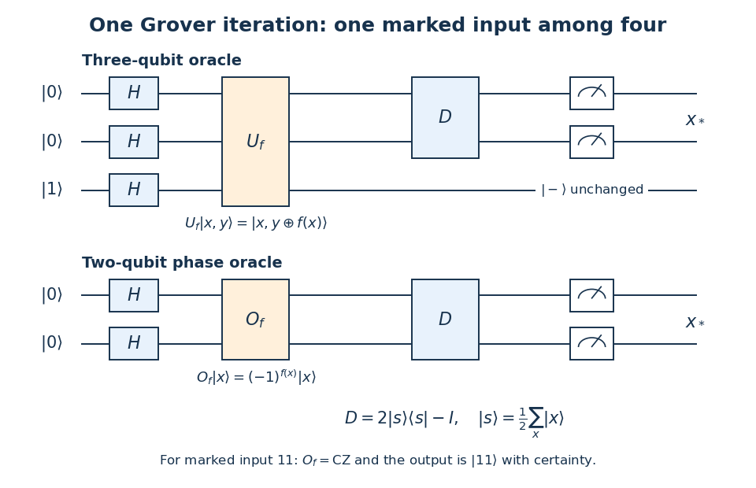

<h1 id="4/b/solution">Solution</h1>

↑ **Parent:** [B](../b.md)

Let $x\in\{00,01,10,11\}$ and let $f(x)$ be one only at the marked input. A three-[qubit](../../../../qubit.md) implementation of [Grover's algorithm](../../../../grover-s-algorithm.md) starts with $|00\rangle|1\rangle$, applies a [Hadamard gate](../../../../hadamard-gate.md) to each [qubit](../../../../qubit.md), queries the reversible [quantum oracle](../../../../quantum-oracle.md) $U_f:|x,y\rangle\mapsto|x,y\mathbin\oplus f(x)\rangle$, applies the [Grover diffusion operator](../../../../grover-diffusion-operator.md) $D=2|s\rangle\langle s|-I$ to the first two [qubits](../../../../qubit.md), and measures those two [qubits](../../../../qubit.md) in the [computational basis](../../../../computational-basis.md). Here $|s\rangle=\tfrac12\sum_x|x\rangle$. The full three-wire [quantum circuit](../../../../quantum-circuit-split.md) is the composition

$$
\boxed{|00\rangle|1\rangle
\xrightarrow{H^{\otimes3}}|s\rangle|-\rangle
\xrightarrow{U_f}(O_f|s\rangle)|-\rangle
\xrightarrow{D\otimes I}|x_*\rangle|-\rangle
\xrightarrow{\text{measure first two}}x_*.}
$$

**[Figure 1](#4/b/image-three-and-two-qubit-implementations-of-grover-s-algorithm-for-four-inputs). Three- and two-qubit implementations of Grover's algorithm for four inputs**.

Here $|-\rangle=(|0\rangle-|1\rangle)/\sqrt2$. Since $X|-\rangle=-|-\rangle$, [phase kickback](../../../../phase-kickback.md) gives $U_f(|x\rangle|-\rangle)=(-1)^{f(x)}|x\rangle|-\rangle$. The third [qubit](../../../../qubit.md) remains separable and unchanged. A direct [marked-state phase oracle](../../../../marked-state-phase-oracle.md) $O_f|x\rangle=(-1)^{f(x)}|x\rangle$ therefore replaces the three-[qubit](../../../../qubit.md) query using only two [qubits](../../../../qubit.md):

$$
\boxed{|00\rangle\xrightarrow{H\otimes H}|s\rangle
\xrightarrow{O_f}O_f|s\rangle\xrightarrow{D}|x_*\rangle
\xrightarrow{\text{measure}}x_*.}
$$

For the explicit choice $f(x)=1$ only at $x=11$, $O_f$ is a [Controlled-Z gate](../../../../controlled-z-gate.md). Immediately after it,

$$
O_f|s\rangle=\tfrac12(|00\rangle+|01\rangle+|10\rangle-|11\rangle).
$$

The mean of these four [probability amplitudes](../../../../probability-amplitude.md) is $\overline a=1/4$. The [Grover diffusion operator](../../../../grover-diffusion-operator.md) maps each [probability amplitude](../../../../probability-amplitude.md) $a_x$ to $2\overline a-a_x$. The three unmarked [probability amplitudes](../../../../probability-amplitude.md) become zero and the marked one becomes one. A single query consequently finds $11$ with [probability](../../../../probability.md) one.

A gate-level implementation of $D$ is $H^{\otimes2}(2|00\rangle\langle00|-I)H^{\otimes2}$. Up to an irrelevant [global phase](../../../../global-phase.md), it is $H^{\otimes2}X^{\otimes2}\,\mathrm{CZ}\,X^{\otimes2}H^{\otimes2}$. For any other chosen marked word, conjugate the [Controlled-Z gate](../../../../controlled-z-gate.md) by [Pauli X gates](../../../../pauli-x-gate.md) on precisely the positions where the marked word has a zero.

## ↑ Ancestors (12)

1. [B](../b.md)
2. [4](../../4.md)
3. [2022](../../../2022-split.md)
4. [Past exam of the laser science and quantum information processing course of the University of Oxford](../../../split.md)
5. [Laser science and quantum information processing course of the University of Oxford](../../../../laser-science-and-quantum-information-processing-course-of-the-university-of-oxford.md)
6. [Year 4 of the physics course of the University of Oxford](../../../../year-4-of-the-physics-course-of-the-university-of-oxford.md)
7. [Physics course of the University of Oxford](../../../../physics-course-of-the-university-of-oxford.md)
8. [Undergraduate course of the University of Oxford](../../../../undergraduate-course-of-the-university-of-oxford.md)
9. [Course of the University of Oxford](../../../../course-of-the-university-of-oxford.md)
10. [University of Oxford](../../../../university-of-oxford-split.md)
11. [List of universities](../../../../list-of-universities.md)
12. [Codex Wiki](../../../../split.md)
