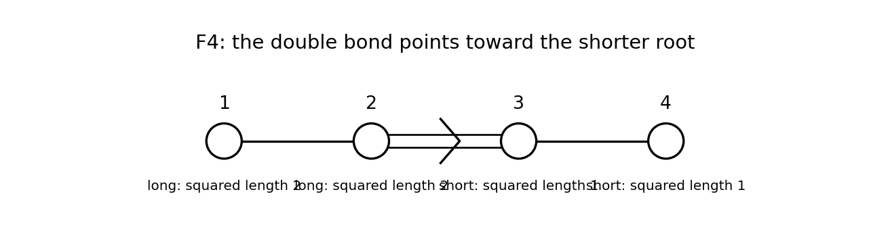

# 2007

↑ **Parent:** [Past exam of the Lie algebras and representation theory of symmetric groups course of the University of Oxford](../past-exam-of-the-lie-algebras-and-representation-theory-of-symmetric-groups-course-of-the-university-of-oxford.md)

Source: [Oxford mathematics examination release](https://www.whatdotheyknow.com/request/maths_past_papers_3), private bundle `Part C 2007 11.pdf`, pages 10–14. The printed Part C cover identifies mathematics, mathematics and philosophy, and mathematics and statistics. The complete editable transcription is retained in the private examination archive.

**Table of contents**

- [A](#a)
  - [1](#a/1)
    - [a](#a/1/a)
      - [Solution](#a/1/a/solution)
    - [b](#a/1/b)
      - [Solution](#a/1/b/solution)
    - [c](#a/1/c)
      - [Solution](#a/1/c/solution)
    - [d](#a/1/d)
      - [Solution](#a/1/d/solution)
  - [2](#a/2)
    - [Solution](#a/2/solution)
  - [3](#a/3)
    - [Solution](#a/3/solution)
  - [4](#a/4)
    - [Solution](#a/4/solution)
- [B](#b)
  - [5](#b/5)
    - [a](#b/5/a)
      - [Solution](#b/5/a/solution)
    - [b](#b/5/b)
      - [Solution](#b/5/b/solution)
    - [c](#b/5/c)
      - [Solution](#b/5/c/solution)
    - [d](#b/5/d)
      - [Solution](#b/5/d/solution)
  - [6](#b/6)
    - [a](#b/6/a)
      - [Solution](#b/6/a/solution)
    - [b](#b/6/b)
      - [Solution](#b/6/b/solution)
    - [c](#b/6/c)
      - [Solution](#b/6/c/solution)
    - [d](#b/6/d)
      - [Solution](#b/6/d/solution)
  - [7](#b/7)
    - [a](#b/7/a)
      - [Solution](#b/7/a/solution)
    - [b](#b/7/b)
      - [Solution](#b/7/b/solution)
    - [c](#b/7/c)
      - [Solution](#b/7/c/solution)
    - [d](#b/7/d)
      - [Solution](#b/7/d/solution)
    - [e](#b/7/e)
      - [Solution](#b/7/e/solution)
  - [8](#b/8)
    - [a](#b/8/a)
      - [Solution](#b/8/a/solution)
    - [b](#b/8/b)
      - [Solution](#b/8/b/solution)
    - [c](#b/8/c)
      - [Solution](#b/8/c/solution)
    - [d](#b/8/d)
      - [Solution](#b/8/d/solution)
    - [e](#b/8/e)
      - [Solution](#b/8/e/solution)

## A

↑ **Parent:** [2007](2007.md)

<h3 id="a/1">1</h3>

↑ **Parent:** [A](#a)

<h4 id="a/1/a">a</h4>

↑ **Parent:** [1](#a/1)

<h5 id="a/1/a/solution">Solution</h5>

↑ **Parent:** [A](#a/1/a)

On the space of [endomorphisms](../algebra.md#endomorphism) of $V$, left and right multiplication by $x$ commute, and $\operatorname{ad}x$ is their difference. The [binomial theorem](../binomial-coefficient.md#binomial-theorem) therefore gives

$$
(\operatorname{ad}x)^m(y)=\sum_{j=0}^m(-1)^j\binom mj x^{m-j}yx^j.
$$

For $m=2n-1$, every term has either $j\ge n$ or $m-j\ge n$, so every term vanishes when $x^n=0$. Restriction to the invariant [Lie subalgebra](../lie-algebra.md#lie-subalgebra) $L$ proves

$$
\boxed{(\operatorname{ad}_Lx)^{2n-1}=0.}
$$

The argument works over every [field](../algebra.md#field); no division by a binomial coefficient is used.

<h4 id="a/1/b">b</h4>

↑ **Parent:** [1](#a/1)

<h5 id="a/1/b/solution">Solution</h5>

↑ **Parent:** [B](#a/1/b)

We prove the common-zero-vector form of [Engel's theorem](../lie-algebra.md#engel-s-theorem) by strong [induction](../foundations-of-mathematics.md#mathematical-induction) on the dimension of the acting [Lie algebra](../lie-algebra.md) of operators, allowing its action on a nonzero finite-dimensional space to have a kernel. The zero-dimensional case is immediate.

First, every proper [Lie subalgebra](../lie-algebra.md#lie-subalgebra) $H<L$ has a strictly larger [normalizer of a Lie subalgebra](../lie-algebra.md#normalizer-of-a-lie-subalgebra). The action of $H$ on $L/H$ by $h\cdot(x+H)=[h,x]+H$ consists of nilpotent operators by part (a). Its image has dimension at most $\dim H<\dim L$. By [induction](../foundations-of-mathematics.md#mathematical-induction) it has a nonzero common-zero [vector](../vector-space.md#vector) $x+H$, giving $[H,x]\subseteq H$ with $x\notin H$. Hence $N_L(H)>H$.

Choose a maximal proper [Lie subalgebra](../lie-algebra.md#lie-subalgebra) $H$. The preceding paragraph forces $N_L(H)=L$, so $H$ is an [ideal of a Lie algebra](../lie-algebra.md#ideal-of-a-lie-algebra). Moreover $L/H$ has dimension one: otherwise any nonzero one-dimensional subspace of $L/H$, which is a [Lie subalgebra](../lie-algebra.md#lie-subalgebra), would lift to an intermediate proper subalgebra. By [induction](../foundations-of-mathematics.md#mathematical-induction) the common kernel

$$
W=\{v\in V:Hv=0\}
$$

is nonzero. It is $L$-invariant, since $h(xv)=x(hv)+[h,x]v=0$ for $v\in W$, $h\in H$, $x\in L$. Take $x\notin H$. Its restriction to $W$ is nilpotent and so has a nonzero [vector](../vector-space.md#vector) $v$ in its kernel. As $L=H+Kx$, this [vector](../vector-space.md#vector) is killed by every element of $L$:

$$
\boxed{Lv=0\quad\text{for some }v\ne0.}
$$

This completes the [induction](../foundations-of-mathematics.md#mathematical-induction). The underlying space is understood to be nonzero, as required for the asserted [vector](../vector-space.md#vector) to exist.

<h4 id="a/1/c">c</h4>

↑ **Parent:** [1](#a/1)

<h5 id="a/1/c/solution">Solution</h5>

↑ **Parent:** [C](#a/1/c)

Start with the given [basis](../vector-space.md#basis) of $U$, and follow it by arbitrary lifts of the given [basis](../vector-space.md#basis) of $V/U$. Since $U$ is an invariant [linear subspace](../vector-space.md#vector-subspace), every acting [endomorphism](../algebra.md#endomorphism) has block form

$$
\begin{pmatrix}A&*\\0&B\end{pmatrix},
$$

where $A$ and $B$ are its [matrices](../vector-space.md#matrix) on $U$ and $V/U$. Both are strictly upper triangular in the chosen [bases](../vector-space.md#basis). Therefore the whole [matrix](../vector-space.md#matrix) has zero entries on and below its diagonal. The same lifted [basis](../vector-space.md#basis) works simultaneously for all elements of $L$.

<h4 id="a/1/d">d</h4>

↑ **Parent:** [1](#a/1)

<h5 id="a/1/d/solution">Solution</h5>

↑ **Parent:** [D](#a/1/d)

Use [induction](../foundations-of-mathematics.md#mathematical-induction) on $\dim V$. By part (b), there is a one-dimensional invariant [linear subspace](../vector-space.md#vector-subspace) $U=Kv$ on which $L$ acts as zero. The induced operators on $V/U$ remain nilpotent, so [induction](../foundations-of-mathematics.md#mathematical-induction) gives a simultaneous strictly upper triangular [basis](../vector-space.md#basis) there. Part (c) lifts it together with $v$ to such a [basis](../vector-space.md#basis) of $V$.

Thus all elements strictly lower one common complete flag. A nested [Lie bracket](../lie-algebra.md#lie-bracket) of sufficiently many flag-lowering operators lowers it past zero. Consequently the [lower central series](../group-theory.md#lower-central-series) of $L$ terminates, proving that **the [Lie algebra](../lie-algebra.md) is nilpotent**. In fact its nilpotency class is at most $n-1$ for $n>1$; the zero algebra covers the one-dimensional case.

<h3 id="a/2">2</h3>

↑ **Parent:** [A](#a)

<h4 id="a/2/solution">Solution</h4>

↑ **Parent:** [2](#a/2)

A [Cartan subalgebra](../semisimple-lie-algebra.md#cartan-subalgebra) is a nilpotent [Lie subalgebra](../lie-algebra.md#lie-subalgebra) equal to its [normalizer of a Lie subalgebra](../lie-algebra.md#normalizer-of-a-lie-subalgebra). Write $H=L_{0,x}$ for a choice $x\in A$ attaining the minimum dimension, and let $h=\dim H$. For $y\in A$, the subalgebra $H$ is invariant under $\operatorname{ad}(x+ty)$ because $A\subseteq H$. On $L/H$, the operator induced by $\operatorname{ad}x$ is invertible: $H$ is its full generalized zero eigenspace, and the [finite-dimensional Fitting decomposition](../module-theory.md#finite-dimensional-fitting-decomposition) separates that from the invertible part.

The determinant of the operator induced by $\operatorname{ad}(x+ty)$ on $L/H$ is a [polynomial](../polynomial.md) in $t$, nonzero at zero. Thus it is nonzero for all but finitely many $t\in K$. For these values, the generalized zero eigenspace $L_{0,x+ty}$ lies in $H$. Minimality of $\dim H$ among elements from $A$ forces equality. Hence $\operatorname{ad}(x+ty)|_H$ is nilpotent for all but finitely many $t$.

Each nonleading coefficient of its [characteristic polynomial](../linear-operator-theory.md#characteristic-polynomial) is a [polynomial](../polynomial.md) in $t$. Since $K$ is infinite, a [polynomial](../polynomial.md) vanishing at all but finitely many elements is identically zero. The coefficient of degree $i$ in the [matrix](../vector-space.md#matrix) entries is homogeneous of degree $i$; its highest possible $t^i$ coefficient is the corresponding characteristic coefficient of $\operatorname{ad}y|_H$. All these vanish, so that operator has [characteristic polynomial](../linear-operator-theory.md#characteristic-polynomial) $T^h$ and is nilpotent by the [Cayley-Hamilton theorem](../cayley-hamilton-theorem.md). Thus

$$
\boxed{H\subseteq L_{0,y}\qquad(y\in A).}
$$

For existence, choose an $L_{0,x}=H$ of smallest dimension among all $x\in L$. Since $x\in H$, it also minimizes the same set with $x$ restricted to $A=H$. Applying the proved statement makes every $\operatorname{ad}y|_H$ nilpotent. [Engel's theorem](../lie-algebra.md#engel-s-theorem) makes $H$ nilpotent, and the allowed self-idealizer property makes it self-normalizing. Therefore it is a [Cartan subalgebra](../semisimple-lie-algebra.md#cartan-subalgebra), illustrating [Cartan subalgebra existence from a minimal Engel subalgebra](../semisimple-lie-algebra.md#cartan-subalgebra-existence-from-a-minimal-engel-subalgebra).

For the three-dimensional example, direct use of the brackets gives $C_L(z)=Kz$ for every nonzero $z$: the equations $[u,z]=0$ are the vanishing of all two-by-two minors of the two coordinate [vectors](../vector-space.md#vector), so they are proportional. Every nonzero nilpotent [Lie algebra](../lie-algebra.md) has a nonzero center, as seen from its last nonzero lower-central term. A nilpotent subalgebra $H$ with a central nonzero element $z$ must therefore satisfy $H\subseteq C_L(z)=Kz$, and has dimension one. The zero subalgebra is not self-normalizing. Thus **all [Cartan subalgebras](../semisimple-lie-algebra.md#cartan-subalgebra) have dimension one**. For example $Ka$ is nilpotent and its normalizer is $Ka$, so such subalgebras do occur.

<h3 id="a/3">3</h3>

↑ **Parent:** [A](#a)

<h4 id="a/3/solution">Solution</h4>

↑ **Parent:** [3](#a/3)

Use the standard split [weight-space decomposition](../semisimple-lie-algebra.md#weight-space-decomposition) in [characteristic zero](../algebra.md#characteristic-zero), in particular the usual complex setting: $L=\bigoplus_\varphi L_\varphi$, with generalized weights for the nilpotent algebra $H$. The characteristic-zero condition prevents nonzero weight shifts from wrapping around; the unrestricted positive-characteristic version would need additional hypotheses.

For fixed $h\in H$, let $D=\operatorname{ad}h$. On a bracket of [vectors](../vector-space.md#vector) from $L_\varphi,L_\psi$, the [derivation](../associative-algebra.md#derivation-of-an-algebra) identity gives

$$
(D-(\varphi+\psi)(h))[u,v]=[(D-\varphi(h))u,v]+[u,(D-\psi(h))v].
$$

Iterating it gives the binomial expansion of these two commuting actions. At power $2n-1$, each term kills at least one factor, because generalized weight [vectors](../vector-space.md#vector) are killed by the $n$th power of the corresponding shifted operator. Therefore the bracket lies in the generalized eigenspace for $(\varphi+\psi)(h)$ for every $h$. Stabilization of kernels by dimension $n$ gives

$$
\boxed{[L_\varphi,L_\psi]\subseteq L_{\varphi+\psi},}
$$

where $L_\eta=0$ when $\eta$ is not a weight.

Nilpotence of $H$ gives $H\subseteq L_0$. If $H$ is a [Cartan subalgebra](../semisimple-lie-algebra.md#cartan-subalgebra) and $L_0/H\ne0$, the action of $H$ on this quotient consists of nilpotent operators. [Engel's theorem](../lie-algebra.md#engel-s-theorem) supplies a nonzero coset $v+H$ killed by $H$, giving $[H,v]\subseteq H$ with $v\notin H$, a contradiction to self-normalization. Conversely, if $L_0=H$ and $v$ normalizes $H$, then $[h,v]\in H$ for each $h$. Applying further powers of $\operatorname{ad}h$ kills this [vector](../vector-space.md#vector) because its restriction to $H$ is nilpotent. Hence $v\in L_0=H$. This proves the equivalence.

The operator $\operatorname{ad}e$ sends $L_\varphi$ into $L_{\varphi+\alpha}$. Repetition follows a consecutive $\alpha$-string; after $r$ steps it must leave the weight set, because $r$ is the largest number of weights in any such string. Thus $\boxed{(\operatorname{ad}e)^r=0}$ on every [weight space](../semisimple-lie-algebra.md#weight-space) and hence on $L$.

Finally put $E=\operatorname{ad}e$ and $F=\operatorname{ad}f$. Expand $(E+F)^n$ as the sum of all words of length $n$, without commuting $E$ and $F$. Acting on $L_\gamma$, each word follows weights $\gamma+i\alpha+j\beta$ with $i+j$ increasing by one at each step. [Linear independence](../vector-space.md#linear-independence) of $\alpha,\beta$ in [characteristic zero](../algebra.md#characteristic-zero) makes the successive weights distinct. A nonzero length-$n$ path would require $n+1$ different [weight spaces](../semisimple-lie-algebra.md#weight-space), but $\dim L=n$. Every word therefore vanishes, giving

$$
\boxed{(\operatorname{ad}(e+f))^n=0.}
$$

<h3 id="a/4">4</h3>

↑ **Parent:** [A](#a)

<h4 id="a/4/solution">Solution</h4>

↑ **Parent:** [4](#a/4)

A reduced crystallographic [root system](../semisimple-lie-algebra.md#root-system) in a real [Euclidean space](../normed-vector-space.md#euclidean-norm) is a finite spanning subset $\Phi$ not containing zero, with $\Phi\cap\mathbb R\alpha=\{\alpha,-\alpha\}$, closed under $s_\alpha(v)=v-2(v,\alpha)\alpha/(\alpha,\alpha)$, and satisfying $2(\beta,\alpha)/(\alpha,\alpha)\in\mathbb Z$ for all roots. A [base of a root system](../semisimple-lie-algebra.md#fundamental-system-of-a-root-system) is a vector-space [basis](../vector-space.md#basis) $\Delta\subseteq\Phi$ such that every root has [integer](../integer.md) coefficients of one sign in that [basis](../vector-space.md#basis).

Choose $h$ not orthogonal to any root and call roots with $(h,\alpha)>0$ positive. Let $\Delta$ be the positive roots that cannot be written as a sum of two positive roots. Repeated decomposition terminates because each summand has strictly smaller positive $h$-value in a finite set. Thus every positive root is a nonnegative [integer](../integer.md) combination of $\Delta$.

For distinct $\alpha,\beta\in\Delta$, $(\alpha,\beta)\le0$: otherwise the allowed difference-root lemma would make either $\alpha-\beta$ or $\beta-\alpha$ positive, decomposing one of them. In a real [linear relation](../vector-space.md#linear-relation) among $\Delta$, move negative coefficients to the other side, obtaining $u=v$ as positive combinations with disjoint supports. Then $\|u\|^2=(u,v)\le0$, so $u=0$. But a nonempty positive combination has $(h,u)>0$, a contradiction. Thus the elements are [linearly independent](../vector-space.md#linear-independence). They span every root and hence $E$, proving existence of a [base of a root system](../semisimple-lie-algebra.md#fundamental-system-of-a-root-system). The difference-root lemma is used only for distinct roots; that qualification excludes the zero difference.

For the displayed set, there are eight coordinate roots, twenty-four roots with two nonzero unit entries, and sixteen half-coordinate roots: forty-eight in total. It spans $\mathbb R^4$, is reduced, and has squared root lengths one and two. Signed coordinate [permutations](../combinatorics.md#permutation) preserve it. [Reflections](../linear-algebra.md#reflection-mathematics) in coordinate roots are sign changes, and [reflections](../linear-algebra.md#reflection-mathematics) in roots $e_i\pm e_j$ are signed coordinate [permutations](../combinatorics.md#permutation). Every half-coordinate root is obtained by a signed [permutation](../combinatorics.md#permutation) from $h=(1/2,1/2,1/2,1/2)$, so it remains to check its [reflection](../linear-algebra.md#reflection-mathematics)

$$
s_h(v)=v-\frac{\sum_i v_i}{2}(1,1,1,1).
$$

It sends $e_i$ to $e_i-h$, a half-coordinate root; it fixes $e_i-e_j$ and sends $e_i+e_j$ to the negative sum of the other two coordinate [vectors](../vector-space.md#vector). For a half-coordinate root, the sum of its four signs is $0,\pm2$ or $\pm4$; the formula sends it, respectively, to itself, a coordinate root, or its negative when parallel to $h$. Thus [reflection](../linear-algebra.md#reflection-mathematics) closure holds. For a long root, the required Cartan [integer](../integer.md) is an [integer](../integer.md) dot product; for a coordinate root it is twice a half-integer; for $h$ it is $\sum_i\beta_i\in\mathbb Z$. Symmetry gives the remaining cases. Therefore this is the [F4 root system](../semisimple-lie-algebra.md#f4-root-system).

In the printed base order, the [Gram matrix](../inner-product.md#gram-matrix) is

$$
G=\begin{pmatrix}2&-1&0&0\\-1&2&-1&0\\0&-1&1&-1/2\\0&0&-1/2&1\end{pmatrix}.
$$

Using the convention $a_{ij}=2(\alpha_i,\alpha_j)/(\alpha_j,\alpha_j)$, the [Cartan matrix](../semisimple-lie-algebra.md#cartan-matrix) is

$$
\boxed{A=\begin{pmatrix}2&-1&0&0\\-1&2&-2&0\\0&-1&2&-1\\0&0&-1&2\end{pmatrix}.}
$$

The row-coroot convention transposes this [matrix](../vector-space.md#matrix). The [Dynkin diagram](../semisimple-lie-algebra.md#dynkin-diagram) is the chain $1-2\Rightarrow3-4$, with the double bond pointing toward the shorter third root:

**[Figure 1](#a/4/image-the-f4-dynkin-diagram-in-the-printed-simple-root-order-the-arrow-points-toward-the-shorter-root). The F4 Dynkin diagram in the printed simple-root order; the arrow points toward the shorter root**.

The associated symmetric positive definite form, normalized as a squared length, is

$$
\boxed{Q(x)=2x_1^2+2x_2^2+x_3^2+x_4^2-2x_1x_2-2x_2x_3-x_3x_4.}
$$

Indeed it equals

$$
(x_4/2)^2+(x_1-x_4/2)^2+(-x_1+x_2-x_4/2)^2+(-x_2+x_3-x_4/2)^2,
$$

which is strictly positive for nonzero $x$. The alternative Gram normalization $Q/2$ is the same positive definite form up to a positive scalar.

<h2 id="b">B</h2>

↑ **Parent:** [2007](2007.md)

<h3 id="b/5">5</h3>

↑ **Parent:** [B](#b)

<h4 id="b/5/a">a</h4>

↑ **Parent:** [5](#b/5)

<h5 id="b/5/a/solution">Solution</h5>

↑ **Parent:** [A](#b/5/a)

A [tabloid](../representation-theory-of-the-symmetric-group.md#tabloid) records the sets of entries in each row of a tableau. Let $C_t$ be the subgroup permuting entries independently within each column. The [polytabloid](../representation-theory-of-the-symmetric-group.md#polytabloid) is

$$
e_t=\sum_{\pi\in C_t}\operatorname{sgn}(\pi)\{\pi t\},
$$

and the [Specht module](../representation-theory-of-the-symmetric-group.md#specht-module) $S^\lambda$ is spanned by these [vectors](../vector-space.md#vector). A [standard polytabloid](../representation-theory-of-the-symmetric-group.md#standard-polytabloid) is one whose tableau increases along rows and down columns.

Order [tabloids](../representation-theory-of-the-symmetric-group.md#tabloid) by first sorting each row increasingly, then comparing the resulting row-reading words lexicographically. For a standard tableau $t$, every nonidentity column [permutation](../combinatorics.md#permutation) produces a strictly larger word. In the first row affected by that [permutation](../combinatorics.md#permutation), each replacement comes from farther down the same column and is larger than the entry it replaces; all earlier rows remain unchanged. Sorting the affected row therefore increases its word. Also no nontrivial column [permutation](../combinatorics.md#permutation) fixes its row sets, since a cell is the unique intersection of its row and column. Hence the least [tabloid](../representation-theory-of-the-symmetric-group.md#tabloid) in $e_t$ is $\{t\}$ with coefficient one.

Distinct standard tableaux have distinct row [tabloids](../representation-theory-of-the-symmetric-group.md#tabloid). In a nonzero [linear relation](../vector-space.md#linear-relation) among their [polytabloids](../representation-theory-of-the-symmetric-group.md#polytabloid), choose the least leading [tabloid](../representation-theory-of-the-symmetric-group.md#tabloid) with a nonzero coefficient. None of the [vectors](../vector-space.md#vector) with larger leading [tabloids](../representation-theory-of-the-symmetric-group.md#tabloid) can contribute to it, so its coefficient cannot cancel. This contradiction proves **[linear independence](../vector-space.md#linear-independence) of the [standard polytabloids](../representation-theory-of-the-symmetric-group.md#standard-polytabloid)**.

<h4 id="b/5/b">b</h4>

↑ **Parent:** [5](#b/5)

<h5 id="b/5/b/solution">Solution</h5>

↑ **Parent:** [B](#b/5/b)

The [hook length](../representation-theory-of-the-symmetric-group.md#hook-length) of a cell is one plus the number of cells to its right in the same row and below it in the same column. The [hook-length formula](../representation-theory-of-the-symmetric-group.md#hook-length-formula) is

$$
f^\lambda=\frac{n!}{\prod_{c\in\lambda}h(c)}.
$$

For $\lambda=(n-k,k)$, with $0\le k\le n/2$, the second-row hook product is $k!$. In the first row, the hooks are $n-k-j+2$ for $1\le j\le k$ and $n-k-j+1$ for $k<j\le n-k$, so their product is $(n-k+1)!/(n-2k+1)$. Consequently

$$
f^{(n-k,k)}=\frac{n!(n-2k+1)}{k!(n-k+1)!}
=\boxed{\binom nk-\binom n{k-1}}.
$$

At $k=0$, interpret the second binomial coefficient as zero.

<h4 id="b/5/c">c</h4>

↑ **Parent:** [5](#b/5)

<h5 id="b/5/c/solution">Solution</h5>

↑ **Parent:** [C](#b/5/c)

For a [cycle type](../finite-group-theory.md#cycle-type) $\mu=(m,\nu)$, the [Murnaghan–Nakayama rule](../representation-theory-of-the-symmetric-group.md#murnaghan-nakayama-rule) is

$$
\chi^\lambda(m,\nu)=\sum_{\lambda/\rho\text{ a rim hook of size }m}
(-1)^{\operatorname{ht}(\lambda/\rho)}\chi^\rho(\nu).
$$

The sum is over partitions $\rho$ whose diagrams remain after removing the specified border strip; $\nu$ is the remaining [cycle type](../finite-group-theory.md#cycle-type), and the recursion ends with the empty [character](../representation-theory.md#character-of-a-representation) equal to one. At the identity, $\chi^\rho(1^{|\rho|})=f^\rho$. Incompatible total sizes contribute zero.

For shape $(2,2)$ and a transposition, a horizontal strip in the bottom row leaves $(2)$ with positive sign; a vertical strip in the right column leaves $(1,1)$ with negative sign. Both remaining dimensions are one. Thus

$$
\boxed{\chi^{(2,2)}(2,1,1)=1-1=0.}
$$

<h4 id="b/5/d">d</h4>

↑ **Parent:** [5](#b/5)

<h5 id="b/5/d/solution">Solution</h5>

↑ **Parent:** [D](#b/5/d)

For shape $(n-2,2)$ with $n\ge6$, there are exactly two removable [rim hooks](../representation-theory-of-the-symmetric-group.md#rim-hook) of size two: the bottom row, leaving $(n-2)$, and the final two cells of the first row, leaving $(n-4,2)$. Both have height zero. A vertical pair cannot be removed while leaving a [Young diagram](../representation-theory-of-the-symmetric-group.md#young-diagram) because the first row is longer than the second by at least two.

By the [Murnaghan–Nakayama rule](../representation-theory-of-the-symmetric-group.md#murnaghan-nakayama-rule) and part (b),

$$
\begin{aligned}
\chi^{(n-2,2)}(2,1^{n-2})
&=1+f^{(n-4,2)}\\
&=1+\binom{n-2}{2}-\binom{n-2}{1}
=\boxed{\frac{(n-4)(n-3)}2}.
\end{aligned}
$$

<h3 id="b/6">6</h3>

↑ **Parent:** [B](#b)

<h4 id="b/6/a">a</h4>

↑ **Parent:** [6](#b/6)

<h5 id="b/6/a/solution">Solution</h5>

↑ **Parent:** [A](#b/6/a)

For an [integer partition](../combinatorics.md#integer-partition) $\lambda=(\lambda_1,\ldots,\lambda_r)$, its [Young diagram](../representation-theory-of-the-symmetric-group.md#young-diagram) has $\lambda_i$ left-justified cells in row $i$. A [Young tableau](../representation-theory-of-the-symmetric-group.md#young-tableau) of shape $\lambda$ is a filling of its cells. Under the usual standard numbering convention, a [standard Young tableau](../representation-theory-of-the-symmetric-group.md#standard-young-tableau) uses each [integer](../integer.md) $1,\ldots,n$ once and increases strictly along every row and down every column. For a different fixed ordered set of distinct labels, the same inequalities define the corresponding ordered-label version, which becomes standard after replacing its labels by their ranks.

<h4 id="b/6/b">b</h4>

↑ **Parent:** [6](#b/6)

<h5 id="b/6/b/solution">Solution</h5>

↑ **Parent:** [B](#b/6/b)

First convert the printed cycle to one-line notation:

$$
\sigma=(3,6,5,2,4,7,8,1).
$$

Apply [row insertion](../representation-theory-of-the-symmetric-group.md#row-insertion) to these values, recording the insertion time in each new cell. The successive insertion-tableau row lists are

$$
\begin{array}{c|l}
1&(3)\\
2&(3,6)\\
3&(3,5);(6)\\
4&(2,5);(3);(6)\\
5&(2,4);(3,5);(6)\\
6&(2,4,7);(3,5);(6)\\
7&(2,4,7,8);(3,5);(6)\\
8&(1,4,7,8);(2,5);(3);(6)
\end{array}.
$$

Therefore the [Robinson-Schensted-Knuth correspondence](../representation-theory-of-the-symmetric-group.md#robinson-schensted-knuth-correspondence) gives

$$
\boxed{P_\sigma=\begin{array}{rrrr}1&4&7&8\\2&5\\3\\6\end{array},\qquad
Q_\sigma=\begin{array}{rrrr}1&2&6&7\\3&5\\4\\8\end{array}.}
$$

Both have shape $(4,2,1,1)$.

<h4 id="b/6/c">c</h4>

↑ **Parent:** [6](#b/6)

<h5 id="b/6/c/solution">Solution</h5>

↑ **Parent:** [C](#b/6/c)

First prove preservation of the row and column inequalities for distinct ordered labels. If $b>c_l$, [row insertion](../representation-theory-of-the-symmetric-group.md#row-insertion) appends it to the first row, and the inequalities remain valid. Otherwise let $j$ be the first position with $c_j>b$. Replace $c_j$ by $b$ and insert the bumped $c_j$ in the second row. Its first larger entry is some $d_k$ with $k\le j$, because $d_j>c_j$. Replace $d_k$ by $c_j$ and put the bumped $d_k$ in the new third-row cell.

The first-larger-entry choices preserve strict row order. At column $k$, if $k<j$ the first-row entry is $c_k<c_j$, while if $k=j$ it is the new $b<c_j$. At column $j$ when $k<j$, the unchanged lower entry satisfies $d_j>c_j>b$. Every other old column keeps its previous inequalities. The new third-row entry is larger than the second-row first entry: for $k=1$ this is $d_1>c_j$, while for $k>1$ it follows from $d_k>d_1$. Thus the new shape $(l,l,1)$ is a [Young diagram](../representation-theory-of-the-symmetric-group.md#young-diagram) with strictly increasing rows and columns. This proves the insertion assertion for the ordered-label convention.

There is a numbering qualification in the literal standard convention of part (a). If $T$ uses exactly $1,\ldots,2l$, an arbitrary missing natural number $b$ need not be $2l+1$. For example, inserting six into rows $(1,2);(3,4)$ produces $(1,2,6);(3,4)$, which has the order inequalities but not the labels $1,\ldots,5$. Thus **standardness with consecutive labels requires $b=2l+1$, or increasing relabelling afterward**. The printed wording is retained in the private transcription; [row insertion](../representation-theory-of-the-symmetric-group.md#row-insertion) itself preserves the needed order structure.

<h4 id="b/6/d">d</h4>

↑ **Parent:** [6](#b/6)

<h5 id="b/6/d/solution">Solution</h5>

↑ **Parent:** [D](#b/6/d)

The [Robinson-Schensted-Knuth correspondence](../representation-theory-of-the-symmetric-group.md#robinson-schensted-knuth-correspondence) is a bijection between [permutations](../combinatorics.md#permutation) and ordered pairs of [standard Young tableaux](../representation-theory-of-the-symmetric-group.md#standard-young-tableau) of the same shape. Hence the class with shape $\lambda$ has size $(f^\lambda)^2$. For $\lambda=(4,2,1,1)$, the [hook lengths](../representation-theory-of-the-symmetric-group.md#hook-length) are

$$
\begin{array}{rrrr}7&4&2&1\\4&1\\2\\1\end{array},
$$

with product $448$. The [hook-length formula](../representation-theory-of-the-symmetric-group.md#hook-length-formula) gives $f^\lambda=8!/448=90$. Therefore

$$
\boxed{\text{class size}=90^2=8100.}
$$

<h3 id="b/7">7</h3>

↑ **Parent:** [B](#b)

<h4 id="b/7/a">a</h4>

↑ **Parent:** [7](#b/7)

<h5 id="b/7/a/solution">Solution</h5>

↑ **Parent:** [A](#b/7/a)

The [symmetric group](../finite-group-theory.md#symmetric-group) acts on [tabloids](../representation-theory-of-the-symmetric-group.md#tabloid) by permuting their entries; extending linearly gives the [permutation module](../representation-theory.md#permutation-module) $M^\mu$. Its dimension is

$$
\boxed{\dim M^\mu=\frac{n!}{\prod_i\mu_i!}.}
$$

A tableau of type $\mu$ contains exactly $\mu_i$ copies of the label $i$. Fix a numbering of the $\lambda$-diagram's cells by $1,\ldots,n$. For a filling $T$, let the $i$th row set of an associated $\mu$-tabloid be the set of cell numbers whose labels in $T$ equal $i$. This is a bijection from type-$\mu$ fillings to $\mu$-tabloids.

Define $\sigma T$ by moving labels along the numbered positions: its label at cell $j$ is the old label at cell $\sigma^{-1}j$. The associated row set is then the image under $\sigma$ of the old row set. Thus the bijection is equivariant, and its linear extension makes $F[\mathcal T_{\lambda,\mu}]$ and $M^\mu$ [isomorphic representations](../representation-theory.md#isomorphic-representations). Extend from group elements to the [group algebra](../associative-algebra.md#group-algebra) by linearity.

<h4 id="b/7/b">b</h4>

↑ **Parent:** [7](#b/7)

<h5 id="b/7/b/solution">Solution</h5>

↑ **Parent:** [B](#b/7/b)

[Young's rule](../representation-theory-of-the-symmetric-group.md#young-s-rule) states that in [characteristic zero](../algebra.md#characteristic-zero),

$$
\boxed{M^\mu\cong\bigoplus_{\lambda\vdash n}K_{\lambda\mu}S^\lambda,}
$$

where the [Kostka number](../representation-theory-of-the-symmetric-group.md#kostka-number) $K_{\lambda\mu}$ counts [Semistandard Young tableaux](../representation-theory-of-the-symmetric-group.md#semistandard-young-tableau) of shape $\lambda$ and type $\mu$: rows are weakly increasing, columns strictly increasing, and label $i$ occurs $\mu_i$ times. The summands are irreducible [Specht modules](../representation-theory-of-the-symmetric-group.md#specht-module), and the coefficients are nonnegative [integer](../integer.md) multiplicities.

<h4 id="b/7/c">c</h4>

↑ **Parent:** [7](#b/7)

<h5 id="b/7/c/solution">Solution</h5>

↑ **Parent:** [C](#b/7/c)

For type $(1^n)$, all labels are distinct, so a semistandard tableau is precisely a [standard Young tableau](../representation-theory-of-the-symmetric-group.md#standard-young-tableau). Thus $K_{\lambda,(1^n)}=f^\lambda$, and [Young's rule](../representation-theory-of-the-symmetric-group.md#young-s-rule) gives

$$
\boxed{M^{(1^n)}\cong\bigoplus_{\lambda\vdash n}f^\lambda S^\lambda,\qquad
m_\lambda=f^\lambda=\frac{n!}{\prod_{c\in\lambda}h(c)}.}
$$

This is also the decomposition of the [regular representation](../representation-theory.md#regular-representation), since [tabloids](../representation-theory-of-the-symmetric-group.md#tabloid) with one entry per row are naturally indexed by all [permutations](../combinatorics.md#permutation).

<h4 id="b/7/d">d</h4>

↑ **Parent:** [7](#b/7)

<h5 id="b/7/d/solution">Solution</h5>

↑ **Parent:** [D](#b/7/d)

For shape and type both $\mu$, column strictness makes every entry in row $r$ at least $r$. All $\mu_1$ entries equal to one must therefore be in the first row, which has exactly that length; it is filled with ones. Remove that row and repeat after subtracting one from the remaining labels. [Induction](../foundations-of-mathematics.md#mathematical-induction) gives the unique filling whose $i$th row consists of $i$'s. Thus $K_{\mu\mu}=1$, and [Young's rule](../representation-theory-of-the-symmetric-group.md#young-s-rule) proves that $S^\mu$ occurs exactly once.

More generally, if a semistandard filling of shape $\lambda$ and type $\mu$ exists, its entries at most $k$ must lie in the first $k$ rows. Counting them gives

$$
\sum_{i=1}^k\mu_i\le\sum_{i=1}^k\lambda_i\qquad\text{for every }k.
$$

These are the inequalities defining the [dominance order on partitions](../representation-theory-of-the-symmetric-group.md#dominance-order-on-partitions). Hence $K_{\lambda\mu}>0$ implies $\boxed{\lambda\ge\mu}$, and the asserted restriction on summands follows from [Young's rule](../representation-theory-of-the-symmetric-group.md#young-s-rule).

<h4 id="b/7/e">e</h4>

↑ **Parent:** [7](#b/7)

<h5 id="b/7/e/solution">Solution</h5>

↑ **Parent:** [E](#b/7/e)

We calculate the exact multiplicity without using [Young's rule](../representation-theory-of-the-symmetric-group.md#young-s-rule), via a [two-subset incidence realization of a two-row Specht module](../representation-theory-of-the-symmetric-group.md#two-subset-incidence-realization-of-a-two-row-specht-module). Let $V_2$ be the [permutation](../combinatorics.md#permutation) [representation](../representation-theory.md#group-representation) on unordered pairs from a six-element set, and $V_1$ the natural [permutation](../combinatorics.md#permutation) [representation](../representation-theory.md#group-representation) on its singletons. The equivariant incidence map

$$
D:V_2\to V_1,\qquad e_{ij}\longmapsto e_i+e_j
$$

is surjective: the transpose map sends $\sum c_ie_i$ to the pair coefficients $c_i+c_j$, and all such sums can be zero only when every $c_i=0$ in [characteristic zero](../algebra.md#characteristic-zero). Thus $\dim\ker D=15-6=9$.

Identify the [tabloids](../representation-theory-of-the-symmetric-group.md#tabloid) of shape $(4,2)$ with their two-element bottom rows. A [polytabloid](../representation-theory-of-the-symmetric-group.md#polytabloid) is a signed four-edge [vector](../vector-space.md#vector) $e_{cd}-e_{ad}-e_{cb}+e_{ab}$, whose incidence at every vertex is zero. Hence $S^{(4,2)}\subseteq\ker D$. The [standard polytabloid](../representation-theory-of-the-symmetric-group.md#standard-polytabloid) [basis](../vector-space.md#basis) theorem and the [hook-length formula](../representation-theory-of-the-symmetric-group.md#hook-length-formula) give $\dim S^{(4,2)}=\binom62-\binom61=9$, so equality holds. By [Maschke's theorem](../representation-theory.md#maschke-s-theorem),

$$
V_2\cong S^{(4,2)}\oplus V_1.
$$

Take $H=\Sigma_3\times\Sigma_2\times\Sigma_1$, preserving blocks of sizes three, two and one. It has three orbits on singletons and five on pairs: pairs inside the first block, inside the second, and between each of the three distinct pairs of blocks. Thus $\dim V_1^H=3$ and $\dim V_2^H=5$. Averaging over $H$ makes taking fixed [vectors](../vector-space.md#vector) exact in [characteristic zero](../algebra.md#characteristic-zero), so $\dim(S^{(4,2)})^H=2$.

Finally $M^{(3,2,1)}=\operatorname{Ind}_H^{\Sigma_6}1$. [Frobenius reciprocity](../representation-theory.md#frobenius-reciprocity), and equality of invariant and coinvariant dimensions in [characteristic zero](../algebra.md#characteristic-zero), identify the required multiplicity with this two-dimensional fixed space. Therefore

$$
\boxed{[M^{(3,2,1)}:S^{(4,2)}]=2,}
$$

which in particular satisfies the requested lower and upper bounds.

<h3 id="b/8">8</h3>

↑ **Parent:** [B](#b)

<h4 id="b/8/a">a</h4>

↑ **Parent:** [8](#b/8)

<h5 id="b/8/a/solution">Solution</h5>

↑ **Parent:** [A](#b/8/a)

The simple [modules](../module-theory.md#module-mathematics) are indexed by the [p-regular partitions](../representation-theory-of-the-symmetric-group.md#regular-partition) $\lambda$ of $n$, meaning no part is repeated $p$ or more times. Equip the [tabloid](../representation-theory-of-the-symmetric-group.md#tabloid) [permutation module](../representation-theory.md#permutation-module) with the [bilinear form](../bilinear-form.md) invariant under the [symmetric group](../finite-group-theory.md#symmetric-group) making its [tabloid](../representation-theory-of-the-symmetric-group.md#tabloid) [basis](../vector-space.md#basis) orthonormal. The construction is

$$
D^\lambda=S^\lambda/(S^\lambda\cap(S^\lambda)^\perp).
$$

The standard modular Specht theorem says this quotient is nonzero precisely for p-regular $\lambda$, is then simple, and these quotients give all simple [modules](../module-theory.md#module-mathematics).

To verify distinctness of labels, use the standard dominance triangularity theorem: if $D^\nu$ occurs as a composition factor of $S^\lambda$, then $\nu\ge\lambda$; for a p-regular label the diagonal multiplicity is one. If $D^\lambda\cong D^\mu$, then $D^\lambda$ occurs in $S^\mu$, so $\lambda\ge\mu$, and the symmetric argument gives $\mu\ge\lambda$. Antisymmetry of the [dominance order on partitions](../representation-theory-of-the-symmetric-group.md#dominance-order-on-partitions) yields $\boxed{\lambda=\mu}$. These are the general representation-theoretic results allowed in this part.

<h4 id="b/8/b">b</h4>

↑ **Parent:** [8](#b/8)

<h5 id="b/8/b/solution">Solution</h5>

↑ **Parent:** [B](#b/8/b)

Realize $S^{(n-1,1)}$ as the augmentation [submodule](../module-theory.md#submodule)

$$
W=\{(x_1,\ldots,x_n)\in F^n:\sum_i x_i=0\}
$$

of the natural [permutation module](../representation-theory.md#permutation-module): its [polytabloids](../representation-theory-of-the-symmetric-group.md#polytabloid) are the differences $e_i-e_j$, which span exactly $W$. Let $U$ be a [submodule](../module-theory.md#submodule). If it contains a [vector](../vector-space.md#vector) $v$ with two unequal coordinates $v_i,v_j$, then

$$
v-(i\ j)v=(v_i-v_j)(e_i-e_j)\in U.
$$

The coefficient is nonzero, so $e_i-e_j\in U$; its symmetric-group orbit spans $W$, forcing $U=W$. Therefore every proper nonzero [submodule](../module-theory.md#submodule) consists only of constant-coordinate [vectors](../vector-space.md#vector). Those form at most a one-dimensional trivial [submodule](../module-theory.md#submodule). If such a trivial [submodule](../module-theory.md#submodule) is absent, no proper nonzero [submodule](../module-theory.md#submodule) exists, so **the [Specht module](../representation-theory-of-the-symmetric-group.md#specht-module) is simple**.

<h4 id="b/8/c">c</h4>

↑ **Parent:** [8](#b/8)

<h5 id="b/8/c/solution">Solution</h5>

↑ **Parent:** [C](#b/8/c)

On a one-dimensional [representation](../representation-theory.md#group-representation), $s_i$ acts by a nonzero scalar $\varepsilon_i$. Its square is one. The braid relation becomes $\varepsilon_i^2\varepsilon_{i+1}=\varepsilon_{i+1}^2\varepsilon_i$, and hence $\varepsilon_{i+1}=\varepsilon_i$. Thus all adjacent transpositions act by one common scalar $\varepsilon$ with $\varepsilon^2=1$.

In characteristic different from two, $\varepsilon=1$ or $-1$. Since adjacent transpositions generate the group, these choices give exactly the [trivial representation](../representation-theory.md#trivial-representation) and [sign representation](../representation-theory-of-the-symmetric-group.md#sign-representation). For $n\le1$ they coincide, leaving only the [trivial representation](../representation-theory.md#trivial-representation).

<h4 id="b/8/d">d</h4>

↑ **Parent:** [8](#b/8)

<h5 id="b/8/d/solution">Solution</h5>

↑ **Parent:** [D](#b/8/d)

In characteristic three with $n=5$, a constant [vector](../vector-space.md#vector) $(c,c,c,c,c)$ belongs to the augmentation [submodule](../module-theory.md#submodule) only if $5c=0$, which forces $c=0$. Thus $S^{(4,1)}$ has no trivial [submodule](../module-theory.md#submodule). Part (b) proves that it is **simple**, of dimension four, and therefore equals $D^{(4,1)}$.

<h4 id="b/8/e">e</h4>

↑ **Parent:** [8](#b/8)

<h5 id="b/8/e/solution">Solution</h5>

↑ **Parent:** [E](#b/8/e)

The [standard polytabloid](../representation-theory-of-the-symmetric-group.md#standard-polytabloid) [basis](../vector-space.md#basis) is defined over the [integers](../integer.md) and remains a [basis](../vector-space.md#basis) after reduction modulo three. Thus $\dim S^{(3,2)}=f^{(3,2)}=\binom52-\binom51=5$. The given [submodule](../module-theory.md#submodule) has dimension four by part (d), so the quotient is one-dimensional and part (c) leaves only the trivial or sign action.

A transposition has ordinary trace one on $S^{(3,2)}$: the [Murnaghan–Nakayama rule](../representation-theory-of-the-symmetric-group.md#murnaghan-nakayama-rule) has only the horizontal bottom-row two-strip, leaving shape $(3)$ with dimension one. Reduction of its integral action [matrix](../vector-space.md#matrix) preserves this trace in $F$. Its trace on $D^{(4,1)}=S^{(4,1)}$ is $3-1=2$, since the natural five-point [permutation](../combinatorics.md#permutation) [representation](../representation-theory.md#group-representation) has three fixed coordinates and contains the trivial line. Therefore its trace on the one-dimensional quotient is $1-2=-1$, distinct from one in characteristic three. This gives the [characteristic-three sign quotient of the Specht module of shape three two](../representation-theory-of-the-symmetric-group.md#characteristic-three-sign-quotient-of-the-specht-module-of-shape-three-two). The quotient is the [sign representation](../representation-theory-of-the-symmetric-group.md#sign-representation):

$$
\boxed{\sigma\cdot\overline v=\operatorname{sgn}(\sigma)\,\overline v
\quad\text{on }S^{(3,2)}/D^{(4,1)}.}
$$

## ↑ Ancestors (9)

1. [Past exam of the Lie algebras and representation theory of symmetric groups course of the University of Oxford](../past-exam-of-the-lie-algebras-and-representation-theory-of-symmetric-groups-course-of-the-university-of-oxford.md)
2. [Lie algebras and representation theory of symmetric groups course of the University of Oxford](../university-of-oxford.md#lie-algebras-and-representation-theory-of-symmetric-groups-course-of-the-university-of-oxford)
3. [Year 4 of the mathematics course of the University of Oxford](../university-of-oxford.md#year-4-of-the-mathematics-course-of-the-university-of-oxford)
4. [Mathematics course of the University of Oxford](../university-of-oxford.md#mathematics-course-of-the-university-of-oxford)
5. [Undergraduate course of the University of Oxford](../university-of-oxford.md#undergraduate-course-of-the-university-of-oxford)
6. [Course of the University of Oxford](../university-of-oxford.md#course-of-the-university-of-oxford)
7. [University of Oxford](../university-of-oxford.md)
8. [List of universities](../README.md#list-of-universities)
9. [Codex Wiki](../README.md)
