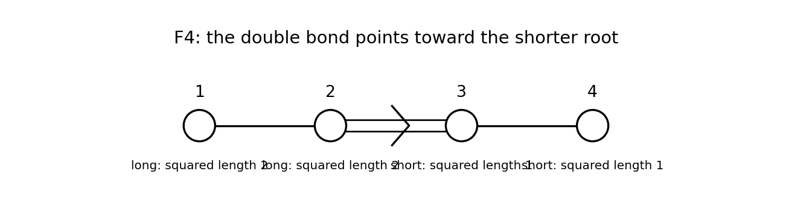

<h1 id="a/4/solution">Solution</h1>

↑ **Parent:** [4](../4.md)

A reduced crystallographic [root system](../../../../root-system.md) in a real [Euclidean space](../../../../euclidean-norm.md) is a finite spanning subset $\Phi$ not containing zero, with $\Phi\cap\mathbb R\alpha=\{\alpha,-\alpha\}$, closed under $s_\alpha(v)=v-2(v,\alpha)\alpha/(\alpha,\alpha)$, and satisfying $2(\beta,\alpha)/(\alpha,\alpha)\in\mathbb Z$ for all roots. A [base of a root system](../../../../fundamental-system-of-a-root-system.md) is a vector-space [basis](../../../../basis.md) $\Delta\subseteq\Phi$ such that every root has [integer](../../../../integer-split.md) coefficients of one sign in that [basis](../../../../basis.md).

Choose $h$ not orthogonal to any root and call roots with $(h,\alpha)>0$ positive. Let $\Delta$ be the positive roots that cannot be written as a sum of two positive roots. Repeated decomposition terminates because each summand has strictly smaller positive $h$-value in a finite set. Thus every positive root is a nonnegative [integer](../../../../integer-split.md) combination of $\Delta$.

For distinct $\alpha,\beta\in\Delta$, $(\alpha,\beta)\le0$: otherwise the allowed difference-root lemma would make either $\alpha-\beta$ or $\beta-\alpha$ positive, decomposing one of them. In a real [linear relation](../../../../linear-relation.md) among $\Delta$, move negative coefficients to the other side, obtaining $u=v$ as positive combinations with disjoint supports. Then $\|u\|^2=(u,v)\le0$, so $u=0$. But a nonempty positive combination has $(h,u)>0$, a contradiction. Thus the elements are [linearly independent](../../../../linear-independence.md). They span every root and hence $E$, proving existence of a [base of a root system](../../../../fundamental-system-of-a-root-system.md). The difference-root lemma is used only for distinct roots; that qualification excludes the zero difference.

For the displayed set, there are eight coordinate roots, twenty-four roots with two nonzero unit entries, and sixteen half-coordinate roots: forty-eight in total. It spans $\mathbb R^4$, is reduced, and has squared root lengths one and two. Signed coordinate [permutations](../../../../permutation.md) preserve it. [Reflections](../../../../reflection-mathematics.md) in coordinate roots are sign changes, and [reflections](../../../../reflection-mathematics.md) in roots $e_i\pm e_j$ are signed coordinate [permutations](../../../../permutation.md). Every half-coordinate root is obtained by a signed [permutation](../../../../permutation.md) from $h=(1/2,1/2,1/2,1/2)$, so it remains to check its [reflection](../../../../reflection-mathematics.md)

$$
s_h(v)=v-\frac{\sum_i v_i}{2}(1,1,1,1).
$$

It sends $e_i$ to $e_i-h$, a half-coordinate root; it fixes $e_i-e_j$ and sends $e_i+e_j$ to the negative sum of the other two coordinate [vectors](../../../../vector.md). For a half-coordinate root, the sum of its four signs is $0,\pm2$ or $\pm4$; the formula sends it, respectively, to itself, a coordinate root, or its negative when parallel to $h$. Thus [reflection](../../../../reflection-mathematics.md) closure holds. For a long root, the required Cartan [integer](../../../../integer-split.md) is an [integer](../../../../integer-split.md) dot product; for a coordinate root it is twice a half-integer; for $h$ it is $\sum_i\beta_i\in\mathbb Z$. Symmetry gives the remaining cases. Therefore this is the [F4 root system](../../../../f4-root-system.md).

In the printed base order, the [Gram matrix](../../../../gram-matrix.md) is

$$
G=\begin{pmatrix}2&-1&0&0\\-1&2&-1&0\\0&-1&1&-1/2\\0&0&-1/2&1\end{pmatrix}.
$$

Using the convention $a_{ij}=2(\alpha_i,\alpha_j)/(\alpha_j,\alpha_j)$, the [Cartan matrix](../../../../cartan-matrix.md) is

$$
\boxed{A=\begin{pmatrix}2&-1&0&0\\-1&2&-2&0\\0&-1&2&-1\\0&0&-1&2\end{pmatrix}.}
$$

The row-coroot convention transposes this [matrix](../../../../matrix.md). The [Dynkin diagram](../../../../dynkin-diagram.md) is the chain $1-2\Rightarrow3-4$, with the double bond pointing toward the shorter third root:

**[Figure 1](#a/4/image-the-f4-dynkin-diagram-in-the-printed-simple-root-order-the-arrow-points-toward-the-shorter-root). The F4 Dynkin diagram in the printed simple-root order; the arrow points toward the shorter root**.

The associated symmetric positive definite form, normalized as a squared length, is

$$
\boxed{Q(x)=2x_1^2+2x_2^2+x_3^2+x_4^2-2x_1x_2-2x_2x_3-x_3x_4.}
$$

Indeed it equals

$$
(x_4/2)^2+(x_1-x_4/2)^2+(-x_1+x_2-x_4/2)^2+(-x_2+x_3-x_4/2)^2,
$$

which is strictly positive for nonzero $x$. The alternative Gram normalization $Q/2$ is the same positive definite form up to a positive scalar.

## ↑ Ancestors (12)

1. [4](../4.md)
2. [A](../../a.md)
3. [2007](../../../2007-split.md)
4. [Past exam of the Lie algebras and representation theory of symmetric groups course of the University of Oxford](../../../split.md)
5. [Lie algebras and representation theory of symmetric groups course of the University of Oxford](../../../../lie-algebras-and-representation-theory-of-symmetric-groups-course-of-the-university-of-oxford.md)
6. [Year 4 of the mathematics course of the University of Oxford](../../../../year-4-of-the-mathematics-course-of-the-university-of-oxford.md)
7. [Mathematics course of the University of Oxford](../../../../mathematics-course-of-the-university-of-oxford.md)
8. [Undergraduate course of the University of Oxford](../../../../undergraduate-course-of-the-university-of-oxford.md)
9. [Course of the University of Oxford](../../../../course-of-the-university-of-oxford.md)
10. [University of Oxford](../../../../university-of-oxford-split.md)
11. [List of universities](../../../../list-of-universities.md)
12. [Codex Wiki](../../../../split.md)
