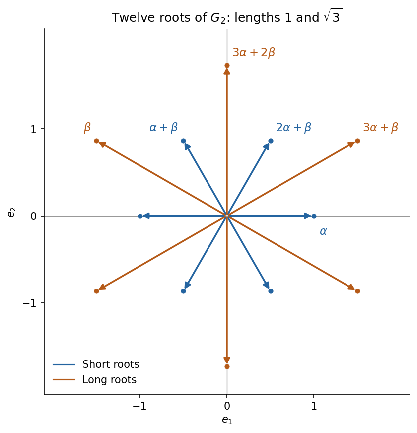

<h1 id="a/3/b/solution">Solution</h1>

↑ **Parent:** [B](../b.md)

Use the column-coroot convention $C_{ij}=2(\alpha_i,\alpha_j)/(\alpha_j,\alpha_j)$, consistent with the printed [matrix](../../../../../matrix.md) and the stated shorter first root. It gives

$$
\frac{2(\alpha,\beta)}{\|\beta\|^2}=-1,\qquad\frac{2(\beta,\alpha)}{\|\alpha\|^2}=-3,\qquad\|\beta\|^2=3\|\alpha\|^2.
$$

The [root string](../../../../../root-string.md) through $\beta$ in the $\alpha$ direction contains $\beta,\beta+\alpha,\beta+2\alpha,\beta+3\alpha$. Reflecting $3\alpha+\beta$ in $\beta$ gives $3\alpha+2\beta$. Together with $\alpha$ and their negatives these give

$$
\boxed{\Phi=\pm\{\alpha,\ \beta,\ \alpha+\beta,\ 2\alpha+\beta,\ 3\alpha+\beta,\ 3\alpha+2\beta\}.}
$$

There are no further roots. Indeed the simple reflections act on coefficient pairs by $(a,b)\mapsto(-a+3b,b)$ and $(a,b)\mapsto(a,a-b)$; the displayed twelve-element set is closed under both. Every positive nonsimple root can be reflected to a [positive root](../../../../../positive-root.md) of smaller height: choose a [simple root](../../../../../simple-root.md) with positive [inner product](../../../../../inner-product-split.md) as in (a), and its positive integral Cartan pairing decreases height. Repetition reaches a [simple root](../../../../../simple-root.md), so every root lies in an orbit already contained in the list. This is the [G2 root system](../../../../../g2-root-system.md).

With $\alpha=e_1$, the [inner product](../../../../../inner-product-split.md) and length give the two reflected possibilities

$$
\boxed{\beta=-\frac32e_1+\frac{\sqrt3}{2}e_2\quad\text{or}\quad\beta=-\frac32e_1-\frac{\sqrt3}{2}e_2.}
$$

**[Figure 1](#a/3/b/image-the-twelve-roots-of-g2-with-the-shorter-simple-root-horizontal). The twelve roots of G2 with the shorter simple root horizontal**.

## ↑ Ancestors (13)

1. [B](../b.md)
2. [3](../../3.md)
3. [A](../../../a.md)
4. [2009](../../../../2009-split.md)
5. [Past exam of the Lie algebras and representation theory of symmetric groups course of the University of Oxford](../../../../split.md)
6. [Lie algebras and representation theory of symmetric groups course of the University of Oxford](../../../../../lie-algebras-and-representation-theory-of-symmetric-groups-course-of-the-university-of-oxford.md)
7. [Year 4 of the mathematics course of the University of Oxford](../../../../../year-4-of-the-mathematics-course-of-the-university-of-oxford.md)
8. [Mathematics course of the University of Oxford](../../../../../mathematics-course-of-the-university-of-oxford.md)
9. [Undergraduate course of the University of Oxford](../../../../../undergraduate-course-of-the-university-of-oxford.md)
10. [Course of the University of Oxford](../../../../../course-of-the-university-of-oxford.md)
11. [University of Oxford](../../../../../university-of-oxford-split.md)
12. [List of universities](../../../../../list-of-universities.md)
13. [Codex Wiki](../../../../../split.md)
