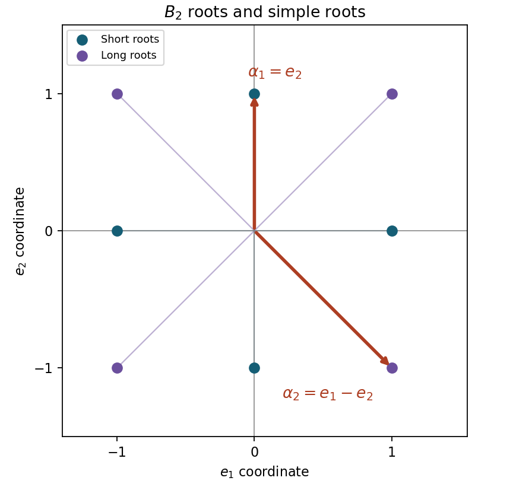

# 2010

↑ **Parent:** [Past exam of the Lie algebras and representation theory of symmetric groups course of the University of Oxford](../past-exam-of-the-lie-algebras-and-representation-theory-of-symmetric-groups-course-of-the-university-of-oxford.md)

Source: [Mathematics release](https://www.whatdotheyknow.com/request/maths_past_papers_3), bundle `Part C 2007 11.pdf`, pages 309–312. This combined paper was sat on 8 June 2010, 2.30–5.30pm, for Mathematics, Mathematics and Computer Science, and Mathematics and Philosophy Part C.

Bounded exact-paper availability checks found no matching answer advertisement. The department's general even-year policy states coverage back to at least 2016 and does not itself establish 2010 coverage. Both printed sections, all thirteen source leaves, and their unnumbered requests are answered below.

**Table of contents**

- [A](#a)
  - [1](#a/1)
    - [a](#a/1/a)
      - [Solution](#a/1/a/solution)
    - [b](#a/1/b)
      - [Solution](#a/1/b/solution)
    - [c](#a/1/c)
      - [i](#a/1/c/i)
        - [Solution](#a/1/c/i/solution)
      - [ii](#a/1/c/ii)
        - [Solution](#a/1/c/ii/solution)
  - [2](#a/2)
    - [a](#a/2/a)
      - [Solution](#a/2/a/solution)
    - [b](#a/2/b)
      - [Solution](#a/2/b/solution)
    - [c](#a/2/c)
      - [Solution](#a/2/c/solution)
  - [3](#a/3)
    - [Solution](#a/3/solution)
- [B](#b)
  - [4](#b/4)
    - [Solution](#b/4/solution)
  - [5](#b/5)
    - [Solution](#b/5/solution)
  - [6](#b/6)
    - [1](#b/6/1)
      - [Solution](#b/6/1/solution)
    - [2](#b/6/2)
      - [Solution](#b/6/2/solution)
    - [3](#b/6/3)
      - [Solution](#b/6/3/solution)

## A

↑ **Parent:** [2010](2010.md)

<h3 id="a/1">1</h3>

↑ **Parent:** [A](#a)

<h4 id="a/1/a">a</h4>

↑ **Parent:** [1](#a/1)

<h5 id="a/1/a/solution">Solution</h5>

↑ **Parent:** [A](#a/1/a)

We prove [Lie's theorem](../lie-algebra.md#lie-s-theorem) in the required form by induction on $\dim L$. If $L=0$, any nonzero vector works. Otherwise solvability gives $[L,L]\ne L$, so choose a codimension-one ideal $K\supseteq[L,L]$ and $x\in L\setminus K$. By induction there are $v\ne0$ and a [linear functional](../dual-space.md#linear-functional) $\lambda:K\to\mathbb C$ with $av=\lambda(a)v$ for all $a\in K$.

Let $W=\operatorname{span}\{v,xv,x^2v,\ldots\}$. Choose the cyclic [basis](../vector-space.md#basis) $v,xv,\ldots,x^{r-1}v$ up to its first [linear dependence](../vector-space.md#linear-dependence). The [commutator](../lie-algebra.md#commutator) identity $ax^j=xax^{j-1}+[a,x]x^{j-1}$, with $[a,x]\in K$, proves inductively that

$$
ax^jv\equiv\lambda(a)x^jv\pmod{\operatorname{span}\{v,\ldots,x^{j-1}v\}}.
$$

Hence $W$ is invariant under $K$ and $x$, and every $a\in K$ has [trace](../linear-algebra.md#matrix-trace) $r\lambda(a)$ on $W$. In particular $\operatorname{tr}_W([x,a])=0$ implies $r\lambda([x,a])=0$. [Characteristic zero](../algebra.md#characteristic-zero) gives $\lambda([x,a])=0$.

The simultaneous [weight space](../semisimple-lie-algebra.md#weight-space) $V_\lambda=\{w:aw=\lambda(a)w\ \forall a\in K\}$ is nonzero and stable under $x$, because

$$
a(xw)=x(aw)+[a,x]w=\lambda(a)xw.
$$

Over $\mathbb C$, the restriction of $x$ to this nonzero finite-dimensional space has an [eigenvector](../linear-operator-theory.md#eigenvector). That vector is an [eigenvector](../linear-operator-theory.md#eigenvector) of both $x$ and every $a\in K$, hence of every element of $L$.

<h4 id="a/1/b">b</h4>

↑ **Parent:** [1](#a/1)

<h5 id="a/1/b/solution">Solution</h5>

↑ **Parent:** [B](#a/1/b)

Let $\pi:L\to L/I$ be the quotient map. A full flag of ideals in $L/I$ lifts by inverse images to a flag from $I$ to $L$, with dimensions increasing by one. Prepending $0<I$ supplies the required full flag in $L$. Thus **supersolubility lifts across a one-dimensional ideal**.

Over $\mathbb C$, a nonzero soluble $L$ has a one-dimensional ideal: apply part (a) to its adjoint image acting on $L$. A common [eigenvector](../linear-operator-theory.md#eigenvector) spans an adjoint-invariant line, which is an ideal. The quotient is soluble and has smaller [dimension](../vector-space.md#dimension-vector-space), so induction and the lifting result give a full flag of ideals. Therefore a soluble complex [Lie algebra](../lie-algebra.md) is [supersoluble](../lie-algebra.md#supersolvable-lie-algebra).

Conversely this implication needs no [field](../algebra.md#field) restriction. If $L$ has a full flag, its first nonzero ideal $I$ is one-dimensional and abelian, and $L/I$ has a full flag. By induction $L/I$ is soluble, so some term of the derived series of $L$ lies in $I$; its next derived term is zero. Hence

$$
\boxed{L\text{ is supersoluble}\iff L\text{ is soluble}\qquad(L\text{ finite-dimensional over }\mathbb C).}
$$

<h4 id="a/1/c">c</h4>

↑ **Parent:** [1](#a/1)

<h5 id="a/1/c/i">i</h5>

↑ **Parent:** [C](#a/1/c)

<h6 id="a/1/c/i/solution">Solution</h6>

↑ **Parent:** [I](#a/1/c/i)

Let $A$ be the two-dimensional affine [Lie algebra](../lie-algebra.md) with [basis](../vector-space.md#basis) $u,v$ and bracket $[u,v]=v$, and put

$$
\boxed{L=\mathfrak{sl}_2(\mathbb C)\oplus A.}
$$

Both factors have zero centre, so $Z(L)=0$. The line $\mathbb Cv$ in the second factor is an ideal, making $L$ [PSS](../lie-algebra.md#pre-supersoluble-lie-algebra). But its quotient onto the nonabelian simple algebra $\mathfrak{sl}_2$ is not soluble. A quotient of a soluble algebra would be soluble, so $L$ is not soluble.

<h5 id="a/1/c/ii">ii</h5>

↑ **Parent:** [C](#a/1/c)

<h6 id="a/1/c/ii/solution">Solution</h6>

↑ **Parent:** [Ii](#a/1/c/ii)

If $L$ is abelian and nonzero, $L'=0<L$. Otherwise choose $x\notin Z=Z(L)$ such that $Z+Fx$ is an ideal. For each $a\in L$ write

$$
[a,x]=\lambda(a)x+z(a),\qquad z(a)\in Z.
$$

The coefficient $\lambda(a)$ is uniquely defined and linear. The [Jacobi identity](../lie-algebra.md#jacobi-identity) gives

$$
[[a,b],x]=\lambda(b)z(a)-\lambda(a)z(b)\in Z,
$$

so $\lambda([a,b])=0$. If $\lambda\ne0$, then $L'\subseteq\ker\lambda<L$.

If $\lambda=0$, the same equation says $[[a,b],x]=0$ for all $a,b$. Hence $L'\subseteq C_L(x)$. Since $x$ is not central, its centralizer is proper. Thus in both cases

$$
\boxed{L'<L.}
$$

No algebraic closure or characteristic restriction was used.

<h3 id="a/2">2</h3>

↑ **Parent:** [A](#a)

<h4 id="a/2/a">a</h4>

↑ **Parent:** [2](#a/2)

<h5 id="a/2/a/solution">Solution</h5>

↑ **Parent:** [A](#a/2/a)

Choose a [basis](../vector-space.md#basis) $(u,v)$ with $U=Fu$. The [representation](../representation-theory.md#group-representation) matrices are

$$
\rho(h)=\begin{pmatrix}\lambda(h)&a(h)\\0&\mu(h)\end{pmatrix}.
$$

The one-dimensional modules $U,V/U$ have characters $\lambda,\mu$. If they coincide, these modules are isomorphic and the first alternative holds.

Otherwise choose $h$ with $\delta(h)\ne0$, where $\delta=\lambda-\mu$. Replacing $v$ by $v-a(h)u/\delta(h)$ makes the upper-right entry of $\rho(h)$ zero. The [representation](../representation-theory.md#group-representation) identity on commutators now gives, for every $x\in H$,

$$
a([h,x])=\delta(h)a(x).
$$

Iteration yields $a((\operatorname{ad}h)^r x)=\delta(h)^r a(x)$. Nilpotence of $H$ implies $(\operatorname{ad}h)^r x=0$ for sufficiently large $r$, by its lower central series. Since $\delta(h)\ne0$, it follows that $a(x)=0$ for all $x$. The new line $W=Fv$ is therefore a [submodule](../module-theory.md#submodule), and

$$
\boxed{V=U\oplus W.}
$$

The argument works over the stated arbitrary [field](../algebra.md#field), including positive characteristic.

<h4 id="a/2/b">b</h4>

↑ **Parent:** [2](#a/2)

<h5 id="a/2/b/solution">Solution</h5>

↑ **Parent:** [B](#a/2/b)

The flag makes every [composition factor](../module-theory.md#composition-factor) one-dimensional, described by a [character](../representation-theory.md#character-of-a-representation) $\lambda:H\to F$. The [Jordan–Hölder theorem for modules](../module-theory.md#jordan-holder-theorem-for-modules) for finite-length modules says that the multiset of simple composition factors is independent of the chosen composition series.

Here is a construction valid over every $F$. For $h\in H$, every [generalized eigenspace](../linear-operator-theory.md#generalized-eigenspace) of $\rho(h)$ is an $H$-[submodule](../module-theory.md#submodule). Indeed $\operatorname{ad}(h)$ is nilpotent on $H$, say of exponent $c$, and

$$
(\rho(h)-aI)^N\rho(x)
=\sum_{j=0}^N\binom Nj\rho((\operatorname{ad}h)^jx)(\rho(h)-aI)^{N-j}.
$$

If $v$ is killed by $(\rho(h)-aI)^{N_0}$, take $N\ge N_0+c$. Terms with $j\ge c$ vanish by adjoint nilpotence, and all other terms kill $v$. This proves invariance of the [generalized eigenspace](../linear-operator-theory.md#generalized-eigenspace).

The flag also makes the [characteristic polynomial](../linear-operator-theory.md#characteristic-polynomial) of every $\rho(h)$ split over $F$. Whenever two composition characters differ, choose an $h$ on which they differ and split the [module](../module-theory.md#module-mathematics) into the distinct generalized eigenspaces of $\rho(h)$. Repeat within each summand until all its composition factors have the same [character](../representation-theory.md#character-of-a-representation). Every nontrivial split lowers dimensions, so the process terminates. Finally combine summands carrying the same [character](../representation-theory.md#character-of-a-representation). Jordan–Hölder ensures that the resulting distinct blocks have distinct factor types, giving

$$
\boxed{V=\bigoplus_\lambda W_\lambda,\qquad
\text{all composition factors of }W_\lambda\text{ have character }\lambda.}
$$

This recursive method does not assume that a single element separates every [character](../representation-theory.md#character-of-a-representation), which could fail over a finite [field](../algebra.md#field).

<h4 id="a/2/c">c</h4>

↑ **Parent:** [2](#a/2)

<h5 id="a/2/c/solution">Solution</h5>

↑ **Parent:** [C](#a/2/c)

Writing matrices in $2\times2$ blocks, the defining relation gives

$$
L=\left\{\begin{pmatrix}A&B\\C&-A^T\end{pmatrix}:B^T=-B,\ C^T=-C\right\}.
$$

The [trace](../linear-algebra.md#matrix-trace) is automatically zero. The relation is linear, and if $as=-sa^T$, $bs=-sb^T$, then

$$
[a,b]s=s(a^Tb^T-b^Ta^T)=-s[a,b]^T.
$$

Thus $L$ is closed under the [commutator](../lie-algebra.md#commutator) and is a [Lie subalgebra](../lie-algebra.md#lie-subalgebra) of $\mathfrak{sl}_4(F)$.

Its diagonal subalgebra is

$$
H=\{D(a,b)=\operatorname{diag}(a,b,-a,-b):a,b\in F\}.
$$

Put $\varepsilon_1(D(a,b))=a$, $\varepsilon_2(D(a,b))=b$. Since $[D,E_{ij}]=(D_{ii}-D_{jj})E_{ij}$, the required block decomposition is

$$
\boxed{\begin{aligned}
L={}&H\oplus F(E_{12}-E_{43})\oplus F(E_{21}-E_{34})\\
&\oplus F(E_{14}-E_{23})\oplus F(E_{32}-E_{41}).
\end{aligned}}
$$

The four lines have respective characters $\varepsilon_1-\varepsilon_2$, $-\varepsilon_1+\varepsilon_2$, $\varepsilon_1+\varepsilon_2$, $-\varepsilon_1-\varepsilon_2$. They are distinct and nonzero because $\operatorname{char}F\ne2$. The two-dimensional summand $H$ has two trivial composition factors. These five submodules therefore have exactly the factor-grouping properties of part (b). Their dimensions sum to $6$, the [dimension](../vector-space.md#dimension-vector-space) obtained from four free entries in $A$ and one each in the skew-symmetric blocks $B,C$.

<h3 id="a/3">3</h3>

↑ **Parent:** [A](#a)

<h4 id="a/3/solution">Solution</h4>

↑ **Parent:** [3](#a/3)

A reduced crystallographic [root system](../semisimple-lie-algebra.md#root-system) $\Phi$ is a finite spanning subset of a real Euclidean [vector space](../vector-space.md), excluding zero, such that $\Phi\cap\mathbb R\alpha=\{\pm\alpha\}$, each [reflection](../linear-algebra.md#reflection-mathematics) $s_\alpha(v)=v-2(v,\alpha)\alpha/(\alpha,\alpha)$ preserves $\Phi$, and all Cartan integers $\langle\beta,\alpha\rangle=2(\beta,\alpha)/(\alpha,\alpha)$ are integers. A base is a vector-space [basis](../vector-space.md#basis) $\Delta\subset\Phi$ in which each [root](../semisimple-lie-algebra.md#root-of-a-root-system) has integer coordinates either all nonnegative or all nonpositive. The [Weyl group](../semisimple-lie-algebra.md#weyl-group) is generated by the [root](../semisimple-lie-algebra.md#root-of-a-root-system) reflections.

For nonparallel roots put $p=\langle\beta,\alpha\rangle$ and $q=\langle\alpha,\beta\rangle$. Then $pq=4\cos^2\theta$ is an integer strictly below $4$ and at least zero. Therefore

$$
\boxed{\cos\theta\in\{0,\pm\tfrac12,\pm\tfrac1{\sqrt2},\pm\tfrac{\sqrt3}{2}\}.}
$$

If $(\alpha,\beta)>0$, the positive integers $p,q$ have product $1,2$ or $3$, so at least one is one. If $p=1$, [reflection](../linear-algebra.md#reflection-mathematics) gives $\beta-\alpha\in\Phi$ and hence its negative. If $q=1$, [reflection](../linear-algebra.md#reflection-mathematics) directly gives $\alpha-\beta\in\Phi$. This proves the positive-inner-product assertion.

To prove that an $\alpha$-string has no gaps, suppose consecutive occurring integer positions $a<b$ in $\beta+t\alpha$ had $b-a\ge2$. If $(\beta+a\alpha,\alpha)<0$, apply the previous result to $\beta+a\alpha$ and $-\alpha$ to obtain the missing [root](../semisimple-lie-algebra.md#root-of-a-root-system) at $a+1$. Thus this [inner product](../inner-product.md) must be nonnegative. Similarly the absence of a [root](../semisimple-lie-algebra.md#root-of-a-root-system) at $b-1$ forces $(\beta+b\alpha,\alpha)\le0$. But the latter [inner product](../inner-product.md) exceeds the former by $(b-a)(\alpha,\alpha)>0$, impossible. Thus every intermediate integer position occurs.

Write the complete finite string as $\beta-r\alpha,\ldots,\beta+s\alpha$. [Reflection](../linear-algebra.md#reflection-mathematics) maps position $t$ to $-p-t$, so it interchanges the two endpoints. Hence

$$
\boxed{r-s=\langle\beta,\alpha\rangle.}
$$

Here $r,s$ are the maximal endpoint distances, not arbitrary shorter distances mentioned in the existence assertion.

Use the Cartan-[matrix](../vector-space.md#matrix) convention $C_{ij}=\langle\alpha_i,\alpha_j\rangle$. The displayed [matrix](../vector-space.md#matrix) is realized by

$$
\alpha_1=e_2,\qquad\alpha_2=e_1-e_2,
$$

with the standard orthonormal coordinates. Closure under the two simple reflections gives

$$
\boxed{\Phi=\{\pm e_1,\pm e_2,\pm(e_1-e_2),\pm(e_1+e_2)\}.}
$$

The positive roots are $\alpha_1,\alpha_2,\alpha_1+\alpha_2,2\alpha_1+\alpha_2$. Conversely the standard fact that every [root](../semisimple-lie-algebra.md#root-of-a-root-system) is Weyl-conjugate to a [simple root](../semisimple-lie-algebra.md#simple-root), or successive height reduction by simple reflections, shows these two [reflection](../linear-algebra.md#reflection-mathematics) orbits exhaust the roots. This is the rank-two system $B_2$, also called $C_2$ after exchanging the length convention. With a transposed Cartan-[matrix](../vector-space.md#matrix) convention, interchange which simple-[root](../semisimple-lie-algebra.md#root-of-a-root-system) label is short; the geometric system and [Weyl group](../semisimple-lie-algebra.md#weyl-group) are unchanged.

**[Figure 1](#a/3/image-rank-two-root-system-with-its-chosen-simple-roots). Rank-two root system with its chosen simple roots**.

The [reflection](../linear-algebra.md#reflection-mathematics) in $e_2$ flips the second coordinate, while the [reflection](../linear-algebra.md#reflection-mathematics) in $e_1-e_2$ swaps the two coordinates. These generate all eight signed permutation matrices in two coordinates. Thus

$$
\boxed{W(\Phi)\cong D_8,\quad |W(\Phi)|=8,}
$$

where $D_8$ means the symmetry group of a square.

<h2 id="b">B</h2>

↑ **Parent:** [2010](2010.md)

<h3 id="b/4">4</h3>

↑ **Parent:** [B](#b)

<h4 id="b/4/solution">Solution</h4>

↑ **Parent:** [4](#b/4)

For a [Young diagram](../representation-theory-of-the-symmetric-group.md#young-diagram) cell $(i,j)$, its [hook length](../representation-theory-of-the-symmetric-group.md#hook-length) is one plus the number of cells to its right and below. The [hook-length formula](../representation-theory-of-the-symmetric-group.md#hook-length-formula) is

$$
f^\lambda=\frac{n!}{\prod_{(i,j)\in\lambda}h_{ij}}.
$$

Applying it to the two shapes gives

$$
\boxed{f^{(n-2,1,1)}=\frac{(n-1)(n-2)}2,\qquad
f^{(n-2,2)}=\frac{n(n-3)}2.}
$$

The shapes here require $n\ge4$.

A hook [tabloid](../representation-theory-of-the-symmetric-group.md#tabloid) remembers its first-row set and the ordered singleton entries below it. The proposed map keeps that first-row set and merges the remaining entries into one unordered row. Thus it is well-defined on tabloids. Permuting entries before merging gives the same [tabloid](../representation-theory-of-the-symmetric-group.md#tabloid) as merging before permuting, so it is a [module](../module-theory.md#module-mathematics) homomorphism. Every target [tabloid](../representation-theory-of-the-symmetric-group.md#tabloid) is reached by putting its second-row entries, in any order, into the singleton rows. Therefore it is surjective.

For $r=2$, the strictly dominating partitions of $\lambda=(n-2,1,1)$ are exactly $(n),(n-1,1),(n-2,2)$. Indeed dominance forces the first part to be at least $n-2$, and the possibilities for the remaining sum give precisely those shapes or $\lambda$ itself.

In [characteristic zero](../algebra.md#characteristic-zero), [Maschke's theorem](../representation-theory.md#maschke-s-theorem) makes the [permutation module](../representation-theory.md#permutation-module) semisimple, and [Young's rule](../representation-theory-of-the-symmetric-group.md#young-s-rule) gives one copy of $S^\lambda$ and only strictly dominating additional shapes. The trivial multiplicity is one, since a transitive [permutation module](../representation-theory.md#permutation-module) has a one-dimensional invariant space. For the standard [representation](../representation-theory.md#group-representation) $S^{(n-1,1)}$, [Frobenius reciprocity](../representation-theory.md#frobenius-reciprocity) identifies its multiplicity with the [dimension](../vector-space.md#dimension-vector-space) of fixed vectors under the row stabilizer $S_{n-2}$. In its realization $\{(z_1,\ldots,z_n):\sum z_i=0\}$, those fixed vectors have the form $(c,\ldots,c,a,b)$ with $(n-2)c+a+b=0$, a two-dimensional space. Thus its multiplicity is two.

Finally $\dim M^\lambda=n(n-1)$. Subtracting the dimensions of one $S^\lambda$, one trivial [module](../module-theory.md#module-mathematics) and two standard modules leaves $n(n-3)/2$, exactly one $S^{(n-2,2)}$. Therefore

$$
\boxed{M^{(n-2,1,1)}\cong
S^{(n-2,1,1)}\oplus S^{(n)}\oplus2S^{(n-1,1)}\oplus S^{(n-2,2)}.}
$$

The additional multiplicities are $1,2,1$ respectively. If the printed weak summation index is read literally alongside its separate $S^\lambda$, then $m_{\lambda,\lambda}=0$; the total multiplicity of $S^\lambda$ is one.

<h3 id="b/5">5</h3>

↑ **Parent:** [B](#b)

<h4 id="b/5/solution">Solution</h4>

↑ **Parent:** [5](#b/5)

A [tabloid](../representation-theory-of-the-symmetric-group.md#tabloid) is the row-equivalence class $\{t\}$ of a tableau filled bijectively with $1,\ldots,n$: order inside each row is forgotten, but the rows remain distinguished. The [permutation module](../representation-theory.md#permutation-module) $M^\lambda$ has these tabloids as an $F$-[basis](../vector-space.md#basis), with $\Sigma_n$ permuting their entries. Let $C_t$ be the column stabilizer of $t$ and define

$$
\kappa_t=\sum_{\sigma\in C_t}\operatorname{sgn}(\sigma)\sigma,\qquad
e_t=\kappa_t\{t\}.
$$

The [Specht module](../representation-theory-of-the-symmetric-group.md#specht-module) $S^\lambda$ is the [submodule](../module-theory.md#submodule) spanned by all polytabloids $e_t$.

If a [module](../module-theory.md#module-mathematics) homomorphism $\phi:M^\lambda\to M^\mu$ is nonzero on $S^\lambda$, it is nonzero on some spanning $e_t$. Equivariance gives $0\ne\phi(e_t)=\kappa_t\phi(\{t\})$, so $\kappa_tM^\mu\ne0$. The allowed criterion yields $\lambda\ge\mu$.

In [characteristic zero](../algebra.md#characteristic-zero), [Maschke's theorem](../representation-theory.md#maschke-s-theorem) gives an equivariant projection $M^\lambda\to S^\lambda$. If $S^\lambda\cong S^\mu$, compose that projection with the isomorphism and the inclusion into $M^\mu$. The preceding argument gives $\lambda\ge\mu$. Reversing the roles gives $\mu\ge\lambda$, so antisymmetry of dominance gives

$$
\boxed{\lambda=\mu.}
$$

For a map defined only on a [Specht module](../representation-theory-of-the-symmetric-group.md#specht-module) in arbitrary characteristic, **dominance need not hold**. Take $F=\mathbb F_2$, $n=2$, $\lambda=(1,1)$ and $\mu=(2)$. The first [Specht module](../representation-theory-of-the-symmetric-group.md#specht-module) is the one-dimensional span of

$$
e=\{1\mid2\}-\{2\mid1\}=\{1\mid2\}+\{2\mid1\}.
$$

The transposition fixes $e$, so this is the trivial [module](../module-theory.md#module-mathematics). The one-row [permutation module](../representation-theory.md#permutation-module) $M^{(2)}$ is also trivial and one-dimensional. Sending $e$ to its single [tabloid](../representation-theory-of-the-symmetric-group.md#tabloid) is a nonzero equivariant map, yet $(1,1)\not\ge(2)$. In this characteristic such a map need not extend to the surrounding [permutation module](../representation-theory.md#permutation-module); that is exactly where the earlier proof ceases to apply.

<h3 id="b/6">6</h3>

↑ **Parent:** [B](#b)

Let $\pi^\lambda$ be the [permutation character](../representation-theory.md#permutation-character) of $M^\lambda$. [Young's rule](../representation-theory-of-the-symmetric-group.md#young-s-rule) gives $\pi^\lambda=\chi^\lambda+\sum_{\mu>\lambda}K_{\mu\lambda}\chi^\mu$, with integer Kostka multiplicities. This dominance-triangular system has diagonal entries one, so recursive subtraction expresses every [irreducible character](../representation-theory.md#irreducible-character) as an integer linear combination of permutation characters. The latter count fixed tabloids, proving that all $\chi^\lambda(g)$ are integers.

For a $k$-cycle, the [Murnaghan–Nakayama rule](../representation-theory-of-the-symmetric-group.md#murnaghan-nakayama-rule) reduces to

$$
\chi^\lambda(g)=\sum_{\substack{\nu\subseteq\lambda,\ |\nu|=n-k\\\lambda/\nu\text{ a rim hook of length }k}}
(-1)^{\operatorname{ht}(\lambda/\nu)}f^\nu,
$$

where height is the number of occupied rows minus one, and $f^\nu$ is the degree of the remaining Specht [character](../representation-theory.md#character-of-a-representation) at the identity. In particular a full $n$-cycle has [character](../representation-theory.md#character-of-a-representation) zero unless $\lambda=(n-r,1^r)$ is a hook, in which case the value is $(-1)^r$.

<h4 id="b/6/1">1</h4>

↑ **Parent:** [6](#b/6)

<h5 id="b/6/1/solution">Solution</h5>

↑ **Parent:** [1](#b/6/1)

There is more than one solution: the [trivial representation](../representation-theory.md#trivial-representation) $\lambda=(6)$ has [character](../representation-theory.md#character-of-a-representation) $1$ everywhere and the [sign representation](../representation-theory-of-the-symmetric-group.md#sign-representation) $\lambda=(1^6)$ has [character](../representation-theory.md#character-of-a-representation) $\pm1$ everywhere. Thus

$$
\boxed{\lambda=(6)\text{ and }(1^6)\text{ both work}.}
$$

In fact they are the only ones. The full-cycle formula in the preceding discussion forces any candidate to be a hook $(6-r,1^r)$. For $r=1$, the standard [character](../representation-theory.md#character-of-a-representation) is the number of fixed points minus one, so it vanishes on cycle type $(5,1)$; its sign twist $r=4$ does too. For $r=2$, the hook [representation](../representation-theory.md#group-representation) is the [exterior square](../multilinear-algebra.md#exterior-square) of the standard [representation](../representation-theory.md#group-representation) and has [character](../representation-theory.md#character-of-a-representation) $\tfrac12(\chi(g)^2-\chi(g^2))$. At cycle type $(4,1,1)$ both standard-[character](../representation-theory.md#character-of-a-representation) values are one, so this [character](../representation-theory.md#character-of-a-representation) is zero. Its sign twist $r=3$ also vanishes there. Only $r=0,5$ remain.

<h4 id="b/6/2">2</h4>

↑ **Parent:** [6](#b/6)

<h5 id="b/6/2/solution">Solution</h5>

↑ **Parent:** [2](#b/6/2)

[Irreducible character](../representation-theory.md#irreducible-character) orthogonality gives $\langle\chi,\chi\rangle=1$. Under the proposed vanishing condition, only the identity contributes, so

$$
1=\frac{\chi(1)^2}{|S_6|}=\frac{\chi(1)^2}{720}.
$$

But $\chi(1)$ is an integer [dimension](../vector-space.md#dimension-vector-space) and $720$ is not a square. Thus **no such partition exists**.

<h4 id="b/6/3">3</h4>

↑ **Parent:** [6](#b/6)

<h5 id="b/6/3/solution">Solution</h5>

↑ **Parent:** [3](#b/6/3)

The full-cycle formula says that precisely the nonhook shapes have zero value on a 6-cycle. These are $(4,2),(3,3),(3,2,1),(2,2,1,1),(2,2,2)$.

Use the standard two-row permutation-[character](../representation-theory.md#character-of-a-representation) rule $\pi^{(6-r,r)}=\chi^{(6)}+\chi^{(5,1)}+\cdots+\chi^{(6-r,r)}$. A transposition has four fixed points, so $\chi^{(5,1)}=3$. It fixes $\binom42+1=7$ two-subsets, giving $\chi^{(4,2)}=7-1-3=3$. It fixes $\binom43+\binom41=8$ three-subsets, giving $\chi^{(3,3)}=8-1-3-3=1$.

Conjugating a partition tensors its [character](../representation-theory.md#character-of-a-representation) with the sign [character](../representation-theory.md#character-of-a-representation). Hence the values on a transposition for the conjugate shapes are $-3$ and $-1$. The shape $(3,2,1)$ is self-conjugate, so its [character](../representation-theory.md#character-of-a-representation) equals its own sign twist and is zero on every odd permutation. The complete candidate table is therefore:

| Shape | Value on a transposition |
| --- | --- |
| $(4,2)$ | $3$ |
| $(3,3)$ | $1$ |
| $(3,2,1)$ | $0$ |
| $(2,2,1,1)$ | $-3$ |
| $(2,2,2)$ | $-1$ |

Thus the unique answer is

$$
\boxed{\lambda=(3,2,1).}
$$

## ↑ Ancestors (9)

1. [Past exam of the Lie algebras and representation theory of symmetric groups course of the University of Oxford](../past-exam-of-the-lie-algebras-and-representation-theory-of-symmetric-groups-course-of-the-university-of-oxford.md)
2. [Lie algebras and representation theory of symmetric groups course of the University of Oxford](../university-of-oxford.md#lie-algebras-and-representation-theory-of-symmetric-groups-course-of-the-university-of-oxford)
3. [Year 4 of the mathematics course of the University of Oxford](../university-of-oxford.md#year-4-of-the-mathematics-course-of-the-university-of-oxford)
4. [Mathematics course of the University of Oxford](../university-of-oxford.md#mathematics-course-of-the-university-of-oxford)
5. [Undergraduate course of the University of Oxford](../university-of-oxford.md#undergraduate-course-of-the-university-of-oxford)
6. [Course of the University of Oxford](../university-of-oxford.md#course-of-the-university-of-oxford)
7. [University of Oxford](../university-of-oxford.md)
8. [List of universities](../README.md#list-of-universities)
9. [Codex Wiki](../README.md)
