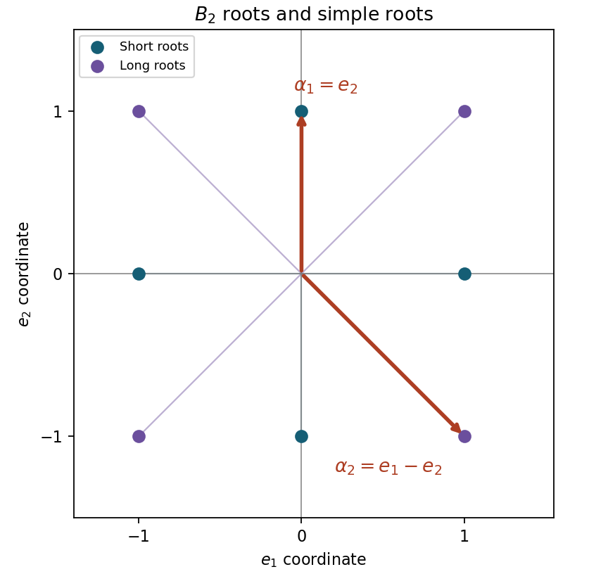

<h1 id="a/3/solution">Solution</h1>

↑ **Parent:** [3](../3.md)

A reduced crystallographic [root system](../../../../root-system.md) $\Phi$ is a finite spanning subset of a real Euclidean [vector space](../../../../vector-space-split.md), excluding zero, such that $\Phi\cap\mathbb R\alpha=\{\pm\alpha\}$, each [reflection](../../../../reflection-mathematics.md) $s_\alpha(v)=v-2(v,\alpha)\alpha/(\alpha,\alpha)$ preserves $\Phi$, and all Cartan integers $\langle\beta,\alpha\rangle=2(\beta,\alpha)/(\alpha,\alpha)$ are integers. A base is a vector-space [basis](../../../../basis.md) $\Delta\subset\Phi$ in which each [root](../../../../root-of-a-root-system.md) has integer coordinates either all nonnegative or all nonpositive. The [Weyl group](../../../../weyl-group.md) is generated by the [root](../../../../root-of-a-root-system.md) reflections.

For nonparallel roots put $p=\langle\beta,\alpha\rangle$ and $q=\langle\alpha,\beta\rangle$. Then $pq=4\cos^2\theta$ is an integer strictly below $4$ and at least zero. Therefore

$$
\boxed{\cos\theta\in\{0,\pm\tfrac12,\pm\tfrac1{\sqrt2},\pm\tfrac{\sqrt3}{2}\}.}
$$

If $(\alpha,\beta)>0$, the positive integers $p,q$ have product $1,2$ or $3$, so at least one is one. If $p=1$, [reflection](../../../../reflection-mathematics.md) gives $\beta-\alpha\in\Phi$ and hence its negative. If $q=1$, [reflection](../../../../reflection-mathematics.md) directly gives $\alpha-\beta\in\Phi$. This proves the positive-inner-product assertion.

To prove that an $\alpha$-string has no gaps, suppose consecutive occurring integer positions $a<b$ in $\beta+t\alpha$ had $b-a\ge2$. If $(\beta+a\alpha,\alpha)<0$, apply the previous result to $\beta+a\alpha$ and $-\alpha$ to obtain the missing [root](../../../../root-of-a-root-system.md) at $a+1$. Thus this [inner product](../../../../inner-product-split.md) must be nonnegative. Similarly the absence of a [root](../../../../root-of-a-root-system.md) at $b-1$ forces $(\beta+b\alpha,\alpha)\le0$. But the latter [inner product](../../../../inner-product-split.md) exceeds the former by $(b-a)(\alpha,\alpha)>0$, impossible. Thus every intermediate integer position occurs.

Write the complete finite string as $\beta-r\alpha,\ldots,\beta+s\alpha$. [Reflection](../../../../reflection-mathematics.md) maps position $t$ to $-p-t$, so it interchanges the two endpoints. Hence

$$
\boxed{r-s=\langle\beta,\alpha\rangle.}
$$

Here $r,s$ are the maximal endpoint distances, not arbitrary shorter distances mentioned in the existence assertion.

Use the Cartan-[matrix](../../../../matrix.md) convention $C_{ij}=\langle\alpha_i,\alpha_j\rangle$. The displayed [matrix](../../../../matrix.md) is realized by

$$
\alpha_1=e_2,\qquad\alpha_2=e_1-e_2,
$$

with the standard orthonormal coordinates. Closure under the two simple reflections gives

$$
\boxed{\Phi=\{\pm e_1,\pm e_2,\pm(e_1-e_2),\pm(e_1+e_2)\}.}
$$

The positive roots are $\alpha_1,\alpha_2,\alpha_1+\alpha_2,2\alpha_1+\alpha_2$. Conversely the standard fact that every [root](../../../../root-of-a-root-system.md) is Weyl-conjugate to a [simple root](../../../../simple-root.md), or successive height reduction by simple reflections, shows these two [reflection](../../../../reflection-mathematics.md) orbits exhaust the roots. This is the rank-two system $B_2$, also called $C_2$ after exchanging the length convention. With a transposed Cartan-[matrix](../../../../matrix.md) convention, interchange which simple-[root](../../../../root-of-a-root-system.md) label is short; the geometric system and [Weyl group](../../../../weyl-group.md) are unchanged.

**[Figure 1](#a/3/image-rank-two-root-system-with-its-chosen-simple-roots). Rank-two root system with its chosen simple roots**.

The [reflection](../../../../reflection-mathematics.md) in $e_2$ flips the second coordinate, while the [reflection](../../../../reflection-mathematics.md) in $e_1-e_2$ swaps the two coordinates. These generate all eight signed permutation matrices in two coordinates. Thus

$$
\boxed{W(\Phi)\cong D_8,\quad |W(\Phi)|=8,}
$$

where $D_8$ means the symmetry group of a square.

## ↑ Ancestors (12)

1. [3](../3.md)
2. [A](../../a.md)
3. [2010](../../../2010-split.md)
4. [Past exam of the Lie algebras and representation theory of symmetric groups course of the University of Oxford](../../../split.md)
5. [Lie algebras and representation theory of symmetric groups course of the University of Oxford](../../../../lie-algebras-and-representation-theory-of-symmetric-groups-course-of-the-university-of-oxford.md)
6. [Year 4 of the mathematics course of the University of Oxford](../../../../year-4-of-the-mathematics-course-of-the-university-of-oxford.md)
7. [Mathematics course of the University of Oxford](../../../../mathematics-course-of-the-university-of-oxford.md)
8. [Undergraduate course of the University of Oxford](../../../../undergraduate-course-of-the-university-of-oxford.md)
9. [Course of the University of Oxford](../../../../course-of-the-university-of-oxford.md)
10. [University of Oxford](../../../../university-of-oxford-split.md)
11. [List of universities](../../../../list-of-universities.md)
12. [Codex Wiki](../../../../split.md)
