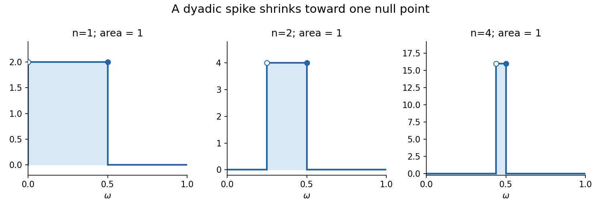
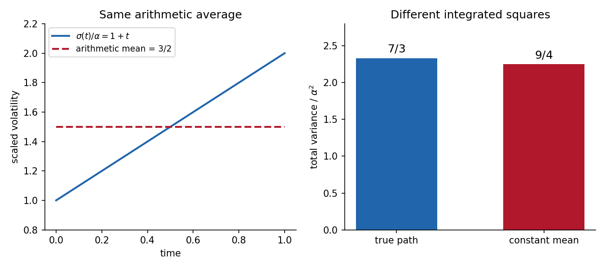
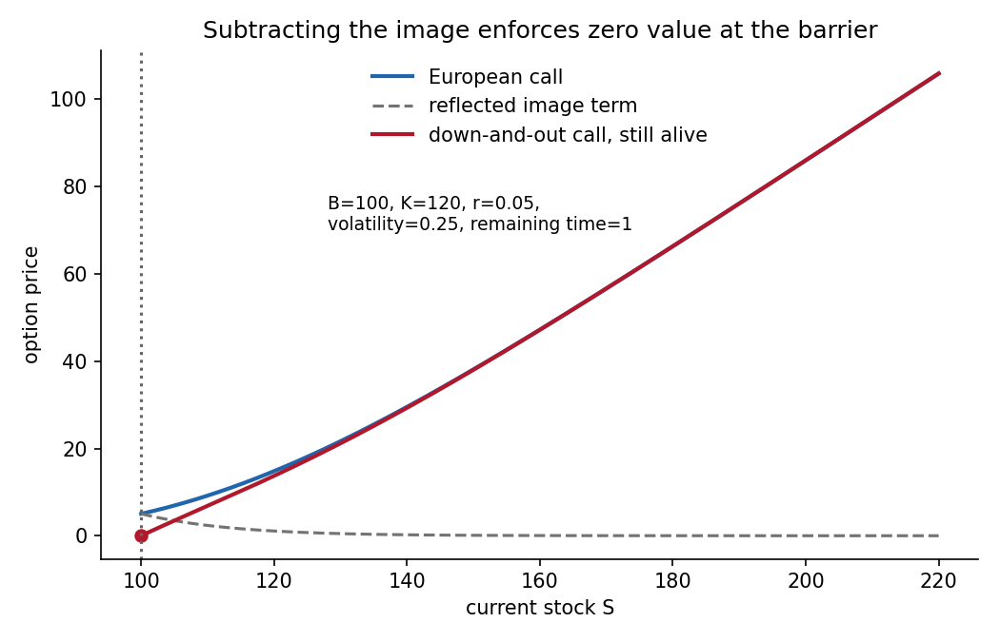

# 2007

↑ **Parent:** [Past exam of the martingales and financial mathematics course of the University of Oxford](../past-exam-of-the-martingales-and-financial-mathematics-course-of-the-university-of-oxford.md)

**Table of contents**

- [A](#a)
  - [1](#a/1)
    - [a](#a/1/a)
      - [i](#a/1/a/i)
        - [Solution](#a/1/a/i/solution)
      - [ii](#a/1/a/ii)
        - [Solution](#a/1/a/ii/solution)
    - [b](#a/1/b)
      - [i](#a/1/b/i)
        - [Solution](#a/1/b/i/solution)
      - [ii](#a/1/b/ii)
        - [Solution](#a/1/b/ii/solution)
      - [iii](#a/1/b/iii)
        - [Solution](#a/1/b/iii/solution)
      - [iv](#a/1/b/iv)
        - [Solution](#a/1/b/iv/solution)
  - [2](#a/2)
    - [a](#a/2/a)
      - [i](#a/2/a/i)
        - [Solution](#a/2/a/i/solution)
      - [ii](#a/2/a/ii)
        - [Solution](#a/2/a/ii/solution)
    - [b](#a/2/b)
      - [i](#a/2/b/i)
        - [Solution](#a/2/b/i/solution)
      - [ii](#a/2/b/ii)
        - [Solution](#a/2/b/ii/solution)
  - [3](#a/3)
    - [a](#a/3/a)
      - [i](#a/3/a/i)
        - [Solution](#a/3/a/i/solution)
      - [ii](#a/3/a/ii)
        - [Solution](#a/3/a/ii/solution)
    - [b](#a/3/b)
      - [i](#a/3/b/i)
        - [Solution](#a/3/b/i/solution)
      - [ii](#a/3/b/ii)
        - [Solution](#a/3/b/ii/solution)
      - [iii](#a/3/b/iii)
        - [Solution](#a/3/b/iii/solution)
  - [4](#a/4)
    - [a](#a/4/a)
      - [i](#a/4/a/i)
        - [Solution](#a/4/a/i/solution)
      - [ii](#a/4/a/ii)
        - [Solution](#a/4/a/ii/solution)
    - [b](#a/4/b)
      - [i](#a/4/b/i)
        - [Solution](#a/4/b/i/solution)
      - [ii](#a/4/b/ii)
        - [Solution](#a/4/b/ii/solution)
- [B](#b)
  - [5](#b/5)
    - [a](#b/5/a)
      - [Solution](#b/5/a/solution)
    - [b](#b/5/b)
      - [Solution](#b/5/b/solution)
    - [c](#b/5/c)
      - [Solution](#b/5/c/solution)
    - [d](#b/5/d)
      - [Solution](#b/5/d/solution)
  - [6](#b/6)
    - [a](#b/6/a)
      - [Solution](#b/6/a/solution)
    - [b](#b/6/b)
      - [Solution](#b/6/b/solution)
    - [c](#b/6/c)
      - [Solution](#b/6/c/solution)
    - [d](#b/6/d)
      - [Solution](#b/6/d/solution)
  - [7](#b/7)
    - [a](#b/7/a)
      - [Solution](#b/7/a/solution)
    - [b](#b/7/b)
      - [Solution](#b/7/b/solution)
    - [c](#b/7/c)
      - [Solution](#b/7/c/solution)
    - [d](#b/7/d)
      - [Solution](#b/7/d/solution)
  - [8](#b/8)
    - [a](#b/8/a)
      - [Solution](#b/8/a/solution)
    - [b](#b/8/b)
      - [Solution](#b/8/b/solution)
    - [c](#b/8/c)
      - [Solution](#b/8/c/solution)
    - [d](#b/8/d)
      - [Solution](#b/8/d/solution)

## A

↑ **Parent:** [2007](2007.md)

<h3 id="a/1">1</h3>

↑ **Parent:** [A](#a)

<h4 id="a/1/a">a</h4>

↑ **Parent:** [1](#a/1)

<h5 id="a/1/a/i">i</h5>

↑ **Parent:** [A](#a/1/a)

<h6 id="a/1/a/i/solution">Solution</h6>

↑ **Parent:** [I](#a/1/a/i)

A map between the [measurable spaces](../measure-theory.md#measurable-space) is measurable when

$$
\boxed{T^{-1}(A')\in\Sigma\quad\text{for every }A'\in\Sigma'.}
$$

A real-valued function $f$ on $S$ is $\Sigma$-measurable when it is measurable from $(S,\Sigma)$ to $(\mathbb R,\mathcal B(\mathbb R))$. Equivalently each set $\{f<a\}$ is in $\Sigma$, since open half-lines generate the [Borel sigma-algebra](../measure-theory.md#borel-sigma-algebra).

A [Borel measurable function](../measure-theory.md#borel-measurable-function) on the real line is a function measurable with respect to the [Borel sigma-algebra](../measure-theory.md#borel-sigma-algebra) on both its domain and range. Continuity is sufficient for this property, but is not required.

<h5 id="a/1/a/ii">ii</h5>

↑ **Parent:** [A](#a/1/a)

<h6 id="a/1/a/ii/solution">Solution</h6>

↑ **Parent:** [Ii](#a/1/a/ii)

Use the characterization of [measurability](../measure-theory.md#measurability) by [preimages](../set-theory.md#preimage) of open half-lines, allowing intermediate extended-real-valued functions. Put $u_m=\inf_{n\geq m}f_n$. For each real $a$,

$$
\{u_m<a\}=\bigcup_{n\geq m}\{f_n<a\}\in\Sigma.
$$

Thus every $u_m$ is measurable. Countable suprema are measurable too, since $\{\sup_m u_m>a\}=\bigcup_m\{u_m>a\}$ and the upper half-lines also generate the [Borel sigma-algebra](../measure-theory.md#borel-sigma-algebra). Therefore

$$
\boxed{\liminf_n f_n=\sup_m\inf_{n\geq m}f_n}
$$

is measurable. Its values are real by the stated hypothesis, so it is the required ordinary real-valued [measurable function](../measure-theory.md#measurable-function), rather than only an extended-real-valued one.

<h4 id="a/1/b">b</h4>

↑ **Parent:** [1](#a/1)

<h5 id="a/1/b/i">i</h5>

↑ **Parent:** [B](#a/1/b)

<h6 id="a/1/b/i/solution">Solution</h6>

↑ **Parent:** [I](#a/1/b/i)

[measurability](../measure-theory.md#measurability) with respect to $\sigma(f)$ gives a [Borel set](../measure-theory.md#borel-set) $C_{n,k}$ with $g^{-1}(B_{n,k})=f^{-1}(C_{n,k})$. Restrict it to the actual image:

$$
\boxed{A_{n,k}=C_{n,k}\cap f(M).}
$$

This is Borel by the assumed Borel property of $f(M)$, and its [preimage](../set-theory.md#preimage) under $f$ is unchanged.

The intervals $B_{n,k}$ partition the real line, so their [preimages](../set-theory.md#preimage) under $g$ partition $M$. If two of the restricted sets overlapped, a point in their intersection would equal $f(x)$ for some $x$, making $g(x)$ lie in two disjoint intervals, a contradiction. Similarly any $t\in f(M)$ has a preimage $x$, whose real value $g(x)$ belongs to one of those intervals; that puts $t$ in the corresponding $A_{n,k}$. Thus the restricted sets are disjoint and their union is exactly $f(M)$. This restriction is what removes arbitrary overlaps of the initially chosen [Borel sets](../measure-theory.md#borel-set) outside the image.

<h5 id="a/1/b/ii">ii</h5>

↑ **Parent:** [B](#a/1/b)

<h6 id="a/1/b/ii/solution">Solution</h6>

↑ **Parent:** [Ii](#a/1/b/ii)

If $t\notin f(M)$, all [indicator functions](../measure-theory.md#indicator-function) vanish and $h_n(t)=0$. If $t\in f(M)$, the partition in part (i) puts it in exactly one $A_{n,k}$, so exactly one term can be nonzero and the sum is a finite real number at that point. There is no ambiguous infinite sum of positive and negative terms.

For [measurability](../measure-theory.md#measurability), each symmetric partial sum

$$
h_{n,m}(t)=\sum_{k=-m}^m k2^{-n}\mathbf1_{A_{n,k}}(t)
$$

is [Borel measurable](../measure-theory.md#borel-measurable-function) by closure under finite linear combinations. For each $t$, these partial sums eventually include its unique possible term and converge to $h_n(t)$. The measurable-limit result from part (a) therefore proves **$h_n$ is [Borel measurable](../measure-theory.md#borel-measurable-function)**.

<h5 id="a/1/b/iii">iii</h5>

↑ **Parent:** [B](#a/1/b)

<h6 id="a/1/b/iii/solution">Solution</h6>

↑ **Parent:** [Iii](#a/1/b/iii)

The two child intervals partition their parent:

$$
B_{n,k}=B_{n+1,2k}\,\dot\cup\,B_{n+1,2k+1}.
$$

Their [preimages](../set-theory.md#preimage) under $g$ satisfy the same identity. Since all $A$ sets lie inside $f(M)$ and $f$ is onto its image, equality of their [preimages](../set-theory.md#preimage) under $f$ implies

$$
A_{n,k}=A_{n+1,2k}\,\dot\cup\,A_{n+1,2k+1}.
$$

On the first child, $h_{n+1}=2k\,2^{-n-1}=k2^{-n}=h_n$; on the second it is $h_n+2^{-n-1}$. Outside the image both functions are zero. Thus

$$
\boxed{0\leq h_{n+1}(t)-h_n(t)\leq2^{-n-1}.}
$$

For $m>n$, summing these bounds gives

$$
|h_m(t)-h_n(t)|\leq\sum_{j=n}^{m-1}2^{-j-1}
\leq2^{-n}.
$$

This tends to zero uniformly in $m>n$, proving that each real sequence $h_n(t)$ is Cauchy and has a finite limit.

<h5 id="a/1/b/iv">iv</h5>

↑ **Parent:** [B](#a/1/b)

<h6 id="a/1/b/iv/solution">Solution</h6>

↑ **Parent:** [Iv](#a/1/b/iv)

For $x\in M$, let $k$ be the unique index such that $g(x)\in B_{n,k}$. Then $f(x)\in A_{n,k}$ and $h_n(f(x))=k2^{-n}$. The chosen interval is open on the left and closed on the right, so

$$
\boxed{0<g(x)-h_n(f(x))\leq2^{-n}.}
$$

This remains correct at dyadic endpoints; changing it to a floor approximation with a non-strict left endpoint would describe a different approximation.

By part (iii), define the finite limit $h(t)=\lim_n h_n(t)$ for every $t\in\mathbb R$. Part (a) makes this limit [Borel measurable](../measure-theory.md#borel-measurable-function). Letting $n\to\infty$ in the displayed error bound gives

$$
\boxed{g=h\circ f.}
$$

This is the factorization conclusion of the [Doob-Dynkin lemma](../measure-theory.md#doob-dynkin-lemma) under the specified Borel-image hypothesis.

<h3 id="a/2">2</h3>

↑ **Parent:** [A](#a)

<h4 id="a/2/a">a</h4>

↑ **Parent:** [2](#a/2)

<h5 id="a/2/a/i">i</h5>

↑ **Parent:** [A](#a/2/a)

<h6 id="a/2/a/i/solution">Solution</h6>

↑ **Parent:** [I](#a/2/a/i)

A real-valued [random variable](../random-variable.md) is a map $X:\Omega\to\mathbb R$ measurable from $(\Omega,\mathcal F)$ to the Borel real line. Equivalently,

$$
\boxed{\{X<a\}\in\mathcal F\quad\text{for every real }a.}
$$

Its values are finite real numbers here; extended-real-valued [random variables](../random-variable.md) require a correspondingly enlarged target.

<h5 id="a/2/a/ii">ii</h5>

↑ **Parent:** [A](#a/2/a)

<h6 id="a/2/a/ii/solution">Solution</h6>

↑ **Parent:** [Ii](#a/2/a/ii)

For two real-valued [random variables](../random-variable.md) and each real $a$,

$$
\{X+Y<a\}=
\bigcup_{q\in\mathbb Q}\bigl(\{X<q\}\cap\{Y<a-q\}\bigr).
$$

If $X+Y<a$, density of the rationals supplies $q$ with $X<q<a-Y$; conversely either pair of inequalities in the union implies $X+Y<a$. Every set in the countable union is measurable, so the half-line criterion proves [measurability](../measure-theory.md#measurability) of $X+Y$. Its values are real, and induction gives **every finite sum $X_1+\cdots+X_n$ is a real-valued [random variable](../random-variable.md)**.

<h4 id="a/2/b">b</h4>

↑ **Parent:** [2](#a/2)

<h5 id="a/2/b/i">i</h5>

↑ **Parent:** [B](#a/2/b)

<h6 id="a/2/b/i/solution">Solution</h6>

↑ **Parent:** [I](#a/2/b/i)

Expand the fourth power and take [expected values](../expected-value.md). [independence](../random-variable.md#independent-random-variables) factors products involving distinct indices, and centering makes every term with an index occurring just once have [expected value](../expected-value.md) zero. The only surviving index patterns are four equal indices and two pairs. There are six orderings of each pair pattern, so

$$
\mathbb ES_n^4
=\sum_{i=1}^n\mathbb EX_i^4
+6\sum_{i<j}\mathbb EX_i^2\,\mathbb EX_j^2.
$$

Uniform boundedness gives $\mathbb EX_i^4\leq c^4$ and $\mathbb EX_i^2\leq c^2$. Hence

$$
\mathbb ES_n^4\leq nc^4+6\binom n2c^4
=(3n^2-2n)c^4\leq\boxed{3c^4n^2.}
$$

Identical distributions were never used: only [independence](../random-variable.md#independent-random-variables), the common bound, and zero means are needed.

<h5 id="a/2/b/ii">ii</h5>

↑ **Parent:** [B](#a/2/b)

<h6 id="a/2/b/ii/solution">Solution</h6>

↑ **Parent:** [Ii](#a/2/b/ii)

The summands are nonnegative, so [monotone convergence theorem](../measure-theory.md#monotone-convergence-theorem), equivalently [Tonelli's theorem](../measure-theory.md#tonelli-theorem) for a sum, gives

$$
\mathbb E\sum_{n=1}^\infty\left(\frac{S_n}{n}\right)^4
=\sum_{n=1}^\infty\frac{\mathbb ES_n^4}{n^4}
\leq3c^4\sum_{n=1}^\infty n^{-2}<\infty.
$$

A nonnegative [random variable](../random-variable.md) with finite [expected value](../expected-value.md) is finite almost surely. Thus the displayed nonnegative series converges almost surely, forcing its individual terms to tend to zero. Taking fourth roots proves

$$
\boxed{\frac1n\sum_{k=1}^nX_k\longrightarrow0
\quad\text{almost surely}.}
$$

This is a fourth-moment proof of a [strong law of large numbers](../convergence-of-random-variables.md#strong-law-of-large-numbers) for these bounded independent variables, without an identical-distribution assumption.

<h3 id="a/3">3</h3>

↑ **Parent:** [A](#a)

<h4 id="a/3/a">a</h4>

↑ **Parent:** [3](#a/3)

<h5 id="a/3/a/i">i</h5>

↑ **Parent:** [A](#a/3/a)

<h6 id="a/3/a/i/solution">Solution</h6>

↑ **Parent:** [I](#a/3/a/i)

A version of $\mathbb E(X\mid\mathcal G)$ is an integrable $\mathcal G$-measurable [random variable](../random-variable.md) $Y$ such that

$$
\boxed{\int_A Y\,d\mathbb P=\int_A X\,d\mathbb P
\quad\text{for every }A\in\mathcal G.}
$$

Let $D=Y_1-Y_2$ for two versions. It is integrable and $\mathcal G$-measurable, and its integral over every $\mathcal G$ event is zero. In particular $A=\{D>0\}$ is allowed, giving $\int D^+d\mathbb P=0$, so $D^+=0$ almost surely. Applying the same reasoning to $\{D<0\}$ gives $D^-=0$ almost surely. Therefore **$Y_1=Y_2$ almost surely**. Equality at every point is not required, since integrals cannot distinguish versions differing on a [null set](../measure-theory.md#null-set).

<h5 id="a/3/a/ii">ii</h5>

↑ **Parent:** [A](#a/3/a)

<h6 id="a/3/a/ii/solution">Solution</h6>

↑ **Parent:** [Ii](#a/3/a/ii)

[conditional dominated convergence theorem](../measure-theory.md#conditional-dominated-convergence-theorem) states that if $U_n\to U$ almost surely and $|U_n|\leq H$ for an integrable $H$, then

$$
\mathbb E(U_n\mid\mathcal G)\to\mathbb E(U\mid\mathcal G)
\quad\text{almost surely and in }L^1.
$$

For an [indicator function](../measure-theory.md#indicator-function) $Z=\mathbf1_B$, $B\in\mathcal G$, the defining integrals of [conditional expectation](../measure-theory.md#conditional-expectation) immediately give the take-out identity: testing on $A\in\mathcal G$ replaces $A$ by $A\cap B$. Finite linear combinations give it for simple $\mathcal G$-measurable $Z$. Approximating a bounded such $Z$ by uniformly bounded simple functions and using [dominated convergence theorem](../measure-theory.md#dominated-convergence-theorem) proves

$$
\mathbb E(ZX\mid\mathcal G)=Z\mathbb E(X\mid\mathcal G)
$$

for bounded $Z$.

For the stated unbounded case, clip $Z$ to $Z_m=(-m)\vee(Z\wedge m)$. Then $XZ_m\to XZ$ and $|XZ_m|\leq|XZ|$, an integrable bound by hypothesis. [conditional dominated convergence theorem](../measure-theory.md#conditional-dominated-convergence-theorem) and the bounded identity give

$$
\mathbb E(XZ\mid\mathcal G)
=\lim_m\mathbb E(XZ_m\mid\mathcal G)
=\lim_m Z_m\mathbb E(X\mid\mathcal G)
=\boxed{Z\mathbb E(X\mid\mathcal G)}
$$

almost surely. The equality with the integrable [conditional expectation](../measure-theory.md#conditional-expectation) also proves integrability of the final product; it is not necessary to assume that separately.

<h4 id="a/3/b">b</h4>

↑ **Parent:** [3](#a/3)

<h5 id="a/3/b/i">i</h5>

↑ **Parent:** [B](#a/3/b)

<h6 id="a/3/b/i/solution">Solution</h6>

↑ **Parent:** [I](#a/3/b/i)

A process is a [supermartingale](../martingale.md#supermartingale) relative to the given [filtration](../stochastic-process.md#filtration-probability-theory) if $X_n$ is $\mathcal F_n$-measurable and integrable for each $n$, and

$$
\boxed{\mathbb E(X_{n+1}\mid\mathcal F_n)\leq X_n
\quad\text{almost surely for every }n\geq0.}
$$

Iteration gives the equivalent inequality $\mathbb E(X_m\mid\mathcal F_n)\leq X_n$ for every $m\geq n$. [adapted process](../stochastic-process.md#adapted-process) and integrability are part of the definition, not consequences of the displayed inequality alone.

<h5 id="a/3/b/ii">ii</h5>

↑ **Parent:** [B](#a/3/b)

<h6 id="a/3/b/ii/solution">Solution</h6>

↑ **Parent:** [Ii](#a/3/b/ii)

The products are nonnegative and measurable. [independence](../random-variable.md#independent-random-variables) and the unit means give $\mathbb EY_n=\prod_{k\leq n}\mathbb E\xi_k=1$, so they are integrable.

Let $\mathcal H_n=\sigma(Y_0,\ldots,Y_n)$ be the [natural filtration](../stochastic-process.md#natural-filtration). It is contained in $\sigma(\xi_1,\ldots,\xi_n)$, so $\xi_{n+1}$ is independent of $\mathcal H_n$ even if some products have vanished. Using the bounded or integrable nonnegative conditional-product identity,

$$
\mathbb E(Y_{n+1}\mid\mathcal H_n)
=Y_n\mathbb E(\xi_{n+1}\mid\mathcal H_n)
=Y_n.
$$

Thus **$Y$ is a [martingale](../martingale.md) in its [natural filtration](../stochastic-process.md#natural-filtration)**.

Doob's convergence theorem in the form needed here states that a nonnegative [supermartingale](../martingale.md#supermartingale) converges almost surely to a finite integrable limit; more generally a [submartingale](../martingale.md#submartingale) with uniformly bounded first absolute moments has such an [almost sure convergence](../convergence-of-random-variables.md#almost-sure-convergence). Applying it to $Y$ gives

$$
\boxed{Y_n\to Y_\infty\text{ almost surely},\qquad
\mathbb E Y_\infty\leq1.}
$$

The [expected value](../expected-value.md) bound follows from [Fatou's lemma](../measure-theory.md#fatou-s-lemma). The theorem does not assert $L^1$ convergence or equality of [expected values](../expected-value.md) without a uniform-integrability hypothesis.

<h5 id="a/3/b/iii">iii</h5>

↑ **Parent:** [B](#a/3/b)

<h6 id="a/3/b/iii/solution">Solution</h6>

↑ **Parent:** [Iii](#a/3/b/iii)

There is an indexing error at the printed initial time. The dyadic [sigma-algebra](../measure-theory.md#sigma-algebra) $\mathcal F_0$ is trivial, whereas the stated formula gives

$$
X_0=\mathbf1_{(0,1/2]}.
$$

This is not $\mathcal F_0$-measurable. Moreover $\mathbb EX_0=1/2$ and $\mathbb EX_1=1$, so the process cannot be a [martingale](../martingale.md) on all of $\mathbb N_0$ as printed.

For every $n\geq1$, its support $I_n=(1/2-2^{-n},1/2]$ is one atom of $\mathcal F_n$, so $X_n$ is adapted and integrable with [expected value](../expected-value.md) one. At the next dyadic level, $I_n$ splits into two equal-measure children; $X_{n+1}$ is zero on its left child and $2^{n+1}$ on its right child $I_{n+1}$. Its conditional average on the parent is $2^n$, and on every other parent it is zero. Hence

$$
\mathbb E(X_{n+1}\mid\mathcal F_n)=X_n
\qquad(n\geq1).
$$

Thus **the printed process is a [martingale](../martingale.md) from time one onward**. The intended full-index repair is to define $X_0\equiv1$ and leave all $n\geq1$ terms unchanged, since then $\mathbb E(X_1\mid\mathcal F_0)=1$.

If $\omega\neq1/2$, it eventually lies outside the shrinking intervals, so $X_n(\omega)\to0$. At the single [null set](../measure-theory.md#null-set) $\omega=1/2$, the values tend to infinity. Therefore

$$
\boxed{X_n\to0\text{ almost surely},\qquad
\lim_n\mathbb EX_n=1.}
$$

The repaired [martingale](../martingale.md) is not uniformly integrable and does not converge in $L^1$. This is the [time-zero correction for a half-point dyadic spike martingale](../stochastic-process.md#time-zero-correction-for-a-half-point-dyadic-spike-martingale).

**[Figure 1](#a/3/b/iii/image-shrinking-dyadic-support-preserves-expected-value-while-the-values-tend-to-zero-almost-everywhere). Shrinking dyadic support preserves expected value while the values tend to zero almost everywhere**.

<h3 id="a/4">4</h3>

↑ **Parent:** [A](#a)

<h4 id="a/4/a">a</h4>

↑ **Parent:** [4](#a/4)

<h5 id="a/4/a/i">i</h5>

↑ **Parent:** [A](#a/4/a)

<h6 id="a/4/a/i/solution">Solution</h6>

↑ **Parent:** [I](#a/4/a/i)

A family of [sigma-algebras](../measure-theory.md#sigma-algebra) is independent if for every finite collection of distinct indices $n_1,\ldots,n_k$ and sets $A_j\in\mathcal G_{n_j}$,

$$
\boxed{\mathbb P\!\left(\bigcap_{j=1}^kA_j\right)
=\prod_{j=1}^k\mathbb P(A_j).}
$$

A family of [random variables](../random-variable.md) is independent if its generated [sigma-algebras](../measure-theory.md#sigma-algebra) $\sigma(X_n)$ are independent. Equivalently, the displayed product identity holds for the events $\{X_{n_j}\in B_j\}$ with arbitrary Borel $B_j$. Pairwise [independence](../random-variable.md#independent-random-variables) alone is weaker and does not suffice for a family.

<h5 id="a/4/a/ii">ii</h5>

↑ **Parent:** [A](#a/4/a)

<h6 id="a/4/a/ii/solution">Solution</h6>

↑ **Parent:** [Ii](#a/4/a/ii)

The [pi-systems](../measure-theory.md#pi-system) criterion says that if $\mathcal I_1,\mathcal I_2$ are [pi-systems](../measure-theory.md#pi-system) and $\mathbb P(A\cap B)=\mathbb P(A)\mathbb P(B)$ for all $A\in\mathcal I_1$, $B\in\mathcal I_2$, then their generated [sigma-algebras](../measure-theory.md#sigma-algebra) are independent. Necessity is immediate. We may add $\Omega$ to either [pi-system](../measure-theory.md#pi-system), since it does not alter the generated [sigma-algebra](../measure-theory.md#sigma-algebra) or the product identities.

For sufficiency, fix $A\in\mathcal I_1$ and define

$$
\mathcal D_A=\{B\in\mathcal G_2:
\mathbb P(A\cap B)=\mathbb P(A)\mathbb P(B)\}.
$$

It contains $\Omega$, is closed under complements by subtraction from $\mathbb P(A)$, and is closed under countable disjoint unions by countable additivity. Thus it is a [lambda-system](../measure-theory.md#dynkin-system). It contains $\mathcal I_2$, so the [pi-lambda theorem](../probability-theory.md#pi-lambda-theorem) gives $\mathcal D_A=\mathcal G_2$.

Now fix any $B\in\mathcal G_2$ and apply the same [lambda-system](../measure-theory.md#dynkin-system) argument to the sets $A\in\mathcal G_1$ satisfying the identity. The first step shows that this [lambda-system](../measure-theory.md#dynkin-system) contains $\mathcal I_1$, so it contains all $\mathcal G_1$. Thus the product identity holds on both entire [sigma-algebras](../measure-theory.md#sigma-algebra), proving their [independence](../random-variable.md#independent-random-variables).

<h4 id="a/4/b">b</h4>

↑ **Parent:** [4](#a/4)

<h5 id="a/4/b/i">i</h5>

↑ **Parent:** [B](#a/4/b)

<h6 id="a/4/b/i/solution">Solution</h6>

↑ **Parent:** [I](#a/4/b/i)

The [tail sigma-algebra](../probability-theory.md#tail-sigma-algebra) is

$$
\boxed{\mathcal T=\bigcap_{m\geq1}
\sigma(X_m,X_{m+1},\ldots).}
$$

Fix $S\in\mathcal T$. [independence](../random-variable.md#independent-random-variables) of the variables and the [pi-systems](../measure-theory.md#pi-system) criterion imply [independence](../random-variable.md#independent-random-variables) of $\sigma(X_1,\ldots,X_n)$ from $\sigma(X_{n+1},X_{n+2},\ldots)$. Hence $S$ is independent of every finite-head [sigma-algebra](../measure-theory.md#sigma-algebra) $\mathcal H_n=\sigma(X_1,\ldots,X_n)$.

The increasing union $\bigcup_n\mathcal H_n$ is an algebra, hence a [pi-system](../measure-theory.md#pi-system), and generates $\mathcal H_\infty=\sigma(X_1,X_2,\ldots)$. Another pi-lambda argument extends the equality $\mathbb P(S\cap A)=\mathbb P(S)\mathbb P(A)$ from that union to all of $\mathcal H_\infty$. Since $S$ itself belongs to $\mathcal H_\infty$, take $A=S$:

$$
\mathbb P(S)=\mathbb P(S)^2.
$$

Therefore

$$
\boxed{\mathbb P(S)\in\{0,1\}.}
$$

This is [Kolmogorov zero-one law](../probability-theory.md#kolmogorov-s-zero-one-law); no moment assumptions on the variables are needed.

<h5 id="a/4/b/ii">ii</h5>

↑ **Parent:** [B](#a/4/b)

<h6 id="a/4/b/ii/solution">Solution</h6>

↑ **Parent:** [Ii](#a/4/b/ii)

Let $C$ be the event that the sample averages have a limit in the [extended real number line](../arithmetic.md#extended-real-number-line). It is measurable: the bounded sequence $\arctan S_n$ converges exactly when it is Cauchy, and the Cauchy condition is a countable combination of measurable inequalities. Limits at $\pm\pi/2$ correspond to extended limits $\pm\infty$.

For each fixed $m$, remove the first $m-1$ terms and set

$$
S_n^{(m)}=\frac1n\sum_{k=m}^nX_k\quad(n\geq m).
$$

The difference $S_n-S_n^{(m)}=n^{-1}\sum_{k<m}X_k$ tends to zero for every outcome, since the finitely many variables are real-valued. Thus these two sequences have an extended limit simultaneously. Equivalently their arctangents differ by a quantity tending to zero, because arctangent is Lipschitz. The event $C$ is therefore expressible using $X_m,X_{m+1},\ldots$ alone. Since this holds for every $m$, $C\in\mathcal T$.

Kolmogorov's law gives $\mathbb P(C)=0$ or one. In the latter case the measurable extended variable $\limsup S_n$, redefined on a [null set](../measure-theory.md#null-set) if needed, is the [almost sure convergence](../convergence-of-random-variables.md#almost-sure-convergence). In the former there is almost surely no extended-real limit. Hence **extended convergence occurs almost surely, or divergence occurs almost surely**. The law need not make the value of a possible limit finite.

<h2 id="b">B</h2>

↑ **Parent:** [2007](2007.md)

<h3 id="b/5">5</h3>

↑ **Parent:** [B](#b)

<h4 id="b/5/a">a</h4>

↑ **Parent:** [5](#b/5)

<h5 id="b/5/a/solution">Solution</h5>

↑ **Parent:** [A](#b/5/a)

Let $\Delta_t$ be the number of stock units and $\beta_t$ the number of bank-account units, with predictable holdings satisfying the integrability conditions for the price integrals. The portfolio value is $V_t=\Delta_tS_t+\beta_tB_t$. It is [self-financing](../mathematical-finance.md#self-financing-portfolio) if

$$
\boxed{V_t=V_0+\int_0^t\Delta_u\,dS_u+
\int_0^t\beta_u\,dB_u.}
$$

Thus changes in value come only from gains on the assets held. Rebalancing transfers money between the stock and [bank account](../mathematical-finance.md#bank-account); it does not inject or withdraw cash. The definition is an identity of [stochastic integrals](../stochastic-calculus.md#stochastic-integral) and automatically includes the bookkeeping needed when holdings themselves vary randomly.

<h4 id="b/5/b">b</h4>

↑ **Parent:** [5](#b/5)

<h5 id="b/5/b/solution">Solution</h5>

↑ **Parent:** [B](#b/5/b)

Write the smooth claim value as $V(t,S)$. [Itô's formula](../stochastic-calculus.md#ito-s-lemma) gives

$$
dV=\left(V_t+\mu SV_S+\tfrac12\sigma^2S^2V_{SS}\right)dt
+\sigma SV_S\,dW.
$$

A replicating [self-financing strategy](../mathematical-finance.md#self-financing-portfolio) with stock holding $\Delta=V_S$ and bank value $V-SV_S$ has gains

$$
dV=V_S\,dS+r(V-SV_S)dt.
$$

The Brownian terms then agree. Equating the drift terms cancels $\mu SV_S$ and gives

$$
\boxed{V_t+\tfrac12\sigma^2S^2V_{SS}+rSV_S-rV=0,
\qquad V(T,S)=\Psi(S).}
$$

The terminal condition enforces replication of the [contingent claim payoff](../fundamental-theorem-of-asset-pricing.md#contingent-claim-payoff). Subject to the usual admissibility and growth conditions for the replicating price, this is the [Black-Scholes equation](../mathematical-finance.md#black-scholes-equation). Its [independence](../random-variable.md#independent-random-variables) of the physical drift is a consequence of hedge cancellation, not an assumption that the drift equals the risk-free rate.

<h4 id="b/5/c">c</h4>

↑ **Parent:** [5](#b/5)

<h5 id="b/5/c/solution">Solution</h5>

↑ **Parent:** [C](#b/5/c)

For deterministic square-integrable [volatility](../mathematical-finance.md#financial-volatility), apply [Itô's formula](../stochastic-calculus.md#ito-s-lemma) to the exponential to obtain

$$
\boxed{S_t=S_0\exp\left(\mu t-\tfrac12\int_0^t\sigma(u)^2du
+\int_0^t\sigma(u)dW_u\right).}
$$

The [stochastic integral](../stochastic-calculus.md#stochastic-integral) is centered Gaussian with [variance](../variance.md) $\int_0^t\sigma(u)^2du$.

Under the [risk-neutral measure](../mathematical-finance.md#risk-neutral-measure) the drift is $r$. Conditional on $S_t=s$, put $\tau=T-t$ and $v=\int_t^T\sigma(u)^2du$. Then

$$
S_T=s\exp(r\tau-v/2+\sqrt v\,Z),\qquad Z\sim N(0,1).
$$

Integrating the discounted [call option](../fundamental-theorem-of-asset-pricing.md#call-option) against this [normal distribution](../probability-distribution.md#normal-distribution) yields

$$
\boxed{C(t,s)=s\Phi(d_1)-Ke^{-r\tau}\Phi(d_2),}
$$

$$
d_1=\frac{\log(s/K)+r\tau+v/2}{\sqrt v},
\qquad d_2=d_1-\sqrt v.
$$

Thus the total remaining [variance](../variance.md) replaces $\sigma^2\tau$ throughout the ordinary formula; the corresponding effective constant [volatility](../mathematical-finance.md#financial-volatility) is $\sqrt{v/\tau}$. If $v=0$, use the limiting deterministic value $(s-Ke^{-r\tau})_+$.

<h4 id="b/5/d">d</h4>

↑ **Parent:** [5](#b/5)

<h5 id="b/5/d/solution">Solution</h5>

↑ **Parent:** [D](#b/5/d)

Over the stated year, the true total [variance](../variance.md) is

$$
v_{\rm true}=\alpha^2\int_0^1(1+t)^2dt
=\frac73\alpha^2.
$$

The second trader uses $v_{\rm offered}=(3\alpha/2)^2=9\alpha^2/4$. Their difference is

$$
\boxed{v_{\rm true}-v_{\rm offered}=\frac{\alpha^2}{12}>0}
$$

when $\alpha\neq0$. A nondegenerate [European call option](../fundamental-theorem-of-asset-pricing.md#european-call-option) has positive [option vega](../mathematical-finance.md#option-vega), equivalently a price strictly increasing in total [variance](../variance.md). The offered price is therefore below the model value, so **buy the option** in the stated comparison.

If the deterministic [volatility](../mathematical-finance.md#financial-volatility) path is indeed the true one and the frictionless Black-Scholes trading assumptions apply, buy the cheap option and short its [replicating portfolio](../fundamental-theorem-of-asset-pricing.md#replicating-strategy) computed with that true path. The initial cash received is the positive price difference, while the two terminal payoffs cancel exactly. Investing the initial surplus yields a strictly positive terminal gain with no net claim liability, an [arbitrage](../mathematical-finance.md#arbitrage) within this model. A mere uncertain [volatility](../mathematical-finance.md#financial-volatility) belief would not by itself provide that replication guarantee. At $\alpha=0$ both variances coincide and this price difference disappears.

**[Figure 2](#b/5/d/image-equal-average-volatility-does-not-imply-equal-integrated-variance). Equal average volatility does not imply equal integrated variance**.

<h3 id="b/6">6</h3>

↑ **Parent:** [B](#b)

<h4 id="b/6/a">a</h4>

↑ **Parent:** [6](#b/6)

<h5 id="b/6/a/solution">Solution</h5>

↑ **Parent:** [A](#b/6/a)

Assume the SDE has the required solution and $f$ is sufficiently smooth. [Itô's formula](../stochastic-calculus.md#ito-s-lemma) along that solution gives

$$
df(u,X_u)=
\left(f_t+\mu f_x+\tfrac12\sigma^2f_{xx}\right)(u,X_u)du
+\sigma(u,X_u)f_x(u,X_u)dW_u.
$$

The PDE cancels the first term. Integrating from $t$ to $T$ gives

$$
\Psi(X_T)-f(t,X_t)
=\int_t^T\sigma(u,X_u)f_x(u,X_u)dW_u.
$$

If this integral is a true [martingale](../martingale.md), for example if its integrand has finite expected integrated square, its [conditional expectation](../measure-theory.md#conditional-expectation) at time $t$ is zero. For the diffusion started at $x$ at time $t$, this yields

$$
\boxed{f(t,x)=\mathbb E_{t,x}\Psi(X_T).}
$$

The notation in the question is the same Markov [conditional expectation](../measure-theory.md#conditional-expectation). The [martingale](../martingale.md) or corresponding uniform-integrability growth hypothesis is part of the usual [Feynman-Kac formula](../stochastic-calculus.md#feynman-kac-formula) justification: a [local martingale](../martingale.md#local-martingale) alone does not automatically have zero expected increment. Standard smooth solutions with the customary integrability bounds satisfy this requirement.

<h4 id="b/6/b">b</h4>

↑ **Parent:** [6](#b/6)

<h5 id="b/6/b/solution">Solution</h5>

↑ **Parent:** [B](#b/6/b)

A stock holding receives both its price change and [dividend](../mathematical-finance.md#dividend), so its total gains are $dS+\delta Sdt$. The [replicating portfolio](../fundamental-theorem-of-asset-pricing.md#replicating-strategy) therefore satisfies

$$
dV_\delta=\Delta(dS+\delta Sdt)+r(V_\delta-\Delta S)dt.
$$

[Itô's formula](../stochastic-calculus.md#ito-s-lemma) and the hedge $\Delta=(V_\delta)_S$ cancel the Brownian risk. Comparing drifts gives

$$
\boxed{(V_\delta)_t+\tfrac12\sigma^2S^2(V_\delta)_{SS}
+(r-\delta)S(V_\delta)_S-rV_\delta=0,\quad
V_\delta(T,S)=\Psi(S).}
$$

To verify the claimed transformation, put $x=Se^{-\delta(T-t)}$ and set $U(t,S)=V_0(t,x)$. Then $x_t=\delta x$, $S U_S=x(V_0)_x$ and $S^2U_{SS}=x^2(V_0)_{xx}$. The [dividend](../mathematical-finance.md#dividend) operator applied to $U$ becomes

$$
(V_0)_t+\delta x(V_0)_x
+\tfrac12\sigma^2x^2(V_0)_{xx}
+(r-\delta)x(V_0)_x-rV_0=0
$$

by the zero-dividend PDE. At maturity $x=S$, so the [contingent claim payoff](../fundamental-theorem-of-asset-pricing.md#contingent-claim-payoff) also agrees. Uniqueness in the pricing class proves

$$
\boxed{V_\delta(t,S)=V_0(t,Se^{-\delta(T-t)}).}
$$

<h4 id="b/6/c">c</h4>

↑ **Parent:** [6](#b/6)

<h5 id="b/6/c/solution">Solution</h5>

↑ **Parent:** [C](#b/6/c)

Differentiate the [dividend](../mathematical-finance.md#dividend) PDE with respect to $S$. The diffusion term contributes $\sigma^2S V_{SS}+\tfrac12\sigma^2S^2V_{SSS}$, and the stock-drift term contributes $(r-\delta)(V_S+SV_{SS})$. With $\Delta=V_S$, the coefficient of $\Delta$ is $(r-\delta)-r=-\delta$. Therefore

$$
\boxed{\Delta_t+(r-\delta+\sigma^2)S\Delta_S
+\tfrac12\sigma^2S^2\Delta_{SS}-\delta\Delta=0.}
$$

The terminal condition is $\Delta(T,S)=\Psi'(S)$ wherever the [contingent claim payoff](../fundamental-theorem-of-asset-pricing.md#contingent-claim-payoff) is differentiable, with an appropriate weak or limiting interpretation at [contingent claim payoff](../fundamental-theorem-of-asset-pricing.md#contingent-claim-payoff) kinks. In the next part the squared positive-part [contingent claim payoff](../fundamental-theorem-of-asset-pricing.md#contingent-claim-payoff) is continuously differentiable, so its terminal [option delta](../mathematical-finance.md#option-delta) has no jump.

<h4 id="b/6/d">d</h4>

↑ **Parent:** [6](#b/6)

<h5 id="b/6/d/solution">Solution</h5>

↑ **Parent:** [D](#b/6/d)

The [contingent claim payoff](../fundamental-theorem-of-asset-pricing.md#contingent-claim-payoff) derivative is $\Psi'(s)=2(s-K)_+$. Differentiating the [risk-neutral valuation](../mathematical-finance.md#risk-neutral-pricing) is justified by the finite [lognormal distribution](../probability-distribution.md#log-normal-distribution), and $S_T$ is proportional to the starting stock value $s$. Thus

$$
\Delta(t,s)=\frac{2e^{-r\tau}}s
\mathbb E\bigl[(S_T^2-KS_T)\mathbf1_{\{S_T\geq K\}}\bigr],
\qquad\tau=T-t.
$$

For a [lognormal](../probability-distribution.md#log-normal-distribution) terminal stock, completing the square in its Gaussian exponent gives

$$
\mathbb E[S_T^p\mathbf1_{\{S_T\geq K\}}]
=s^p e^{pr\tau+p(p-1)\sigma^2\tau/2}
\Phi\left(\frac{\log(s/K)+(r+(p-\tfrac12)\sigma^2)\tau}
{\sigma\sqrt\tau}\right).
$$

Use $p=2$ and $p=1$, and let $d_1=[\log(s/K)+(r+\sigma^2/2)\tau]/(\sigma\sqrt\tau)$. The result is

$$
\boxed{\Delta(t,s)=
2s e^{(r+\sigma^2)\tau}\Phi(d_1+\sigma\sqrt\tau)
-2K\Phi(d_1).}
$$

As $\tau\downarrow0$ this tends to $2(s-K)_+$, including value zero at $s=K$, as required. The extra $\sigma^2$ in the [option delta](../mathematical-finance.md#option-delta) PDE's stock drift gives the same shifted Gaussian arguments. This is [delta of a squared positive-part call](../mathematical-finance.md#delta-of-a-squared-positive-part-call).

<h3 id="b/7">7</h3>

↑ **Parent:** [B](#b)

<h4 id="b/7/a">a</h4>

↑ **Parent:** [7](#b/7)

<h5 id="b/7/a/solution">Solution</h5>

↑ **Parent:** [A](#b/7/a)

Use the usual nondegenerate positive-rate case $r>0$, $\sigma>0$, $K>0$. Define the [Black-Scholes equation](../mathematical-finance.md#black-scholes-equation)

$$
\mathcal LV=V_t+\tfrac12\sigma^2S^2V_{SS}+rSV_S-rV,
\qquad g(S)=(K-S)_+.
$$

The American value dominates immediate exercise. Its discounted value is a [supermartingale](../martingale.md#supermartingale) under the [risk-neutral measure](../mathematical-finance.md#risk-neutral-measure), so $\mathcal LV\leq0$, with equality where it is optimal to continue. The [obstacle problem](../partial-differential-equation.md#obstacle-problem) is

$$
\boxed{V\geq g,\quad\mathcal LV\leq0,\quad
(V-g)\mathcal LV=0,\quad V(T,S)=g(S).}
$$

Equivalently $\max(\mathcal LV,g-V)=0$.

For the put, write the exercise boundary as $S=b(t)$. On $S>b(t)$ solve $\mathcal LV=0$; on $0<S\leq b(t)$ set $V=K-S$. Value matching and [smooth pasting](../martingale.md#smooth-pasting) require

$$
\boxed{V(t,b(t))=K-b(t),\qquad V_S(t,b(t))=-1.}
$$

The remaining conditions are $V(t,0)=K$, $V(t,S)\to0$ as $S\to\infty$, and the terminal [contingent claim payoff](../fundamental-theorem-of-asset-pricing.md#contingent-claim-payoff), with $b(T-)=K$ in this positive-rate setting. The boundary is an unknown to be found with the price, which is what makes this a [free boundary problem](../partial-differential-equation.md#free-boundary-problem).

<h4 id="b/7/b">b</h4>

↑ **Parent:** [7](#b/7)

<h5 id="b/7/b/solution">Solution</h5>

↑ **Parent:** [B](#b/7/b)

[put-call parity](../fundamental-theorem-of-asset-pricing.md#put-call-parity) and nonnegativity of the [European put option](../fundamental-theorem-of-asset-pricing.md#european-put-option) give

$$
C^E=P^E+S-Ke^{-r\tau}\geq\boxed{S-Ke^{-r\tau}}.
$$

For $r\geq0$ this is at least $S-K$, and the call value is also nonnegative, so $C^E$ dominates the immediate call exercise [contingent claim payoff](../fundamental-theorem-of-asset-pricing.md#contingent-claim-payoff). Its discounted price is a [martingale](../martingale.md). At any admissible exercise time, [optional stopping theorem](../martingale.md#optional-sampling-theorem-for-a-supermartingale) therefore bounds the expected discounted [call option](../fundamental-theorem-of-asset-pricing.md#call-option) by the [European call option](../fundamental-theorem-of-asset-pricing.md#european-call-option) price. Exercising at maturity attains that price. Hence **American and European calls coincide** for this non-dividend model with nonnegative rates.

For the strict put comparison assume $r>0$, $\sigma>0$, $S>0$ and $t<T$. Choose $u$ strictly between $t$ and $T$. A [European put option](../fundamental-theorem-of-asset-pricing.md#european-put-option) at $u$ has value at most $Ke^{-r(T-u)}$. On the event

$$
S_u<K(1-e^{-r(T-u)}),
$$

immediate exercise gives $K-S_u>Ke^{-r(T-u)}\geq P^E(u,S_u)$. This event has positive probability because the [lognormal](../probability-distribution.md#log-normal-distribution) stock density is positive on $(0,\infty)$. Exercise there at time $u$, and otherwise hold to maturity. This strategy strictly improves the [European put option](../fundamental-theorem-of-asset-pricing.md#european-put-option) [expected value](../expected-value.md), proving

$$
\boxed{P^A(t,S)>P^E(t,S)}
$$

under these positive-rate, pre-maturity assumptions.

The source's strict statement needs those qualifications. At maturity the prices agree, and at $r=0$ the [put option](../fundamental-theorem-of-asset-pricing.md#put-option) is a [convex function](../real-analysis.md#convex-function) of the [martingale](../martingale.md) stock and therefore is a [submartingale](../martingale.md#submartingale), so waiting to maturity is optimal and the American and European puts coincide. Negative rates also invalidate the nonnegative-rate call argument. These are mathematical assumptions of the comparison, rather than changes to the printed question.

<h4 id="b/7/c">c</h4>

↑ **Parent:** [7](#b/7)

<h5 id="b/7/c/solution">Solution</h5>

↑ **Parent:** [C](#b/7/c)

Let

$$
c(u)=\Phi\left(\frac{r+\sigma^2/2}{\sigma}\sqrt u\right)
-e^{-ru}\Phi\left(\frac{r-\sigma^2/2}{\sigma}\sqrt u\right),
\qquad c(0)=0.
$$

The [homogeneous function](../real-analysis.md#homogeneous-function) of the [Black-Scholes formula](../mathematical-finance.md#black-scholes-formula) gives its at-the-money value at the start date as $S_{T_1}c(T-T_1)$. Before that date, [risk-neutral valuation](../mathematical-finance.md#risk-neutral-pricing) and the discounted stock [martingale](../martingale.md) give

$$
e^{-r(T_1-t)}\mathbb E[S_{T_1}c(T-T_1)\mid\mathcal F_t]
=S_t c(T-T_1).
$$

After the start date the [strike price](../mathematical-finance.md#strike-price) is the realized value $S_{T_1}$, so the complete answer is

$$
\boxed{V_t=
\begin{cases}
S_t c(T-T_1),&0\leq t<T_1,\\
C(t,S_t;T,S_{T_1}),&T_1\leq t\leq T.
\end{cases}}
$$

At maturity the second line is $(S_T-S_{T_1})_+$. After entry the price depends on the historical [strike price](../mathematical-finance.md#strike-price) as well as the current stock, so that history cannot be discarded when giving the answer for all times.

<h4 id="b/7/d">d</h4>

↑ **Parent:** [7](#b/7)

<h5 id="b/7/d/solution">Solution</h5>

↑ **Parent:** [D](#b/7/d)

At an entry date the holder chooses between entering the at-the-money call immediately and retaining the right to choose at the next date. The [Snell envelope](../martingale.md#snell-envelope) therefore gives, under [risk-neutral valuation](../mathematical-finance.md#risk-neutral-pricing),

$$
B^{FSC}(T_i,s)=\max\left\{s\,c(T-T_i),
e^{-r(T_{i+1}-T_i)}
\mathbb E[B^{FSC}(T_{i+1},S_{T_{i+1}})\mid S_{T_i}=s]\right\},
$$

with terminal value zero if entry has never occurred.

[homogeneous function](../real-analysis.md#homogeneous-function) makes $B^{FSC}(T_i,s)=s b_i$. The discounted stock [expected value](../expected-value.md) is $s$, so the recursion reduces to

$$
\boxed{b_{N+1}=0,\qquad
b_i=\max\{c(T-T_i),b_{i+1}\}
=\max_{j\geq i}c(T-T_j).}
$$

In the positive-rate case in the hint, put $\gamma=r/\sigma$ and $\beta=\sigma/2$. Then $c(u)$ is exactly its increasing function. The largest remaining maturity is $T-T_i$, so $b_i=c(T-T_i)$: immediate entry is optimal at every date while unentered.

At time zero this yields

$$
\boxed{B^{FSC}(0,S_0)=S_0c(T)
=C(0,S_0;T,S_0).}
$$

Thus the Bermudan choice of start date adds no value over the ordinary at-the-money [European call option](../fundamental-theorem-of-asset-pricing.md#european-call-option) in this setting. The maximum formula remains the general recursion; using monotonicity to select immediate entry uses the rate assumption supplied with the hint. This is [immediate entry for a Bermudan forward-start call](../fundamental-theorem-of-asset-pricing.md#immediate-entry-for-a-bermudan-forward-start-call).

<h3 id="b/8">8</h3>

↑ **Parent:** [B](#b)

<h4 id="b/8/a">a</h4>

↑ **Parent:** [8](#b/8)

<h5 id="b/8/a/solution">Solution</h5>

↑ **Parent:** [A](#b/8/a)

Set $x=B^2/S$ and $q=(S/B)^\alpha$, so $W=qV(t,x)$. Direct differentiation gives

$$
W_t=qV_t,\qquad SW_S=q(\alpha V-xV_x),
$$

$$
S^2W_{SS}=q\left[\alpha(\alpha-1)V+
2(1-\alpha)xV_x+x^2V_{xx}\right].
$$

Substitute into the [Black-Scholes equation](../mathematical-finance.md#black-scholes-equation) and divide by $q$:

$$
\frac{\mathcal LW}{q}=V_t+\tfrac12\sigma^2x^2V_{xx}
+[\sigma^2(1-\alpha)-r]xV_x
+[\tfrac12\sigma^2\alpha(\alpha-1)+r\alpha-r]V.
$$

To recover the same operator on $V$, its first-derivative coefficient must be $r$. This gives

$$
\boxed{\alpha=1-\frac{2r}{\sigma^2}.}
$$

For this choice the last coefficient is $-r$, since $\tfrac12\sigma^2(\alpha-1)+r=0$. Hence $\mathcal LW=q\mathcal LV=0$, proving the required invariance. The transformation is the [stock-inversion reflection for the Black-Scholes equation](../mathematical-finance.md#stock-inversion-reflection-for-the-black-scholes-equation).

<h4 id="b/8/b">b</h4>

↑ **Parent:** [8](#b/8)

<h5 id="b/8/b/solution">Solution</h5>

↑ **Parent:** [B](#b/8/b)

A [down-and-out option](../fundamental-theorem-of-asset-pricing.md#down-and-out-claim) with no rebate pays $(S_T-K)_+$ only if the stock has stayed above the lower barrier $B$ up to maturity; if the barrier is hit, it expires worthless. For an unknocked-out contract currently at $S>B$, apply part (a) to the ordinary [European call option](../fundamental-theorem-of-asset-pricing.md#european-call-option) price:

$$
\boxed{C^{DO}(t,S)=C^E(t,S;K)
-\left(\frac SB\right)^{1-2r/\sigma^2}
C^E(t,B^2/S;K),\qquad K\geq B.}
$$

Both terms solve the PDE. At $S=B$ they cancel, enforcing the absorbing boundary. At maturity and $S>B$, the reflected stock value is $B^2/S<B\leq K$, so the reflected [call option](../fundamental-theorem-of-asset-pricing.md#call-option) is zero and the required terminal [contingent claim payoff](../fundamental-theorem-of-asset-pricing.md#contingent-claim-payoff) remains. Standard growth and uniqueness conditions for the killed pricing problem identify this solution as the option value.

If the contract has already hit its barrier, its value is zero regardless of a later hypothetical stock recovery. Thus the formula is conditional on survival to the current time; the barrier history is part of the contract state.

**[Figure 3](#b/8/b/image-the-reflected-call-term-cancels-the-option-value-at-the-lower-barrier). The reflected call term cancels the option value at the lower barrier**.

<h4 id="b/8/c">c</h4>

↑ **Parent:** [8](#b/8)

<h5 id="b/8/c/solution">Solution</h5>

↑ **Parent:** [C](#b/8/c)

At maturity debt receives the smaller of face value and firm assets:

$$
D_T=\min(F,V_T)=F-(F-V_T)_+.
$$

Thus it is equivalent to a zero-coupon payment $F$ minus a [European put option](../fundamental-theorem-of-asset-pricing.md#european-put-option) on the firm value. Its time-$t$ price is

$$
\boxed{D_t=Fe^{-r(T-t)}-P^E(t,V_t;F).}
$$

Equity receives the residual $(V_T-F)_+$, hence is a [European call option](../fundamental-theorem-of-asset-pricing.md#european-call-option):

$$
\boxed{E_t=C^E(t,V_t;F).}
$$

[put-call parity](../fundamental-theorem-of-asset-pricing.md#put-call-parity) verifies $E_t+D_t=V_t$, consistent with the stated balance-sheet identity. As with the replication arguments elsewhere, the physical drift $\mu$ does not enter these option prices.

<h4 id="b/8/d">d</h4>

↑ **Parent:** [8](#b/8)

<h5 id="b/8/d/solution">Solution</h5>

↑ **Parent:** [D](#b/8/d)

If default liquidates the firm as soon as its value crosses below $F$, equity is extinguished at that event. If default never occurs before maturity, equity receives $(V_T-F)_+$. It is therefore a no-rebate [down-and-out option](../fundamental-theorem-of-asset-pricing.md#down-and-out-claim) on firm value, with [strike price](../mathematical-finance.md#strike-price) and barrier both equal to $F$.

For a firm that has survived to $t$ and has $V_t>F$, part (b) gives

$$
\boxed{E_t=C^E(t,V_t;F)
-\left(\frac{V_t}{F}\right)^{1-2r/\sigma^2}
C^E(t,F^2/V_t;F).}
$$

If default has already occurred, $E_t=0$. At maturity a surviving firm has equity $(V_T-F)_+$.

The source uses a strict crossing $V<F$. With nonzero [volatility](../mathematical-finance.md#financial-volatility), continuity and immediate two-sided Brownian fluctuations at a first barrier hit make the pre-maturity absorbing value at $V=F$ zero as well: starting at the barrier, the process crosses below it immediately almost surely. At maturity the [contingent claim payoff](../fundamental-theorem-of-asset-pricing.md#contingent-claim-payoff) at equality is also zero. Thus this convention has the same pricing boundary as the usual barrier-hit convention in this nondegenerate model.

## ↑ Ancestors (9)

1. [Past exam of the martingales and financial mathematics course of the University of Oxford](../past-exam-of-the-martingales-and-financial-mathematics-course-of-the-university-of-oxford.md)
2. [Martingales and financial mathematics course of the University of Oxford](../university-of-oxford.md#martingales-and-financial-mathematics-course-of-the-university-of-oxford)
3. [Year 3 of the mathematics course of the University of Oxford](../university-of-oxford.md#year-3-of-the-mathematics-course-of-the-university-of-oxford)
4. [Mathematics course of the University of Oxford](../university-of-oxford.md#mathematics-course-of-the-university-of-oxford)
5. [Undergraduate course of the University of Oxford](../university-of-oxford.md#undergraduate-course-of-the-university-of-oxford)
6. [Course of the University of Oxford](../university-of-oxford.md#course-of-the-university-of-oxford)
7. [University of Oxford](../university-of-oxford.md)
8. [List of universities](../README.md#list-of-universities)
9. [Codex Wiki](../README.md)
