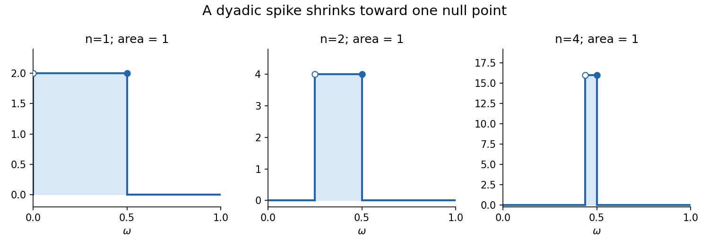

<h1 id="a/3/b/iii/solution">Solution</h1>

↑ **Parent:** [Iii](../iii.md)

There is an indexing error at the printed initial time. The dyadic [sigma-algebra](../../../../../../sigma-algebra.md) $\mathcal F_0$ is trivial, whereas the stated formula gives

$$
X_0=\mathbf1_{(0,1/2]}.
$$

This is not $\mathcal F_0$-measurable. Moreover $\mathbb EX_0=1/2$ and $\mathbb EX_1=1$, so the process cannot be a [martingale](../../../../../../martingale-split.md) on all of $\mathbb N_0$ as printed.

For every $n\geq1$, its support $I_n=(1/2-2^{-n},1/2]$ is one atom of $\mathcal F_n$, so $X_n$ is adapted and integrable with [expected value](../../../../../../expected-value-split.md) one. At the next dyadic level, $I_n$ splits into two equal-measure children; $X_{n+1}$ is zero on its left child and $2^{n+1}$ on its right child $I_{n+1}$. Its conditional average on the parent is $2^n$, and on every other parent it is zero. Hence

$$
\mathbb E(X_{n+1}\mid\mathcal F_n)=X_n
\qquad(n\geq1).
$$

Thus **the printed process is a [martingale](../../../../../../martingale-split.md) from time one onward**. The intended full-index repair is to define $X_0\equiv1$ and leave all $n\geq1$ terms unchanged, since then $\mathbb E(X_1\mid\mathcal F_0)=1$.

If $\omega\neq1/2$, it eventually lies outside the shrinking intervals, so $X_n(\omega)\to0$. At the single [null set](../../../../../../null-set.md) $\omega=1/2$, the values tend to infinity. Therefore

$$
\boxed{X_n\to0\text{ almost surely},\qquad
\lim_n\mathbb EX_n=1.}
$$

The repaired [martingale](../../../../../../martingale-split.md) is not uniformly integrable and does not converge in $L^1$. This is the [time-zero correction for a half-point dyadic spike martingale](../../../../../../time-zero-correction-for-a-half-point-dyadic-spike-martingale.md).

**[Figure 1](#a/3/b/iii/image-shrinking-dyadic-support-preserves-expected-value-while-the-values-tend-to-zero-almost-everywhere). Shrinking dyadic support preserves expected value while the values tend to zero almost everywhere**.

## ↑ Ancestors (14)

1. [Iii](../iii.md)
2. [B](../../b.md)
3. [3](../../../3.md)
4. [A](../../../../a.md)
5. [2007](../../../../../2007-split.md)
6. [Past exam of the martingales and financial mathematics course of the University of Oxford](../../../../../split.md)
7. [Martingales and financial mathematics course of the University of Oxford](../../../../../../martingales-and-financial-mathematics-course-of-the-university-of-oxford.md)
8. [Year 3 of the mathematics course of the University of Oxford](../../../../../../year-3-of-the-mathematics-course-of-the-university-of-oxford.md)
9. [Mathematics course of the University of Oxford](../../../../../../mathematics-course-of-the-university-of-oxford.md)
10. [Undergraduate course of the University of Oxford](../../../../../../undergraduate-course-of-the-university-of-oxford.md)
11. [Course of the University of Oxford](../../../../../../course-of-the-university-of-oxford.md)
12. [University of Oxford](../../../../../../university-of-oxford-split.md)
13. [List of universities](../../../../../../list-of-universities.md)
14. [Codex Wiki](../../../../../../split.md)
