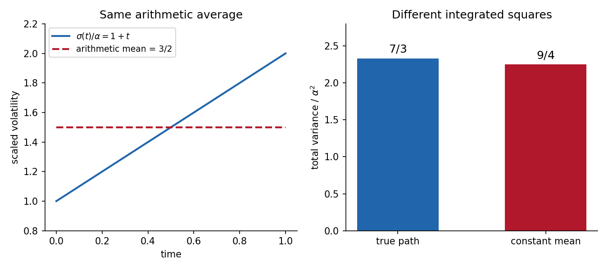

<h1 id="b/5/d/solution">Solution</h1>

↑ **Parent:** [D](../d.md)

Over the stated year, the true total [variance](../../../../../variance-split.md) is

$$
v_{\rm true}=\alpha^2\int_0^1(1+t)^2dt
=\frac73\alpha^2.
$$

The second trader uses $v_{\rm offered}=(3\alpha/2)^2=9\alpha^2/4$. Their difference is

$$
\boxed{v_{\rm true}-v_{\rm offered}=\frac{\alpha^2}{12}>0}
$$

when $\alpha\neq0$. A nondegenerate [European call option](../../../../../european-call-option.md) has positive [option vega](../../../../../option-vega.md), equivalently a price strictly increasing in total [variance](../../../../../variance-split.md). The offered price is therefore below the model value, so **buy the option** in the stated comparison.

If the deterministic [volatility](../../../../../financial-volatility.md) path is indeed the true one and the frictionless Black-Scholes trading assumptions apply, buy the cheap option and short its [replicating portfolio](../../../../../replicating-strategy.md) computed with that true path. The initial cash received is the positive price difference, while the two terminal payoffs cancel exactly. Investing the initial surplus yields a strictly positive terminal gain with no net claim liability, an [arbitrage](../../../../../arbitrage.md) within this model. A mere uncertain [volatility](../../../../../financial-volatility.md) belief would not by itself provide that replication guarantee. At $\alpha=0$ both variances coincide and this price difference disappears.

**[Figure 2](#b/5/d/image-equal-average-volatility-does-not-imply-equal-integrated-variance). Equal average volatility does not imply equal integrated variance**.

## ↑ Ancestors (13)

1. [D](../d.md)
2. [5](../../5.md)
3. [B](../../../b.md)
4. [2007](../../../../2007-split.md)
5. [Past exam of the martingales and financial mathematics course of the University of Oxford](../../../../split.md)
6. [Martingales and financial mathematics course of the University of Oxford](../../../../../martingales-and-financial-mathematics-course-of-the-university-of-oxford.md)
7. [Year 3 of the mathematics course of the University of Oxford](../../../../../year-3-of-the-mathematics-course-of-the-university-of-oxford.md)
8. [Mathematics course of the University of Oxford](../../../../../mathematics-course-of-the-university-of-oxford.md)
9. [Undergraduate course of the University of Oxford](../../../../../undergraduate-course-of-the-university-of-oxford.md)
10. [Course of the University of Oxford](../../../../../course-of-the-university-of-oxford.md)
11. [University of Oxford](../../../../../university-of-oxford-split.md)
12. [List of universities](../../../../../list-of-universities.md)
13. [Codex Wiki](../../../../../split.md)
