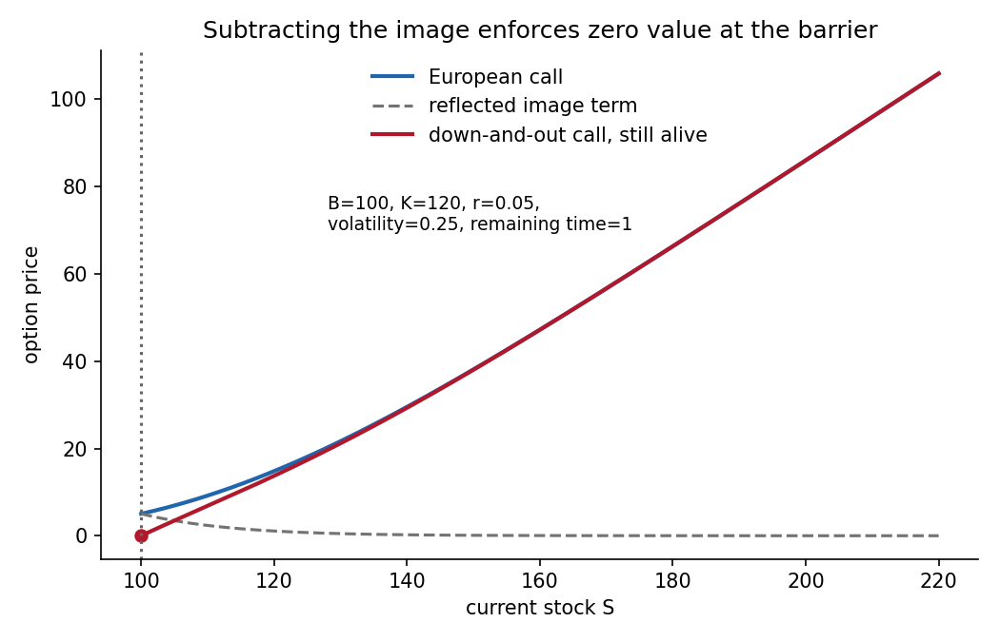

<h1 id="b/8/b/solution">Solution</h1>

↑ **Parent:** [B](../b.md)

A [down-and-out option](../../../../../down-and-out-claim.md) with no rebate pays $(S_T-K)_+$ only if the stock has stayed above the lower barrier $B$ up to maturity; if the barrier is hit, it expires worthless. For an unknocked-out contract currently at $S>B$, apply part (a) to the ordinary [European call option](../../../../../european-call-option.md) price:

$$
\boxed{C^{DO}(t,S)=C^E(t,S;K)
-\left(\frac SB\right)^{1-2r/\sigma^2}
C^E(t,B^2/S;K),\qquad K\geq B.}
$$

Both terms solve the PDE. At $S=B$ they cancel, enforcing the absorbing boundary. At maturity and $S>B$, the reflected stock value is $B^2/S<B\leq K$, so the reflected [call option](../../../../../call-option.md) is zero and the required terminal [contingent claim payoff](../../../../../contingent-claim-payoff.md) remains. Standard growth and uniqueness conditions for the killed pricing problem identify this solution as the option value.

If the contract has already hit its barrier, its value is zero regardless of a later hypothetical stock recovery. Thus the formula is conditional on survival to the current time; the barrier history is part of the contract state.

**[Figure 3](#b/8/b/image-the-reflected-call-term-cancels-the-option-value-at-the-lower-barrier). The reflected call term cancels the option value at the lower barrier**.

## ↑ Ancestors (13)

1. [B](../b.md)
2. [8](../../8.md)
3. [B](../../../b.md)
4. [2007](../../../../2007-split.md)
5. [Past exam of the martingales and financial mathematics course of the University of Oxford](../../../../split.md)
6. [Martingales and financial mathematics course of the University of Oxford](../../../../../martingales-and-financial-mathematics-course-of-the-university-of-oxford.md)
7. [Year 3 of the mathematics course of the University of Oxford](../../../../../year-3-of-the-mathematics-course-of-the-university-of-oxford.md)
8. [Mathematics course of the University of Oxford](../../../../../mathematics-course-of-the-university-of-oxford.md)
9. [Undergraduate course of the University of Oxford](../../../../../undergraduate-course-of-the-university-of-oxford.md)
10. [Course of the University of Oxford](../../../../../course-of-the-university-of-oxford.md)
11. [University of Oxford](../../../../../university-of-oxford-split.md)
12. [List of universities](../../../../../list-of-universities.md)
13. [Codex Wiki](../../../../../split.md)
