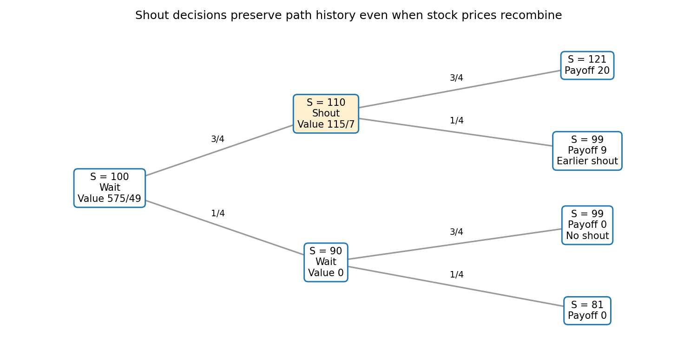

# 2008

↑ **Parent:** [Past exam of the martingales and financial mathematics course of the University of Oxford](../past-exam-of-the-martingales-and-financial-mathematics-course-of-the-university-of-oxford.md)

**Table of contents**

- [A](#a)
  - [1](#a/1)
    - [a](#a/1/a)
      - [Solution](#a/1/a/solution)
    - [b](#a/1/b)
      - [i](#a/1/b/i)
        - [Solution](#a/1/b/i/solution)
      - [ii](#a/1/b/ii)
        - [Solution](#a/1/b/ii/solution)
      - [iii](#a/1/b/iii)
        - [Solution](#a/1/b/iii/solution)
    - [c](#a/1/c)
      - [Solution](#a/1/c/solution)
  - [2](#a/2)
    - [a](#a/2/a)
      - [i](#a/2/a/i)
        - [Solution](#a/2/a/i/solution)
      - [ii](#a/2/a/ii)
        - [Solution](#a/2/a/ii/solution)
    - [b](#a/2/b)
      - [i](#a/2/b/i)
        - [Solution](#a/2/b/i/solution)
      - [ii](#a/2/b/ii)
        - [Solution](#a/2/b/ii/solution)
    - [c](#a/2/c)
      - [Solution](#a/2/c/solution)
  - [3](#a/3)
    - [a](#a/3/a)
      - [i](#a/3/a/i)
        - [Solution](#a/3/a/i/solution)
      - [ii](#a/3/a/ii)
        - [Solution](#a/3/a/ii/solution)
      - [iii](#a/3/a/iii)
        - [Solution](#a/3/a/iii/solution)
    - [b](#a/3/b)
      - [i](#a/3/b/i)
        - [Solution](#a/3/b/i/solution)
      - [ii](#a/3/b/ii)
        - [Solution](#a/3/b/ii/solution)
      - [iii](#a/3/b/iii)
        - [Solution](#a/3/b/iii/solution)
  - [4](#a/4)
    - [a](#a/4/a)
      - [i](#a/4/a/i)
        - [Solution](#a/4/a/i/solution)
      - [ii](#a/4/a/ii)
        - [Solution](#a/4/a/ii/solution)
      - [iii](#a/4/a/iii)
        - [Solution](#a/4/a/iii/solution)
    - [b](#a/4/b)
      - [i](#a/4/b/i)
        - [Solution](#a/4/b/i/solution)
      - [ii](#a/4/b/ii)
        - [Solution](#a/4/b/ii/solution)
- [B](#b)
  - [5](#b/5)
    - [a](#b/5/a)
      - [Solution](#b/5/a/solution)
    - [b](#b/5/b)
      - [Solution](#b/5/b/solution)
    - [c](#b/5/c)
      - [Solution](#b/5/c/solution)
    - [d](#b/5/d)
      - [Solution](#b/5/d/solution)
  - [6](#b/6)
    - [i](#b/6/i)
      - [a](#b/6/i/a)
        - [Solution](#b/6/i/a/solution)
      - [b](#b/6/i/b)
        - [Solution](#b/6/i/b/solution)
      - [c](#b/6/i/c)
        - [Solution](#b/6/i/c/solution)
    - [ii](#b/6/ii)
      - [Solution](#b/6/ii/solution)
  - [7](#b/7)
    - [a](#b/7/a)
      - [Solution](#b/7/a/solution)
    - [b](#b/7/b)
      - [Solution](#b/7/b/solution)
    - [c](#b/7/c)
      - [Solution](#b/7/c/solution)
    - [d](#b/7/d)
      - [Solution](#b/7/d/solution)
  - [8](#b/8)
    - [a](#b/8/a)
      - [Solution](#b/8/a/solution)
    - [b](#b/8/b)
      - [Solution](#b/8/b/solution)
    - [c](#b/8/c)
      - [Solution](#b/8/c/solution)
    - [d](#b/8/d)
      - [Solution](#b/8/d/solution)

## A

↑ **Parent:** [2008](2008.md)

<h3 id="a/1">1</h3>

↑ **Parent:** [A](#a)

<h4 id="a/1/a">a</h4>

↑ **Parent:** [1](#a/1)

<h5 id="a/1/a/solution">Solution</h5>

↑ **Parent:** [A](#a/1/a)

A [filtration](../stochastic-process.md#filtration-probability-theory) is an increasing sequence of sub-sigma-algebras $\mathcal F_n\subseteq\mathcal F$: if $m\leq n$, then $\mathcal F_m\subseteq\mathcal F_n$. It represents information available through each time.

A [stopping time](../martingale.md#stopping-time) $T:\Omega\to\mathbb N_0\cup\{\infty\}$ satisfies

$$
\boxed{\{T\leq n\}\in\mathcal F_n\quad\text{for every }n\geq0.}
$$

Thus whether stopping has already occurred is determined by the current information.

<h4 id="a/1/b">b</h4>

↑ **Parent:** [1](#a/1)

<h5 id="a/1/b/i">i</h5>

↑ **Parent:** [B](#a/1/b)

<h6 id="a/1/b/i/solution">Solution</h6>

↑ **Parent:** [I](#a/1/b/i)

The whole space belongs to $\mathcal F_T$, since $\Omega\cap\{T\leq n\}=\{T\leq n\}\in\mathcal F_n$. If $A\in\mathcal F_T$, then

$$
A^c\cap\{T\leq n\}=\{T\leq n\}\setminus(A\cap\{T\leq n\})\in\mathcal F_n.
$$

If $A_j\in\mathcal F_T$, then $(\bigcup_jA_j)\cap\{T\leq n\}=\bigcup_j(A_j\cap\{T\leq n\})$ is also in $\mathcal F_n$. These are precisely the sigma-algebra closure properties, so $\mathcal F_T$ is a sigma-algebra.

For every integer $m\geq0$,

$$
\{T\leq m\}\cap\{T\leq n\}=\{T\leq\min(m,n)\}\in\mathcal F_n.
$$

Hence $\{T\leq m\}\in\mathcal F_T$. Such threshold sets generate the Borel sigma-algebra on $\mathbb N_0\cup\{\infty\}$, proving **$T$ is $\mathcal F_T$-measurable**. This is the [stopping-time sigma-algebra](../martingale.md#stopping-time-sigma-algebra).

<h5 id="a/1/b/ii">ii</h5>

↑ **Parent:** [B](#a/1/b)

<h6 id="a/1/b/ii/solution">Solution</h6>

↑ **Parent:** [Ii](#a/1/b/ii)

For $A\in\mathcal F_S$, write

$$
A\cap\{S\leq T\}\cap\{T\leq n\}
=\bigcup_{k=0}^n\left[A\cap\{S=k\}\cap\{k\leq T\leq n\}\right].
$$

The first two factors together belong to $\mathcal F_k$, since $A\cap\{S=k\}$ is the difference of its intersections with $\{S\leq k\}$ and $\{S\leq k-1\}$. Also $\{k\leq T\leq n\}\in\mathcal F_n$ by the [stopping time](../martingale.md#stopping-time) property. The filtration inclusion puts every term, and therefore the union, in $\mathcal F_n$. By definition,

$$
\boxed{A\cap\{S\leq T\}\in\mathcal F_T.}
$$

<h5 id="a/1/b/iii">iii</h5>

↑ **Parent:** [B](#a/1/b)

<h6 id="a/1/b/iii/solution">Solution</h6>

↑ **Parent:** [Iii](#a/1/b/iii)

If $S\leq T$, then $\{S\leq T\}=\Omega$. The previous result says that every $A\in\mathcal F_S$ equals $A\cap\{S\leq T\}\in\mathcal F_T$. Thus

$$
\boxed{\mathcal F_S\subseteq\mathcal F_T.}
$$

Information known at the earlier stopping time remains known at the later stopping time.

<h4 id="a/1/c">c</h4>

↑ **Parent:** [1](#a/1)

<h5 id="a/1/c/solution">Solution</h5>

↑ **Parent:** [C](#a/1/c)

Both stopped variables are integrable, since $|X_S|,|X_T|\leq\sum_{j=0}^N|X_j|$. Also $X_S$ is $\mathcal F_S$-measurable: intersecting $\{X_S\in B\}$ with $\{S\leq n\}$ gives the finite union $\bigcup_{j\leq\min(n,N)}\{S=j,X_j\in B\}$ in $\mathcal F_n$ for each Borel $B$.

The increment identity is

$$
X_T-X_S=\sum_{k=0}^{N-1}(X_{k+1}-X_k)1_{\{S\leq k<T\}}.
$$

For $A\in\mathcal F_S$, the event $A\cap\{S\leq k\}\cap\{T>k\}$ belongs to $\mathcal F_k$. The [martingale](../martingale.md) increment has conditional mean zero given that sigma-algebra. Multiplying by its indicator and using the [tower property](../measure-theory.md#law-of-total-expectation) gives zero expectation for each summand. Therefore

$$
\mathbb E[1_A(X_T-X_S)]=0\qquad(A\in\mathcal F_S).
$$

Together with measurability and integrability, this is the defining property of [conditional expectation](../measure-theory.md#conditional-expectation), proving the bounded [optional sampling theorem](../martingale.md#optional-sampling-theorem-for-a-supermartingale)

$$
\boxed{\mathbb E(X_T\mid\mathcal F_S)=X_S\quad\text{almost surely}.}
$$

<h3 id="a/2">2</h3>

↑ **Parent:** [A](#a)

<h4 id="a/2/a">a</h4>

↑ **Parent:** [2](#a/2)

<h5 id="a/2/a/i">i</h5>

↑ **Parent:** [A](#a/2/a)

<h6 id="a/2/a/i/solution">Solution</h6>

↑ **Parent:** [I](#a/2/a/i)

A real [random variable](../random-variable.md) is a measurable map from $(\Omega,\mathcal F)$ to $\mathbb R$ with its Borel sigma-algebra. Equivalently, $\{X\leq x\}\in\mathcal F$ for every real $x$. Its [cumulative distribution function](../probability-distribution.md#cumulative-distribution-function) is

$$
\boxed{F(x)=\mathbb P(X\leq x).}
$$

It is nondecreasing, right-continuous, and tends to zero and one at the two infinities.

<h5 id="a/2/a/ii">ii</h5>

↑ **Parent:** [A](#a/2/a)

<h6 id="a/2/a/ii/solution">Solution</h6>

↑ **Parent:** [Ii](#a/2/a/ii)

Let $\mu_X$ be the distribution measure of $X$. The measurable change-of-variables rule for expectations gives

$$
\mathbb EX=\int_{\mathbb R}x\,\mu_X(dx)=\int_{\mathbb R}x\,dF(x).
$$

For the second equality, let $U$ be uniform on $(0,1)$ and $Q=F^\leftarrow$. The [quantile function](../probability-distribution.md#quantile-function) is measurable and satisfies

$$
Q(u)\leq x\quad\Longleftrightarrow\quad u\leq F(x).
$$

This equivalence uses monotonicity and right-continuity of $F$. Consequently $\mathbb P(Q(U)\leq x)=F(x)$: $Q(U)$ has the same distribution as $X$. In particular $\int_0^1|Q(u)|\,du=\mathbb E|X|<\infty$, so the signed integral is legitimate. Hence the [quantile expectation formula](../probability-distribution.md#quantile-expectation-formula) is

$$
\boxed{\mathbb EX=\int_{\mathbb R}x\,dF(x)
=\int_0^1F^\leftarrow(u)\,du.}
$$

No continuity or strict increase of the distribution function is required.

<h4 id="a/2/b">b</h4>

↑ **Parent:** [2](#a/2)

<h5 id="a/2/b/i">i</h5>

↑ **Parent:** [B](#a/2/b)

<h6 id="a/2/b/i/solution">Solution</h6>

↑ **Parent:** [I](#a/2/b/i)

The variables are [independent and identically distributed](../random-variable.md#independent-and-identically-distributed-random-variables) if they all have one common probability distribution and every finite selection satisfies

$$
\mathbb P(X_{n_1}\in B_1,\ldots,X_{n_k}\in B_k)
=\prod_{j=1}^k\mathbb P(X_{n_j}\in B_j)
$$

for distinct indices and arbitrary Borel sets. The condition concerns joint distributions, not merely pairwise correlations.

<h5 id="a/2/b/ii">ii</h5>

↑ **Parent:** [B](#a/2/b)

<h6 id="a/2/b/ii/solution">Solution</h6>

↑ **Parent:** [Ii](#a/2/b/ii)

The [strong law of large numbers](../convergence-of-random-variables.md#strong-law-of-large-numbers) states that if $X_n$ are independent and identically distributed real random variables with $\mathbb E|X_1|<\infty$, then

$$
\boxed{\frac1N\sum_{n=1}^NX_n\longrightarrow\mathbb EX_1
\quad\text{almost surely}.}
$$

The first absolute moment condition is part of the standard statement.

<h4 id="a/2/c">c</h4>

↑ **Parent:** [2](#a/2)

<h5 id="a/2/c/solution">Solution</h5>

↑ **Parent:** [C](#a/2/c)

The zero means and orthogonality give the exact second moment

$$
\mathbb E A_N^2=\frac1{N^2}\sum_{n,m\leq N}\mathbb E(X_nX_m)=\frac1N.
$$

Thus $A_N\to0$ in $L^2$. [Chebyshev's inequality](../probability-inequality.md#chebyshev-s-inequality) gives the requested [weak law of large numbers](../convergence-of-random-variables.md#weak-law-of-large-numbers):

$$
\boxed{\mathbb P(|A_N|\geq\epsilon)\leq\frac1{N\epsilon^2}\longrightarrow0.}
$$

Independence is unnecessary; the stated second-moment orthogonality is sufficient.

For an explicit almost surely convergent subsequence take $N_j=2^j$. For each positive integer $m$,

$$
\sum_j\mathbb P(|A_{2^j}|\geq1/m)\leq m^2\sum_j2^{-j}<\infty.
$$

The [First Borel-Cantelli lemma](../probability-theory.md#borel-cantelli-first-lemma) makes only finitely many such exceedances occur. Intersecting the resulting probability-one events over $m$ gives **$A_{2^j}\to0$ almost surely**.

<h3 id="a/3">3</h3>

↑ **Parent:** [A](#a)

<h4 id="a/3/a">a</h4>

↑ **Parent:** [3](#a/3)

<h5 id="a/3/a/i">i</h5>

↑ **Parent:** [A](#a/3/a)

<h6 id="a/3/a/i/solution">Solution</h6>

↑ **Parent:** [I](#a/3/a/i)

A version of $\mathbb E(X\mid\mathcal G)$ is an integrable $\mathcal G$-measurable random variable $Y$ satisfying

$$
\boxed{\int_A Y\,d\mathbb P=\int_A X\,d\mathbb P
\quad\text{for every }A\in\mathcal G.}
$$

The measurability requirement restricts $Y$ to the available information; the integral identities preserve all averages visible to that information. This is the definition of [conditional expectation](../measure-theory.md#conditional-expectation).

<h5 id="a/3/a/ii">ii</h5>

↑ **Parent:** [A](#a/3/a)

<h6 id="a/3/a/ii/solution">Solution</h6>

↑ **Parent:** [Ii](#a/3/a/ii)

Let $Y,Z$ be two versions. For every $A\in\mathcal G$, their defining identities imply $\int_A(Y-Z)\,d\mathbb P=0$. The set $A_m=\{Y\geq Z+1/m\}$ belongs to $\mathcal G$, and therefore

$$
0=\int_{A_m}(Y-Z)\,d\mathbb P\geq\frac1m\mathbb P(A_m).
$$

Every $A_m$ is null. Their union is $\{Y>Z\}$, so it too is null. Reversing $Y,Z$ proves the same for $\{Z>Y\}$. Hence **versions of conditional expectation are equal almost surely**.

<h5 id="a/3/a/iii">iii</h5>

↑ **Parent:** [A](#a/3/a)

<h6 id="a/3/a/iii/solution">Solution</h6>

↑ **Parent:** [Iii](#a/3/a/iii)

A [martingale](../martingale.md) is an adapted process $X_n$ with $\mathbb E|X_n|<\infty$ for every $n$ and

$$
\boxed{\mathbb E(X_{n+1}\mid\mathcal F_n)=X_n\quad\text{almost surely}.}
$$

Adaptedness means that $X_n$ is $\mathcal F_n$-measurable. Iterating the [tower property](../measure-theory.md#law-of-total-expectation) gives the analogous identity for any two deterministic times $m\leq n$.

<h4 id="a/3/b">b</h4>

↑ **Parent:** [3](#a/3)

<h5 id="a/3/b/i">i</h5>

↑ **Parent:** [B](#a/3/b)

<h6 id="a/3/b/i/solution">Solution</h6>

↑ **Parent:** [I](#a/3/b/i)

The [supermartingale](../martingale.md#supermartingale) property and linearity of [conditional expectation](../measure-theory.md#conditional-expectation) give, for $n\geq1$,

$$
G_n=\mathbb E(X_n\mid\mathcal F_{n-1})-X_{n-1}\leq0.
$$

Each $G_n$ is integrable and $\mathcal F_{n-1}$-measurable, while $G_0=0$. Thus $Z_n$ is integrable and

$$
\boxed{Z_{n+1}-Z_n=G_{n+1}\leq0.}
$$

Moreover, all terms $G_j$, $j\leq n+1$, are $\mathcal F_n$-measurable, so $Z_{n+1}\in m\mathcal F_n$. This is predictability of the decreasing component in the [Doob decomposition theorem](../martingale.md#doob-decomposition-theorem).

<h5 id="a/3/b/ii">ii</h5>

↑ **Parent:** [B](#a/3/b)

<h6 id="a/3/b/ii/solution">Solution</h6>

↑ **Parent:** [Ii](#a/3/b/ii)

The process $Y_n=X_n-Z_n$ is adapted and integrable. Since $Z_{n+1}=Z_n+G_{n+1}$ is already $\mathcal F_n$-measurable,

$$
\begin{aligned}
\mathbb E(Y_{n+1}\mid\mathcal F_n)
&=\mathbb E(X_{n+1}\mid\mathcal F_n)-Z_n-G_{n+1}\\
&=X_n+G_{n+1}-Z_n-G_{n+1}=Y_n.
\end{aligned}
$$

Therefore **$Y$ is a martingale**, and $X=Y+Z$ is the [Doob decomposition in discrete time](../martingale.md#doob-decomposition-theorem). Its normalization is $Z_0=0$, so the initial value is included in $Y_0=X_0$.

<h5 id="a/3/b/iii">iii</h5>

↑ **Parent:** [B](#a/3/b)

<h6 id="a/3/b/iii/solution">Solution</h6>

↑ **Parent:** [Iii](#a/3/b/iii)

In any proposed decomposition, $Z_n'=X_n-Y_n'$ is integrable. Its increment is $\mathcal F_{n-1}$-measurable by predictability. Taking [conditional expectation](../measure-theory.md#conditional-expectation) of the difference equation gives

$$
G_n=\mathbb E(X_n-X_{n-1}\mid\mathcal F_{n-1})
=\mathbb E(Y_n'-Y_{n-1}'\mid\mathcal F_{n-1})+(Z_n'-Z_{n-1}')
=Z_n'-Z_{n-1}'.
$$

The martingale increment has conditional mean zero, and a measurable integrable variable equals its own conditional expectation. Starting from $Z_0'=0$, summation gives $Z_n'=\sum_{j=0}^nG_j=Z_n$. Hence $Y_n'=X_n-Z_n'=Y_n$. Thus **the normalized predictable decomposition is unique**, with a common probability-one event available for all integer times by countability.

<h3 id="a/4">4</h3>

↑ **Parent:** [A](#a)

<h4 id="a/4/a">a</h4>

↑ **Parent:** [4](#a/4)

<h5 id="a/4/a/i">i</h5>

↑ **Parent:** [A](#a/4/a)

<h6 id="a/4/a/i/solution">Solution</h6>

↑ **Parent:** [I](#a/4/a/i)

A [Borel measurable function](../measure-theory.md#borel-measurable-function) has $f^{-1}(B)\in\mathcal B$ for every Borel set $B$. Thus the upper-ray condition is necessary.

For sufficiency, note that the rays generate the stipulated sigma-algebra: $(a,b]=(a,\infty)\setminus(b,\infty)$, and $(y,\infty)=\bigcup_{m>y}(y,m]$, with integer $m$. The family

$$
\mathcal H=\{B\subseteq\mathbb R:f^{-1}(B)\in\mathcal B\}
$$

is a sigma-algebra because inverse images preserve complements and countable unions. If it contains all upper rays, it contains their generated Borel sigma-algebra. Therefore **upper-ray preimages suffice to prove Borel measurability**.

<h5 id="a/4/a/ii">ii</h5>

↑ **Parent:** [A](#a/4/a)

<h6 id="a/4/a/ii/solution">Solution</h6>

↑ **Parent:** [Ii](#a/4/a/ii)

Every open interval is Borel, since $(a,b)=\bigcup_{m\geq1}(a,b-1/m]$, omitting empty pieces. Open subsets of the line are countable unions of open intervals and hence Borel. Conversely, each half-open interval is obtained from open sets by sigma-algebra operations, so this is the usual Borel sigma-algebra.

A continuous function has open, and therefore Borel, inverse images of open sets. Since open sets generate the target Borel sigma-algebra, it is a [Borel measurable function](../measure-theory.md#borel-measurable-function). A discontinuous example is **$1_{[0,\infty)}$**, whose only level sets are built from the Borel half-lines; it jumps at zero.

<h5 id="a/4/a/iii">iii</h5>

↑ **Parent:** [A](#a/4/a)

<h6 id="a/4/a/iii/solution">Solution</h6>

↑ **Parent:** [Iii](#a/4/a/iii)

For a [lower semicontinuous](../calculus.md#lower-semicontinuity) function, each upper-ray inverse image is open, hence Borel, so part (a)(i) applies directly. For an [upper semicontinuous](../calculus.md#upper-semicontinuity) $h$, the function $-h$ is lower semicontinuous because

$$
\{-h>y\}=\{h<-y\}
$$

is open. Negation is continuous and Borel measurable, so $h=-(-h)$ is Borel measurable too. Thus **both semicontinuity classes are Borel measurable**.

<h4 id="a/4/b">b</h4>

↑ **Parent:** [4](#a/4)

<h5 id="a/4/b/i">i</h5>

↑ **Parent:** [B](#a/4/b)

<h6 id="a/4/b/i/solution">Solution</h6>

↑ **Parent:** [I](#a/4/b/i)

Boundedness of $f$ makes $\varphi$ finite and nonnegative. Suppose $\varphi(x_0)<a$. By its infimum definition, some $n$ satisfies $\varphi_n(x_0)<a$. If $|x-x_0|<1/(2n)$, then

$$
(x-1/(2n),x+1/(2n))\subset(x_0-1/n,x_0+1/n).
$$

The supremum over the smaller interval cannot exceed that over the larger one. Hence

$$
\varphi(x)\leq\varphi_{2n}(x)\leq\varphi_n(x_0)<a.
$$

Thus $\{\varphi<a\}$ is open for every $a$, proving **$\varphi$ is upper semicontinuous**. Measurability of the original $f$ was never needed: these are purely pointwise oscillation bounds.

<h5 id="a/4/b/ii">ii</h5>

↑ **Parent:** [B](#a/4/b)

<h6 id="a/4/b/ii/solution">Solution</h6>

↑ **Parent:** [Ii](#a/4/b/ii)

If $f$ is continuous at $x_0$, choose a small interval on which $|f(s)-f(x_0)|<\epsilon/2$. The triangle inequality makes its oscillation less than $\epsilon$, so $\varphi(x_0)=0$.

Conversely, if $\varphi(x_0)=0$, then for every $\epsilon>0$ some $n$ has $\varphi_n(x_0)<\epsilon$. As $x_0$ itself belongs to the interval used in that supremum, $|f(x)-f(x_0)|<\epsilon$ for $|x-x_0|<1/n$. Thus $f$ is continuous at $x_0$.

The [continuity set of a function](../calculus.md#continuity-set-of-a-function) is therefore

$$
\boxed{\{x:f\text{ is continuous at }x\}
=\bigcap_{m\geq1}\{x:\varphi(x)<1/m\}.}
$$

Each set in the intersection is open by part (i), so this is a [G-delta set](../topology.md#g-delta-set) and in particular a Borel set, even if $f$ itself is not measurable.

<h2 id="b">B</h2>

↑ **Parent:** [2008](2008.md)

<h3 id="b/5">5</h3>

↑ **Parent:** [B](#b)

<h4 id="b/5/a">a</h4>

↑ **Parent:** [5](#b/5)

<h5 id="b/5/a/solution">Solution</h5>

↑ **Parent:** [A](#b/5/a)

Applying [Itô's formula](../stochastic-calculus.md#ito-s-lemma) to $\log S$ gives the [geometric Brownian motion](../stochastic-calculus.md#geometric-brownian-motion)

$$
\boxed{S_t=s\exp\{(\mu-\tfrac12\sigma^2)t+\sigma W_t\}.}
$$

The Gaussian exponential moment $\mathbb E e^{aW_t}=e^{a^2t/2}$ then yields

$$
\mathbb E S_t^2=s^2e^{(2\mu-\sigma^2)t}\mathbb E e^{2\sigma W_t}
=\boxed{s^2e^{(2\mu+\sigma^2)t}.}
$$

This expectation is under the physical measure and therefore uses drift $\mu$.

<h4 id="b/5/b">b</h4>

↑ **Parent:** [5](#b/5)

<h5 id="b/5/b/solution">Solution</h5>

↑ **Parent:** [B](#b/5/b)

Under the [risk-neutral measure](../mathematical-finance.md#risk-neutral-measure), the same second-moment formula uses drift $r$. Discounting the [power option](../fundamental-theorem-of-asset-pricing.md#power-option) payoff therefore gives

$$
V(t,s)=e^{-r(T-t)}\mathbb E[S_T^2\mid S_t=s]
=\boxed{s^2e^{(r+\sigma^2)(T-t)}}.
$$

Let $a(t)=e^{(r+\sigma^2)(T-t)}$ and $B_t=e^{rt}$. The [delta hedging](../mathematical-finance.md#delta-hedge) portfolio holds

$$
\boxed{\Delta_t=2a(t)S_t\ \text{stock units},\qquad
\beta_t=-\frac{a(t)S_t^2}{B_t}\ \text{bank-account units}.}
$$

Its wealth is $\Delta_tS_t+\beta_tB_t=a(t)S_t^2=V_t$. To verify self financing, Itô's formula gives

$$
dV_t=(2\mu-r)V_t\,dt+2\sigma V_t\,dW_t
=\Delta_t\,dS_t+\beta_t\,dB_t.
$$

At maturity the wealth is $S_T^2$, completing replication.

<h4 id="b/5/c">c</h4>

↑ **Parent:** [5](#b/5)

<h5 id="b/5/c/solution">Solution</h5>

↑ **Parent:** [C](#b/5/c)

The stochastic differential computed above is

$$
dV_t=V_t\{(2\mu-r)\,dt+2\sigma\,dW_t\}.
$$

Thus this positive no-dividend traded claim behaves as a new [geometric Brownian motion](../stochastic-calculus.md#geometric-brownian-motion) asset with

$$
\boxed{\tilde\mu=2\mu-r,\qquad\tilde\sigma=2\sigma.}
$$

The transformed drift need not be positive, even though the three original market parameters were assumed positive. Under the risk-neutral measure it becomes $r$, as it must for a non-dividend traded asset.

<h4 id="b/5/d">d</h4>

↑ **Parent:** [5](#b/5)

<h5 id="b/5/d/solution">Solution</h5>

↑ **Parent:** [D](#b/5/d)

Let $F(t,s)$ be the ordinary Black-Scholes price of the terminal claim $G(S_T)$. Denote the new asset by $U_t=a(t)S_t^2$. Since it is strictly increasing in $S_t>0$, invert it as $s=\sqrt{U/a(t)}$ and write $H(t,U)=F(t,\sqrt{U/a(t)})$. Its derivative is

$$
H_U=\frac{sF_s}{2U}.
$$

The [replicating portfolio](../fundamental-theorem-of-asset-pricing.md#replicating-strategy) in the new asset and bank account therefore holds

$$
\boxed{\Gamma_t=\frac{S_tF_s(t,S_t)}{2U_t},\qquad
\beta_t=\frac{F(t,S_t)-\tfrac12S_tF_s(t,S_t)}{B_t}.}
$$

The wealth is $F$. The diffusion coefficient of $\Gamma\,dU$ is $2\sigma U\Gamma=\sigma SF_s$, agreeing with that of $dF$. Its drift together with the bank holding is

$$
(2\mu-r)\Gamma U+r\beta B
=\mu SF_s+r(F-SF_s),
$$

which equals the drift of $F$ by its Black-Scholes equation. This verifies self financing and terminal replication. Thus the square-payoff claim has nonzero volatility and can replace the original stock as the traded risky asset.

<h3 id="b/6">6</h3>

↑ **Parent:** [B](#b)

<h4 id="b/6/i">i</h4>

↑ **Parent:** [6](#b/6)

<h5 id="b/6/i/a">a</h5>

↑ **Parent:** [I](#b/6/i)

<h6 id="b/6/i/a/solution">Solution</h6>

↑ **Parent:** [A](#b/6/i/a)

The terminal put payoff obeys $0\leq(K-S_T)^+\leq K$. If the put cost more than the [zero-coupon bond](../mathematical-finance.md#zero-coupon-bond) paying $K$, sell the put and buy that bond. Invest the strictly positive initial difference in the bank account. At maturity the bond covers every possible put liability and the extra investment remains positive. This [arbitrage](../mathematical-finance.md#arbitrage) is excluded, so

$$
\boxed{P(t,S_t)\leq Ke^{-r(T-t)}.}
$$

<h5 id="b/6/i/b">b</h5>

↑ **Parent:** [I](#b/6/i)

<h6 id="b/6/i/b/solution">Solution</h6>

↑ **Parent:** [B](#b/6/i/b)

A stock share plus a put has terminal value $S_T+(K-S_T)^+=\max(S_T,K)\geq K$. If $S_t+P(t,S_t)<Ke^{-r(T-t)}$, buy that package and borrow the price of a bond paying $K$. The package covers the debt at maturity, while the strictly positive initial surplus can be invested. This would be an [arbitrage](../mathematical-finance.md#arbitrage). Consequently

$$
\boxed{P(t,S_t)\geq Ke^{-r(T-t)}-S_t.}
$$

Together with payoff nonnegativity, the lower bound can be strengthened to the maximum of this expression and zero.

<h5 id="b/6/i/c">c</h5>

↑ **Parent:** [I](#b/6/i)

<h6 id="b/6/i/c/solution">Solution</h6>

↑ **Parent:** [C](#b/6/i/c)

The difference between the high-strike and low-strike put payoffs satisfies

$$
0\leq(K_1-S_T)^+-(K_2-S_T)^+\leq K_1-K_2.
$$

If its price were negative, buying the nonnegative-payoff spread would generate an arbitrage. If its price exceeded the discounted maximum payoff, selling it and buying a bond for that maximum would generate an arbitrage. Thus the sharper inequality is

$$
\boxed{0\leq P(K_1)-P(K_2)\leq
(K_1-K_2)e^{-r(T-t)}.}
$$

For the positive-rate convention of the paper this implies the printed upper bound $K_1-K_2$. If rates were allowed to be negative, the undiscounted upper bound need not hold; the discounted bound is the correct rate-independent statement. This distinction is about the stated financial assumptions, not a change to the transcribed inequality.

<h4 id="b/6/ii">ii</h4>

↑ **Parent:** [6](#b/6)

<h5 id="b/6/ii/solution">Solution</h5>

↑ **Parent:** [Ii](#b/6/ii)

The call spread in the hint has payoff

$$
H_\epsilon(s)=\frac{(s-K)^+-(s-K-\epsilon)^+}{\epsilon}.
$$

It is between zero and one and converges to $1_{\{s>K\}}$ as $\epsilon\downarrow0$. In the [Black-Scholes model](../mathematical-finance.md#black-scholes-model) with positive volatility and $t<T$, the conditional terminal stock distribution has no atom at $K$. The strict and non-strict indicator therefore have the same discounted expectation. The [dominated convergence theorem](../measure-theory.md#dominated-convergence-theorem) in the risk-neutral pricing formula gives

$$
V_{\rm digital}
=\lim_{\epsilon\downarrow0}
\frac{C(t,S_t;K)-C(t,S_t;K+\epsilon)}{\epsilon}
=\boxed{-C_K(t,S_t;K).}
$$

Equivalently this is $e^{-r(T-t)}\Phi(d_2)$. The no-atom condition explains the endpoint subtlety: the displayed spread has value zero at $s=K$, whereas the printed digital pays one there. At maturity the strike derivative can be one-sided or undefined, so the smooth pricing identity is understood before expiry.

<h3 id="b/7">7</h3>

↑ **Parent:** [B](#b)

<h4 id="b/7/a">a</h4>

↑ **Parent:** [7](#b/7)

<h5 id="b/7/a/solution">Solution</h5>

↑ **Parent:** [A](#b/7/a)

A self-financing replicating strategy must fund both the claim's price change and its outgoing cash flow:

$$
dV_t+q_tS_t\,dt=\Delta_t\,dS_t+\beta_t\,dB_t,\qquad
V_t=\Delta_tS_t+\beta_tB_t.
$$

Apply [Itô's formula](../stochastic-calculus.md#ito-s-lemma) to $V(t,S_t)$. Matching the diffusion gives $\Delta=V_s$. Matching drift and eliminating $\beta B=V-sV_s$ gives the [Black-Scholes equation with claim dividends](../mathematical-finance.md#black-scholes-equation-with-claim-dividends)

$$
\boxed{V_t+\tfrac12\sigma^2s^2V_{ss}+rsV_s-rV+q_ts=0,\qquad
V(T,s)=\Psi(s).}
$$

The physical drift cancels because stock risk is hedged. The cash-flow term has a plus sign because it is a payment to the holder.

<h4 id="b/7/b">b</h4>

↑ **Parent:** [7](#b/7)

<h5 id="b/7/b/solution">Solution</h5>

↑ **Parent:** [B](#b/7/b)

Invest each cash payment $q_vS_v\,dv$ received at time $v$ in the bank account until $T$. Its accumulated terminal amount is $q_vS_ve^{r(T-v)}\,dv$, so the entire future stream is equivalent, path by path, to the terminal payment $\int_t^Tq_vS_ve^{r(T-v)}\,dv$.

The [risk-neutral pricing](../mathematical-finance.md#risk-neutral-pricing) formula, including this reinvested payoff, is

$$
\boxed{V(t,s)=e^{-r(T-t)}\mathbb E^{\mathbb Q}\left[
\Psi(\widetilde S_T)+\int_t^Tq_v\widetilde S_ve^{r(T-v)}\,dv
\,\middle|\,\widetilde S_t=s\right],}
$$

where $d\widetilde S_v=r\widetilde S_v\,dv+\sigma\widetilde S_v\,dW_v^{\mathbb Q}$. Equivalently, discount each cash flow directly to time $t$. This is the discounted-gains martingale principle underlying the PDE in part (a).

<h4 id="b/7/c">c</h4>

↑ **Parent:** [7](#b/7)

<h5 id="b/7/c/solution">Solution</h5>

↑ **Parent:** [C](#b/7/c)

Use the auxiliary diffusion $dX_v=\mu X_v\,dv+\sigma X_v\,dW_v$, started at $X_t=x$. Under sufficient regularity and integrability for the [Feynman-Kac formula](../stochastic-calculus.md#feynman-kac-formula),

$$
\boxed{F(t,x)=\mathbb E\left[
e^{-r(T-t)}\Psi(X_T)+
\int_t^Te^{-r(v-t)}d(v,X_v)\,dv
\,\middle|\,X_t=x\right].}
$$

To verify the signs, apply Itô's formula to $e^{-r(v-t)}F(v,X_v)$. Its drift is $e^{-r(v-t)}(F_t+\mu X_vF_x+\sigma^2X_v^2F_{xx}/2-rF)=-e^{-r(v-t)}d(v,X_v)$. Adding the accumulated source integral makes a martingale; taking expectations through $T$ proves the formula.

Here the auxiliary drift is the printed $\mu$, rather than automatically $r$: this part is a general terminal-value PDE, whose diffusion must match its generator.

<h4 id="b/7/d">d</h4>

↑ **Parent:** [7](#b/7)

<h5 id="b/7/d/solution">Solution</h5>

↑ **Parent:** [D](#b/7/d)

Linearity separates the terminal call payoff from the running payment stream. The first contributes the supplied European call price. Under the [risk-neutral measure](../mathematical-finance.md#risk-neutral-measure), $\mathbb E(S_v\mid S_t=s)=se^{r(v-t)}$, so the stream contributes

$$
\mathbb E^{\mathbb Q}\int_t^Te^{-r(v-t)}qS_v\,dv
=qs\int_t^Tdv=qs(T-t).
$$

Consequently

$$
\boxed{V(t,s)=s\Phi(d_1)-Ke^{-r(T-t)}\Phi(d_2)+qs(T-t).}
$$

This is the [claim dividends proportional to the underlying stock](../mathematical-finance.md#claim-dividends-proportional-to-the-underlying-stock) identity. The underlying itself is still non-dividend-paying; the cash flow belongs to the derivative.

<h3 id="b/8">8</h3>

↑ **Parent:** [B](#b)

<h4 id="b/8/a">a</h4>

↑ **Parent:** [8](#b/8)

<h5 id="b/8/a/solution">Solution</h5>

↑ **Parent:** [A](#b/8/a)

The risk-neutral one-step mean multiplier must equal the bank growth factor:

$$
qu+(1-q)d=e^r=1.05.
$$

Thus the [risk-neutral probability in a binomial market](../mathematical-finance.md#risk-neutral-probability-in-a-binomial-market) is

$$
\boxed{q=\frac{1.05-0.9}{1.1-0.9}=\frac34,\qquad1-q=\frac14.}
$$

It lies strictly between zero and one, consistent with the no-arbitrage inequality $d<e^r<u$.

<h4 id="b/8/b">b</h4>

↑ **Parent:** [8](#b/8)

<h5 id="b/8/b/solution">Solution</h5>

↑ **Parent:** [B](#b/8/b)

At maturity a shout has payoff $S_2-K$, while no shout gives $(S_2-K)^+$. If $S_2<K$, shouting creates a negative payoff and is strictly worse. If $S_2\geq K$, the two choices give exactly the same payoff, so shouting is optional and gives no improvement.

Thus **do not shout when out of the money; be indifferent when at or in the money**. The terminal stock values are 121, 99, and 81, so only the up-up node permits an indifferent shout with the given strike.

<h4 id="b/8/c">c</h4>

↑ **Parent:** [8](#b/8)

<h5 id="b/8/c/solution">Solution</h5>

↑ **Parent:** [C](#b/8/c)

If the first move is up, $S_1=110$ and $S_2$ can be 121 or 99. A shout now gives $\max(S_2,110)-101$, hence payoffs 20 and 9. Waiting until maturity or never shouting gives 20 and 0. The first policy is no worse on either branch and strictly better on the down branch, so **shout after the first up move**.

If the first move is down, $S_1=90$ and the terminal prices are 99 or 81. A shout would give $-2$ or $-11$, while waiting gives zero. Thus **do not shout after the first down move**. These comparisons use terminal payoffs directly, so no intermediate discounting can change their ordering.

<h4 id="b/8/d">d</h4>

↑ **Parent:** [8](#b/8)

<h5 id="b/8/d/solution">Solution</h5>

↑ **Parent:** [D](#b/8/d)

Shouting at zero locks in $S_0-K=-1$, producing terminal payoff $\max(S_2,100)-101$. Its pathwise values are 20 on $uu$ and $-1$ on each other path. Waiting and applying part (c) instead gives values 20 on $uu$, 9 on $ud$, and zero on $du,dd$. Therefore waiting dominates shouting now, strictly on events of positive probability.

Under the optimal [binomial shout option with signed lock-in](../mathematical-finance.md#binomial-shout-option-with-signed-lock-in), discount the latter terminal payoffs using independent risk-neutral transitions:

$$
V_0=\frac{q^2\,20+q(1-q)\,9}{1.05^2}
=\frac{(9/16)20+(3/16)9}{(21/20)^2}
=\boxed{\frac{575}{49}\approx11.7347.}
$$

The time-one option value is $115/7$ after an up move and zero after a down move. These values also reproduce the price by one-step backward induction.

**[Figure 1](#b/8/d/image-optimal-shout-decisions-and-the-four-path-dependent-terminal-payoffs). Optimal shout decisions and the four path-dependent terminal payoffs**.

The recombining stock price 99 has two different claim payoffs, because $ud$ has an earlier lock-in while $du$ does not. Keeping the path history is essential.

## ↑ Ancestors (9)

1. [Past exam of the martingales and financial mathematics course of the University of Oxford](../past-exam-of-the-martingales-and-financial-mathematics-course-of-the-university-of-oxford.md)
2. [Martingales and financial mathematics course of the University of Oxford](../university-of-oxford.md#martingales-and-financial-mathematics-course-of-the-university-of-oxford)
3. [Year 3 of the mathematics course of the University of Oxford](../university-of-oxford.md#year-3-of-the-mathematics-course-of-the-university-of-oxford)
4. [Mathematics course of the University of Oxford](../university-of-oxford.md#mathematics-course-of-the-university-of-oxford)
5. [Undergraduate course of the University of Oxford](../university-of-oxford.md#undergraduate-course-of-the-university-of-oxford)
6. [Course of the University of Oxford](../university-of-oxford.md#course-of-the-university-of-oxford)
7. [University of Oxford](../university-of-oxford.md)
8. [List of universities](../README.md#list-of-universities)
9. [Codex Wiki](../README.md)
