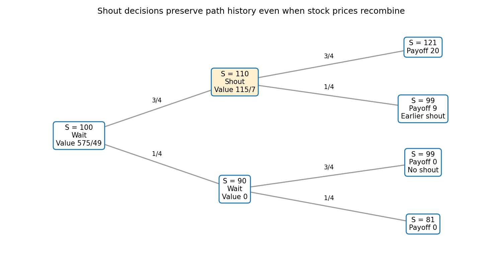

<h1 id="b/8/d/solution">Solution</h1>

↑ **Parent:** [D](../d.md)

Shouting at zero locks in $S_0-K=-1$, producing terminal payoff $\max(S_2,100)-101$. Its pathwise values are 20 on $uu$ and $-1$ on each other path. Waiting and applying part (c) instead gives values 20 on $uu$, 9 on $ud$, and zero on $du,dd$. Therefore waiting dominates shouting now, strictly on events of positive probability.

Under the optimal [binomial shout option with signed lock-in](../../../../../binomial-shout-option-with-signed-lock-in.md), discount the latter terminal payoffs using independent risk-neutral transitions:

$$
V_0=\frac{q^2\,20+q(1-q)\,9}{1.05^2}
=\frac{(9/16)20+(3/16)9}{(21/20)^2}
=\boxed{\frac{575}{49}\approx11.7347.}
$$

The time-one option value is $115/7$ after an up move and zero after a down move. These values also reproduce the price by one-step backward induction.

**[Figure 1](#b/8/d/image-optimal-shout-decisions-and-the-four-path-dependent-terminal-payoffs). Optimal shout decisions and the four path-dependent terminal payoffs**.

The recombining stock price 99 has two different claim payoffs, because $ud$ has an earlier lock-in while $du$ does not. Keeping the path history is essential.

## ↑ Ancestors (13)

1. [D](../d.md)
2. [8](../../8.md)
3. [B](../../../b.md)
4. [2008](../../../../2008-split.md)
5. [Past exam of the martingales and financial mathematics course of the University of Oxford](../../../../split.md)
6. [Martingales and financial mathematics course of the University of Oxford](../../../../../martingales-and-financial-mathematics-course-of-the-university-of-oxford.md)
7. [Year 3 of the mathematics course of the University of Oxford](../../../../../year-3-of-the-mathematics-course-of-the-university-of-oxford.md)
8. [Mathematics course of the University of Oxford](../../../../../mathematics-course-of-the-university-of-oxford.md)
9. [Undergraduate course of the University of Oxford](../../../../../undergraduate-course-of-the-university-of-oxford.md)
10. [Course of the University of Oxford](../../../../../course-of-the-university-of-oxford.md)
11. [University of Oxford](../../../../../university-of-oxford-split.md)
12. [List of universities](../../../../../list-of-universities.md)
13. [Codex Wiki](../../../../../split.md)
