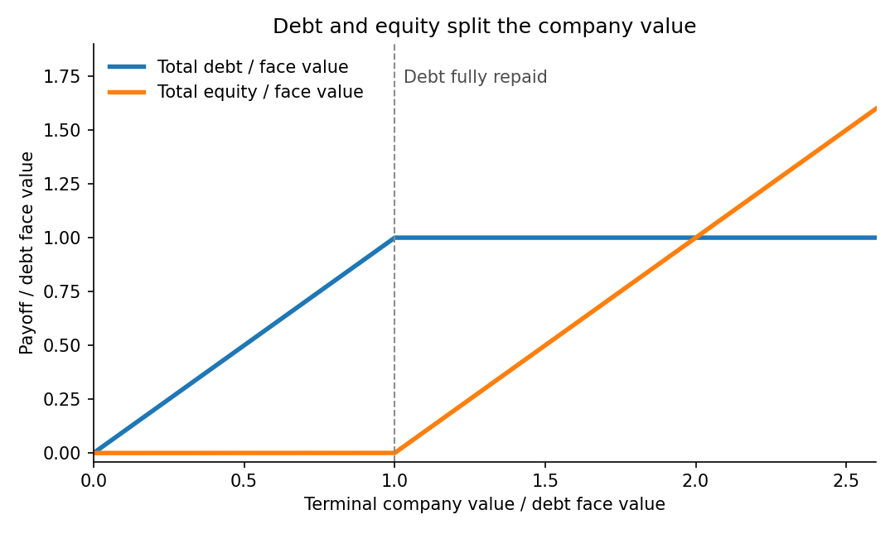

<h1 id="b/4/b/solution">Solution</h1>

↑ **Parent:** [B](../b.md)

In the [Merton model](../../../../../merton-model.md), the total equity payoff is $(X_T-m)^+$, exactly a [European call option](../../../../../european-call-option.md) on the company value with strike $m$. Total debt pays $\min(X_T,m)=X_T-(X_T-m)^+$. The first payoff has slope zero below $m$ and slope one above it; the second has slope one below $m$ and is constant above it.

**[Figure 1](#b/4/b/image-total-debt-and-equity-payoffs-in-units-of-the-debt-face-value). Total debt and equity payoffs in units of the debt face value**.

Let

$$
d_1=\frac{\log(x_0/m)+(r+\sigma^2/2)T}{\sigma\sqrt T},\qquad d_2=d_1-\sigma\sqrt T.
$$

The [Black-Scholes formula](../../../../../black-scholes-formula.md) gives total equity value $C=x_0\Phi(d_1)-me^{-rT}\Phi(d_2)$. Because the total company value is a traded asset, replication gives total debt value $x_0-C$. Divide by the numbers of securities to obtain

$$
\boxed{\text{one share}=\frac{x_0\Phi(d_1)-me^{-rT}\Phi(d_2)}n,}
$$

$$
\boxed{\text{one bond}=\frac{x_0}m\Phi(-d_1)+e^{-rT}\Phi(d_2).}
$$

These are prices per security; the payoff diagram represents the two aggregate claims.

## ↑ Ancestors (13)

1. [B](../b.md)
2. [4](../../4.md)
3. [B](../../../b.md)
4. [2009](../../../../2009-split.md)
5. [Past exam of the martingales and financial mathematics course of the University of Oxford](../../../../split.md)
6. [Martingales and financial mathematics course of the University of Oxford](../../../../../martingales-and-financial-mathematics-course-of-the-university-of-oxford.md)
7. [Year 3 of the mathematics course of the University of Oxford](../../../../../year-3-of-the-mathematics-course-of-the-university-of-oxford.md)
8. [Mathematics course of the University of Oxford](../../../../../mathematics-course-of-the-university-of-oxford.md)
9. [Undergraduate course of the University of Oxford](../../../../../undergraduate-course-of-the-university-of-oxford.md)
10. [Course of the University of Oxford](../../../../../course-of-the-university-of-oxford.md)
11. [University of Oxford](../../../../../university-of-oxford-split.md)
12. [List of universities](../../../../../list-of-universities.md)
13. [Codex Wiki](../../../../../split.md)
