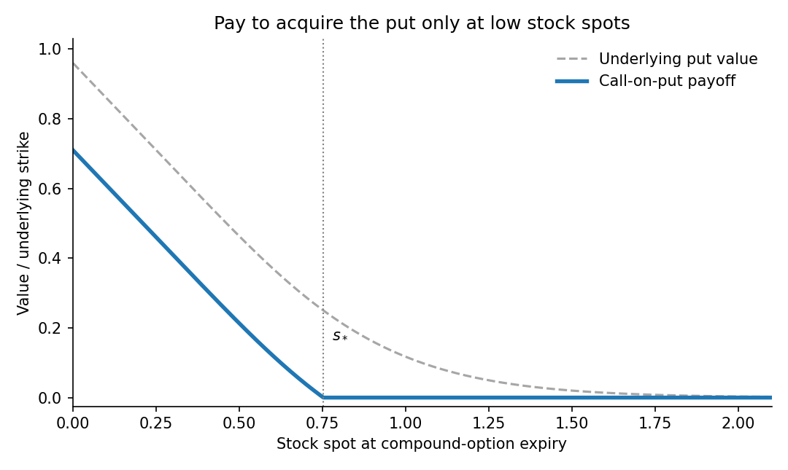

<h1 id="b/5/c/solution">Solution</h1>

↑ **Parent:** [C](../c.md)

At $T_1$, with underlying spot $s$, the [call option on a put option](../../../../../call-option-on-a-put-option.md) pays

$$
H(s)=\bigl[p(T_1,s;K_2,T_2)-K_1\bigr]^+.
$$

Let $D=K_2e^{-r(T_2-T_1)}$. The underlying [put option](../../../../../put-option.md) value is strictly decreasing and convex in $s>0$, with limits $D$ at zero and zero at infinity. If $0<K_1<D$, there is a unique $s_*$ at which that put value equals $K_1$. Hence the compound option payoff is a decreasing convex curve from $D-K_1$ to zero on $[0,s_*]$, followed by a horizontal zero segment. There is an upward kink at $s_*$. If $K_1\geq D$, the payoff is identically zero.

**[Figure 2](#b/5/c/image-a-call-on-a-put-has-positive-payoff-only-below-an-exercise-threshold). A call on a put has positive payoff only below an exercise threshold**.

For $K_1=0$, the holder obtains the underlying put at no cost, so the payoff is its full value at $T_1$. The discounted put price is a [martingale](../../../../../martingale-split.md) under the [risk-neutral measure](../../../../../risk-neutral-measure.md). Using the [tower property](../../../../../law-of-total-expectation.md) in the [risk-neutral pricing](../../../../../risk-neutral-pricing.md),

$$
\boxed{V(t,s)=p(t,s;K_2,T_2),\qquad t<T_1.}
$$

Explicitly, this is $K_2e^{-r(T_2-t)}\Phi(-d_2)-s\Phi(-d_1)$ with $d_1,d_2$ evaluated over $T_2-t$. The intermediate choice time disappears when its exercise cost is zero.

## ↑ Ancestors (13)

1. [C](../c.md)
2. [5](../../5.md)
3. [B](../../../b.md)
4. [2009](../../../../2009-split.md)
5. [Past exam of the martingales and financial mathematics course of the University of Oxford](../../../../split.md)
6. [Martingales and financial mathematics course of the University of Oxford](../../../../../martingales-and-financial-mathematics-course-of-the-university-of-oxford.md)
7. [Year 3 of the mathematics course of the University of Oxford](../../../../../year-3-of-the-mathematics-course-of-the-university-of-oxford.md)
8. [Mathematics course of the University of Oxford](../../../../../mathematics-course-of-the-university-of-oxford.md)
9. [Undergraduate course of the University of Oxford](../../../../../undergraduate-course-of-the-university-of-oxford.md)
10. [Course of the University of Oxford](../../../../../course-of-the-university-of-oxford.md)
11. [University of Oxford](../../../../../university-of-oxford-split.md)
12. [List of universities](../../../../../list-of-universities.md)
13. [Codex Wiki](../../../../../split.md)
