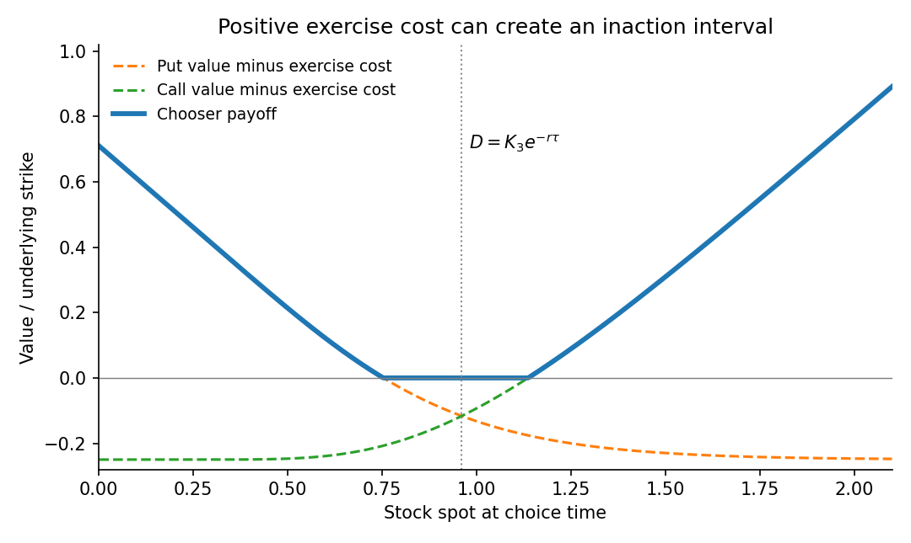

<h1 id="b/5/d/solution">Solution</h1>

↑ **Parent:** [D](../d.md)

Write $p(s)=p(T,s;K_3,T_3)$ and $c(s)=c(T,s;K_3,T_3)$. Because the right can be left unexercised, the [chooser with positive exercise cost](../../../../../chooser-with-positive-exercise-cost.md) has payoff

$$
\boxed{H(s)=\max\{p(s)-K,\ c(s)-K,\ 0\}.}
$$

Let $\tau=T_3-T$ and $D=K_3e^{-r\tau}$. [Put-call parity](../../../../../put-call-parity.md) gives $c(s)-p(s)=s-D$. Thus the put is selected for $s<D$ and the call for $s>D$; the two are equal at $s=D$. Before truncation at zero, the payoff is decreasing on the left and increasing on the right.

At the meeting point, the [Black-Scholes formula](../../../../../black-scholes-formula.md) gives

$$
p(D)=c(D)=M=D\{2\Phi(\sigma\sqrt\tau/2)-1\}.
$$

If $K<M$, the payoff has a positive minimum $M-K$ at $D$. If $K=M$, it touches zero there. If $M<K<D$, each side has a distinct exercise threshold and the payoff is zero between them. If $K\geq D$, even the left-end put value cannot cover the exercise cost, and only the right call branch can be positive. The illustration shows the middle case, including the competing underlying option values.

**[Figure 3](#b/5/d/image-chooser-payoff-with-an-exercise-cost-above-its-central-option-value). Chooser payoff with an exercise cost above its central option value**.

## ↑ Ancestors (13)

1. [D](../d.md)
2. [5](../../5.md)
3. [B](../../../b.md)
4. [2009](../../../../2009-split.md)
5. [Past exam of the martingales and financial mathematics course of the University of Oxford](../../../../split.md)
6. [Martingales and financial mathematics course of the University of Oxford](../../../../../martingales-and-financial-mathematics-course-of-the-university-of-oxford.md)
7. [Year 3 of the mathematics course of the University of Oxford](../../../../../year-3-of-the-mathematics-course-of-the-university-of-oxford.md)
8. [Mathematics course of the University of Oxford](../../../../../mathematics-course-of-the-university-of-oxford.md)
9. [Undergraduate course of the University of Oxford](../../../../../undergraduate-course-of-the-university-of-oxford.md)
10. [Course of the University of Oxford](../../../../../course-of-the-university-of-oxford.md)
11. [University of Oxford](../../../../../university-of-oxford-split.md)
12. [List of universities](../../../../../list-of-universities.md)
13. [Codex Wiki](../../../../../split.md)
