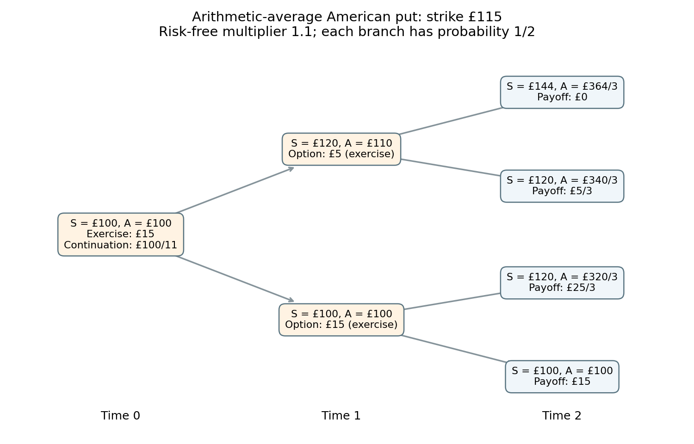

# 2010

↑ **Parent:** [Past exam of the martingales and financial mathematics course of the University of Oxford](../past-exam-of-the-martingales-and-financial-mathematics-course-of-the-university-of-oxford.md)

Source: [released examination bundle](https://www.whatdotheyknow.com/request/maths_past_papers_3), `Part B 2007 11.pdf`, pages 237–243. All six questions in both sections are covered. No mark allocations are printed.

**Table of contents**

- [A](#a)
  - [1](#a/1)
    - [a](#a/1/a)
      - [i](#a/1/a/i)
        - [Solution](#a/1/a/i/solution)
      - [ii](#a/1/a/ii)
        - [Solution](#a/1/a/ii/solution)
    - [b](#a/1/b)
      - [i](#a/1/b/i)
        - [Solution](#a/1/b/i/solution)
      - [ii](#a/1/b/ii)
        - [Solution](#a/1/b/ii/solution)
  - [2](#a/2)
    - [a](#a/2/a)
      - [i](#a/2/a/i)
        - [Solution](#a/2/a/i/solution)
      - [ii](#a/2/a/ii)
        - [Solution](#a/2/a/ii/solution)
    - [b](#a/2/b)
      - [i](#a/2/b/i)
        - [Solution](#a/2/b/i/solution)
      - [ii](#a/2/b/ii)
        - [Solution](#a/2/b/ii/solution)
  - [3](#a/3)
    - [a](#a/3/a)
      - [Solution](#a/3/a/solution)
    - [b](#a/3/b)
      - [i](#a/3/b/i)
        - [Solution](#a/3/b/i/solution)
      - [ii](#a/3/b/ii)
        - [Solution](#a/3/b/ii/solution)
      - [iii](#a/3/b/iii)
        - [Solution](#a/3/b/iii/solution)
- [B](#b)
  - [4](#b/4)
    - [a](#b/4/a)
      - [Solution](#b/4/a/solution)
    - [b](#b/4/b)
      - [Solution](#b/4/b/solution)
    - [c](#b/4/c)
      - [Solution](#b/4/c/solution)
    - [d](#b/4/d)
      - [Solution](#b/4/d/solution)
    - [e](#b/4/e)
      - [Solution](#b/4/e/solution)
  - [5](#b/5)
    - [a](#b/5/a)
      - [Solution](#b/5/a/solution)
    - [b](#b/5/b)
      - [Solution](#b/5/b/solution)
    - [c](#b/5/c)
      - [Solution](#b/5/c/solution)
    - [d](#b/5/d)
      - [Solution](#b/5/d/solution)
  - [6](#b/6)
    - [a](#b/6/a)
      - [Solution](#b/6/a/solution)
    - [b](#b/6/b)
      - [Solution](#b/6/b/solution)
    - [c](#b/6/c)
      - [Solution](#b/6/c/solution)
    - [d](#b/6/d)
      - [Solution](#b/6/d/solution)

## A

↑ **Parent:** [2010](2010.md)

<h3 id="a/1">1</h3>

↑ **Parent:** [A](#a)

<h4 id="a/1/a">a</h4>

↑ **Parent:** [1](#a/1)

<h5 id="a/1/a/i">i</h5>

↑ **Parent:** [A](#a/1/a)

<h6 id="a/1/a/i/solution">Solution</h6>

↑ **Parent:** [I](#a/1/a/i)

A [measurable space](../measure-theory.md#measurable-space) is a set $E$ together with a [sigma-algebra](../measure-theory.md#sigma-algebra) $\mathcal E$ of its subsets: it contains $E$ and is closed under complements relative to $E$ and countable unions. A [measure](../measure.md) is a map $\mu:\mathcal E\to[0,\infty]$ with $\mu(\varnothing)=0$ and [countable additivity](../measure.md#countable-additivity) on disjoint measurable sets:

$$
\mu\left(\bigcup_jA_j\right)=\sum_j\mu(A_j).
$$

A finite measure additionally satisfies $\mu(E)<\infty$.

<h5 id="a/1/a/ii">ii</h5>

↑ **Parent:** [A](#a/1/a)

<h6 id="a/1/a/ii/solution">Solution</h6>

↑ **Parent:** [Ii](#a/1/a/ii)

For $\varepsilon>0$, define the measurable decreasing tail events

$$
A_n(\varepsilon)=\bigcup_{m\geq n}\{|f_m-f|>\varepsilon\}
=\left\{\sup_{m\geq n}|f_m-f|>\varepsilon\right\}.
$$

If $f_n\to f$ almost everywhere, every point outside its null exceptional set eventually leaves each such tail event, so $\mu(\bigcap_nA_n(\varepsilon))=0$. [Continuity from above of a measure](../measure.md#continuity-from-above-of-a-measure) applies because $\mu(E)<\infty$, giving $\mu(A_n(\varepsilon))\to0$.

Conversely, assume these measures tend to zero. For each positive integer $k$, the intersection $\bigcap_nA_n(1/k)$ has measure zero. Outside the union of these countably many null sets, every $k$ has an index after which $|f_m-f|\leq1/k$ for all later $m$. Hence $f_m\to f$ there. This proves the desired equivalence. The argument uses all positive thresholds; replacing the intersection of tail events by a single strict limsup inequality at the same threshold would mishandle equality cases.

<h4 id="a/1/b">b</h4>

↑ **Parent:** [1](#a/1)

<h5 id="a/1/b/i">i</h5>

↑ **Parent:** [B](#a/1/b)

<h6 id="a/1/b/i/solution">Solution</h6>

↑ **Parent:** [I](#a/1/b/i)

The [triangle inequality](../topological-analysis.md#triangle-inequality) gives the event inclusion

$$
\{|f_n-f_m|>\varepsilon\}\subseteq
\{|f_n-f|>\varepsilon/2\}\cup\{|f_m-f|>\varepsilon/2\}.
$$

[Countable subadditivity of a measure](../measure.md#countable-subadditivity-of-a-measure) bounds its measure by the sum of the two terms on the right. Both tend to zero as $m,n\to\infty$ by [convergence in measure](../measure-theory.md#convergence-in-measure). Thus **convergence in measure implies the Cauchy property in measure**.

<h5 id="a/1/b/ii">ii</h5>

↑ **Parent:** [B](#a/1/b)

<h6 id="a/1/b/ii/solution">Solution</h6>

↑ **Parent:** [Ii](#a/1/b/ii)

The Cauchy assumption lets us choose $n_k$ recursively, increasing strictly, so that $\mu(|f_n-f_m|>2^{-k})<2^{-k}$ for all $m,n\geq n_k$. In particular the measurable events

$$
E_k=\{|f_{n_{k+1}}-f_{n_k}|>2^{-k}\}
$$

have summable measures. The measure of $\bigcup_{k\geq K}E_k$ is at most $\sum_{k\geq K}2^{-k}\to0$, so $\limsup E_k$ is a null set. Outside it, the successive differences are eventually bounded by a summable geometric series. Hence $f_{n_k}$ is pointwise Cauchy and has a finite real limit.

Define $f$ to be that limit wherever the sequence converges, and zero elsewhere. The convergence set is measurable by the countable Cauchy criterion, and the limit is measurable as a limit of measurable functions on that set. Thus there is no need to assume the measure is complete. Part (a)(ii), or the corresponding finite-measure implication, gives $f_{n_k}\to f$ in measure.

For the full sequence use

$$
\mu(|f_n-f|>\varepsilon)\leq
\mu(|f_n-f_{n_k}|>\varepsilon/2)+\mu(|f_{n_k}-f|>\varepsilon/2).
$$

Choose a sufficiently late subsequence index so the second term is small; the Cauchy property then bounds the first uniformly for all large $n$. Therefore **$f_n\to f$ in measure**. This proves [completeness of convergence in measure on a finite measure space](../measure-theory.md#completeness-of-convergence-in-measure-on-a-finite-measure-space).

<h3 id="a/2">2</h3>

↑ **Parent:** [A](#a)

<h4 id="a/2/a">a</h4>

↑ **Parent:** [2](#a/2)

<h5 id="a/2/a/i">i</h5>

↑ **Parent:** [A](#a/2/a)

<h6 id="a/2/a/i/solution">Solution</h6>

↑ **Parent:** [I](#a/2/a/i)

[Kolmogorov zero-one law](../probability-theory.md#kolmogorov-s-zero-one-law) states that every event in the tail sigma-algebra of an independent sequence has probability zero or one. Removing any fixed number of summands changes $S_n/n$ by a finite random constant divided by $n$, so does not change its extended-real limsup. Therefore $\overline X$ is measurable with respect to the tail sigma-algebra. Each event $\{\overline X\leq q\}$ for rational $q$ has probability zero or one. Monotonicity of these events forces the distribution to be concentrated at one extended-real value, allowing either infinity.

The [strong law of large numbers](../convergence-of-random-variables.md#strong-law-of-large-numbers) says that for independent identically distributed variables with $\mathbb E|X_1|<\infty$,

$$
\boxed{S_n/n\longrightarrow\mathbb E X_1\quad\text{almost surely}.}
$$

<h5 id="a/2/a/ii">ii</h5>

↑ **Parent:** [A](#a/2/a)

<h6 id="a/2/a/ii/solution">Solution</h6>

↑ **Parent:** [Ii](#a/2/a/ii)

Pointwise, the positive integers $n$ with $Z\geq n$ are exactly $1,\ldots,\lfloor Z\rfloor$. Thus $Y=\lfloor Z\rfloor=\sum_{n\geq1}\mathbf1_{\{Z\geq n\}}$. The [monotone convergence theorem](../measure-theory.md#monotone-convergence-theorem) gives $\mathbb EY=\sum_{n\geq1}\mathbb P(Z\geq n)$. Since $Y\leq Z<Y+1$,

$$
\boxed{\sum_{n\geq1}\mathbb P(Z\geq n)\leq\mathbb EZ\leq1+\sum_{n\geq1}\mathbb P(Z\geq n).}
$$

These inequalities also hold for infinite expectations. This is the [tail-sum formula](../expected-value.md#tail-sum-formula) comparison for a nonnegative real variable.

<h4 id="a/2/b">b</h4>

↑ **Parent:** [2](#a/2)

<h5 id="a/2/b/i">i</h5>

↑ **Parent:** [B](#a/2/b)

<h6 id="a/2/b/i/solution">Solution</h6>

↑ **Parent:** [I](#a/2/b/i)

For any $\lambda>0$, the variable $Z=|X_1|/\lambda$ has infinite expectation. Part (a)(ii) therefore forces $\sum_n\mathbb P(|X_1|\geq\lambda n)=\infty$. Identical distributions give

$$
\boxed{\sum_n\mathbb P(|X_n|\geq\lambda n)=\infty.}
$$

<h5 id="a/2/b/ii">ii</h5>

↑ **Parent:** [B](#a/2/b)

<h6 id="a/2/b/ii/solution">Solution</h6>

↑ **Parent:** [Ii](#a/2/b/ii)

For each positive integer $m$, the events $\{|X_n|\geq mn\}$ are independent and have divergent total probability by part (i). The [Borel-Cantelli second lemma](../probability-theory.md#borel-cantelli-second-lemma) makes them occur infinitely often. Taking the countable intersection over $m$ gives

$$
\boxed{\limsup_n|X_n|/n=\infty\quad\text{almost surely}.}
$$

If $\limsup_n|S_n|/n$ were finite along any such sample path, then for some finite path-dependent $C$, $|S_n|\leq Cn$ eventually. But $X_n=S_n-S_{n-1}$ would give $|X_n|/n\leq C+C(n-1)/n\leq2C$ eventually, a contradiction. Therefore

$$
\boxed{\limsup_n|S_n|/n=\infty\quad\text{almost surely}.}
$$

This is the [divergence of normalized iid partial sums without a first absolute moment](../convergence-of-random-variables.md#divergence-of-normalized-iid-partial-sums-without-a-first-absolute-moment).

<h3 id="a/3">3</h3>

↑ **Parent:** [A](#a)

<h4 id="a/3/a">a</h4>

↑ **Parent:** [3](#a/3)

<h5 id="a/3/a/solution">Solution</h5>

↑ **Parent:** [A](#a/3/a)

The [Borel-Cantelli second lemma](../probability-theory.md#borel-cantelli-second-lemma) says that independent events whose probabilities have divergent sum occur infinitely often almost surely. The events here are independent and have probabilities $\min\{1,\lambda/n\}$. Their sum diverges by the harmonic series, so

$$
\boxed{\mathbb P(U_n\leq\lambda/n\text{ infinitely often})=1\quad(\lambda>0).}
$$

<h4 id="a/3/b">b</h4>

↑ **Parent:** [3](#a/3)

<h5 id="a/3/b/i">i</h5>

↑ **Parent:** [B](#a/3/b)

<h6 id="a/3/b/i/solution">Solution</h6>

↑ **Parent:** [I](#a/3/b/i)

The printed update needs a one-step index correction to match its filtration: the draw for the transition from $n$ to $n+1$ must be the fresh variable $U_{n+1}$. Also the trivial initial sigma-algebra is $\{\varnothing,\Omega\}$, rather than the printed $\{\varnothing,\mathcal F\}$. With literal $U_n$, the next increment is already known at time $n$, so $\mathbb E[X_{n+1}\mid\mathcal F_n]=X_{n+1}$; the nontrivial update differs from $X_n$. Thus the stated martingale claim is false with that indexing. The following uses the standard [Pólya urn](../stochastic-process.md#polya-urn-model) described in words.

Put $m=B_0+R_0$, so the total count is $m+n$. Conditional on $\mathcal F_n$, the next blue indicator $I_{n+1}$ has expectation $X_n$. Hence

$$
\mathbb E[X_{n+1}\mid\mathcal F_n]
=\frac{B_n+\mathbb E[I_{n+1}\mid\mathcal F_n]}{m+n+1}
=\frac{B_n+B_n/(m+n)}{m+n+1}=X_n.
$$

Adaptedness and integrability follow from the recursive construction and $0\leq X_n\leq1$. Thus $X_n$ is a bounded [martingale](../martingale.md). The [martingale convergence theorem](../martingale.md#martingale-convergence-theorem) gives an almost-sure limit $X_\infty\in[0,1]$. Boundedness and the [dominated convergence theorem](../measure-theory.md#dominated-convergence-theorem) then give $\mathbb E|X_n-X_\infty|^2\to0$, establishing convergence in $L^2$.

<h5 id="a/3/b/ii">ii</h5>

↑ **Parent:** [B](#a/3/b)

<h6 id="a/3/b/ii/solution">Solution</h6>

↑ **Parent:** [Ii](#a/3/b/ii)

The blue count never decreases, so $X_n\geq B_0/(m+n)$. For all sufficiently large $n$, this is at least $B_0/[2(n+1)]$. Whenever the fresh draw satisfies $U_{n+1}\leq B_0/[2(n+1)]$, a blue ball is added. Part (a), with $\lambda=B_0/2$, says that such events occur infinitely often almost surely. Therefore $B_n\to\infty$. Consequently

$$
\boxed{nX_n=\frac n{m+n}B_n\longrightarrow\infty\quad\text{almost surely}.}
$$

<h5 id="a/3/b/iii">iii</h5>

↑ **Parent:** [B](#a/3/b)

<h6 id="a/3/b/iii/solution">Solution</h6>

↑ **Parent:** [Iii](#a/3/b/iii)

Since $X_n>0$, the pointwise inequality

$$
\mathbf1_{\{X_\infty=0\}}\leq\frac{(X_n-X_\infty)^2}{X_n^2}
$$

holds: on that event both sides equal one, and elsewhere the left side is zero. Take [conditional expectation](../measure-theory.md#conditional-expectation) and pull out the positive $\mathcal F_n$-measurable denominator to obtain the requested bound. The supplied variance estimate improves it to

$$
0\leq\mathbb P(X_\infty=0\mid\mathcal F_n)
\leq\frac1{(m+n)X_n}=\frac1{B_n}\longrightarrow0
$$

almost surely, by part (ii). These conditional probabilities are bounded by one. The [dominated convergence theorem](../measure-theory.md#dominated-convergence-theorem) and [tower property of conditional expectation](../measure-theory.md#law-of-total-expectation) give

$$
\boxed{\mathbb P(X_\infty=0)=\lim_n\mathbb E[\mathbb P(X_\infty=0\mid\mathcal F_n)]
=\mathbb E[\lim_n\mathbb P(X_\infty=0\mid\mathcal F_n)]=0.}
$$

This proves [Positivity of the limiting Pólya urn proportion](../stochastic-process.md#positivity-of-the-limiting-polya-urn-proportion) without needing its explicit beta distribution.

<h2 id="b">B</h2>

↑ **Parent:** [2010](2010.md)

<h3 id="b/4">4</h3>

↑ **Parent:** [B](#b)

<h4 id="b/4/a">a</h4>

↑ **Parent:** [4](#b/4)

<h5 id="b/4/a/solution">Solution</h5>

↑ **Parent:** [A](#b/4/a)

Short one share at time zero and invest the one hundred pounds received in the bank asset. The initial net investment is zero. After one period, repurchasing the share leaves $100e^{0.2}-S_1$. Since $S_1\leq120$ and $e^{0.2}>1+0.2=1.2$, this payoff is strictly positive in both states. Hence **this is an arbitrage opportunity**.

<h4 id="b/4/b">b</h4>

↑ **Parent:** [4](#b/4)

<h5 id="b/4/b/solution">Solution</h5>

↑ **Parent:** [B](#b/4/b)

The [risk-neutral probability](../mathematical-finance.md#risk-neutral-probability) must make the expected stock multiplier equal the bank multiplier:

$$
1.2q+1(1-q)=1.1,\qquad\boxed{q=\tfrac12.}
$$

Both up and down paths have positive probability under this measure. A self-financing portfolio's discounted value is then a Q-martingale, since the discounted bank asset is constant and the discounted stock is a martingale. An arbitrage with zero initial wealth would have nonnegative terminal value and positive value in some possible state, giving a strictly positive Q-expectation and contradicting its zero discounted initial value. Thus **the market with $e^r=1.1$ is arbitrage free**.

<h4 id="b/4/c">c</h4>

↑ **Parent:** [4](#b/4)

<h5 id="b/4/c/solution">Solution</h5>

↑ **Parent:** [C](#b/4/c)

Retain the whole price history when calculating the arithmetic average. The [Asian option](../fundamental-theorem-of-asset-pricing.md#asian-option) payoffs at expiry are

$$
\boxed{\begin{array}{c|c|c|c}
\text{path}&(S_0,S_1,S_2)&A_2&(115-A_2)^+\\\hline
uu&(100,120,144)&364/3&0\\
ud&(100,120,120)&340/3&5/3\\
du&(100,100,120)&320/3&25/3\\
dd&(100,100,100)&100&15
\end{array}}
$$

In particular $ud$ and $du$ have the same terminal stock price but different averages and payoffs. The average is an additional state variable; the terminal stock nodes cannot be merged for this claim.

<h4 id="b/4/d">d</h4>

↑ **Parent:** [4](#b/4)

<h5 id="b/4/d/solution">Solution</h5>

↑ **Parent:** [D](#b/4/d)

Use $q=1/2$ and discount one step by $R=1.1$. At the up node, $A_1=110$ and immediate exercise pays $5$. Continuation is worth $(0+5/3)/(2R)=25/33<5$. At the down node, $A_1=100$ and immediate exercise pays $15$, while continuation is $(25/3+15)/(2R)=350/33<15$. Thus the [American put option](../fundamental-theorem-of-asset-pricing.md#american-put-option) should be exercised at either time-one node, and

$$
\boxed{V_1=\begin{cases}5,&S_1=120,\\15,&S_1=100.\end{cases}}
$$

<h4 id="b/4/e">e</h4>

↑ **Parent:** [4](#b/4)

<h5 id="b/4/e/solution">Solution</h5>

↑ **Parent:** [E](#b/4/e)

At time zero, exercise pays $115-A_0=15$, while continuation is worth

$$
\frac{\mathbb E_Q V_1}{R}=\frac{(5+15)/2}{1.1}=\frac{100}{11}<15.
$$

Therefore **exercise at time zero is optimal**, and $V_0=15$ pounds.

The discounted unexercised option-value process is **not a Q-martingale**: already $\mathbb E_Q[V_1/B_1]=100/11<15=V_0/B_0$. It is the [Snell envelope](../martingale.md#snell-envelope) of the discounted exercise payoff, hence a supermartingale in general, with strict decrease of expected value when immediate exercise beats continuation. Stopping at an optimal exercise time restores the stopped martingale property; that is a different assertion from the unexercised price being a martingale.

**[Figure 1](#b/4/e/image-the-american-arithmetic-average-put-four-terminal-histories-are-retained-because-ud-and-du-have-different-average-prices-backward-induction-selects-immediate-exercise-at-both-time-one-nodes-and-at-time-zero). The American arithmetic-average put: four terminal histories are retained because ud and du have different average prices. Backward induction selects immediate exercise at both time-one nodes and at time zero.**

<h3 id="b/5">5</h3>

↑ **Parent:** [B](#b)

<h4 id="b/5/a">a</h4>

↑ **Parent:** [5](#b/5)

<h5 id="b/5/a/solution">Solution</h5>

↑ **Parent:** [A](#b/5/a)

For the time integral $I_t=\int_0^tW_sds$, [Fubini's theorem](../measure-theory.md#fubini-s-theorem) and $\mathbb EW_s=0$ give $\mathbb EI_t=0$. Brownian covariance is $\mathbb E[W_uW_v]=\min(u,v)$, so

$$
\operatorname{Var}(I_t)=\int_0^t\int_0^t\min(u,v)\,du\,dv
=2\int_0^t\int_0^v u\,du\,dv=\int_0^t v^2dv.
$$

Consequently

$$
\boxed{\mathbb EI_t=0,\qquad\operatorname{Var}(I_t)=t^3/3.}
$$

<h4 id="b/5/b">b</h4>

↑ **Parent:** [5](#b/5)

<h5 id="b/5/b/solution">Solution</h5>

↑ **Parent:** [B](#b/5/b)

For [geometric Brownian motion](../stochastic-calculus.md#geometric-brownian-motion), $\log S_u=\log S_0+(\mu-\sigma^2/2)u+\sigma W_u$. Averaging in time gives

$$
\log A_t=\log S_0+\tfrac12(\mu-\sigma^2/2)t+\frac\sigma t I_t.
$$

Thus $\log A_t$ is normal with mean $\log S_0+(\mu-\sigma^2/2)t/2$ and variance $\sigma^2t/3$. The [moment-generating function of a normal distribution](../probability-distribution.md#moment-generating-function-of-a-normal-distribution) gives

$$
\boxed{\mathbb EA_t=S_0\exp\left[\left(\frac\mu2-\frac{\sigma^2}{12}\right)t\right].}
$$

<h4 id="b/5/c">c</h4>

↑ **Parent:** [5](#b/5)

<h5 id="b/5/c/solution">Solution</h5>

↑ **Parent:** [C](#b/5/c)

For $v\leq t$, the two stock paths agree, so their geometric averages agree. For $v>t$, the future log-price is

$$
\log\widetilde S_u=\log S_t+(r-\sigma^2/2)(u-t)+\sigma(W_u-W_t).
$$

Split the average's log-integral into $[0,t]$ and $[t,v]$. The first part is $t\log A_t$, while integration of the displayed formula gives

$$
v\log\widetilde A_v=t\log A_t+(v-t)\log S_t+\tfrac12(r-\sigma^2/2)(v-t)^2
+\sigma\int_t^v(W_u-W_t)du.
$$

Dividing by $v$ and exponentiating proves

$$
\boxed{\widetilde A_v=A_t^{t/v}S_t^{(v-t)/v}
\exp\left[\left(r-\frac{\sigma^2}{2}\right)\frac{(v-t)^2}{2v}
+\frac\sigma v\int_t^v(W_u-W_t)du\right]\quad(v>t).}
$$

<h4 id="b/5/d">d</h4>

↑ **Parent:** [5](#b/5)

<h5 id="b/5/d/solution">Solution</h5>

↑ **Parent:** [D](#b/5/d)

Put $\tau=T-t$. Conditional on present information, $J=\int_t^T(W_u-W_t)du$ is independent of the past and is normal with mean zero and variance $\tau^3/3$. Part (c) gives

$$
\widetilde A_T^2=A_t^{2t/T}S_t^{2\tau/T}
\exp\left[(r-\sigma^2/2)\frac{\tau^2}{T}+\frac{2\sigma}{T}J\right].
$$

The future drift $r$ in this auxiliary stock is precisely the risk-neutral drift. Discounting the conditional expectation and applying the normal exponential-moment formula yields

$$
\boxed{V^A(t,S_t,A_t)=e^{-r\tau}A_t^{2t/T}S_t^{2\tau/T}
\exp\left[\left(r-\frac{\sigma^2}{2}\right)\frac{\tau^2}{T}
+\frac{2\sigma^2\tau^3}{3T^2}\right].}
$$

At expiry this reduces to $A_T^2$; at time zero it gives $S_0^2e^{\sigma^2T/6}$. This is a special case of [conditional power moments of a continuous geometric Asian average](../fundamental-theorem-of-asset-pricing.md#conditional-power-moments-of-a-continuous-geometric-asian-average).

<h3 id="b/6">6</h3>

↑ **Parent:** [B](#b)

<h4 id="b/6/a">a</h4>

↑ **Parent:** [6](#b/6)

<h5 id="b/6/a/solution">Solution</h5>

↑ **Parent:** [A](#b/6/a)

The commodity's total gain from holding one unit is $dS-\delta\,dt$, because the storage cost is a fixed cash rate, not a proportional dividend yield. Form a locally self-financing delta hedge long the derivative and short $\Delta=V_S$ units of the commodity. [Itô's formula](../stochastic-calculus.md#ito-s-lemma) eliminates Brownian risk and leaves drift

$$
V_t+\tfrac12\sigma^2S^2V_{SS}+\delta V_S.
$$

Its value is $V-SV_S$, so absence of arbitrage makes that drift equal to $r(V-SV_S)$. Therefore the [Black-Scholes equation with constant cash storage costs](../mathematical-finance.md#black-scholes-equation-with-constant-cash-storage-costs) is

$$
\boxed{V_t+(rS+\delta)V_S+\tfrac12\sigma^2S^2V_{SS}=rV,\qquad V(T,S)=\Psi(S).}
$$

The cash cost enters as $\delta V_S$, rather than as $\delta SV_S$, because one unit costs $\delta$ per unit time regardless of its current price.

<h4 id="b/6/b">b</h4>

↑ **Parent:** [6](#b/6)

<h5 id="b/6/b/solution">Solution</h5>

↑ **Parent:** [B](#b/6/b)

Use the auxiliary diffusion with generator $(rS+\delta)\partial_S+(\sigma^2S^2/2)\partial_{SS}$. Applying [Itô's formula](../stochastic-calculus.md#ito-s-lemma) to $e^{-r(v-t)}V(v,\widehat S_v)$ makes its drift zero by part (a), leaving only $e^{-r(v-t)}\sigma\widehat S_vV_S\,dW_v$. Under the usual integrability conditions, localization and expectation give the [Feynman-Kac formula](../stochastic-calculus.md#feynman-kac-formula)

$$
\boxed{V(t,S_t)=\mathbb E\left[e^{-r(T-t)}\Psi(\widehat S_T)\mid\widehat S_t=S_t\right],\quad
 d\widehat S_v=(r\widehat S_v+\delta)dv+\sigma\widehat S_vdW_v.}
$$

For polynomial-growth payoffs, the linear diffusion has the finite moments needed for this martingale argument. Its pricing drift includes the cash storage cost as an additive term.

<h4 id="b/6/c">c</h4>

↑ **Parent:** [6](#b/6)

<h5 id="b/6/c/solution">Solution</h5>

↑ **Parent:** [C](#b/6/c)

The conditional mean solves $m'(v)=rm(v)+\delta$ with $m(t)=S_t$. Hence, for $r\ne0$,

$$
\boxed{\mathbb E[\widehat S_T\mid\widehat S_t=S_t]
=S_te^{r\tau}+\frac\delta r(e^{r\tau}-1).}
$$

The forward contract's terminal payoff is $S_T-K$, so discounting this expectation gives its current value

$$
\boxed{F(t,S_t)=S_t+\frac\delta r(1-e^{-r\tau})-Ke^{-r\tau}.}
$$

For $r=0$, the continuous limits are $S_t+\delta\tau$ for the mean and $S_t+\delta\tau-K$ for the contract value. A fair delivery price, as distinct from the current contract value, is the strike making this value zero: $K_*=S_te^{r\tau}+\delta(e^{r\tau}-1)/r$.

<h4 id="b/6/d">d</h4>

↑ **Parent:** [6](#b/6)

<h5 id="b/6/d/solution">Solution</h5>

↑ **Parent:** [D](#b/6/d)

At expiry, the difference of a European call and put with matching strike is $(S_T-K)^+-(K-S_T)^+=S_T-K$. Linearity of pricing therefore makes their difference equal the forward-contract value from part (c):

$$
\boxed{C(t,S)-P(t,S)=S+\frac\delta r(1-e^{-r(T-t)})-Ke^{-r(T-t)}.}
$$

A direct [put-call parity](../fundamental-theorem-of-asset-pricing.md#put-call-parity) replication gives the same result. Buy one unit of the commodity and deposit $\delta\int_t^T e^{-r(u-t)}du$ in the bank. Withdraw the fixed cash storage payments from this reserve; the reserve is exhausted at expiry, leaving one commodity unit. Its initial cost is $S+\delta(1-e^{-r\tau})/r$. Borrow $Ke^{-r\tau}$ as well, leaving terminal value $S_T-K$. The law of one price proves the parity identity. If $r=0$, replace the storage reserve by $\delta\tau$.

## ↑ Ancestors (9)

1. [Past exam of the martingales and financial mathematics course of the University of Oxford](../past-exam-of-the-martingales-and-financial-mathematics-course-of-the-university-of-oxford.md)
2. [Martingales and financial mathematics course of the University of Oxford](../university-of-oxford.md#martingales-and-financial-mathematics-course-of-the-university-of-oxford)
3. [Year 3 of the mathematics course of the University of Oxford](../university-of-oxford.md#year-3-of-the-mathematics-course-of-the-university-of-oxford)
4. [Mathematics course of the University of Oxford](../university-of-oxford.md#mathematics-course-of-the-university-of-oxford)
5. [Undergraduate course of the University of Oxford](../university-of-oxford.md#undergraduate-course-of-the-university-of-oxford)
6. [Course of the University of Oxford](../university-of-oxford.md#course-of-the-university-of-oxford)
7. [University of Oxford](../university-of-oxford.md)
8. [List of universities](../README.md#list-of-universities)
9. [Codex Wiki](../README.md)
