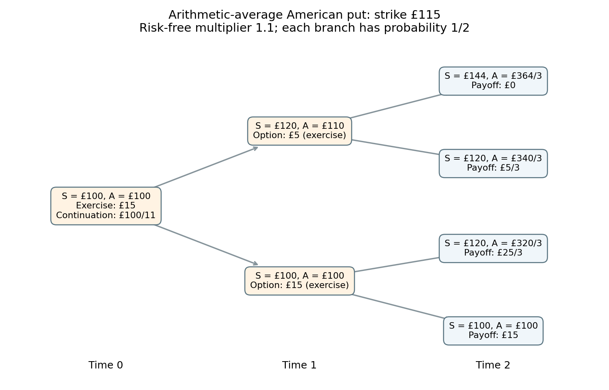

<h1 id="b/4/e/solution">Solution</h1>

↑ **Parent:** [E](../e.md)

At time zero, exercise pays $115-A_0=15$, while continuation is worth

$$
\frac{\mathbb E_Q V_1}{R}=\frac{(5+15)/2}{1.1}=\frac{100}{11}<15.
$$

Therefore **exercise at time zero is optimal**, and $V_0=15$ pounds.

The discounted unexercised option-value process is **not a Q-martingale**: already $\mathbb E_Q[V_1/B_1]=100/11<15=V_0/B_0$. It is the [Snell envelope](../../../../../snell-envelope.md) of the discounted exercise payoff, hence a supermartingale in general, with strict decrease of expected value when immediate exercise beats continuation. Stopping at an optimal exercise time restores the stopped martingale property; that is a different assertion from the unexercised price being a martingale.

**[Figure 1](#b/4/e/image-the-american-arithmetic-average-put-four-terminal-histories-are-retained-because-ud-and-du-have-different-average-prices-backward-induction-selects-immediate-exercise-at-both-time-one-nodes-and-at-time-zero). The American arithmetic-average put: four terminal histories are retained because ud and du have different average prices. Backward induction selects immediate exercise at both time-one nodes and at time zero.**

## ↑ Ancestors (13)

1. [E](../e.md)
2. [4](../../4.md)
3. [B](../../../b.md)
4. [2010](../../../../2010-split.md)
5. [Past exam of the martingales and financial mathematics course of the University of Oxford](../../../../split.md)
6. [Martingales and financial mathematics course of the University of Oxford](../../../../../martingales-and-financial-mathematics-course-of-the-university-of-oxford.md)
7. [Year 3 of the mathematics course of the University of Oxford](../../../../../year-3-of-the-mathematics-course-of-the-university-of-oxford.md)
8. [Mathematics course of the University of Oxford](../../../../../mathematics-course-of-the-university-of-oxford.md)
9. [Undergraduate course of the University of Oxford](../../../../../undergraduate-course-of-the-university-of-oxford.md)
10. [Course of the University of Oxford](../../../../../course-of-the-university-of-oxford.md)
11. [University of Oxford](../../../../../university-of-oxford-split.md)
12. [List of universities](../../../../../list-of-universities.md)
13. [Codex Wiki](../../../../../split.md)
