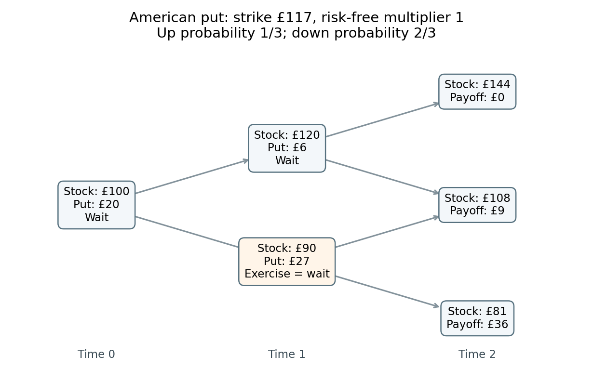

# 2011

↑ **Parent:** [Past exam of the martingales and financial mathematics course of the University of Oxford](../past-exam-of-the-martingales-and-financial-mathematics-course-of-the-university-of-oxford.md)

Source: [released examination bundle](https://www.whatdotheyknow.com/request/maths_past_papers_3), `Part B 2007 11.pdf`, pages 306–311. All six questions and both sections are covered. No mark allocations are printed.

**Table of contents**

- [A](#a)
  - [1](#a/1)
    - [a](#a/1/a)
      - [i](#a/1/a/i)
        - [Solution](#a/1/a/i/solution)
      - [ii](#a/1/a/ii)
        - [Solution](#a/1/a/ii/solution)
      - [iii](#a/1/a/iii)
        - [Solution](#a/1/a/iii/solution)
    - [b](#a/1/b)
      - [i](#a/1/b/i)
        - [Solution](#a/1/b/i/solution)
      - [ii](#a/1/b/ii)
        - [Solution](#a/1/b/ii/solution)
    - [c](#a/1/c)
      - [i](#a/1/c/i)
        - [Solution](#a/1/c/i/solution)
      - [ii](#a/1/c/ii)
        - [Solution](#a/1/c/ii/solution)
      - [iii](#a/1/c/iii)
        - [Solution](#a/1/c/iii/solution)
  - [2](#a/2)
    - [a](#a/2/a)
      - [i](#a/2/a/i)
        - [Solution](#a/2/a/i/solution)
      - [ii](#a/2/a/ii)
        - [Solution](#a/2/a/ii/solution)
      - [iii](#a/2/a/iii)
        - [Solution](#a/2/a/iii/solution)
    - [b](#a/2/b)
      - [Solution](#a/2/b/solution)
    - [c](#a/2/c)
      - [i](#a/2/c/i)
        - [Solution](#a/2/c/i/solution)
      - [ii](#a/2/c/ii)
        - [Solution](#a/2/c/ii/solution)
      - [iii](#a/2/c/iii)
        - [Solution](#a/2/c/iii/solution)
  - [3](#a/3)
    - [a](#a/3/a)
      - [i](#a/3/a/i)
        - [Solution](#a/3/a/i/solution)
      - [ii](#a/3/a/ii)
        - [Solution](#a/3/a/ii/solution)
      - [iii](#a/3/a/iii)
        - [Solution](#a/3/a/iii/solution)
    - [b](#a/3/b)
      - [Solution](#a/3/b/solution)
    - [c](#a/3/c)
      - [Solution](#a/3/c/solution)
    - [d](#a/3/d)
      - [Solution](#a/3/d/solution)
- [B](#b)
  - [4](#b/4)
    - [a](#b/4/a)
      - [Solution](#b/4/a/solution)
    - [b](#b/4/b)
      - [Solution](#b/4/b/solution)
    - [c](#b/4/c)
      - [Solution](#b/4/c/solution)
    - [d](#b/4/d)
      - [Solution](#b/4/d/solution)
    - [e](#b/4/e)
      - [Solution](#b/4/e/solution)
  - [5](#b/5)
    - [a](#b/5/a)
      - [Solution](#b/5/a/solution)
    - [b](#b/5/b)
      - [Solution](#b/5/b/solution)
    - [c](#b/5/c)
      - [Solution](#b/5/c/solution)
    - [d](#b/5/d)
      - [Solution](#b/5/d/solution)
    - [e](#b/5/e)
      - [Solution](#b/5/e/solution)
  - [6](#b/6)
    - [a](#b/6/a)
      - [Solution](#b/6/a/solution)
    - [b](#b/6/b)
      - [Solution](#b/6/b/solution)
    - [c](#b/6/c)
      - [Solution](#b/6/c/solution)
    - [d](#b/6/d)
      - [Solution](#b/6/d/solution)
    - [e](#b/6/e)
      - [Solution](#b/6/e/solution)

## A

↑ **Parent:** [2011](2011.md)

<h3 id="a/1">1</h3>

↑ **Parent:** [A](#a)

<h4 id="a/1/a">a</h4>

↑ **Parent:** [1](#a/1)

<h5 id="a/1/a/i">i</h5>

↑ **Parent:** [A](#a/1/a)

<h6 id="a/1/a/i/solution">Solution</h6>

↑ **Parent:** [I](#a/1/a/i)

A [pi-system](../measure-theory.md#pi-system) is a collection of subsets closed under binary intersections: $A,B\in\mathcal I$ implies $A\cap B\in\mathcal I$. Induction then gives closure under every nonempty finite intersection. A pi-system need not contain complements or unions.

<h5 id="a/1/a/ii">ii</h5>

↑ **Parent:** [A](#a/1/a)

<h6 id="a/1/a/ii/solution">Solution</h6>

↑ **Parent:** [Ii](#a/1/a/ii)

The [sigma-algebra generated by a collection](../measure-theory.md#sigma-algebra-generated-by-a-collection) is the smallest [sigma-algebra](../measure-theory.md#sigma-algebra) containing that collection:

$$
\boxed{\sigma(\mathcal I)=\bigcap\{\mathcal A:\mathcal A\text{ is a sigma-algebra on }\Omega,\ \mathcal I\subseteq\mathcal A\}.}
$$

The family being intersected is nonempty, since it contains the power set of $\Omega$. Intersections of sigma-algebras are sigma-algebras, so this definition has the asserted minimality.

<h5 id="a/1/a/iii">iii</h5>

↑ **Parent:** [A](#a/1/a)

<h6 id="a/1/a/iii/solution">Solution</h6>

↑ **Parent:** [Iii](#a/1/a/iii)

The set function is [countably additive](../measure.md#countable-additivity) if, whenever $A_1,A_2,\ldots\in\mathcal I$ are pairwise disjoint and their union $A$ also belongs to $\mathcal I$,

$$
\boxed{\mu(A)=\sum_{j=1}^{\infty}\mu(A_j).}
$$

The equality is in the extended nonnegative reals. To be a [measure](../measure.md) one also imposes $\mu(\varnothing)=0$ and an appropriate domain such as a sigma-algebra.

<h4 id="a/1/b">b</h4>

↑ **Parent:** [1](#a/1)

<h5 id="a/1/b/i">i</h5>

↑ **Parent:** [B](#a/1/b)

<h6 id="a/1/b/i/solution">Solution</h6>

↑ **Parent:** [I](#a/1/b/i)

The intersection of two nonempty members is

$$
(-\infty,x]\cap(-\infty,y]=(-\infty,\min(x,y)],
$$

which belongs to the collection. Any intersection involving the empty set is empty and is included too. Hence **$\pi(\mathbb R)$ is a pi-system**.

<h5 id="a/1/b/ii">ii</h5>

↑ **Parent:** [B](#a/1/b)

<h6 id="a/1/b/ii/solution">Solution</h6>

↑ **Parent:** [Ii](#a/1/b/ii)

Each half-line $(-\infty,x]$ is a closed [Borel set](../measure-theory.md#borel-set), and the empty set is Borel. Thus $\sigma(\pi(\mathbb R))\subseteq\mathcal B(\mathbb R)$.

Conversely,

$$
(-\infty,b)=\bigcup_{n\geq1}(-\infty,b-1/n],\qquad
(a,b)=(-\infty,b)\setminus(-\infty,a].
$$

The generated [sigma-algebra](../measure-theory.md#sigma-algebra) contains both sets on the right and is closed under their difference, so it contains every open interval. By the given definition of the [Borel sigma-algebra](../measure-theory.md#borel-sigma-algebra), the reverse inclusion follows. Therefore

$$
\boxed{\sigma(\pi(\mathbb R))=\mathcal B(\mathbb R).}
$$

<h4 id="a/1/c">c</h4>

↑ **Parent:** [1](#a/1)

<h5 id="a/1/c/i">i</h5>

↑ **Parent:** [C](#a/1/c)

<h6 id="a/1/c/i/solution">Solution</h6>

↑ **Parent:** [I](#a/1/c/i)

Two [sigma-algebras](../measure-theory.md#sigma-algebra) are independent if every event in one is independent of every event in the other:

$$
\boxed{\mathbb P(G\cap H)=\mathbb P(G)\mathbb P(H)\quad
\text{for all }G\in\mathcal G,\ H\in\mathcal H.}
$$

The same formula defines independence of the generating collections when restricted to their members.

<h5 id="a/1/c/ii">ii</h5>

↑ **Parent:** [C](#a/1/c)

<h6 id="a/1/c/ii/solution">Solution</h6>

↑ **Parent:** [Ii](#a/1/c/ii)

Independence of the full sigma-algebras immediately gives independence of their generating [pi-systems](../measure-theory.md#pi-system). For the converse, fix $H\in\mathcal H_0$. On $\mathcal G$, define finite [measures](../measure.md)

$$
\nu_H(G)=\mathbb P(G\cap H),\qquad\lambda_H(G)=\mathbb P(G)\mathbb P(H).
$$

They have the same total mass $\mathbb P(H)$ and agree on $\mathcal G_0$ by assumption. The supplied measure-uniqueness theorem makes them equal on $\mathcal G$. Thus the independence formula holds for every $G\in\mathcal G$ and every $H\in\mathcal H_0$.

Now fix such an arbitrary $G$. The measures $H\mapsto\mathbb P(G\cap H)$ and $H\mapsto\mathbb P(G)\mathbb P(H)$ on $\mathcal H$ have equal total mass and agree on $\mathcal H_0$. A second application gives equality on all of $\mathcal H$. This proves [independence extended from generating pi-systems](../probability-theory.md#independence-extended-from-generating-pi-systems).

<h5 id="a/1/c/iii">iii</h5>

↑ **Parent:** [C](#a/1/c)

<h6 id="a/1/c/iii/solution">Solution</h6>

↑ **Parent:** [Iii](#a/1/c/iii)

For each $i$, the collection of events $\{X_i\leq x\}$, together with the empty event, is a [pi-system](../measure-theory.md#pi-system). Its generated [sigma-algebra](../measure-theory.md#sigma-algebra) is $\sigma(X_i)$, because the half-lines generate the [Borel sigma-algebra](../measure-theory.md#borel-sigma-algebra) and inverse images preserve intersections and the sigma-algebra operations.

The displayed probability identity says precisely that these two pi-systems are independent. Part (ii) makes $\sigma(X_1)$ and $\sigma(X_2)$ independent, which is the definition of independent [random variables](../random-variable.md). Conversely independence of the random variables applies to the half-line events and gives the identity. Thus **the joint cumulative distribution function factors exactly when the variables are independent**.

<h3 id="a/2">2</h3>

↑ **Parent:** [A](#a)

<h4 id="a/2/a">a</h4>

↑ **Parent:** [2](#a/2)

<h5 id="a/2/a/i">i</h5>

↑ **Parent:** [A](#a/2/a)

<h6 id="a/2/a/i/solution">Solution</h6>

↑ **Parent:** [I](#a/2/a/i)

[Convergence in probability](../convergence-of-random-variables.md#convergence-in-probability) means

$$
\boxed{\mathbb P(|Y_n-Y|>\varepsilon)\longrightarrow0\quad\text{for every }\varepsilon>0.}
$$

The probability concerns each index separately; it does not require eventual closeness along almost every sample path.

<h5 id="a/2/a/ii">ii</h5>

↑ **Parent:** [A](#a/2/a)

<h6 id="a/2/a/ii/solution">Solution</h6>

↑ **Parent:** [Ii](#a/2/a/ii)

For $1\leq p<\infty$, [convergence in Lp](../convergence-of-random-variables.md#convergence-in-lp) means the variables belong to $L^p$ and

$$
\boxed{\|Y_n-Y\|_p=(\mathbb E|Y_n-Y|^p)^{1/p}\longrightarrow0.}
$$

Equivalently the $p$th absolute moment of the difference tends to zero. The analogous definition for $p=\infty$ uses the essential-supremum norm.

<h5 id="a/2/a/iii">iii</h5>

↑ **Parent:** [A](#a/2/a)

<h6 id="a/2/a/iii/solution">Solution</h6>

↑ **Parent:** [Iii](#a/2/a/iii)

[Almost sure convergence](../convergence-of-random-variables.md#almost-sure-convergence) means

$$
\boxed{\mathbb P\{\omega:Y_n(\omega)\to Y(\omega)\}=1.}
$$

Outside a single [null set](../measure-theory.md#null-set), the numerical sequence converges pointwise.

<h4 id="a/2/b">b</h4>

↑ **Parent:** [2](#a/2)

<h5 id="a/2/b/solution">Solution</h5>

↑ **Parent:** [B](#a/2/b)

For events $E_n$, the [Borel-Cantelli first lemma](../probability-theory.md#borel-cantelli-first-lemma) states that $\sum_n\mathbb P(E_n)<\infty$ implies $\mathbb P(E_n\text{ infinitely often})=0$. Indeed,

$$
\mathbb P\left(\bigcup_{n\geq m}E_n\right)\leq\sum_{n\geq m}\mathbb P(E_n)\to0.
$$

These unions decrease to $\limsup E_n$, so continuity from above proves the assertion.

The [Borel-Cantelli second lemma](../probability-theory.md#borel-cantelli-second-lemma) states that independent events with $\sum_n\mathbb P(E_n)=\infty$ satisfy $\mathbb P(E_n\text{ infinitely often})=1$. For every fixed $m$, independence and $1-x\leq e^{-x}$ give

$$
\mathbb P\left(\bigcap_{n=m}^N E_n^c\right)=\prod_{n=m}^N(1-\mathbb P(E_n))
\leq\exp\left(-\sum_{n=m}^N\mathbb P(E_n)\right)\to0.
$$

Continuity from above shows there is probability zero of no event after $m$. A countable union over $m$ gives probability zero of only finitely many occurrences. Independence is needed for this second conclusion, but not for the first.

<h4 id="a/2/c">c</h4>

↑ **Parent:** [2](#a/2)

<h5 id="a/2/c/i">i</h5>

↑ **Parent:** [C](#a/2/c)

<h6 id="a/2/c/i/solution">Solution</h6>

↑ **Parent:** [I](#a/2/c/i)

For fixed $\varepsilon>0$ and $n>\varepsilon$,

$$
\mathbb P(|X_n-1|>\varepsilon)=\frac1{n\log n}\to0,
$$

so there is [convergence in probability](../convergence-of-random-variables.md#convergence-in-probability) to one. The absolute difference is exactly $n$ on the exceptional event, hence

$$
\boxed{\mathbb E|X_n-1|^p=\frac{n^{p-1}}{\log n}.}
$$

For every $p>1$ this tends to infinity, so [convergence in Lp](../convergence-of-random-variables.md#convergence-in-lp) fails. In contrast its first moment is $1/\log n\to0$, so convergence actually holds in $L^1$.

<h5 id="a/2/c/ii">ii</h5>

↑ **Parent:** [C](#a/2/c)

<h6 id="a/2/c/ii/solution">Solution</h6>

↑ **Parent:** [Ii](#a/2/c/ii)

There are exactly $n$ summands in $S_n$, and the [triangle inequality](../topological-analysis.md#triangle-inequality) gives

$$
\mathbb E\left|\frac{S_n}{n}-1\right|
\leq\frac1n\sum_{i=2}^{n+1}\mathbb E|X_i-1|
=\frac1n\sum_{i=2}^{n+1}\frac1{\log i}\longrightarrow0.
$$

The last step is convergence of arithmetic means of a sequence tending to zero. Thus $S_n/n\to1$ in $L^1$, and [Markov's inequality](../probability-inequality.md#markov-s-inequality) gives

$$
\boxed{S_n/n\longrightarrow1\text{ in probability}.}
$$

<h5 id="a/2/c/iii">iii</h5>

↑ **Parent:** [C](#a/2/c)

<h6 id="a/2/c/iii/solution">Solution</h6>

↑ **Parent:** [Iii](#a/2/c/iii)

Let $E_n=\{|X_n-1|=n\}$. These events are independent and $\sum_{n\geq2}\mathbb P(E_n)=\sum_{n\geq2}1/(n\log n)=\infty$. By the [Borel-Cantelli second lemma](../probability-theory.md#borel-cantelli-second-lemma), they occur infinitely often almost surely.

If $S_n/n$ had any finite sample-path limit, then

$$
\frac{X_{n+1}}n=\frac{S_n}n-\frac{n-1}{n}\frac{S_{n-1}}{n-1}\longrightarrow0.
$$

But on $E_{n+1}$, $|X_{n+1}|/n$ is either $1$ or $(n+2)/n$, contradicting this convergence infinitely often. Therefore **the averages have no finite almost sure limit**. This is a [rare-jump counterexample to a strong law with convergent first-moment averages](../convergence-of-random-variables.md#rare-jump-counterexample-to-a-strong-law-with-convergent-first-moment-averages).

<h3 id="a/3">3</h3>

↑ **Parent:** [A](#a)

<h4 id="a/3/a">a</h4>

↑ **Parent:** [3](#a/3)

<h5 id="a/3/a/i">i</h5>

↑ **Parent:** [A](#a/3/a)

<h6 id="a/3/a/i/solution">Solution</h6>

↑ **Parent:** [I](#a/3/a/i)

A [filtration](../stochastic-process.md#filtration-probability-theory) is a nondecreasing family of sub-sigma-algebras: $\mathcal F_n\subseteq\mathcal F_{n+1}\subseteq\mathcal F$. It represents information available up to each time.

<h5 id="a/3/a/ii">ii</h5>

↑ **Parent:** [A](#a/3/a)

<h6 id="a/3/a/ii/solution">Solution</h6>

↑ **Parent:** [Ii](#a/3/a/ii)

A [martingale](../martingale.md) relative to the filtration is a sequence $M_n$ such that $M_n$ is $\mathcal F_n$-measurable, $\mathbb E|M_n|<\infty$, and

$$
\boxed{\mathbb E[M_{n+1}\mid\mathcal F_n]=M_n\quad\text{a.s.}}
$$

Iterating conditional expectation gives the analogous identity between any two ordered times.

<h5 id="a/3/a/iii">iii</h5>

↑ **Parent:** [A](#a/3/a)

<h6 id="a/3/a/iii/solution">Solution</h6>

↑ **Parent:** [Iii](#a/3/a/iii)

A [stopping time](../martingale.md#stopping-time) is a random time $\tau$ taking values in the nonnegative integers together with infinity and satisfying $\{\tau\leq n\}\in\mathcal F_n$ for each $n$. Whether stopping has occurred by time $n$ can therefore be decided from information available then.

<h4 id="a/3/b">b</h4>

↑ **Parent:** [3](#a/3)

<h5 id="a/3/b/solution">Solution</h5>

↑ **Parent:** [B](#a/3/b)

The [optional stopping theorem](../martingale.md#optional-sampling-theorem-for-a-supermartingale) says that for a [martingale](../martingale.md) and bounded stopping times $\sigma\leq\tau$,

$$
\boxed{\mathbb E[M_\tau\mid\mathcal F_\sigma]=M_\sigma,\qquad \mathbb E M_\tau=\mathbb E M_0.}
$$

For unbounded almost surely finite stopping times, additional hypotheses are essential. Sufficient versions include uniform integrability of the stopped martingale, or an integrable stopping time together with uniformly bounded increments. In the latter case, stop at $\tau\wedge n$ and use $|M_{\tau\wedge n}|\leq|M_0|+C\tau$ and the [dominated convergence theorem](../measure-theory.md#dominated-convergence-theorem). This is [bounded-increment optional stopping with integrable time](../martingale.md#bounded-increment-optional-stopping-with-integrable-time).

<h4 id="a/3/c">c</h4>

↑ **Parent:** [3](#a/3)

<h5 id="a/3/c/solution">Solution</h5>

↑ **Parent:** [C](#a/3/c)

Put $q=1-\epsilon<1$. The hypothesis implies $\mathbb P(\tau>n+N\mid\mathcal F_n)\leq q$. Since $\{\tau>n\}\in\mathcal F_n$ and survival to $n+N$ implies survival to $n$, the [tower property of conditional expectation](../measure-theory.md#law-of-total-expectation) gives

$$
\mathbb P(\tau>n+N)=\mathbb E\left[\mathbf1_{\{\tau>n\}}\mathbb P(\tau>n+N\mid\mathcal F_n)\right]
\leq q\,\mathbb P(\tau>n).
$$

Apply this at $n=0,N,2N,\ldots$ and use $\mathbb P(\tau>0)\leq1$ to obtain

$$
\boxed{\mathbb P(\tau>kN)\leq(1-\epsilon)^k.}
$$

This is a [geometric tail bound from a uniform escape probability](../martingale.md#geometric-tail-bound-from-a-uniform-escape-probability). The [tail-sum formula](../expected-value.md#tail-sum-formula) for a nonnegative integer-valued variable now gives

$$
\boxed{\mathbb E\tau=\sum_{m\geq0}\mathbb P(\tau>m)
\leq N\sum_{k\geq0}(1-\epsilon)^k=\frac N\epsilon<\infty.}
$$

<h4 id="a/3/d">d</h4>

↑ **Parent:** [3](#a/3)

<h5 id="a/3/d/solution">Solution</h5>

↑ **Parent:** [D](#a/3/d)

Let $T$ be the first completion time of the word. A fresh gambler arrives before every throw with capital one, betting it all on the successive symbols $1,2,1,2$. Each correct bet multiplies capital by six and each wrong bet loses it, so every bet is fair. A gambler who completes the word keeps the winnings.

At time $T$, the gambler who bet on all four final throws has capital $6^4$. The gambler who bet on the final two throws has correctly matched the suffix $12$ and has capital $6^2$. There are no other survivors: the only nonempty suffixes of $1212$ that are also prefixes are $12$ and $1212$. Thus the total surviving capital is $6^4+6^2$.

To justify the expectation identity, independent blocks of four throws each have probability $6^{-4}$ of equalling the pattern, so $\mathbb P(T>4k)\leq(1-6^{-4})^k$ and $\mathbb ET<\infty$. Total gambling capital minus the number of arriving unit stakes is a martingale with bounded increments before $T$. [Optional stopping](../martingale.md#optional-sampling-theorem-for-a-supermartingale) therefore equates expected terminal capital with expected total stakes:

$$
\boxed{\mathbb ET=6^4+6^2=1332.}
$$

This is the [waiting time for a word in independent uniform symbols](../martingale.md#waiting-time-for-a-word-in-independent-uniform-symbols). The extra $6^2$ reflects the overlapping occurrence of the prefix $12$ at the word's end.

<h2 id="b">B</h2>

↑ **Parent:** [2011](2011.md)

<h3 id="b/4">4</h3>

↑ **Parent:** [B](#b)

<h4 id="b/4/a">a</h4>

↑ **Parent:** [4](#b/4)

<h5 id="b/4/a/solution">Solution</h5>

↑ **Parent:** [A](#b/4/a)

Write $R=e^r$, $u=1.2$ and $d=0.9$. In a one-step [binomial options pricing model](../mathematical-finance.md#binomial-options-pricing-model), absence of [arbitrage](../mathematical-finance.md#arbitrage) requires $d<R<u$. If $R\leq d$, borrowing to buy the stock gives a nonnegative gain in either state and a positive gain in at least one. If $R\geq u$, shorting the stock and investing the proceeds does the same. Conversely, strict inequalities give the [risk-neutral probability](../mathematical-finance.md#risk-neutral-probability) $q=(R-d)/(u-d)\in(0,1)$, under which the discounted stock is a martingale; this excludes arbitrage at each node. Hence

$$
\boxed{\log0.9<r<\log1.2.}
$$

<h4 id="b/4/b">b</h4>

↑ **Parent:** [4](#b/4)

<h5 id="b/4/b/solution">Solution</h5>

↑ **Parent:** [B](#b/4/b)

Under a [risk-neutral measure](../mathematical-finance.md#risk-neutral-measure), the expected stock multiplier is the bank multiplier. With $q=1/3$,

$$
e^r=\frac13(1.2)+\frac23(0.9)=1.
$$

Thus **$r=0$**, and the one-period effective return $e^r-1$ is also zero.

<h4 id="b/4/c">c</h4>

↑ **Parent:** [4](#b/4)

<h5 id="b/4/c/solution">Solution</h5>

↑ **Parent:** [C](#b/4/c)

The terminal stock prices and [European put option](../fundamental-theorem-of-asset-pricing.md#european-put-option) payoffs are

$$
\begin{array}{c|ccc}
\text{state}&uu&ud,du&dd\\\hline
S_2&144&108&81\\
(117-S_2)^+&0&9&36.
\end{array}
$$

Let $q$ be the risk-neutral up probability. [Risk-neutral pricing](../mathematical-finance.md#risk-neutral-pricing) and the supplied discounted-price condition give

$$
8=e^{2r}V_0=18q(1-q)+36(1-q)^2,
$$

so $9q^2-27q+14=0$. Its roots are $2/3$ and $7/3$; only the first is a probability. Therefore

$$
\boxed{q=\frac23,\qquad e^r=0.9+0.3q=1.1,\qquad r=\log1.1.}
$$

The current put price is $V_0=8/1.1^2=800/121$ pounds. This interest rate is specific to part (c), and differs from the zero rate in part (b).

<h4 id="b/4/d">d</h4>

↑ **Parent:** [4](#b/4)

<h5 id="b/4/d/solution">Solution</h5>

↑ **Parent:** [D](#b/4/d)

For matching European strike and expiry with no dividends, [put-call parity](../fundamental-theorem-of-asset-pricing.md#put-call-parity) gives $C_0-P_0=S_0-Ke^{-2r}$. Using the rate and put price from part (c),

$$
\boxed{C_0=\frac{800}{121}+100-\frac{11700}{121}=\frac{1200}{121}\text{ pounds}\approx9.9174.}
$$

As a check, only the $uu$ call payoff is positive, at $27$. Its risk-neutral expectation is $27(2/3)^2=12$, and discounting by $1.1^2$ gives the same value.

<h4 id="b/4/e">e</h4>

↑ **Parent:** [4](#b/4)

<h5 id="b/4/e/solution">Solution</h5>

↑ **Parent:** [E](#b/4/e)

Return to $r=0$ and $q=1/3$ from part (b). An [American put option](../fundamental-theorem-of-asset-pricing.md#american-put-option) is valued by the larger of immediate exercise and discounted continuation at each node. At time one with stock price $120$, exercise gives zero, while continuation gives $(1/3)0+(2/3)9=6$. With stock price $90$, exercise gives $27$, and continuation gives $(1/3)9+(2/3)36=27$; the holder is indifferent.

At time zero, exercise gives $17$, while continuation gives $(1/3)6+(2/3)27=20$. Consequently

$$
\boxed{V_0^{\mathrm{American}}=20\text{ pounds}.}
$$

It is optimal to wait initially and at the up node; at the down node either exercise or waiting is optimal. At this zero interest rate, the European put also costs twenty pounds.

**[Figure 1](#b/4/e/image-backward-induction-for-the-american-put-when-the-risk-free-multiplier-is-one-and-the-up-probability-is-one-third-each-node-shows-the-stock-price-and-option-value). Backward induction for the American put when the risk-free multiplier is one and the up probability is one third. Each node shows the stock price and option value.**

<h3 id="b/5">5</h3>

↑ **Parent:** [B](#b)

<h4 id="b/5/a">a</h4>

↑ **Parent:** [5](#b/5)

<h5 id="b/5/a/solution">Solution</h5>

↑ **Parent:** [A](#b/5/a)

Put $\sigma=\sqrt{\sigma_1^2+\sigma_2^2}>0$. The linear combination $W_3$ starts at zero and has continuous paths. An increment over an interval of length $h$ is a linear combination of independent centred [normal random variables](../probability-distribution.md#gaussian-random-variable), so is centred normal with variance

$$
\left(\frac{\sigma_1^2}{\sigma^2}+\frac{\sigma_2^2}{\sigma^2}\right)h=h.
$$

Increments on disjoint intervals are independent, since they depend on disjoint increments of the two independent [Brownian motions](../brownian-motion.md). These are the defining properties, so **$W_3$ is a standard Brownian motion**.

<h4 id="b/5/b">b</h4>

↑ **Parent:** [5](#b/5)

<h5 id="b/5/b/solution">Solution</h5>

↑ **Parent:** [B](#b/5/b)

Cubing the supplied [geometric Brownian motion](../stochastic-calculus.md#geometric-brownian-motion) solution gives $S_t^3=s^3\exp((3\mu-3\sigma^2/2)t+3\sigma W_3(t))$. The [moment-generating function of a normal distribution](../probability-distribution.md#moment-generating-function-of-a-normal-distribution) yields $\mathbb E[e^{aW_3(t)}]=e^{a^2t/2}$. Therefore

$$
\boxed{\mathbb E[S_t^3]=s^3\exp\bigl((3\mu+3\sigma^2)t\bigr).}
$$

<h4 id="b/5/c">c</h4>

↑ **Parent:** [5](#b/5)

<h5 id="b/5/c/solution">Solution</h5>

↑ **Parent:** [C](#b/5/c)

For this stock-dependent payoff, replace the stock drift by $r$ under a [risk-neutral measure](../mathematical-finance.md#risk-neutral-measure). Conditional lognormal moments then give, with $\tau=T-t$,

$$
\boxed{V_t=e^{-r\tau}\mathbb E^Q[S_T^3\mid\mathcal F_t]
=S_t^3e^{(2r+3\sigma^2)\tau}.}
$$

This is the [Power payoff in the Black-Scholes model](../mathematical-finance.md#power-payoff-in-the-black-scholes-model). The [delta hedge](../mathematical-finance.md#delta-hedge) is $\Delta_t=\partial V/\partial S=3V_t/S_t$ shares, so the stock holding is worth $3V_t$. The rest is a bank position worth $-2V_t$, or $-2V_t/B_t$ units of the bank asset. This gives a [replicating portfolio](../fundamental-theorem-of-asset-pricing.md#replicating-strategy); its self-financing identity follows from Itô's formula and the Black-Scholes pricing equation, and its terminal value is $S_T^3$.

The full two-Brownian filtration contains an additional orthogonal noise direction, but this particular payoff is replicated using the traded stock and bank asset, so that extra noise does not affect its price.

<h4 id="b/5/d">d</h4>

↑ **Parent:** [5](#b/5)

<h5 id="b/5/d/solution">Solution</h5>

↑ **Parent:** [D](#b/5/d)

Apply [Itô's formula](../stochastic-calculus.md#ito-s-lemma) to $V_t=A(t)S_t^3$, where $A'(t)=-(2r+3\sigma^2)A(t)$. Since $dS_t/S_t=\mu\,dt+\sigma\,dW_3(t)$, the drift and diffusion are

$$
\frac{dV_t}{V_t}=\bigl(-(2r+3\sigma^2)+3\mu+3\sigma^2\bigr)dt+3\sigma\,dW_3(t).
$$

Thus

$$
\boxed{\overline\mu=3\mu-2r,\qquad\overline\sigma=3\sigma.}
$$

Under the risk-neutral measure its drift becomes $3r-2r=r$, as required for a traded, non-dividend-paying replicating asset.

<h4 id="b/5/e">e</h4>

↑ **Parent:** [5](#b/5)

<h5 id="b/5/e/solution">Solution</h5>

↑ **Parent:** [E](#b/5/e)

For a [call option on a power payoff](../mathematical-finance.md#call-option-on-a-power-payoff), the replicating asset $V$ from part (c) has $V_T=S_T^3$, volatility $3\sigma$, and risk-neutral drift $r$. The new payoff is therefore a [European call option](../fundamental-theorem-of-asset-pricing.md#european-call-option) on $V$, with strike $K$. Applying the given [Black-Scholes formula](../mathematical-finance.md#black-scholes-formula) gives

$$
\boxed{C_t=V_t\Phi(D_1)-Ke^{-r\tau}\Phi(D_2),\qquad
D_1=\frac{\log(V_t/K)+(r+9\sigma^2/2)\tau}{3\sigma\sqrt\tau},\quad
D_2=D_1-3\sigma\sqrt\tau.}
$$

Here $V_t=S_t^3e^{(2r+3\sigma^2)\tau}$. Equivalently $D_1=[\log(S_t^3/K)+(3r+15\sigma^2/2)\tau]/(3\sigma\sqrt\tau)$. It is the price process $V_t$, rather than the raw power $S_t^3$, that serves as the self-financing underlying for this application.

<h3 id="b/6">6</h3>

↑ **Parent:** [B](#b)

<h4 id="b/6/a">a</h4>

↑ **Parent:** [6](#b/6)

<h5 id="b/6/a/solution">Solution</h5>

↑ **Parent:** [A](#b/6/a)

Under the physical probability, the stock has mean $\mathbb E S_t=50e^{0.1t}$. Nonnegativity permits interchanging expectation and integration in the accumulated dividends. Hence

$$
\begin{aligned}
\mathbb E X_T&=50e^{0.1T}+0.01\int_0^T50e^{0.1t}e^{0.05(T-t)}\,dt\\
&=50e^{0.1T}+10(e^{0.1T}-e^{0.05T}).
\end{aligned}
$$

Therefore

$$
\boxed{\mathbb E X_T=60e^{0.1T}-10e^{0.05T}\text{ pounds}.}
$$

<h4 id="b/6/b">b</h4>

↑ **Parent:** [6](#b/6)

<h5 id="b/6/b/solution">Solution</h5>

↑ **Parent:** [B](#b/6/b)

Let the accumulated bank account from past dividends be

$$
A_t=\int_0^t0.01S_u e^{0.05(t-u)}\,du.
$$

Holding one stock share and banking its dividends is a [self-financing portfolio](../mathematical-finance.md#self-financing-portfolio) with wealth $X_t=S_t+A_t$ and $dA_t=0.05A_tdt+0.01S_tdt$. Doubling that strategy replicates the specified terminal payoff. Its price is therefore

$$
\boxed{\text{price at }t=2X_t=2S_t+2\int_0^t0.01S_u e^{0.05(t-u)}\,du.}
$$

In particular its initial price is one hundred pounds. This illustrates [banking stock dividends versus reinvesting them](../mathematical-finance.md#banking-stock-dividends-versus-reinvesting-them). The accrued-dividend term is known at time $t$ and belongs to the payoff defined from time zero; it cannot be discarded when $t>0$.

<h4 id="b/6/c">c</h4>

↑ **Parent:** [6](#b/6)

<h5 id="b/6/c/solution">Solution</h5>

↑ **Parent:** [C](#b/6/c)

For an ex-dividend stock, holding $\Delta$ shares earns both $\Delta\,dS$ and the dividend gain $\Delta\delta S\,dt$. Freeze $\Delta=V_S$ locally in a self-financing hedge that is long the claim and short these shares. [Itô's formula](../stochastic-calculus.md#ito-s-lemma) cancels its Brownian exposure, leaving drift $V_t+\tfrac12\sigma^2S^2V_{SS}-\delta SV_S$. Its value is $V-SV_S$, so absence of arbitrage requires this drift to equal $r(V-SV_S)$. Rearrangement gives the [Black-Scholes equation with continuous stock dividends](../mathematical-finance.md#black-scholes-equation-with-continuous-stock-dividends):

$$
V_t+(r-\delta)SV_S+\tfrac12\sigma^2S^2V_{SS}-rV=0.
$$

With the given parameters,

$$
\boxed{V_t+0.04SV_S+0.02S^2V_{SS}-0.05V=0,\qquad V(T,S)=\Psi(S).}
$$

The physical drift $0.1$ cancels because the hedge removes the stock-price risk; the dividend payment remains in the stock's total gain.

<h4 id="b/6/d">d</h4>

↑ **Parent:** [6](#b/6)

<h5 id="b/6/d/solution">Solution</h5>

↑ **Parent:** [D](#b/6/d)

The diffusion associated with the displayed pricing equation is $d\widetilde S_s=0.04\widetilde S_sds+0.2\widetilde S_s dW_s$. For $Y_s=e^{-0.05s}V(s,\widetilde S_s)$, [Itô's formula](../stochastic-calculus.md#ito-s-lemma) gives

$$
dY_s=e^{-0.05s}\bigl(V_t+0.04\widetilde S_sV_S+0.02\widetilde S_s^2V_{SS}-0.05V\bigr)ds
+e^{-0.05s}0.2\widetilde S_sV_S\,dW_s.
$$

The drift vanishes by the PDE. Under the usual integrability conditions for the payoff and solution, localization and conditional expectation make $Y$ a true martingale; for polynomial-growth data the lognormal moment bounds provide the needed integrability. Applying the terminal condition yields the [Feynman-Kac formula](../stochastic-calculus.md#feynman-kac-formula)

$$
\boxed{V(t,S)=e^{-0.05(T-t)}\mathbb E[\Psi(\widetilde S_T)\mid\widetilde S_t=S].}
$$

The printed diffusion contains an additional undefined factor $\sigma$ multiplying $0.2\widetilde S_s dW_s$. If literally retained, its second-order generator coefficient would be $0.02\sigma^2S^2$, so the requested representation would correspond to that different PDE unless $\sigma^2=1$. The formula above uses the volatility $0.2$ specified by the stock model and by part (c).

<h4 id="b/6/e">e</h4>

↑ **Parent:** [6](#b/6)

<h5 id="b/6/e/solution">Solution</h5>

↑ **Parent:** [E](#b/6/e)

Under the pricing measure, the ex-dividend stock drift is $r-\delta=0.04$. Thus

$$
\boxed{V(t,S_t)=2e^{-0.05(T-t)}\mathbb E^Q[S_T\mid\mathcal F_t]
=2S_t e^{-0.01(T-t)}.}
$$

A direct replication holds $2e^{-\delta(T-t)}$ shares and reinvests every dividend into more shares. The share count grows at rate $\delta$, reaching two shares at expiry, with no external cash input. This payoff contains only the terminal ex-dividend stock value, unlike part (b), which also includes the separately accumulated dividends.

## ↑ Ancestors (9)

1. [Past exam of the martingales and financial mathematics course of the University of Oxford](../past-exam-of-the-martingales-and-financial-mathematics-course-of-the-university-of-oxford.md)
2. [Martingales and financial mathematics course of the University of Oxford](../university-of-oxford.md#martingales-and-financial-mathematics-course-of-the-university-of-oxford)
3. [Year 3 of the mathematics course of the University of Oxford](../university-of-oxford.md#year-3-of-the-mathematics-course-of-the-university-of-oxford)
4. [Mathematics course of the University of Oxford](../university-of-oxford.md#mathematics-course-of-the-university-of-oxford)
5. [Undergraduate course of the University of Oxford](../university-of-oxford.md#undergraduate-course-of-the-university-of-oxford)
6. [Course of the University of Oxford](../university-of-oxford.md#course-of-the-university-of-oxford)
7. [University of Oxford](../university-of-oxford.md)
8. [List of universities](../README.md#list-of-universities)
9. [Codex Wiki](../README.md)
