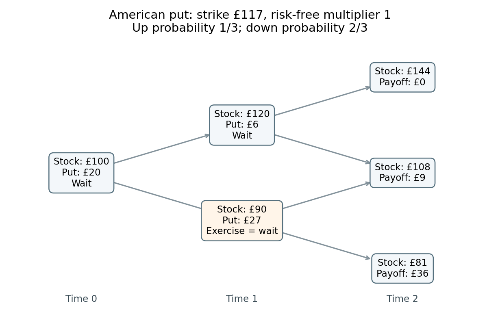

<h1 id="b/4/e/solution">Solution</h1>

↑ **Parent:** [E](../e.md)

Return to $r=0$ and $q=1/3$ from part (b). An [American put option](../../../../../american-put-option.md) is valued by the larger of immediate exercise and discounted continuation at each node. At time one with stock price $120$, exercise gives zero, while continuation gives $(1/3)0+(2/3)9=6$. With stock price $90$, exercise gives $27$, and continuation gives $(1/3)9+(2/3)36=27$; the holder is indifferent.

At time zero, exercise gives $17$, while continuation gives $(1/3)6+(2/3)27=20$. Consequently

$$
\boxed{V_0^{\mathrm{American}}=20\text{ pounds}.}
$$

It is optimal to wait initially and at the up node; at the down node either exercise or waiting is optimal. At this zero interest rate, the European put also costs twenty pounds.

**[Figure 1](#b/4/e/image-backward-induction-for-the-american-put-when-the-risk-free-multiplier-is-one-and-the-up-probability-is-one-third-each-node-shows-the-stock-price-and-option-value). Backward induction for the American put when the risk-free multiplier is one and the up probability is one third. Each node shows the stock price and option value.**

## ↑ Ancestors (13)

1. [E](../e.md)
2. [4](../../4.md)
3. [B](../../../b.md)
4. [2011](../../../../2011-split.md)
5. [Past exam of the martingales and financial mathematics course of the University of Oxford](../../../../split.md)
6. [Martingales and financial mathematics course of the University of Oxford](../../../../../martingales-and-financial-mathematics-course-of-the-university-of-oxford.md)
7. [Year 3 of the mathematics course of the University of Oxford](../../../../../year-3-of-the-mathematics-course-of-the-university-of-oxford.md)
8. [Mathematics course of the University of Oxford](../../../../../mathematics-course-of-the-university-of-oxford.md)
9. [Undergraduate course of the University of Oxford](../../../../../undergraduate-course-of-the-university-of-oxford.md)
10. [Course of the University of Oxford](../../../../../course-of-the-university-of-oxford.md)
11. [University of Oxford](../../../../../university-of-oxford-split.md)
12. [List of universities](../../../../../list-of-universities.md)
13. [Codex Wiki](../../../../../split.md)
