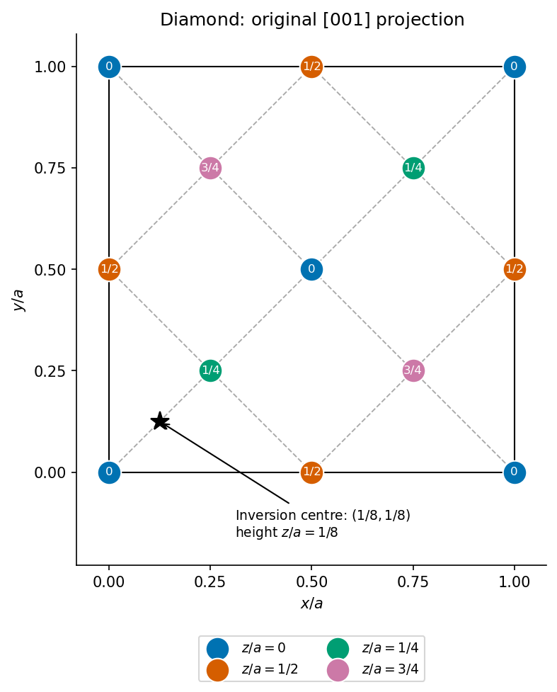

<h1 id="1/a/solution">Solution</h1>

↑ **Parent:** [A](../a.md)

Use fractional coordinates in a conventional cubic cell with an atom at the origin. The [diamond cubic structure](../../../../../diamond-cubic-structure.md) consists of an FCC [Bravais lattice](../../../../../bravais-lattice.md) with the two-atom basis

$$
(0,0,0),\qquad(\tfrac14,\tfrac14,\tfrac14).
$$

The FCC translations within the conventional cell are $(0,0,0)$, $(0,\tfrac12,\tfrac12)$, $(\tfrac12,0,\tfrac12)$ and $(\tfrac12,\tfrac12,0)$. Adding the basis gives eight atoms per conventional cell. Equivalently, **two identical FCC sublattices are displaced by $a[111]/4$**. It is not a monatomic close-packed arrangement: every atom has four tetrahedrally arranged nearest neighbors rather than twelve.

In the projection, label each atom by its fractional height. The $(0,0)$ and $(1/2,1/2)$ columns have height0; $(0,1/2)$ and $(1/2,0)$ have height1/2. The additional four columns are $(1/4,1/4)$ and $(3/4,3/4)$ at height1/4, and $(1/4,3/4)$ and $(3/4,1/4)$ at height3/4. Boundary columns repeat periodically; they must not be counted as full extra atoms.

**[Figure 1](#1/a/image-original-fractional-coordinate-projection-of-diamond-silicon-with-atom-heights-vertical-mirror-traces-and-a-bond-centred-inversion-point). Original fractional-coordinate projection of diamond silicon, with atom heights, vertical mirror traces and a bond-centred inversion point**.

## ↑ Ancestors (13)

1. [A](../a.md)
2. [1](../../1.md)
3. [Paper 1](../../../paper-1-split.md)
4. [2015](../../../split.md)
5. [Past exam of the materials science course of the University of Cambridge](../../../../split.md)
6. [Materials science course of the University of Cambridge](../../../../../materials-science-course-of-the-university-of-cambridge.md)
7. [Year 1 of the natural sciences course of the University of Cambridge](../../../../../year-1-of-the-natural-sciences-course-of-the-university-of-cambridge.md)
8. [Year of the natural sciences course of the University of Cambridge](../../../../../year-of-the-natural-sciences-course-of-the-university-of-cambridge.md)
9. [Natural sciences course of the University of Cambridge](../../../../../natural-sciences-course-of-the-university-of-cambridge.md)
10. [Course of the University of Cambridge](../../../../../course-of-the-university-of-cambridge.md)
11. [University of Cambridge](../../../../../university-of-cambridge-split.md)
12. [List of universities](../../../../../list-of-universities.md)
13. [Codex Wiki](../../../../../split.md)
