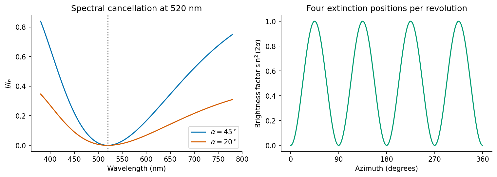

<h1 id="2/a/solution">Solution</h1>

↑ **Parent:** [A](../a.md)

The normal to the section is $[010]$, so its in-plane principal vibration directions are $[100]$ and $[001]$. Their refractive-index difference is

$$
\boxed{\Delta n=1.45-1.32=0.13.}
$$

The slow direction is $[001]$. The optical path retardation is

$$
\Gamma=t\Delta n=(4\ {\rm \mu m})(0.13)=0.52\ {\rm \mu m}.
$$

At an angle $\alpha$ between a principal direction and the [polarizer](../../../../../polarizer.md), ideal crossed-polar transmission has the form

$$
I(\lambda)=I_P\sin^2(2\alpha)
\sin^2\left(\frac{\pi\Gamma}{\lambda}\right),
$$

where $I_P$ is the intensity after the first [polarizer](../../../../../polarizer.md). The two components recombine parallel to the incident [polarization](../../../../../polarization-waves.md) when $\Gamma=m\lambda$, and the crossed analyser removes them. Consequently

$$
\boxed{\lambda=\Gamma/m,\qquad
\lambda_{\rm visible}=520\ {\rm nm}\quad(m=1).}
$$

The next order is260nm, outside ordinary visible illumination. At exact principal-axis alignment, $\sin2\alpha=0$ and every wavelength is extinguished, explaining the black appearance rather than a special single-wavelength cancellation.

**[Figure 2](#2/a/image-original-crossed-polar-transmission-calculation-for-the-given-retardation-including-the-visible-extinction-wavelength-and-azimuthal-brightness-factor). Original crossed-polar transmission calculation for the given retardation, including the visible extinction wavelength and azimuthal brightness factor**.

## ↑ Ancestors (13)

1. [A](../a.md)
2. [2](../../2.md)
3. [Paper 1](../../../paper-1-split.md)
4. [2015](../../../split.md)
5. [Past exam of the materials science course of the University of Cambridge](../../../../split.md)
6. [Materials science course of the University of Cambridge](../../../../../materials-science-course-of-the-university-of-cambridge.md)
7. [Year 1 of the natural sciences course of the University of Cambridge](../../../../../year-1-of-the-natural-sciences-course-of-the-university-of-cambridge.md)
8. [Year of the natural sciences course of the University of Cambridge](../../../../../year-of-the-natural-sciences-course-of-the-university-of-cambridge.md)
9. [Natural sciences course of the University of Cambridge](../../../../../natural-sciences-course-of-the-university-of-cambridge.md)
10. [Course of the University of Cambridge](../../../../../course-of-the-university-of-cambridge.md)
11. [University of Cambridge](../../../../../university-of-cambridge-split.md)
12. [List of universities](../../../../../list-of-universities.md)
13. [Codex Wiki](../../../../../split.md)
