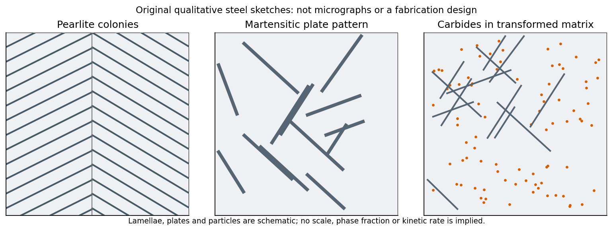

<h1 id="3/a/solution">Solution</h1>

↑ **Parent:** [A](../a.md)

The materials interpretation is a cooling-rate gradient in a near-eutectoid [steel](../../../../../steel.md). Before transformation, the parent [thermodynamic phase](../../../../../thermodynamic-phase.md) is [austenite](../../../../../austenite.md). A small section can cool rapidly enough to suppress diffusional decomposition and form [martensite](../../../../../martensite.md), a supersaturated, highly strained transformation product. A much thicker interior cools more slowly and can transform diffusively to [pearlite](../../../../../pearlite.md): alternating [ferrite](../../../../../ferrite.md) and [cementite](../../../../../cementite.md) lamellae grouped into colonies. Bainite or mixed products are also possible for intermediate histories.

The likely contrast is therefore **a martensite-rich rapidly cooled region and a more pearlitic slowly cooled interior**. Brittle fracture is promoted by the highly strained martensitic state, residual [stresses](../../../../../stress.md) and local [stress](../../../../../stress.md) concentration. A larger intact interior need not share the same microstructure or local loading. The observations are consistent with this contrast, not a measurement proving pure [thermodynamic phases](../../../../../thermodynamic-phase.md) everywhere.

The sketches below are generic [steel microstructures](../../../../../steel-microstructure.md), rather than a component design or fabrication prescription. No cooling curve, dimensions or transformation diagram is provided, so exact [thermodynamic phase](../../../../../thermodynamic-phase.md) fractions, plate sizes and a universally pearlitic centre cannot be inferred.

**[Figure 3](#3/a/image-original-qualitative-steel-microstructure-sketches-lamellar-pearlite-a-strained-martensitic-plate-structure-and-carbide-precipitation-within-a-transformed-matrix). Original qualitative steel microstructure sketches: lamellar pearlite, a strained martensitic plate structure and carbide precipitation within a transformed matrix**.

## ↑ Ancestors (13)

1. [A](../a.md)
2. [3](../../3.md)
3. [Paper 1](../../../paper-1-split.md)
4. [2015](../../../split.md)
5. [Past exam of the materials science course of the University of Cambridge](../../../../split.md)
6. [Materials science course of the University of Cambridge](../../../../../materials-science-course-of-the-university-of-cambridge.md)
7. [Year 1 of the natural sciences course of the University of Cambridge](../../../../../year-1-of-the-natural-sciences-course-of-the-university-of-cambridge.md)
8. [Year of the natural sciences course of the University of Cambridge](../../../../../year-of-the-natural-sciences-course-of-the-university-of-cambridge.md)
9. [Natural sciences course of the University of Cambridge](../../../../../natural-sciences-course-of-the-university-of-cambridge.md)
10. [Course of the University of Cambridge](../../../../../course-of-the-university-of-cambridge.md)
11. [University of Cambridge](../../../../../university-of-cambridge-split.md)
12. [List of universities](../../../../../list-of-universities.md)
13. [Codex Wiki](../../../../../split.md)
