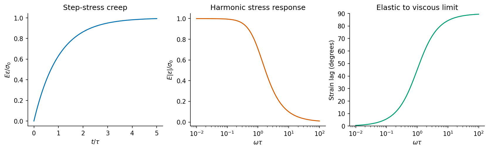

<h1 id="5/d/solution">Solution</h1>

↑ **Parent:** [D](../d.md)

The original diagram is a [Kelvin-Voigt model](../../../../../kelvin-voigt-model.md): a [spring](../../../../../spring.md) and a [dashpot](../../../../../dashpot.md) act in parallel. The [spring](../../../../../spring.md) is an ideal elastic element, $\sigma_s=E\varepsilon_s$; under its own sinusoidal [stress](../../../../../stress.md) its [strain](../../../../../strain.md) is in [phase](../../../../../phase-waves.md) with [stress](../../../../../stress.md) and energy is stored reversibly. The [dashpot](../../../../../dashpot.md) is viscous, $\sigma_d=\eta\dot\varepsilon_d$; its [strain](../../../../../strain.md) under an oscillating [stress](../../../../../stress.md) lags by90degrees and mechanical energy is dissipated.

In parallel the [strain](../../../../../strain.md) is common and the branch [stresses](../../../../../stress.md) add:

$$
\sigma=E\varepsilon+\eta\dot\varepsilon,\qquad
\tau=\eta/E.
$$

For imposed harmonic [stress](../../../../../stress.md), the [strain](../../../../../strain.md) amplitude and [phase](../../../../../phase-waves.md) lag are

$$
|\varepsilon|=\frac{\sigma_0}{\sqrt{E^2+(\omega\eta)^2}},
\qquad
\delta=\tan^{-1}(\omega\tau).
$$

The short- and long-timescale limits follow under the printed roman labels below.

A sudden constant [stress](../../../../../stress.md) $\sigma_0$ gives delayed, bounded creep:

$$
\boxed{\varepsilon(t)=\frac{\sigma_0}{E}
(1-e^{-t/\tau}),\qquad t\geq0.}
$$

The [strain](../../../../../strain.md) is initially zero because an instantaneous change would require an infinite [dashpot](../../../../../dashpot.md) [stress](../../../../../stress.md). Initially the [dashpot](../../../../../dashpot.md) carries the load, with finite [strain](../../../../../strain.md) rate $\sigma_0/\eta$; the [spring](../../../../../spring.md) gradually carries more of it as the rate decays. On unloading, the [strain](../../../../../strain.md) recovers exponentially to zero. The network does not produce the instantaneous [strain](../../../../../strain.md) jump or unbounded constant-stress creep of a series Maxwell element.

**[Figure 4](#5/d/image-original-kelvin-voigt-predictions-for-step-stress-creep-frequency-dependent-compliance-and-stress-strain-phase-lag). Original Kelvin-Voigt predictions for step-stress creep, frequency-dependent compliance and stress-strain phase lag**.

## ↑ Ancestors (13)

1. [D](../d.md)
2. [5](../../5.md)
3. [Paper 1](../../../paper-1-split.md)
4. [2015](../../../split.md)
5. [Past exam of the materials science course of the University of Cambridge](../../../../split.md)
6. [Materials science course of the University of Cambridge](../../../../../materials-science-course-of-the-university-of-cambridge.md)
7. [Year 1 of the natural sciences course of the University of Cambridge](../../../../../year-1-of-the-natural-sciences-course-of-the-university-of-cambridge.md)
8. [Year of the natural sciences course of the University of Cambridge](../../../../../year-of-the-natural-sciences-course-of-the-university-of-cambridge.md)
9. [Natural sciences course of the University of Cambridge](../../../../../natural-sciences-course-of-the-university-of-cambridge.md)
10. [Course of the University of Cambridge](../../../../../course-of-the-university-of-cambridge.md)
11. [University of Cambridge](../../../../../university-of-cambridge-split.md)
12. [List of universities](../../../../../list-of-universities.md)
13. [Codex Wiki](../../../../../split.md)
