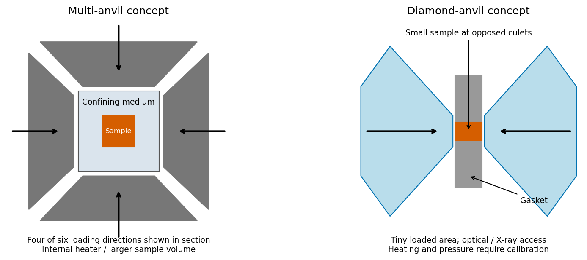

<h1 id="6/b/solution">Solution</h1>

↑ **Parent:** [B](../b.md)

A [multi-anvil press](../../../../../multi-anvil-press.md) transmits a large external load through several hard anvils onto a confined pressure medium surrounding the sample. Reducing the loaded area raises pressure, while the surrounding medium and gasket limit lateral escape. A resistive heater within the assembly can heat the sample, with insulation and temperature sensing arranged around it. It provides relatively large sample volumes and useful bulk, high-temperature experimental conditions, but access to the sample and optical paths is restricted, [pressure gradients](../../../../../pressure-gradient.md) and calibration matter, and the maximum pressure is constrained by anvil strength and geometry.

A [diamond anvil cell](../../../../../diamond-anvil-cell.md) squeezes a very small sample and pressure medium in a gasket hole between opposed [diamond](../../../../../diamond.md) culets. [Diamond](../../../../../diamond.md) combines high strength with useful optical transparency, permitting spectroscopy and optical [pressure calibration](../../../../../pressure-calibration.md) as well as suitable X-ray access. Heating can be external or laser-based. The very small contact area permits high pressure from a modest total force, but gives a tiny sample volume. Nonhydrostatic [stress](../../../../../stress.md), [pressure gradients](../../../../../pressure-gradient.md), gasket deformation, heating gradients, chemical compatibility and [diamond](../../../../../diamond.md) failure are important limitations.

Neither device generates pressure by force alone independent of area and confinement. Nor does a nominal force-to-area ratio guarantee a known hydrostatic sample pressure; experimental pressure and temperature must be calibrated. The two assemblies trade sample volume and access against pressure reach rather than one being universally preferable.

**[Figure 5](#6/b/image-original-conceptual-comparison-of-multi-anvil-load-transmission-and-opposed-diamond-culets-showing-confinement-and-qualitative-heating-access-tradeoffs). Original conceptual comparison of multi-anvil load transmission and opposed diamond culets, showing confinement and qualitative heating/access tradeoffs**.

## ↑ Ancestors (13)

1. [B](../b.md)
2. [6](../../6.md)
3. [Paper 1](../../../paper-1-split.md)
4. [2015](../../../split.md)
5. [Past exam of the materials science course of the University of Cambridge](../../../../split.md)
6. [Materials science course of the University of Cambridge](../../../../../materials-science-course-of-the-university-of-cambridge.md)
7. [Year 1 of the natural sciences course of the University of Cambridge](../../../../../year-1-of-the-natural-sciences-course-of-the-university-of-cambridge.md)
8. [Year of the natural sciences course of the University of Cambridge](../../../../../year-of-the-natural-sciences-course-of-the-university-of-cambridge.md)
9. [Natural sciences course of the University of Cambridge](../../../../../natural-sciences-course-of-the-university-of-cambridge.md)
10. [Course of the University of Cambridge](../../../../../course-of-the-university-of-cambridge.md)
11. [University of Cambridge](../../../../../university-of-cambridge-split.md)
12. [List of universities](../../../../../list-of-universities.md)
13. [Codex Wiki](../../../../../split.md)
