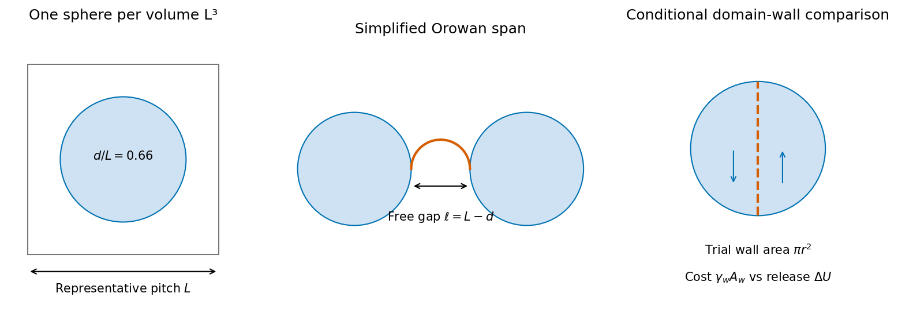

<h1 id="7/b/solution">Solution</h1>

↑ **Parent:** [B](../b.md)

Assume the two [thermodynamic phases](../../../../../thermodynamic-phase.md) have similar atomic volumes, so use $f_V\simeq0.15$. Model the stated average pitch $L=1\ {\rm \mu m}$ by one sphere per representative cubic volume $L^3$. If the sphere diameter is $d$,

$$
f_V=\frac{(\pi/6)d^3}{L^3},
\qquad
\boxed{d=L\left(\frac{6f_V}{\pi}\right)^{1/3}
\simeq0.66\ {\rm \mu m},\quad r\simeq0.33\ {\rm \mu m}.}
$$

Using the more literal lever-rule reading0.145 gives about0.65micrometres instead, within graphical uncertainty. The central estimate is therefore a diameter of roughly two-thirds of a micrometre.

A random distribution does not make a nearest-neighbor mean distance exactly equal to the cube root of inverse [number density](../../../../../number-density.md). The representative cubic spacing is an explicit geometric closure, not evidence that the [precipitates](../../../../../precipitate.md) actually form a cubic lattice. Unequal [molar volumes](../../../../../molar-volume.md) or a different spacing statistic would change the inferred size.

**[Figure 6](#7/b/image-original-geometric-estimates-for-a-spherical-precipitate-fraction-a-dislocation-free-gap-and-a-trial-internal-domain-wall). Original geometric estimates for a spherical precipitate fraction, a dislocation free gap and a trial internal domain wall**.

## ↑ Ancestors (13)

1. [B](../b.md)
2. [7](../../7.md)
3. [Paper 1](../../../paper-1-split.md)
4. [2015](../../../split.md)
5. [Past exam of the materials science course of the University of Cambridge](../../../../split.md)
6. [Materials science course of the University of Cambridge](../../../../../materials-science-course-of-the-university-of-cambridge.md)
7. [Year 1 of the natural sciences course of the University of Cambridge](../../../../../year-1-of-the-natural-sciences-course-of-the-university-of-cambridge.md)
8. [Year of the natural sciences course of the University of Cambridge](../../../../../year-of-the-natural-sciences-course-of-the-university-of-cambridge.md)
9. [Natural sciences course of the University of Cambridge](../../../../../natural-sciences-course-of-the-university-of-cambridge.md)
10. [Course of the University of Cambridge](../../../../../course-of-the-university-of-cambridge.md)
11. [University of Cambridge](../../../../../university-of-cambridge-split.md)
12. [List of universities](../../../../../list-of-universities.md)
13. [Codex Wiki](../../../../../split.md)
