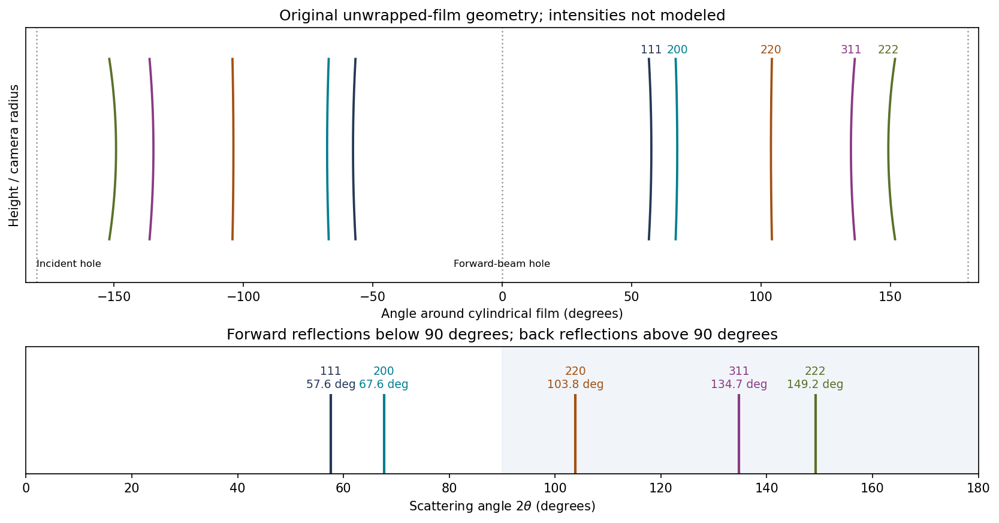
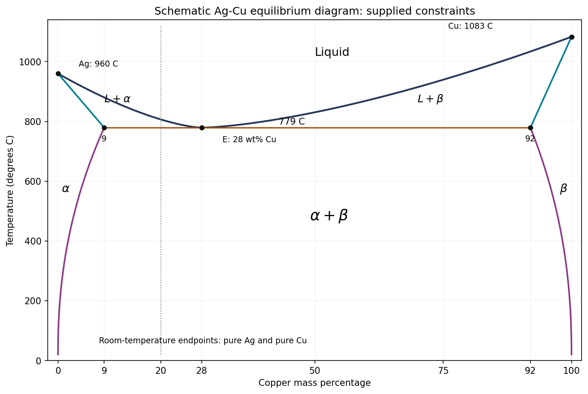
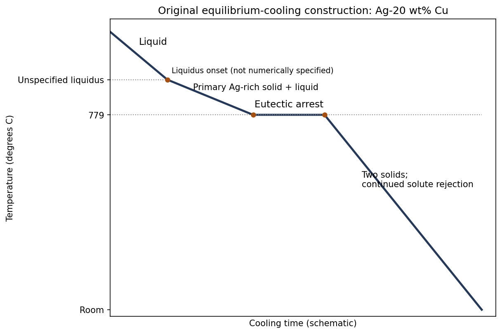
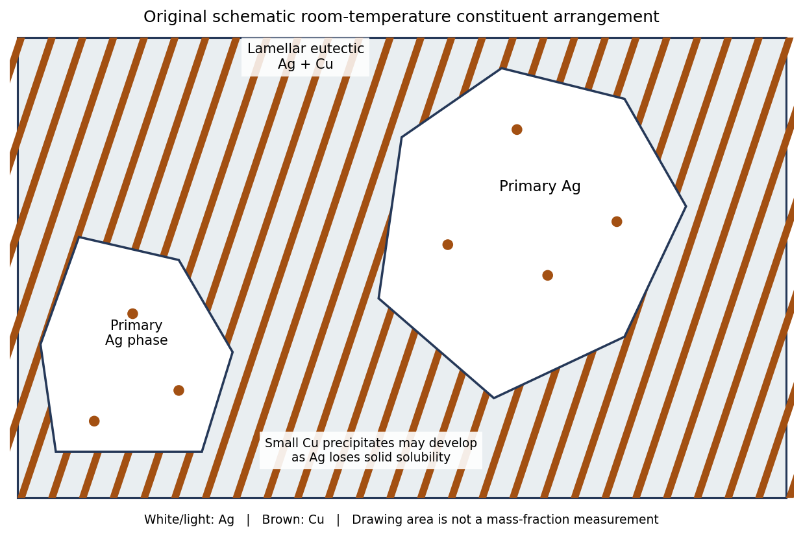

# Paper 1

↑ **Parent:** [2016](../2016.md)

Original paper: [Public original PDF, physical pages 9–16; question pages 10–16](https://www.whatdotheyknow.com/request/natural_sciences_tripos_part_1a/response/3284364/attach/3/FOI%202025%201239%20Hagendoorn%20materials.pdf?cookie_passthrough=1#page=9).

**Table of contents**

- [1](#1)
  - [a](#1/a)
    - [i](#1/a/i)
      - [Solution](#1/a/i/solution)
    - [ii](#1/a/ii)
      - [Solution](#1/a/ii/solution)
    - [iii](#1/a/iii)
      - [Solution](#1/a/iii/solution)
  - [b](#1/b)
    - [Solution](#1/b/solution)
  - [c](#1/c)
    - [Solution](#1/c/solution)
- [2](#2)
  - [a](#2/a)
    - [Solution](#2/a/solution)
  - [b](#2/b)
    - [Solution](#2/b/solution)
  - [c](#2/c)
    - [Solution](#2/c/solution)
  - [d](#2/d)
    - [Solution](#2/d/solution)
- [3](#3)
  - [a](#3/a)
    - [Solution](#3/a/solution)
  - [b](#3/b)
    - [Solution](#3/b/solution)
  - [c](#3/c)
    - [Solution](#3/c/solution)
- [4](#4)
  - [a](#4/a)
    - [Solution](#4/a/solution)
  - [b](#4/b)
    - [Solution](#4/b/solution)
  - [c](#4/c)
    - [i](#4/c/i)
      - [Solution](#4/c/i/solution)
    - [ii](#4/c/ii)
      - [Solution](#4/c/ii/solution)
  - [d](#4/d)
    - [Solution](#4/d/solution)
  - [e](#4/e)
    - [Solution](#4/e/solution)
- [5](#5)
  - [a](#5/a)
    - [Solution](#5/a/solution)
  - [b](#5/b)
    - [i](#5/b/i)
      - [Solution](#5/b/i/solution)
    - [ii](#5/b/ii)
      - [Solution](#5/b/ii/solution)
    - [iii](#5/b/iii)
      - [Solution](#5/b/iii/solution)
  - [c](#5/c)
    - [Solution](#5/c/solution)
  - [d](#5/d)
    - [Solution](#5/d/solution)
- [6](#6)
  - [a](#6/a)
    - [Solution](#6/a/solution)
  - [b](#6/b)
    - [Solution](#6/b/solution)
  - [c](#6/c)
    - [Solution](#6/c/solution)
  - [d](#6/d)
    - [i](#6/d/i)
      - [Solution](#6/d/i/solution)
    - [ii](#6/d/ii)
      - [Solution](#6/d/ii/solution)
    - [iii](#6/d/iii)
      - [Solution](#6/d/iii/solution)
- [7](#7)
  - [a](#7/a)
    - [Solution](#7/a/solution)
  - [b](#7/b)
    - [Solution](#7/b/solution)
  - [c](#7/c)
    - [Solution](#7/c/solution)

## 1

↑ **Parent:** [Paper 1](paper-1.md)

<h3 id="1/a">a</h3>

↑ **Parent:** [1](#1)

Use $y/b$ horizontally and $z/c$ vertically, and label each molecular center by its fractional height $x/a$ along the viewing direction. The four centers in one periodic cell are $(0,0)$ with height $0$ and orientation A, $(1/2,0)$ with height $1/2$ and orientation A, $(0,1/2)$ with height $1/2$ and orientation B, and $(1/2,1/2)$ with height $0$ and orientation B. Boundary images complete the projected rectangle. The A and B bonds have opposite slopes; the atoms in each bond are indistinguishable.

**[Figure 1](#1/a/image-original-molecular-center-construction-and-symmetry-traces-for-the-iodine-cell-viewed-along-100-bond-inclination-is-schematic-heights-and-bond-length-are-specified). Original molecular-center construction and symmetry traces for the iodine cell viewed along $[100]$; bond inclination is schematic, heights and bond length are specified**.

The height labels matter: a symmetry of the unlabelled projection need not be a translation or reflection symmetry of the three-dimensional crystal. The drawing uses the given $0.267\,\mathrm{nm}$ molecular bond length and an illustrative inclination, since no exact inclination angle is specified.

<h4 id="1/a/i">i</h4>

↑ **Parent:** [A](#1/a)

<h5 id="1/a/i/solution">Solution</h5>

↑ **Parent:** [I](#1/a/i)

**This is a [C-centered orthorhombic lattice](../../physical-chemistry.md#c-centered-orthorhombic-lattice).** The translation $(1/2,1/2,0)$ takes each A molecule to another A molecule and each B molecule to another B molecule. Thus the conventional cell has two [lattice points](../../quantum-scattering.md#lattice-point).

A two-molecule [crystal motif](../../physical-chemistry.md#crystal-motif) can be chosen as A at $(0,0,0)$ and B at $(1/2,0,1/2)$. Attaching that same motif to both C-centered [lattice points](../../quantum-scattering.md#lattice-point) produces all four molecules, hence **eight [iodine](../../chemical-substance.md#iodine) atoms per conventional cell**.

The centers alone appear face-centered, but $(1/2,0,1/2)$ exchanges A and B orientations. It is not a translation symmetry of the oriented molecular solid. An F-centered assignment would discard essential motif information.

<h4 id="1/a/ii">ii</h4>

↑ **Parent:** [A](#1/a)

<h5 id="1/a/ii/solution">Solution</h5>

↑ **Parent:** [Ii](#1/a/ii)

**There are $2_1$ [screw axes](../../physical-chemistry.md#screw-axis) parallel to $[100]$ through $(y/b,z/c)=(1/4,0),(3/4,0),(1/4,1/2),(3/4,1/2)$**, with periodic repeats.

For the first axis the operation in fractional coordinates is

$$
(x,y,z)\longmapsto(x+1/2,1/2-y,-z).
$$

It rotates by $180^\circ$ about the axis and translates by $a/2$. For example, it sends the A center at $(0,0,0)$ to the A center at $(1/2,1/2,0)$, and sends B at $(1/2,0,1/2)$ to B at $(0,1/2,1/2)$ modulo integer translations. A half-turn preserves each unoriented diatomic bond. A second application gives one full $a$ translation.

There are also ordinary twofold axes through the molecular-center rows; those should not be confused with the [screw axes](../../physical-chemistry.md#screw-axis) halfway between the corresponding rows.

<h4 id="1/a/iii">iii</h4>

↑ **Parent:** [A](#1/a)

<h5 id="1/a/iii/solution">Solution</h5>

↑ **Parent:** [Iii](#1/a/iii)

The relevant planes contain $[100]$, so their normals lie in the $bc$ plane. The symmetry operations can be checked directly on the height-labelled molecules:

- **[Glide planes](../../physical-chemistry.md#glide-plane) of type $c$, parallel to $(010)$ at $y/b=1/4,3/4$**, for example

$$
(x,y,z)\longmapsto(x,1/2-y,z+1/2).
$$

Reflection reverses the bond slope, and the $c/2$ translation carries A to B with the correct height.

- **[Glide planes](../../physical-chemistry.md#glide-plane) of type $a$, parallel to $(001)$ at $z/c=1/4,3/4$**, for example

$$
(x,y,z)\longmapsto(x+1/2,y,1/2-z).
$$

This again exchanges A and B. Combining it with the C-centering translation gives the equivalent description with a $b/2$ glide in the same plane.

**There are no ordinary mirror planes containing $[100]$ for the illustrated generic bond inclination.** Reflection alone would reverse a bond slope without the necessary accompanying translation. A mirror perpendicular to $[100]$ is a different symmetry and is outside the requested zone.

<h3 id="1/b">b</h3>

↑ **Parent:** [1](#1)

<h4 id="1/b/solution">Solution</h4>

↑ **Parent:** [B](#1/b)

Count atoms before comparing cell [volumes](../../geometry-and-topology.md#volume). The molecular conventional cell has eight atoms; the metallic face-centered cubic cell has four. Thus

$$
v_{\rm mol}=\frac{0.726(0.480)(0.978)}8
=0.04260168\,\mathrm{nm^3},\qquad
v_{\rm met}=\frac{0.51^3}{4}=0.03316275\,\mathrm{nm^3}.
$$

Relative to the molecular phase,

$$
\boxed{100\frac{v_{\rm met}-v_{\rm mol}}{v_{\rm mol}}=-22.16\%.}
$$

The transformation therefore produces **about 22.2% contraction per atom** on the stated extrapolated-volume comparison. Conversely, the molecular [volume](../../geometry-and-topology.md#volume) is about $28.5\%$ larger than the metallic [volume](../../geometry-and-topology.md#volume); these percentages have different denominators. Compressibility would be needed to turn the extrapolated comparison into exact [volumes](../../geometry-and-topology.md#volume) at the transformation [pressure](../../pressure.md).

<h3 id="1/c">c</h3>

↑ **Parent:** [1](#1)

<h4 id="1/c/solution">Solution</h4>

↑ **Parent:** [C](#1/c)

At fixed [temperature](../../temperature.md), a phase's [Gibbs free energy](../../thermodynamic-potential.md#gibbs-free-energy) satisfies $\mathrm dG=V\,\mathrm dp$. For the metallic-minus-molecular difference,

$$
\left(\frac{\partial\Delta G}{\partial p}\right)_T=\Delta V<0.
$$

**Increasing [pressure](../../pressure.md) favors the smaller-volume metallic phase.** With a pressure-independent [volume](../../geometry-and-topology.md#volume) approximation, $\Delta G(p)\simeq\Delta G(p_0)+(p-p_0)\Delta V$, so [pressure](../../pressure.md) can overcome an initially positive free-energy difference. The [volume](../../geometry-and-topology.md#volume) comparison explains the direction of stabilization; it does not by itself determine the transition [pressure](../../pressure.md) or the electronic origin of [metallic bonding](../../chemical-bond.md#metallic-bonding).

## 2

↑ **Parent:** [Paper 1](paper-1.md)

<h3 id="2/a">a</h3>

↑ **Parent:** [2](#2)

<h4 id="2/a/solution">Solution</h4>

↑ **Parent:** [A](#2/a)

Assume one temperature-independent [activation energy](../../chemical-kinetics.md#activation-energy) over this interval and an unchanged dopant-controlled carrier population. Write the [Arrhenius equation](../../chemical-kinetics.md#arrhenius-equation) as $D=D_0\exp[-Q/(k_BT)]$. The two measurements give

$$
\frac Q{k_B}=\frac{\ln 10}{1/1000-1/1180}=1.5095\times10^4\,\mathrm K,
\qquad Q=1.301\,\mathrm{eV}=125.5\,\mathrm{kJ\,mol^{-1}}.
$$

Using $D(T)=10^{-13}\exp[(Q/k_B)(1/1000-1/T)]$ yields

$$
\boxed{D(1250)=2.047\times10^{-12},\qquad
D(1110)=4.463\times10^{-13}\quad\mathrm{m^2\,s^{-1}}.}
$$

The [Nernst-Einstein relation](../../electric-charge.md#nernst-einstein-relation) includes the factor $1/T$: $\sigma=nq^2D/(k_BT)$. For fixed $n$ and a fixed correlation correction,

$$
\sigma(1110)=0.08\frac{D(1110)}{D(1250)}\frac{1250}{1110}
=\boxed{1.964\times10^{-2}\,\mathrm{S\,m^{-1}}}.
$$

Using conductivity proportional to $D$ alone would miss the [temperature](../../temperature.md) factor. Carrier association, a changing vacancy population or a changing [diffusion](../../thermodynamics.md#diffusion) correlation factor would invalidate this simple extrapolation.

<h3 id="2/b">b</h3>

↑ **Parent:** [2](#2)

<h4 id="2/b/solution">Solution</h4>

↑ **Parent:** [B](#2/b)

For an oxide [ion](../../chemistry.md#ion), or an [oxygen vacancy](../../physical-chemistry.md#oxygen-vacancy) measured relative to the ideal lattice, the charge magnitude is $|q|=2e$. The independent-carrier Nernst-Einstein inversion at $1250\,\mathrm K$ gives

$$
\boxed{n_{\rm eff}=\frac{\sigma k_BT}{(2e)^2D}
=6.569\times10^{27}\,\mathrm{m^{-3}}.}
$$

Here $D$ and $n_{\rm eff}$ must describe the same carrier convention. If the quoted diffusivity is a mobile-vacancy diffusivity, this is the vacancy [density](../../fluid-mechanics.md#density). If it is literally an oxygen-ion tracer diffusivity, it is an effective oxygen-ion [density](../../fluid-mechanics.md#density) under an uncorrelated model. Vacancy [density](../../fluid-mechanics.md#density) cannot be substituted for oxygen-ion [density](../../fluid-mechanics.md#density) while retaining the same diffusivity. This distinction is consequential in the last part.

<h3 id="2/c">c</h3>

↑ **Parent:** [2](#2)

<h4 id="2/c/solution">Solution</h4>

↑ **Parent:** [C](#2/c)

The conventional cubic cell has [volume](../../geometry-and-topology.md#volume)

$$
a^3=(0.52\times10^{-9})^3=1.40608\times10^{-28}\,\mathrm{m^3}.
$$

Consequently the same effective carrier count is

$$
\boxed{N_{\rm eff}=n_{\rm eff}a^3=0.9236\quad\text{carriers per cell}.}
$$

A noninteger mean is normal for a doped crystal: it describes an ensemble average, not a requirement that every cell contain the same number of defects. The [fluorite structure](../../physical-chemistry.md#fluorite-structure) has four cation sites and eight oxygen sites in this conventional cell.

<h3 id="2/d">d</h3>

↑ **Parent:** [2](#2)

<h4 id="2/d/solution">Solution</h4>

↑ **Parent:** [D](#2/d)

**The numerical vacancy fraction depends on what the supplied diffusivity describes.** In the usual effective mobile-vacancy calculation, the $0.9236$ carriers per cell are [oxygen vacancies](../../physical-chemistry.md#oxygen-vacancy), each of effective charge $+2e$. There are eight oxygen sites, so that convention gives

$$
\boxed{f_v=\frac{0.9236}{8}=0.1155\simeq11.5\%.\quad\text{Vacancy-carrier convention}}
$$

There is a real qualification: the printed description calls the measured particles oxygen carrier [ions](../../chemistry.md#ion). If $D$ is their tracer diffusivity and every occupied oxygen site is counted as an uncorrelated carrier, the inversion instead gives $N_O=0.9236$, formally $f_v=1-N_O/8=0.8845$. Such an enormous oxygen deficiency is inconsistent with the ordinary lightly doped fluorite picture; it is not a credible deduction of $88.5\%$ vacancies in stabilized [zirconia](../../chemical-substance.md#zirconia).

More generally the conductivity involves a collective [diffusion coefficient](../../brownian-motion.md#diffusion-coefficient), whereas [tracer diffusion](../../thermodynamics.md#tracer-diffusion) includes jump correlations. With the explicitly defined convention $H_R=D_{\rm tr}/D_\sigma$,

$$
\sigma=\frac{n_O(2e)^2D_{\rm tr}}{H_Rk_BT},
\qquad n_O=H_R n_{\rm eff}.
$$

Without a carrier definition and the relevant correlation information, **the literal tracer data do not uniquely establish the vacancy fraction**. The consistent vacancy-carrier interpretation gives the boxed **$11.5\%$** estimate. Interpreting the same measured $D$ as an oxygen-ion tracer diffusivity requires the collective/tracer conversion above; ordinary [Nernst-Einstein relation](../../electric-charge.md#nernst-einstein-relation) arithmetic cannot identify these two carrier populations. This states the model assumption needed for the numerical result without treating the physically implausible uncorrelated oxygen-ion inversion as an established material composition.

## 3

↑ **Parent:** [Paper 1](paper-1.md)

<h3 id="3/a">a</h3>

↑ **Parent:** [3](#3)

<h4 id="3/a/solution">Solution</h4>

↑ **Parent:** [A](#3/a)

Measure ring centers and [radii](../../topology.md#radius) against the printed scale, rather than comparing raw squared [radii](../../topology.md#radius). A representative reading of the four rings is $R\simeq6.0,7.0,10.6,13.2\,\mathrm{mm}$, with broad photographic lines. For a flat plate at distance $L$,

$$
2\theta=\arctan(R/L),\qquad
\sin^2\theta=\frac12\left(1-\frac{L}{\sqrt{L^2+R^2}}\right).
$$

With $L=16\,\mathrm{mm}$ the $\sin^2\theta$ ratios are approximately $1:1.33:2.67:3.67$, giving

$$
\boxed{111,\quad200,\quad220,\quad311;\qquad\text{face-centered cubic lattice}.}
$$

For identical atoms at the four conventional FCC positions,

$$
F_{hkl}=f\{1+(-1)^{h+k}+(-1)^{h+l}+(-1)^{k+l}\}.
$$

The [structure factor](../../quantum-scattering.md#structure-factor) is $4f$ for indices all even or all odd, and zero for mixed parity. Thus, for example, 100, 110 and 210 are [systematic absences](../../quantum-scattering.md#systematic-absence). The allowed squared-index sums begin $3,4,8,11,12,16,\ldots$. Only the first four rings fit within the displayed field; 222 and later allowed reflections are not forbidden merely because they are outside the image. The central shadow and its holder are not extra [diffraction](../../quantum-scattering.md#diffraction) peaks.

<h3 id="3/b">b</h3>

↑ **Parent:** [3](#3)

<h4 id="3/b/solution">Solution</h4>

↑ **Parent:** [B](#3/b)

Take $\lambda_{\rm Fe}\simeq0.1937\,\mathrm{nm}$ for the unresolved [iron](../../chemical-substance.md#iron) $K_\alpha$ doublet. The underlying tabulated $K_{\alpha1}$ and $K_{\alpha2}$ wavelengths are approximately $0.193604$ and $0.193998\,\mathrm{nm}$.[Table V, iron entries; physical PDF page17](../../physics-bibliography.md#x-ray-wavelengths-and-x-ray-atomic-energy-levels-by-j-a-bearden)

Using the inferred $a\simeq0.348\,\mathrm{nm}$, [Bragg's law](../../quantum-scattering.md#bragg-s-law) gives the following approximate cone angles:

$$
\begin{array}{c|ccccc}
hkl&111&200&220&311&222\\\hline
2\theta&57.6^\circ&67.6^\circ&103.8^\circ&134.7^\circ&149.2^\circ
\end{array}
$$

The exact angles inherit the lattice-parameter uncertainty. **Five reflection families are kinematically possible with this longer wavelength**: $h^2+k^2+l^2\leq(2a/\lambda_{\rm Fe})^2\simeq12.9$. The next FCC family, 400, cannot satisfy [Bragg's law](../../quantum-scattering.md#bragg-s-law).

**[Figure 2](#3/b/image-original-calculated-fe-k-alpha-cone-intersections-on-unwrapped-cylindrical-film-angular-positions-use-the-measured-lattice-estimate-line-intensities-are-schematic). Original calculated Fe $K_\alpha$ cone intersections on unwrapped cylindrical film; angular positions use the measured lattice estimate, line intensities are schematic**.

A cylindrical [Debye-Scherrer camera](../../quantum-scattering.md#debye-scherrer-camera) records paired curved lines where each [diffraction](../../quantum-scattering.md#diffraction) cone intersects the film. Both forward and backward cones can be intercepted. The last three families are back reflections here, unlike the rings recorded on the original forward flat plate. Film position is proportional to camera angle along the equatorial circumference, rather than to $L\tan2\theta$; the incident and transmitted beam holes must also be distinguished from reflections. A sufficiently resolved exposure may separate the characteristic doublet, but the schematic does not claim to predict line intensities.

<h3 id="3/c">c</h3>

↑ **Parent:** [3](#3)

<h4 id="3/c/solution">Solution</h4>

↑ **Parent:** [C](#3/c)

For any indexed cubic reflection,

$$
a=\frac{\lambda\sqrt{h^2+k^2+l^2}}{2\sin[\tfrac12\arctan(R/L)]}.
$$

Use $\lambda_{\rm Mo}\simeq0.07107\,\mathrm{nm}$ for the unresolved [molybdenum](../../chemical-substance.md#molybdenum) $K_\alpha$ doublet; the tabulated components are approximately $0.0709300$ and $0.0713590\,\mathrm{nm}$. These are external spectral constants, not an assertion about the unavailable historical Data Book.[Table V, molybdenum entries; physical PDF page19](../../physics-bibliography.md#x-ray-wavelengths-and-x-ray-atomic-energy-levels-by-j-a-bearden)

Reading broad ring centers in the supplied image more closely gives representative [radii](../../topology.md#radius) $5.96,6.99,10.63,13.23\,\mathrm{mm}$. Their corresponding estimates are about $0.3471,0.3473,0.3478,0.3480\,\mathrm{nm}$. Their small scatter understates possible common scale and camera-distance errors. In particular,

$$
\left|\frac{\delta a}{a}\right|\simeq
\frac{\cot\theta}{2[1+(R/L)^2]}
\left|\frac{\delta R}{L}-\frac{R\,\delta L}{L^2}\right|
$$

for a first-order signed perturbation; independent uncertainties are combined in quadrature instead. A reading uncertainty of order $0.2\,\mathrm{mm}$, plus the printed-scale and setup uncertainty, justifies a deliberately modest precision:

$$
\boxed{a\simeq0.35\pm0.01\,\mathrm{nm}.}
$$

**[Nickel](../../chemical-substance.md#nickel) is a plausible identification**, since it is FCC with room-temperature edge about $0.352\,\mathrm{nm}$.[Abstract, pure-nickel lattice parameter at25°C](../../engineering.md#thermal-expansion-of-nickel-and-iron-and-the-influence-of-nitrogen-on-the-lattice-parameter-of-iron-at-the-curie-temperature-by-jinn-wen-hwang) The source photograph alone does not chemically identify the specimen; nearby elemental lattice constants and the scale uncertainty preclude a rigorous unique assignment. The estimate is not reported with artificial precision inherited from pixel fitting.

## 4

↑ **Parent:** [Paper 1](paper-1.md)

<h3 id="4/a">a</h3>

↑ **Parent:** [4](#4)

<h4 id="4/a/solution">Solution</h4>

↑ **Parent:** [A](#4/a)

**[Eutectic solidification](../../thermodynamic-potential.md#eutectic-solidification) is the coupled transformation of a liquid into two distinct solid phases at the [eutectic temperature](../../thermodynamic-potential.md#eutectic-temperature) and composition**, $L\rightarrow\alpha+\beta$. At fixed [pressure](../../pressure.md) in a binary system the three-phase equilibrium is invariant. An exactly eutectic liquid can therefore finish freezing at one [temperature](../../temperature.md), instead of over a broad liquid-plus-solid interval.

[Eutectic compositions](../../thermodynamic-potential.md#eutectic-composition) are useful in joining alloys, for example silver-copper [brazing](../../engineering.md#brazing) filler: the comparatively low melting [temperature](../../temperature.md) and narrow freezing interval help liquid flow into a joint and then solidify. Alternating growth of the two phases often produces a fine lamellar [eutectic microstructure](../../thermodynamic-potential.md#eutectic-microstructure). The eutectic is a two-phase aggregate, not a new single solid phase.

<h3 id="4/b">b</h3>

↑ **Parent:** [4](#4)

<h4 id="4/b/solution">Solution</h4>

↑ **Parent:** [B](#4/b)

**[Figure 3](#4/b/image-original-schematic-ag-cu-phase-diagram-constrained-by-the-supplied-endpoints-and-eutectic-tie-line-unprovided-curve-shapes-and-intermediate-temperatures-are-illustrative). Original schematic Ag-Cu phase diagram constrained by the supplied endpoints and eutectic tie line; unprovided curve shapes and intermediate temperatures are illustrative**.

The horizontal axis is [copper](../../chemical-substance.md#copper) [mass](../../classical-mechanics.md#mass) percentage. The two [liquidus](../../thermodynamic-potential.md#liquidus) branches meet at $(28\%,779^\circ\mathrm C)$ and connect to pure [silver](../../chemical-substance.md#silver) at $960^\circ\mathrm C$ and pure [copper](../../chemical-substance.md#copper) at $1083^\circ\mathrm C$. The terminal solid-solution boundaries at the [eutectic temperature](../../thermodynamic-potential.md#eutectic-temperature) are $9\%$ Cu for $\alpha$ and $92\%$ Cu for $\beta$. Label the single-phase fields $L,\alpha,\beta$, the two liquid-plus-solid fields $L+\alpha,L+\beta$, and the lower two-solid field $\alpha+\beta$.

The [solidus](../../thermodynamic-potential.md#solidus) boundaries link the pure-component melting points to their terminal solubility limits; the eutectic isotherm spans the three-phase tie line. Below it, the [solvus](../../thermodynamic-potential.md#solvus) branches approach pure Ag and pure Cu at room [temperature](../../temperature.md). The supplied data determine this topology and the marked points, **not the exact shapes of every boundary**. The drawing therefore does not invent a numerical [liquidus](../../thermodynamic-potential.md#liquidus) [temperature](../../temperature.md) for an intermediate composition.

<h3 id="4/c">c</h3>

↑ **Parent:** [4](#4)

<h4 id="4/c/i">i</h4>

↑ **Parent:** [C](#4/c)

<h5 id="4/c/i/solution">Solution</h5>

↑ **Parent:** [I](#4/c/i)

Apply the [lever rule](../../thermodynamic-potential.md#lever-rule) on the $779^\circ\mathrm C$ solid tie line. All compositions are [copper](../../chemical-substance.md#copper) [mass](../../classical-mechanics.md#mass) percentages:

$$
\boxed{w_\alpha=\frac{92-28}{92-9}=\frac{64}{83}=0.7711,
\qquad w_\beta=\frac{28-9}{92-9}=\frac{19}{83}=0.2289.}
$$

Thus the equilibrium material is **77.1% $\alpha$ and 22.9% $\beta$ by [mass](../../classical-mechanics.md#mass)** just below the [eutectic temperature](../../thermodynamic-potential.md#eutectic-temperature). These are phase fractions; converting them to [volume fractions](../../continuum-mechanics.md#volume-fraction) would require [densities](../../fluid-mechanics.md#density).

<h4 id="4/c/ii">ii</h4>

↑ **Parent:** [C](#4/c)

<h5 id="4/c/ii/solution">Solution</h5>

↑ **Parent:** [Ii](#4/c/ii)

The room-temperature endpoints are pure Ag and pure Cu. Conservation of the total [copper](../../chemical-substance.md#copper) [mass](../../classical-mechanics.md#mass) therefore gives

$$
\boxed{w_\alpha=1-0.28=0.72,\qquad w_\beta=0.28.}
$$

The answer is **72% [silver](../../chemical-substance.md#silver) phase and 28% [copper](../../chemical-substance.md#copper) phase by [mass](../../classical-mechanics.md#mass)**. The change from the high-temperature fractions is caused by decreasing solid solubility: the phases reject the opposite component during equilibrium cooling. Simply retaining the eutectic-temperature lever-rule fractions would violate the stipulated room-temperature equilibrium compositions.

<h3 id="4/d">d</h3>

↑ **Parent:** [4](#4)

<h4 id="4/d/solution">Solution</h4>

↑ **Parent:** [D](#4/d)

The cooling curve first falls in the entirely liquid field. On crossing the [liquidus](../../thermodynamic-potential.md#liquidus), primary Ag-rich $\alpha$ begins to grow. [Latent heat](../../thermodynamic-potential.md#latent-heat) release makes the descent shallower; the remaining liquid becomes richer in [copper](../../chemical-substance.md#copper) and approaches the [eutectic composition](../../thermodynamic-potential.md#eutectic-composition).

At $779^\circ\mathrm C$, the remaining liquid solidifies as $\alpha+\beta$, giving an **isothermal arrest** under the ideal equilibrium, heat-extraction model. After the liquid is exhausted, [temperature](../../temperature.md) falls through the two-solid field. Continued loss of solid solubility causes additional redistribution and precipitation; it does not require another invariant liquid-freezing plateau.

**[Figure 4](#4/d/image-original-schematic-cooling-curve-for-ag-20-wt-percent-cu-with-an-unspecified-liquidus-kink-and-a-labelled-eutectic-arrest). Original schematic cooling curve for Ag-20 wt% Cu, with an unspecified liquidus kink and a labelled eutectic arrest**.

Immediately before the eutectic reaction, the remaining liquid fraction is

$$
w_L=\frac{20-9}{28-9}=\frac{11}{19}=0.5789;
\qquad w_{\alpha,\rm primary}=\frac8{19}=0.4211.
$$

The arrest represents freezing of roughly $58\%$ of the sample by [mass](../../classical-mechanics.md#mass). Its duration cannot be calculated without the heat-extraction rate and [latent heat](../../thermodynamic-potential.md#latent-heat), and the onset [temperature](../../temperature.md) cannot be calculated exactly from the supplied phase-diagram points alone.

<h3 id="4/e">e</h3>

↑ **Parent:** [4](#4)

<h4 id="4/e/solution">Solution</h4>

↑ **Parent:** [E](#4/e)

**At equilibrium at room [temperature](../../temperature.md) the phases are pure Ag and pure Cu, with [mass fractions](../../mixture.md#mass-fraction) $0.80$ and $0.20$.** A representative [solidification](../../critical-phenomenon.md#freezing) structure contains primary Ag-rich grains or dendrites surrounded by a finer two-phase eutectic aggregate. Subsequent equilibrium solute rejection modifies both constituents as they cool.

**[Figure 5](#4/e/image-original-schematic-primary-silver-and-lamellar-eutectic-arrangement-geometrical-drawing-areas-do-not-assert-mass-or-volume-fractions). Original schematic primary-silver and lamellar eutectic arrangement; geometrical drawing areas do not assert mass or volume fractions**.

The $42.1\%$ primary-$\alpha$ and $57.9\%$ eutectic-constituent fractions calculated at the eutectic arrest describe how the liquid froze. They are **not** the final pure-Ag and pure-Cu phase fractions. For example, just below the arrest the total copper-rich phase fraction is $(20-9)/(92-9)=11/83=0.1325$; it rises to $0.20$ as solubility is lost on further equilibrium cooling. The distinction separates a microstructural constituent from a [thermodynamic phase](../../thermodynamics.md#thermodynamic-phase).

Faster [solidification](../../critical-phenomenon.md#freezing) usually refines the dendrite and eutectic spacings. If solid-state [diffusion](../../thermodynamics.md#diffusion) cannot keep up, composition gradients, supersaturated solids and delayed precipitation can persist. Their exact fractions then depend on the thermal history; faster cooling does not change the alloy's overall $20\%$ [copper](../../chemical-substance.md#copper) inventory. Complete long-term equilibration would restore the same equilibrium phase compositions and [mass fractions](../../mixture.md#mass-fraction).

## 5

↑ **Parent:** [Paper 1](paper-1.md)

<h3 id="5/a">a</h3>

↑ **Parent:** [5](#5)

<h4 id="5/a/solution">Solution</h4>

↑ **Parent:** [A](#5/a)

The alloy shear yield [stress](../../continuum-mechanics.md#stress) can be roughly $70/0.78\simeq90$ times the stated pure-aluminium [critical resolved shear stress](../../physical-chemistry.md#critical-resolved-shear-stress). Strengthening raises the [stress](../../continuum-mechanics.md#stress) required for [dislocation glide](../../physical-chemistry.md#dislocation-glide) rather than requiring homogeneous shearing of a perfect crystal.

- **[Solid-solution strengthening](../../chemical-substance.md#solid-solution-strengthening):** substitutional solutes create elastic and chemical disturbances that interact with [dislocations](../../physical-chemistry.md#dislocation). A moving [dislocation](../../physical-chemistry.md#dislocation) must escape or drag these disturbances.
- **[Precipitation hardening](../../chemical-substance.md#precipitation-hardening):** suitably spaced second-phase particles obstruct glide. Small shearable precipitates resist cutting; larger nonshearable obstacles require [dislocation](../../physical-chemistry.md#dislocation) bowing and bypass. Particle spacing and coherency matter, so overaging can reduce strength.
- **[Work hardening](../../continuum-mechanics.md#work-hardening):** prior plastic deformation increases [dislocation density](../../physical-chemistry.md#dislocation-density). Intersections, junctions and forest [dislocations](../../physical-chemistry.md#dislocation) impede subsequent glide; a common scaling is $\Delta\tau\sim\alpha Gb\sqrt{\rho_d}$.
- **[Grain boundary strengthening](../../physical-chemistry.md#grain-boundary-strengthening):** smaller grains shorten the distance over which [dislocations](../../physical-chemistry.md#dislocation) can pile up and make slip transfer across differently oriented grains more difficult. In its ordinary regime, the [Hall-Petch relation](../../physical-chemistry.md#hall-petch-relation) is $\sigma_y=\sigma_0+k_y d^{-1/2}$.

These mechanisms can coexist. The numerical comparison is an order-of-magnitude comparison of shear strengths; it is not a conversion of the alloy's shear yield [stress](../../continuum-mechanics.md#stress) directly into a tensile yield [stress](../../continuum-mechanics.md#stress).

<h3 id="5/b">b</h3>

↑ **Parent:** [5](#5)

<h4 id="5/b/i">i</h4>

↑ **Parent:** [B](#5/b)

<h5 id="5/b/i/solution">Solution</h5>

↑ **Parent:** [I](#5/b/i)

For a coarse-grained, approximately untextured polycrystal undergoing general plastic flow, use the conventional orientation-and-compatibility estimate

$$
\sigma_y\simeq M\tau_c,\qquad M\simeq3.
$$

With the supplied $\tau_c=27.5\,\mathrm{MPa}$,

$$
\boxed{\sigma_y\simeq82.5\,\mathrm{MPa}\quad\text{for the }M=3\text{ estimate}.}
$$

The round $M=3$ result is a conventional estimate for an unspecified coarse polycrystal, not a material-independent exact conversion. The most favorably oriented individual grains can first slip at $2\tau_c=55\,\mathrm{MPa}$; that is not the same event as compatible macroscopic yielding throughout the aggregate.

There is no single crystallographic tensile axis for all grains. Individual grains rotate and can develop [crystallographic texture](../../physical-chemistry.md#crystallographic-texture), while the macroscopic bar remains loaded along its tensile axis. A specified initial texture or yield criterion would be needed for a more exact numerical prediction.

<h4 id="5/b/ii">ii</h4>

↑ **Parent:** [B](#5/b)

<h5 id="5/b/ii/solution">Solution</h5>

↑ **Parent:** [Ii](#5/b/ii)

For FCC [aluminium](../../chemical-substance.md#aluminium), consider $\{111\}\langle110\rangle$ slip. Normalize the tensile direction and one candidate system:

$$
\mathbf l_0=\frac{(1,2,4)}{\sqrt{21}},\qquad
\mathbf n=\frac{(-1,1,1)}{\sqrt3},\qquad
\mathbf s=\frac{(1,0,1)}{\sqrt2}.
$$

Here $\mathbf n\cdot\mathbf s=0$. Comparing all twelve systems gives the largest [Schmid factor](../../physical-chemistry.md#schmid-factor) on $(\overline111)[101]$:

$$
m=|\mathbf l_0\cdot\mathbf n|\,|\mathbf l_0\cdot\mathbf s|
=\frac{25}{21\sqrt6}=0.48601.
$$

[Schmid's law](../../physical-chemistry.md#schmid-s-law) therefore gives

$$
\boxed{\sigma_y=\frac{0.78}{0.48601}=1.605\,\mathrm{MPa}.}
$$

During ideal single slip, the tensile direction expressed in crystal coordinates rotates **towards $[101]$**, along the great-circle path joining the original axis to that slip direction. It reaches a symmetry boundary where another [slip system](../../physical-chemistry.md#slip-system) becomes equally favored. This [single-slip tensile-axis rotation](../../physical-chemistry.md#single-slip-tensile-axis-rotation) concerns the crystal relative to the externally held loading direction, rather than a rotation of the laboratory loading apparatus.

<h4 id="5/b/iii">iii</h4>

↑ **Parent:** [B](#5/b)

<h5 id="5/b/iii/solution">Solution</h5>

↑ **Parent:** [Iii](#5/b/iii)

Take ordinary [basal slip](../../physical-chemistry.md#basal-slip) in [magnesium](../../chemical-substance.md#magnesium), $(0001)\langle11\overline20\rangle$. In three-index hexagonal notation, $[101]$ denotes a vector proportional to $\mathbf a_1+\mathbf c$, not a cubic Cartesian $(1,0,1)$ with equal axis lengths. The [basal slip](../../physical-chemistry.md#basal-slip) direction closest to the tensile axis is along $\mathbf a_1$; its four-index representative is $[2\overline1\overline10]$.

For $r=c/a$,

$$
\cos\phi=\frac{r}{\sqrt{1+r^2}},\qquad
\cos\lambda=\frac1{\sqrt{1+r^2}},\qquad
m=\frac{r}{1+r^2}.
$$

Thus the algebraic answer is

$$
\boxed{\sigma_y=0.8\frac{1+r^2}{r}\,\mathrm{MPa}.}
$$

An external crystallographic reference gives $a=0.320927\,\mathrm{nm}$ and $c=0.521033\,\mathrm{nm}$, hence $r\simeq1.624$ and **$\sigma_y\simeq1.79\,\mathrm{MPa}$**. This is a conditional external-data estimate, not a fabricated value attributed to the supplied Data Book.[Volume1, magnesium entry reproduced in COD9008506](../../engineering.md#crystal-structures-by-r-w-g-wyckoff)

The tensile axis rotates towards the selected [basal slip](../../physical-chemistry.md#basal-slip) direction during ideal single slip. As the axis approaches the basal plane, the resolved basal shear eventually becomes small; other modes, hardening and instability can interrupt the single-slip description. The boxed expression also permits direct substitution of any lattice ratio used in the examination Data Book; the numerical estimate above is explicitly tied to the cited crystallographic data. Taking a $45^\circ$ angle solely from the indices would incorrectly use a cubic metric.

<h3 id="5/c">c</h3>

↑ **Parent:** [5](#5)

<h4 id="5/c/solution">Solution</h4>

↑ **Parent:** [C](#5/c)

A second [slip system](../../physical-chemistry.md#slip-system) begins to operate as the tensile-axis rotation makes its [resolved shear stress](../../physical-chemistry.md#resolved-shear-stress) comparable to that on the primary system. [Dislocations](../../physical-chemistry.md#dislocation) on intersecting planes interact much more strongly, giving the transition from easy single slip to rapid [work hardening](../../continuum-mechanics.md#work-hardening). The standard geometric estimate neglects differences between the evolving critical [stresses](../../continuum-mechanics.md#stress) of the two systems.

The primary direction is $\mathbf s\parallel[101]$. Single-slip shear carries the line joining the specimen ends, expressed in crystal coordinates, along

$$
\mathbf r(t)=(1,2,4)+t(1,0,1)=(1+t,2,4+t).
$$

The initial fundamental sector has $x<y<z$. Its first reached boundary is $x=y$, at $t=1$, giving $\mathbf r=[225]$. At that orientation $(\overline111)[101]$ and $(1\overline11)[011]$ have equal [Schmid factors](../../physical-chemistry.md#schmid-factor). Since the component perpendicular to the primary slip direction is unchanged by that shear, the length ratio follows directly:

$$
\frac{L}{L_0}=\frac{|(2,2,5)|}{|(1,2,4)|}
=\sqrt{\frac{33}{21}}=\sqrt{\frac{11}7}.
$$

Therefore

$$
\boxed{\varepsilon_{\rm eng}=\sqrt{11/7}-1=0.2536\simeq25.4\%.}
$$

The corresponding logarithmic [strain](../../continuum-mechanics.md#strain) is $\ln(L/L_0)=0.2260$. This is an **ideal equal-critical-stress geometric onset estimate**. Real secondary slip can start earlier or later because of [latent hardening](../../continuum-mechanics.md#latent-hardening), nonuniform deformation and grip constraints; the problem supplies no hardening law that would determine that shift.[§3.12.2, points10–12: tensile-axis rotation, secondary slip and stages of hardening](../../engineering.md#applied-mechanics-of-solids-by-a-f-bower)

<h3 id="5/d">d</h3>

↑ **Parent:** [5](#5)

<h4 id="5/d/solution">Solution</h4>

↑ **Parent:** [D](#5/d)

**The printed numerical ratios are about $35$, not about $10$**:

$$
\frac{27.5}{0.78}=35.3,\qquad\frac{27.5}{0.8}=34.4.
$$

The qualitative contrast is nevertheless meaningful. FCC [aluminium](../../chemical-substance.md#aluminium) has close-packed [glide planes](../../physical-chemistry.md#glide-plane) and relatively mobile [dislocations](../../physical-chemistry.md#dislocation). [Magnesium](../../chemical-substance.md#magnesium) also has easy close-packed basal glide, although it lacks enough equivalently easy [slip systems](../../physical-chemistry.md#slip-system) for arbitrary room-temperature polycrystal deformation.

BCC [iron](../../chemical-substance.md#iron) has no close-packed plane. Its screw-dislocation cores and lattice-friction barrier give much stronger resistance to glide; thermally activated kink motion makes the critical [stress](../../continuum-mechanics.md#stress) particularly temperature- and rate-sensitive. This is the relevant Peierls-stress explanation. A high polycrystal constraint factor cannot explain the supplied contrast, because the data are already [critical resolved shear stresses](../../physical-chemistry.md#critical-resolved-shear-stress). Neither the precise factor35 nor a universal BCC/FCC ratio follows from crystal packing alone: purity, [dislocation](../../physical-chemistry.md#dislocation) structure, [temperature](../../temperature.md) and testing conditions also matter.

## 6

↑ **Parent:** [Paper 1](paper-1.md)

<h3 id="6/a">a</h3>

↑ **Parent:** [6](#6)

<h4 id="6/a/solution">Solution</h4>

↑ **Parent:** [A](#6/a)

For a spherical homogeneous [nucleus](../../atomic-nucleus.md), the capillarity approximation gives

$$
\Delta G(r)=4\pi r^2\gamma+\frac{4\pi r^3}{3}\Delta g_V.
$$

The first term penalizes creating an interface; below the melting point the bulk free-energy change per [volume](../../geometry-and-topology.md#volume) $\Delta g_V$ is negative and favors growth. Near $T_m$, neglect the [temperature](../../temperature.md) dependence of the [latent heat](../../thermodynamic-potential.md#latent-heat). Since the free-energy difference vanishes at $T_m$,

$$
\Delta g_V\simeq\Delta H_V\frac{\Delta T}{T_m},
\qquad\Delta T=T_m-T>0,
\qquad\Delta H_V<0\quad\text{on freezing}.
$$

Set the [radius](../../topology.md#radius) derivative to zero:

$$
\frac{\mathrm d\Delta G}{\mathrm dr}=8\pi r\gamma+4\pi r^2\Delta g_V=0,
\qquad
\boxed{r^*=-\frac{2\gamma}{\Delta g_V}
=-\frac{2\gamma T_m}{\Delta H_V\Delta T}.}
$$

The nonzero stationary point is a maximum, since $\Delta G''(r^*)=-8\pi\gamma<0$. Subcritical [nuclei](../../atomic-nucleus.md) lower free energy by shrinking; supercritical [nuclei](../../atomic-nucleus.md) lower it by growing. The positive [radius](../../topology.md#radius) and its inverse-supercooling dependence follow from the negative freezing [enthalpy](../../enthalpy.md). This derivation assumes an isotropic, size-independent interfacial energy and a bulk-like spherical [nucleus](../../atomic-nucleus.md); it is not a molecular-scale kinetic theory.

<h3 id="6/b">b</h3>

↑ **Parent:** [6](#6)

<h4 id="6/b/solution">Solution</h4>

↑ **Parent:** [B](#6/b)

TODO: user-deferred biology. No biological nucleation-agent calculation or biological interpretation has been researched or supplied.

<h3 id="6/c">c</h3>

↑ **Parent:** [6](#6)

<h4 id="6/c/solution">Solution</h4>

↑ **Parent:** [C](#6/c)

TODO: user-deferred biology. No organism-injury explanation has been researched or supplied.

<h3 id="6/d">d</h3>

↑ **Parent:** [6](#6)

<h4 id="6/d/i">i</h4>

↑ **Parent:** [D](#6/d)

<h5 id="6/d/i/solution">Solution</h5>

↑ **Parent:** [I](#6/d/i)

TODO: user-deferred biology. No organism-specific survival mechanism has been researched or supplied.

<h4 id="6/d/ii">ii</h4>

↑ **Parent:** [D](#6/d)

<h5 id="6/d/ii/solution">Solution</h5>

↑ **Parent:** [Ii](#6/d/ii)

TODO: user-deferred biology. No organism-specific survival mechanism has been researched or supplied.

<h4 id="6/d/iii">iii</h4>

↑ **Parent:** [D](#6/d)

<h5 id="6/d/iii/solution">Solution</h5>

↑ **Parent:** [Iii](#6/d/iii)

TODO: user-deferred biology. No organism-specific survival mechanism has been researched or supplied.

## 7

↑ **Parent:** [Paper 1](paper-1.md)

<h3 id="7/a">a</h3>

↑ **Parent:** [7](#7)

<h4 id="7/a/solution">Solution</h4>

↑ **Parent:** [A](#7/a)

**[Material creep](../../engineering.md#creep-deformation) is time-dependent permanent deformation under sustained [stress](../../continuum-mechanics.md#stress).** Its rate is often appreciable at a large [homologous temperature](../../engineering.md#homologous-temperature) $T/T_m$, because [diffusion](../../thermodynamics.md#diffusion) and obstacle-escape processes become rapid. In an activated regime a useful form is

$$
\dot\varepsilon=A\sigma^n d^{-p}\exp[-Q_c/(RT)],
$$

with additional elastic, geometric and [temperature](../../temperature.md) prefactors absorbed into $A$ for the chosen approximation. The [activation energy](../../chemical-kinetics.md#activation-energy) belongs to the rate-controlling process: bulk [diffusion](../../thermodynamics.md#diffusion), grain-boundary [diffusion](../../thermodynamics.md#diffusion) and [dislocation](../../physical-chemistry.md#dislocation) motion need not have the same value.

- **A: power-law [dislocation](../../physical-chemistry.md#dislocation) [material creep](../../engineering.md#creep-deformation).** [Dislocations](../../physical-chemistry.md#dislocation) glide and climb around obstacles; vacancy transport enables climb and recovery. The rate is strongly stress-dependent, typically with $n$ several times greater than one. It dominates the higher-stress, hot field below the glide-strength boundary.
- **B: [Nabarro-Herring creep](../../engineering.md#nabarro-herring-creep).** Stress-directed [vacancy diffusion](../../thermodynamics.md#vacancy-diffusion) through the grain interiors transfers material between differently stressed boundaries, extending grains along tension. In the simple equiaxed-grain model $\dot\varepsilon\propto D_V\sigma/(Td^2)$. It occupies the high-temperature, low-stress field.
- **C: [Coble creep](../../engineering.md#coble-creep).** The analogous transport runs predominantly along [grain boundaries](../../physical-chemistry.md#grain-boundary). The characteristic scaling is $\dot\varepsilon\propto\delta D_{GB}\sigma/(Td^3)$, where $\delta$ is an effective boundary thickness. The lower activation cost of boundary [diffusion](../../thermodynamics.md#diffusion) makes it competitive at lower [temperature](../../temperature.md) than bulk-diffusion [material creep](../../engineering.md#creep-deformation).

Boundary sliding can accommodate grain-shape changes during diffusional [material creep](../../engineering.md#creep-deformation); it is not a reason to identify either [diffusion](../../thermodynamics.md#diffusion) field as [dislocation glide](../../physical-chemistry.md#dislocation-glide). The supplied map's A/B/C placement, including the boundary between B and C, determines these assignments. Its numerical contours apply to the material state used to construct that map, not to arbitrary [grain sizes](../../thermodynamics.md#grain-size).

<h3 id="7/b">b</h3>

↑ **Parent:** [7](#7)

<h4 id="7/b/solution">Solution</h4>

↑ **Parent:** [B](#7/b)

**Lower the operating [temperature](../../temperature.md) or [stress](../../continuum-mechanics.md#stress), suppress [diffusion](../../thermodynamics.md#diffusion), and remove or stabilize the paths that accommodate [material creep](../../engineering.md#creep-deformation).** Increasing the melting [temperature](../../temperature.md) can reduce $T/T_m$ at a specified operating [temperature](../../temperature.md). Chemistry that reduces diffusivity or impedes [dislocation climb](../../physical-chemistry.md#dislocation-climb) can reduce the [material creep](../../engineering.md#creep-deformation) rate; stable precipitates or dispersoids can resist glide and climb, provided they do not dissolve or coarsen rapidly in service.

Large grains reduce both Nabarro-Herring and [Coble creep](../../engineering.md#coble-creep), according to their $d^{-2}$ and $d^{-3}$ dependencies. Directional [solidification](../../critical-phenomenon.md#freezing) can reduce boundaries normal to the dominant tensile [stress](../../continuum-mechanics.md#stress), while a single crystal removes grain-boundary transport and sliding from the ordinary polycrystal mechanism inventory. It does not remove bulk [diffusion](../../thermodynamics.md#diffusion) or [dislocation](../../physical-chemistry.md#dislocation) [material creep](../../engineering.md#creep-deformation).

This is why room-temperature grain-refinement strengthening is not automatically a high-temperature [material creep](../../engineering.md#creep-deformation) strategy: fine grains create more boundary transport paths. Any protective [microstructure](../../engineering.md#microstructure) must remain stable at the service [temperature](../../temperature.md), and the design must also avoid [stress](../../continuum-mechanics.md#stress) concentrations and unwanted thermal loading.

<h3 id="7/c">c</h3>

↑ **Parent:** [7](#7)

<h4 id="7/c/solution">Solution</h4>

↑ **Parent:** [C](#7/c)

At height $z$ above the free lower end, a uniform vertical filament carries the weight of length $z$. With cross-sectional area $A$,

$$
F(z)=\rho A g z,\qquad\sigma(z)=\rho g z,
\qquad\boxed{\sigma_{\max}=\rho g L.}
$$

**The maximum [stress](../../continuum-mechanics.md#stress) is at the top and is independent of diameter.** The diameter cancels because both [mass](../../classical-mechanics.md#mass) and load-bearing area scale with $A$. Neglecting self-heating gradients, evaporation and initial fabrication [stress](../../continuum-mechanics.md#stress), this top point sets the first creep-strain limit.

For a clearly labelled external reference estimate, take $\rho=1.93\times10^4\,\mathrm{kg\,m^{-3}}$. Then $\sigma_{\max}=1.89\times10^4\,\mathrm{Pa}=0.0189\,\mathrm{MPa}$; the area is $3.14\times10^{-8}\,\mathrm{m^2}$ and the total suspended [mass](../../classical-mechanics.md#mass) is about $6.06\times10^{-5}\,\mathrm{kg}$. The [density](../../fluid-mechanics.md#density) is independently tabulated, not invented as a supplied 2016 value.[2009 table, density entry](../../physics-bibliography.md#atomic-and-nuclear-properties-of-tungsten-by-the-particle-data-group)

Use the original map's top [temperature](../../temperature.md) axis at $2500^\circ\mathrm C$ and its **right-hand tensile-stress axis**, so no uncertain shear-stress conversion or additional [shear modulus](../../elasticity-physics.md#shear-modulus) is required. The point lies in C, between the $10^{-9}$ and $10^{-8}\,\mathrm{s^{-1}}$ contours, nearer $10^{-8}$. A logarithmic interpolation of the scanned contours gives about $6\times10^{-9}\,\mathrm{s^{-1}}$, with only graphical precision. Thus

$$
t_f\simeq\frac{0.05}{\dot\varepsilon_{\max}}
\simeq8\times10^6\,\mathrm s
\simeq2.3\times10^3\,\mathrm h,
$$

or **of order three months in this steady-rate, reference-density map estimate**. Reading only the bracketing contours gives the appropriately broad interval $5\times10^6$ to $5\times10^7\,\mathrm s$; the graph does not support an exact service-life number.

For the exact prescribed input, the answer remains

$$
\boxed{t_f\simeq\frac{0.05}{\dot\varepsilon(2500^\circ\mathrm C,\rho gL)}}.
$$

This estimate uses the cited reference [density](../../fluid-mechanics.md#density) and the grain-size assumptions of the supplied map. [Thermal expansion](../../thermodynamics.md#thermal-expansion) lowers [density](../../fluid-mechanics.md#density), and an evolved area or tertiary [material creep](../../engineering.md#creep-deformation) changes the rate; a steady initial-rate estimate is not a guaranteed lifetime. In particular, a different filament [grain size](../../thermodynamics.md#grain-size) could require a different map. Other failure mechanisms could shorten useful life.

## ↑ Ancestors (10)

1. [2016](../2016.md)
2. [Past exam of the materials science course of the University of Cambridge](../../past-exam-of-the-materials-science-course-of-the-university-of-cambridge.md)
3. [Materials science course of the University of Cambridge](../../university-of-cambridge.md#materials-science-course-of-the-university-of-cambridge)
4. [Year 1 of the natural sciences course of the University of Cambridge](../../university-of-cambridge.md#year-1-of-the-natural-sciences-course-of-the-university-of-cambridge)
5. [Year of the natural sciences course of the University of Cambridge](../../university-of-cambridge.md#year-of-the-natural-sciences-course-of-the-university-of-cambridge)
6. [Natural sciences course of the University of Cambridge](../../university-of-cambridge.md#natural-sciences-course-of-the-university-of-cambridge)
7. [Course of the University of Cambridge](../../university-of-cambridge.md#course-of-the-university-of-cambridge)
8. [University of Cambridge](../../university-of-cambridge.md)
9. [List of universities](../../README.md#list-of-universities)
10. [Codex Wiki](../../README.md)
