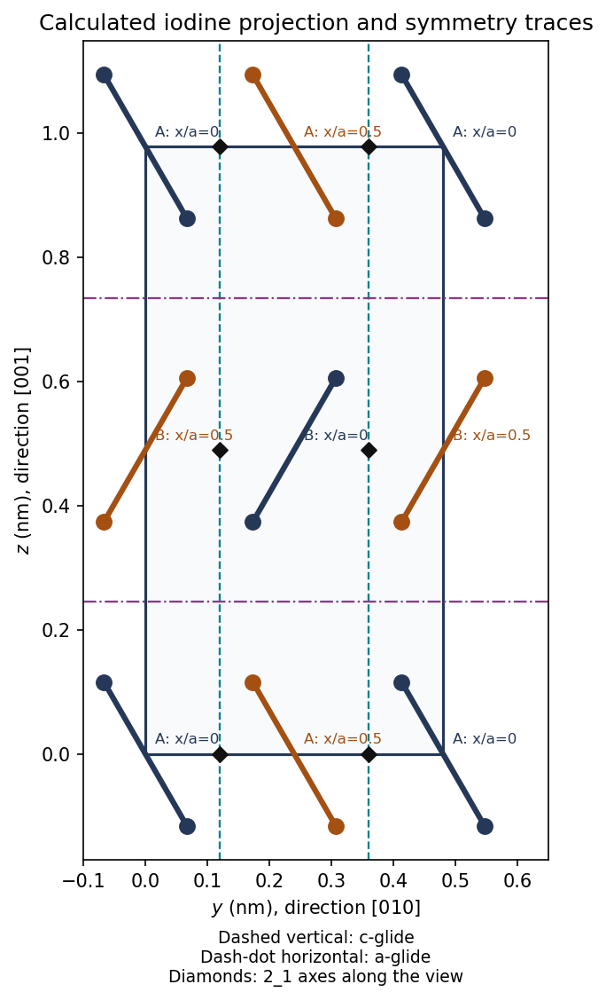

<h1 id="1/a">a</h1>

↑ **Parent:** [1](../1.md)

Use $y/b$ horizontally and $z/c$ vertically, and label each molecular center by its fractional height $x/a$ along the viewing direction. The four centers in one periodic cell are $(0,0)$ with height $0$ and orientation A, $(1/2,0)$ with height $1/2$ and orientation A, $(0,1/2)$ with height $1/2$ and orientation B, and $(1/2,1/2)$ with height $0$ and orientation B. Boundary images complete the projected rectangle. The A and B bonds have opposite slopes; the atoms in each bond are indistinguishable.

**[Figure 1](#1/a/image-original-molecular-center-construction-and-symmetry-traces-for-the-iodine-cell-viewed-along-100-bond-inclination-is-schematic-heights-and-bond-length-are-specified). Original molecular-center construction and symmetry traces for the iodine cell viewed along $[100]$; bond inclination is schematic, heights and bond length are specified**.

The height labels matter: a symmetry of the unlabelled projection need not be a translation or reflection symmetry of the three-dimensional crystal. The drawing uses the given $0.267\,\mathrm{nm}$ molecular bond length and an illustrative inclination, since no exact inclination angle is specified.

**Table of contents**

- [i](a/i.md)
  - [Solution](a/i/solution.md)
- [ii](a/ii.md)
  - [Solution](a/ii/solution.md)
- [iii](a/iii.md)
  - [Solution](a/iii/solution.md)

## ↑ Ancestors (12)

1. [1](../1.md)
2. [Paper 1](../../paper-1-split.md)
3. [2016](../../split.md)
4. [Past exam of the materials science course of the University of Cambridge](../../../split.md)
5. [Materials science course of the University of Cambridge](../../../../materials-science-course-of-the-university-of-cambridge.md)
6. [Year 1 of the natural sciences course of the University of Cambridge](../../../../year-1-of-the-natural-sciences-course-of-the-university-of-cambridge.md)
7. [Year of the natural sciences course of the University of Cambridge](../../../../year-of-the-natural-sciences-course-of-the-university-of-cambridge.md)
8. [Natural sciences course of the University of Cambridge](../../../../natural-sciences-course-of-the-university-of-cambridge.md)
9. [Course of the University of Cambridge](../../../../course-of-the-university-of-cambridge.md)
10. [University of Cambridge](../../../../university-of-cambridge-split.md)
11. [List of universities](../../../../list-of-universities.md)
12. [Codex Wiki](../../../../split.md)
