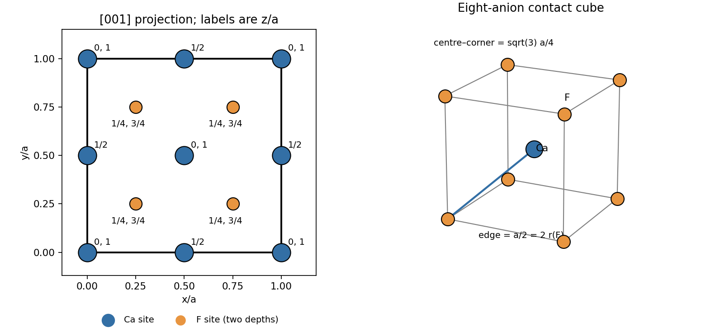
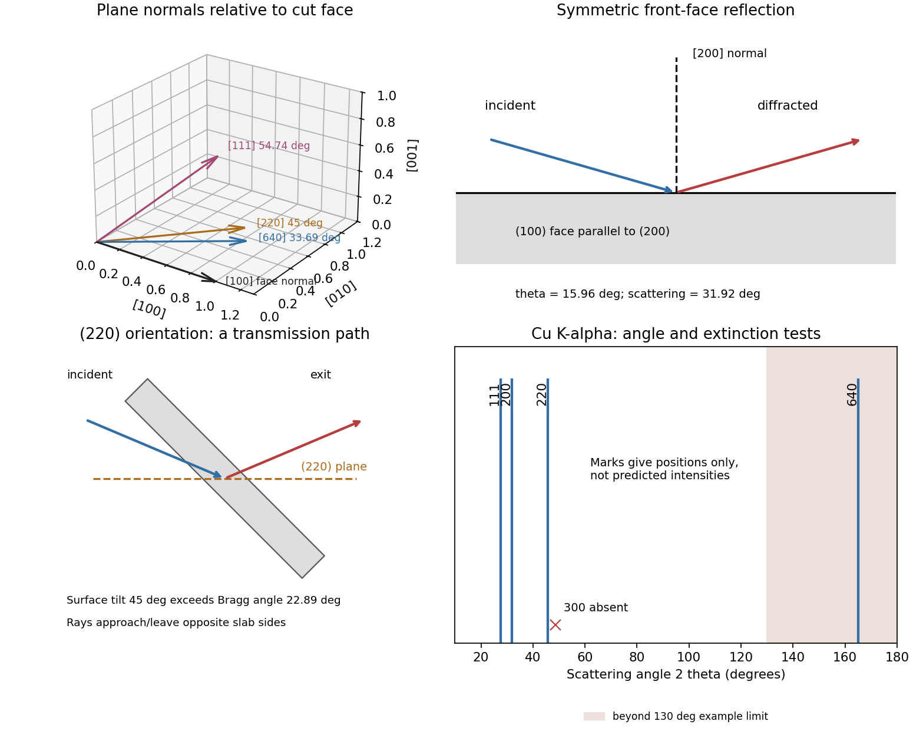

# Paper 1

↑ **Parent:** [2017](../2017.md)

Original solutions to the released 2017 paper. [Original public PDF, physical pages 17–24; questions on pages 18–24](https://www.whatdotheyknow.com/request/natural_sciences_tripos_part_1a/response/3284364/attach/3/FOI%202025%201239%20Hagendoorn%20materials.pdf?cookie_passthrough=1#page=17)

**Table of contents**

- [1](#1)
  - [a](#1/a)
    - [Solution](#1/a/solution)
  - [b](#1/b)
    - [Solution](#1/b/solution)
  - [c](#1/c)
    - [Solution](#1/c/solution)
  - [d](#1/d)
    - [Solution](#1/d/solution)
  - [e](#1/e)
    - [Solution](#1/e/solution)
- [2](#2)
  - [a](#2/a)
    - [Solution](#2/a/solution)
  - [b](#2/b)
    - [Solution](#2/b/solution)
  - [c](#2/c)
    - [Solution](#2/c/solution)
  - [d](#2/d)
    - [Solution](#2/d/solution)
  - [e](#2/e)
    - [Solution](#2/e/solution)
- [3](#3)
  - [a](#3/a)
    - [Solution](#3/a/solution)
  - [b](#3/b)
    - [i](#3/b/i)
      - [Solution](#3/b/i/solution)
    - [ii](#3/b/ii)
      - [Solution](#3/b/ii/solution)
    - [iii](#3/b/iii)
      - [Solution](#3/b/iii/solution)
    - [iv](#3/b/iv)
      - [Solution](#3/b/iv/solution)
    - [v](#3/b/v)
      - [Solution](#3/b/v/solution)
  - [c](#3/c)
    - [Solution](#3/c/solution)
- [4](#4)
  - [a](#4/a)
    - [i](#4/a/i)
      - [Solution](#4/a/i/solution)
    - [ii](#4/a/ii)
      - [Solution](#4/a/ii/solution)
  - [b](#4/b)
    - [Solution](#4/b/solution)
  - [c](#4/c)
    - [Solution](#4/c/solution)
  - [d](#4/d)
    - [Solution](#4/d/solution)
  - [e](#4/e)
    - [Solution](#4/e/solution)
- [5](#5)
  - [a](#5/a)
    - [Solution](#5/a/solution)
  - [b](#5/b)
    - [Solution](#5/b/solution)
  - [c](#5/c)
    - [Solution](#5/c/solution)
- [6](#6)
  - [a](#6/a)
    - [Solution](#6/a/solution)
  - [b](#6/b)
    - [Solution](#6/b/solution)
  - [c](#6/c)
    - [i](#6/c/i)
      - [Solution](#6/c/i/solution)
    - [ii](#6/c/ii)
      - [Solution](#6/c/ii/solution)
    - [iii](#6/c/iii)
      - [Solution](#6/c/iii/solution)
  - [d](#6/d)
    - [i](#6/d/i)
      - [Solution](#6/d/i/solution)
    - [ii](#6/d/ii)
      - [Solution](#6/d/ii/solution)
    - [iii](#6/d/iii)
      - [Solution](#6/d/iii/solution)
- [7](#7)
  - [a](#7/a)
    - [Solution](#7/a/solution)
  - [b](#7/b)
    - [Solution](#7/b/solution)
  - [c](#7/c)
    - [Solution](#7/c/solution)
  - [d](#7/d)
    - [Solution](#7/d/solution)

## 1

↑ **Parent:** [Paper 1](paper-1.md)

<h3 id="1/a">a</h3>

↑ **Parent:** [1](#1)

<h4 id="1/a/solution">Solution</h4>

↑ **Parent:** [A](#1/a)

The [fluorite structure](../../physical-chemistry.md#fluorite-structure) consists of a [face-centered cubic lattice](../../quantum-scattering.md#face-centered-cubic-lattice) of [calcium](../../chemical-substance.md#calcium) sites with all eight [tetrahedral interstitial sites](../../physical-chemistry.md#tetrahedral-interstitial-site) occupied by [fluoride](../../chemistry.md#fluoride). In fractional coordinates of the conventional cubic [unit cell](../../quantum-scattering.md#unit-cell), the [calcium](../../chemical-substance.md#calcium) basis is $(0,0,0),(0,\tfrac12,\tfrac12),(\tfrac12,0,\tfrac12),(\tfrac12,\tfrac12,0)$, and [fluoride](../../chemistry.md#fluoride) occupies all combinations $(x,y,z)$ with $x,y,z\in\{\tfrac14,\tfrac34\}$. The projection therefore superposes two [fluoride](../../chemistry.md#fluoride) sites at each quarter-coordinate position. Labels in the original diagram give fractional depth along $[001]$; periodic boundary sites are displayed on both edges.

**[Figure 1](#1/a/image-original-fluorite-projection-along-the-cubic-z-axis-with-fractional-depths-and-the-limiting-anion-contact-geometry). Original fluorite projection along the cubic z axis with fractional depths and the limiting anion-contact geometry**.

Counting shared sites gives $8/8+6/2=4$ [calcium](../../chemical-substance.md#calcium) sites and eight interior [fluoride](../../chemistry.md#fluoride) sites: **four [formula units](../../chemical-substance.md#formula-unit) per conventional cell**.

<h3 id="1/b">b</h3>

↑ **Parent:** [1](#1)

<h4 id="1/b/solution">Solution</h4>

↑ **Parent:** [B](#1/b)

Each [calcium](../../chemical-substance.md#calcium) [cation](../../chemistry.md#cation) has eight [fluoride](../../chemistry.md#fluoride) neighbours at the vertices of a [cube](../../euclidean-geometry.md#cube): [cubic coordination](../../ionic-bonding.md#cubic-coordination). Each [fluoride](../../chemistry.md#fluoride) [anion](../../chemistry.md#anion) has four [calcium](../../chemical-substance.md#calcium) neighbours in [tetrahedral coordination](../../ionic-bonding.md#tetrahedral-coordination). Both unlike-neighbour [Euclidean distances](../../topological-analysis.md#euclidean-distance) are $\sqrt3a/4$, with $a$ the conventional cubic [lattice parameter](../../physical-chemistry.md#lattice-constant).

Apply the [Goldschmidt packing principle](../../ionic-bonding.md#goldschmidt-packing-principle) at its limiting eight-coordinate geometry: the eight surrounding [anions](../../chemistry.md#anion) just touch one another and also touch the central [cation](../../chemistry.md#cation). The [anions](../../chemistry.md#anion) form a [cube](../../euclidean-geometry.md#cube) of edge $a/2$, so $2r_a=a/2$ and $r_a+r_c=\sqrt3a/4$. Eliminating $a$ gives

$$
\boxed{\frac{r_a}{r_c}=\frac1{\sqrt3-1}=\frac{\sqrt3+1}{2}\simeq1.366.}
$$

Equivalently, $r_c/r_a=0.732$. This is a limiting [radius ratio rule](../../ionic-bonding.md#radius-ratio-rule), rather than a measured ionic-radius ratio. It does not assume that the [calcium](../../chemical-substance.md#calcium) sublattice consists of mutually touching [spheres](../../euclidean-geometry.md#sphere): the [calcium](../../chemical-substance.md#calcium) positions have face-centred cubic symmetry, but that symmetry alone does not specify which [ions](../../chemistry.md#ion) touch. A different construction with touching [calcium](../../chemical-substance.md#calcium) [spheres](../../euclidean-geometry.md#sphere) and [fluoride](../../chemistry.md#fluoride) just filling their [tetrahedral interstitial sites](../../physical-chemistry.md#tetrahedral-interstitial-site) would instead give $r_a/r_c=\sqrt{3/2}-1=0.225$; that is the opposite contact limit, not the eight-coordinate anion-contact ideal used here.

<h3 id="1/c">c</h3>

↑ **Parent:** [1](#1)

<h4 id="1/c/solution">Solution</h4>

↑ **Parent:** [C](#1/c)

Using the contact model of (b), $r_a=a/4$ and $r_c=(\sqrt3-1)a/4$. Divide the [volume](../../geometry-and-topology.md#volume) of four [cation](../../chemistry.md#cation) [spheres](../../euclidean-geometry.md#sphere) and eight [anion](../../chemistry.md#anion) [spheres](../../euclidean-geometry.md#sphere) by $a^3$ to obtain the [packing fraction](../../euclidean-geometry.md#packing-fraction):

$$
\eta=\frac{4\pi}{3a^3}(4r_c^3+8r_a^3)=\frac\pi{12}\left[(\sqrt3-1)^3+2\right]=\boxed{\frac\pi6(3\sqrt3-4)\simeq0.6263.}
$$

For one-radius [cubic close-packed structure](../../physical-chemistry.md#cubic-close-packed-structure), face-diagonal contact gives $4r=\sqrt2a$, hence $\eta_{\rm ccp}=4(4\pi r^3/3)/a^3=\pi/(3\sqrt2)\simeq0.7405$. The limiting fluorite value is **lower than the one-radius close-packed value**. Its two sizes, stoichiometry and eight-to-four coordination impose a different geometry: the [fluoride](../../chemistry.md#fluoride) sites form a simple-cubic array, and the [calcium](../../chemical-substance.md#calcium) sites are too far apart for [calcium](../../chemical-substance.md#calcium)–[calcium](../../chemical-substance.md#calcium) contact. A face-centred arrangement of one species is therefore not sufficient to infer a close-packed whole crystal.

<h3 id="1/d">d</h3>

↑ **Parent:** [1](#1)

<h4 id="1/d/solution">Solution</h4>

↑ **Parent:** [D](#1/d)

The actual [ionic radii](../../chemistry.md#ionic-radius) need not equal the limiting ratio, and electronic charge distributions are not rigid [sphere](../../euclidean-geometry.md#sphere) boundaries. In the same unlike-contact [hard-sphere model](../../euclidean-geometry.md#hard-sphere-model), put $q=r_a/r_c$ and use $a=4(r_a+r_c)/\sqrt3$ to get

$$
\eta(q)=\frac{\pi\sqrt3}{4}\frac{1+2q^3}{(1+q)^3}.
$$

A [cation](../../chemistry.md#cation) somewhat larger relative to the [anion](../../chemistry.md#anion) than the limiting size opens gaps between the [anions](../../chemistry.md#anion). Starting from $q=1.366$ and reducing $q$ modestly reduces this [packing fraction](../../euclidean-geometry.md#packing-fraction); thus **a lower value is expected for that departure from the ideal contact construction**. The formula is not monotonic for all imaginable ratios, so no universal inequality should be inferred without specifying [radii](../../topology.md#radius). Coordination-dependent [ionic radii](../../chemistry.md#ionic-radius), [polarizability](../../electrostatics.md#electric-polarizability), nonionic contributions to bonding, [thermal expansion](../../thermodynamics.md#thermal-expansion) and [point defects](../../physical-chemistry.md#point-defect) also limit the model. No numerical real-crystal [packing fraction](../../euclidean-geometry.md#packing-fraction) is determined by the supplied data alone.

<h3 id="1/e">e</h3>

↑ **Parent:** [1](#1)

<h4 id="1/e/solution">Solution</h4>

↑ **Parent:** [E](#1/e)

A larger [barium](../../chemical-substance.md#barium) [cation](../../chemistry.md#cation) expands the [fluorite structure](../../physical-chemistry.md#fluorite-structure) and can widen the constrictions through which [fluoride](../../chemistry.md#fluoride) [ions](../../chemistry.md#ion) move. A plausible explanation is therefore a smaller [ionic migration barrier](../../electric-charge.md#ionic-migration-barrier) and greater [fluoride](../../chemistry.md#fluoride) mobility. In a simple dilute-carrier description, $\sigma_{\rm ion}=n|q|\mu$, or $nq^2D/(k_BT)$ when an uncorrelated [Nernst-Einstein relation](../../electric-charge.md#nernst-einstein-relation) applies. [fluoride](../../chemistry.md#fluoride) [vacancies](../../physical-chemistry.md#vacancy) and [interstitial defects](../../physical-chemistry.md#interstitial-defect), including those generated as [Frenkel pairs](../../physical-chemistry.md#frenkel-pair), provide possible carriers.

**More open migration pathways can raise the conductivity**, but [ion](../../chemistry.md#ion) size by itself is not a proof: defect formation [free energies](../../thermodynamic-potential.md#thermodynamic-free-energy) set $n$, migration [free energies](../../thermodynamic-potential.md#thermodynamic-free-energy) set mobility, and correlated hopping can alter the simple relation. A controlled comparison would use crystals with comparable impurity content, thermal history and [electrode](../../electrochemistry.md#electrode) conditions, and measure conductivity over [temperature](../../temperature.md) to separate plausible activation behaviour from extrinsic defect effects.

## 2

↑ **Parent:** [Paper 1](paper-1.md)

<h3 id="2/a">a</h3>

↑ **Parent:** [2](#2)

<h4 id="2/a/solution">Solution</h4>

↑ **Parent:** [A](#2/a)

Take the longitudinal scalar [piezoelectric coefficient](../../quantum-mechanics.md#piezoelectric-coefficient) appropriate to the load and [electrode](../../electrochemistry.md#electrode) direction. For a uniformly stressed slab of face [area](../../differential-geometry.md#surface-area) $A$ and thickness $t$, the source charge is $\Delta Q=d\Delta F=dA\Delta\sigma$. Its [capacitance](../../electromagnetism.md#capacitance) is $C=\epsilon_0\kappa A/t$, so the ideal initially uncharged, electrically isolated sensor gives

$$
\boxed{\left|\frac{\Delta V}{\Delta\sigma}\right|=\frac{dt}{\epsilon_0\kappa}.}
$$

The sign depends on the [poling](../../engineering.md#ferroelectric-poling) direction and [electrode](../../electrochemistry.md#electrode) convention. Equivalently, the incremental constitutive law is $\Delta D=d\Delta\sigma+\epsilon_0\kappa\Delta E$; an ideal [open circuit](../../electrical-circuit.md#open-circuit) keeps free [electrode](../../electrochemistry.md#electrode) charge, hence $D$, fixed and gives $\Delta E=-d\Delta\sigma/(\epsilon_0\kappa)$. [area](../../differential-geometry.md#surface-area) cancels because both generated charge and [capacitance](../../electromagnetism.md#capacitance) scale with [area](../../differential-geometry.md#surface-area). Thickness does not cancel: the material comparison is through $d/\kappa$ only when geometry is fixed. Here $\kappa$ must be the [relative permittivity](../../quantum-mechanics.md#relative-permittivity) under the relevant mechanical and frequency conditions.

<h3 id="2/b">b</h3>

↑ **Parent:** [2](#2)

<h4 id="2/b/solution">Solution</h4>

↑ **Parent:** [B](#2/b)

For identical thicknesses, compare $d/\kappa$ using the supplied coefficients:

$$
\frac d\kappa=0.02667,\quad0.2105,\quad0.6053\quad\mathrm{pC\,N^{-1}}
$$

for [barium titanate](../../chemical-substance.md#barium-titanate), [lead zirconate titanate](../../chemical-substance.md#lead-zirconate-titanate) and [quartz](../../chemical-substance.md#quartz) respectively. Thus **[barium titanate](../../chemical-substance.md#barium-titanate), then [lead zirconate titanate](../../chemical-substance.md#lead-zirconate-titanate), then [quartz](../../chemical-substance.md#quartz)** is the increasing [voltage sensitivity of a piezoelectric sensor](../../quantum-mechanics.md#voltage-sensitivity-of-a-piezoelectric-sensor) order. A large charge coefficient alone does not guarantee a large voltage: the large [permittivity](../../permittivity.md) of a ferroelectric also increases its [capacitance](../../electromagnetism.md#capacitance).

<h3 id="2/c">c</h3>

↑ **Parent:** [2](#2)

<h4 id="2/c/solution">Solution</h4>

↑ **Parent:** [C](#2/c)

For [quartz](../../chemical-substance.md#quartz), $A=10^{-4}\,\mathrm{m^2}$ and $t=5.0\times10^{-4}\,\mathrm m$. With $g=9.81\,\mathrm{m\,s^{-2}}$, the load and [stress](../../continuum-mechanics.md#stress) are $F=4.905\,\mathrm N$ and $\Delta\sigma=4.905\times10^4\,\mathrm{Pa}$. Therefore

$$
|\Delta V|=\frac{(2.3\times10^{-12})(5.0\times10^{-4})(4.905\times10^4)}{(8.854\times10^{-12})(3.8)}=\boxed{1.68\,\mathrm V.}
$$

As a check, $Q=dF=11.28\,\mathrm{pC}$ and $C=6.73\,\mathrm{pF}$ give the same result. This is the ideal maximum open-circuit change on applying the load. Input [capacitance](../../electromagnetism.md#capacitance) reduces it to $Q/(C+C_{\rm in})$, while finite leakage makes it decay: it is not a guaranteed permanent DC output.

<h3 id="2/d">d</h3>

↑ **Parent:** [2](#2)

<h4 id="2/d/solution">Solution</h4>

↑ **Parent:** [D](#2/d)

The sensor must survive the [stress](../../continuum-mechanics.md#stress) range and repeated loading without fracture, fatigue or excessive mechanical compliance. The [tensor](../../multilinear-algebra.md#tensor) character of the [piezoelectric coefficient](../../quantum-mechanics.md#piezoelectric-coefficient) makes [crystal orientation](../../physical-chemistry.md#crystal-orientation) important; a ceramic's [poling](../../engineering.md#ferroelectric-poling) quality and domain stability also matter. Compare linearity, [hysteresis](../../critical-phenomenon.md#hysteresis), reproducibility, aging and the usable frequency bandwidth, including [resonance](../../dynamical-systems.md#resonance) and dynamic response.

Electrical design is equally important: leakage resistance and readout input impedance determine low-frequency loss, and cable/input [capacitance](../../electromagnetism.md#capacitance) loads a voltage output. A [charge amplifier](../../electrical-circuit.md#charge-amplifier) may favour a different material ranking from a passive open-circuit voltage measurement. [temperature](../../temperature.md) changes can alter the coefficients, produce a pyroelectric signal in a polar material and depole a ferroelectric near its transition. Humidity, [electrode](../../electrochemistry.md#electrode) bonding, electrical breakdown, manufacturability, cost and environmental constraints such as lead content also affect a practical choice. Calibration should separate applied [stress](../../continuum-mechanics.md#stress) from [temperature](../../temperature.md) drift and readout loading.

<h3 id="2/e">e</h3>

↑ **Parent:** [2](#2)

<h4 id="2/e/solution">Solution</h4>

↑ **Parent:** [E](#2/e)

**[ferroelectric poling](../../engineering.md#ferroelectric-poling) is essential.** An initially unpoled ceramic has differently oriented [crystal grains](../../thermodynamics.md#grain-in-a-polycrystal) and domains whose charge responses largely cancel. An applied [electric field](../../electric-field.md) favours suitably oriented domains and leaves a remanent macroscopic polarization after removal; it does not rotate all [crystal grains](../../thermodynamics.md#grain-in-a-polycrystal) into a [single crystal](../../thermodynamics.md#single-crystal).

In the linear coefficient model the added source polarization is

$$
\Delta P_{\rm source}=d\Delta\sigma=(80\times10^{-12})\frac{10(9.81)}{10^{-4}}=\boxed{7.85\times10^{-5}\,\mathrm{C\,m^{-2}}.}
$$

This is the stress-generated contribution at fixed [electric field](../../electric-field.md), equivalent to the short-circuit charge per face [area](../../differential-geometry.md#surface-area). Under open-circuit conditions the induced field supplies an opposing [dielectric](../../permittivity.md#dielectric) contribution, so $\Delta D=0$; the source quantity must not be confused with a change of total free [electrode](../../electrochemistry.md#electrode) charge. For scale, room-temperature single-domain [barium titanate](../../chemical-substance.md#barium-titanate) has [spontaneous polarization](../../electromagnetism.md#spontaneous-polarization) of order $0.26\,\mathrm{C\,m^{-2}}$: the calculated increment is about $3.0\times10^{-4}$ of that value, a small response rather than wholesale reversal of the [spontaneous polarization](../../electromagnetism.md#spontaneous-polarization).[pp. 1799–1800, spontaneous-polarization measurements and temperature dependence](../../engineering.md#dielectric-and-optical-properties-of-melt-grown-batio3-by-s-h-wemple-and-others)

For the requested displacement estimate, assign the whole additional dipole moment of one cell to movement of its single $\mathrm{Ti^{4+}}$ [ion](../../chemistry.md#ion) relative to a fixed background. Then $\Delta P=(4e)\Delta x/(a^2c)$, giving

$$
\Delta x=\frac{(7.848\times10^{-5})(0.3994\times10^{-9})^2(0.4033\times10^{-9})}{4(1.6022\times10^{-19})}=\boxed{7.88\times10^{-15}\,\mathrm m.}
$$

This formal-charge estimate is only an equivalent displacement: real polarization changes involve [oxygen](../../chemical-substance.md#oxygen) and [barium](../../chemical-substance.md#barium) displacements, electronic polarization and [Born effective charges](../../electromagnetism.md#born-effective-charge), as well as possible domain-wall motion. The coefficient supplied for the ceramic cannot uniquely determine an actual microscopic [titanium](../../chemical-substance.md#titanium) trajectory.

## 3

↑ **Parent:** [Paper 1](paper-1.md)

<h3 id="3/a">a</h3>

↑ **Parent:** [3](#3)

<h4 id="3/a/solution">Solution</h4>

↑ **Parent:** [A](#3/a)

A heated [cathode](../../electrochemistry.md#cathode) emits [electrons](../../physics.md#electron), accelerated through a potential difference onto a metal target. Deceleration produces a [bremsstrahlung](../../electromagnetic-radiation.md#bremsstrahlung) continuum with $\lambda_{\min}=hc/(eV_{\rm acc})$; inner-shell ionization followed by electronic relaxation produces characteristic lines. The pictured instrument is consistent with the copper-target TEL-X-Ometer used for teaching diffraction. Its [copper](../../chemical-substance.md#copper) $K_\alpha$ radiation has wavelength about $0.154\,\mathrm{nm}$, comparable with atomic plane spacings. A [nickel](../../chemical-substance.md#nickel) filter preferentially suppresses [copper](../../chemical-substance.md#copper) $K_\beta$, while slits collimate the beam; filtering does not remove every continuum [photon](../../quantum-mechanics.md#photon).

A [Geiger-Müller counter](../../particle-detection.md#geiger-counter) converts photon-induced gas ionization into countable electrical pulses. A scintillator with [photomultiplier](../../particle-detection.md#photomultiplier) is another detector option. A detector-arm scan records count rate against scattering angle; coupled crystal rotation preserves the usual reflection geometry. These instrument features are documented by its manufacturer.[Sections 3.5–3.6 and 7.1: crystal/detector geometry and detection; section 4.6: copper characteristic wavelengths](../../engineering.md#tel-x-ometer-x-ray-system-manual-by-joseph-dohm)

For the numerical calculations below use **$\lambda=0.154\,\mathrm{nm}$**, explicitly identifying the characteristic line assumed. The photograph alone does not give a measured wavelength or angular travel limit; conclusions depending on these parameters are stated conditionally. A different selected line changes the angles but not a crystallographic extinction.

<h3 id="3/b">b</h3>

↑ **Parent:** [3](#3)

For a cubic crystal, $d_{hkl}=a/\sqrt{h^2+k^2+l^2}$ and first-order [bragg diffraction](../../quantum-scattering.md#bragg-diffraction) requires $2d_{hkl}\sin\theta=\lambda$. The face-centred lattice sum is

$$
L_{hkl}=1+e^{i\pi(k+l)}+e^{i\pi(h+l)}+e^{i\pi(h+k)}.
$$

It is four if $h,k,l$ are all even or all odd, and zero for mixed parity. With the NaCl basis displaced by $(\tfrac12,0,0)$, the allowed amplitudes are $F_{hkl}=4[f_{\rm Cl}+(-1)^{h+k+l}f_{\rm Na}]$, up to the arbitrary choice of origin/species. Both allowed parity classes survive because the two ionic scattering factors are not identical. Intensities depend on $|F|^2$, geometry, absorption and scattering vector.

There are three separate tests: **nonzero [structure factor](../../quantum-scattering.md#structure-factor), accessible [Bragg angle](../../quantum-scattering.md#bragg-angle), and accessible plane orientation**. In a symmetric reflection scan the scattering vector is normal to the specimen face, selecting the surface-parallel family and its allowed orders. Other families need a different mounting, independent orientation control or transmission/another facet. The original diagrams distinguish these geometric requirements; angles in the reciprocal-space panel are between plane normals, not [Bragg angles](../../quantum-scattering.md#bragg-angle).

**[Figure 2](#3/b/image-original-diffraction-diagrams-separating-orientation-scattering-angle-and-reflection-versus-transmission-access). Original diffraction diagrams separating orientation, scattering angle and reflection versus transmission access**.

<h4 id="3/b/i">i</h4>

↑ **Parent:** [B](#3/b)

<h5 id="3/b/i/solution">Solution</h5>

↑ **Parent:** [I](#3/b/i)

The even indices give an allowed reflection. Its spacing is $d_{200}=0.280\,\mathrm{nm}$, and

$$
\theta_B=\sin^{-1}\frac{0.154}{2(0.280)}=15.96^\circ,\qquad \boxed{2\theta_B=31.92^\circ.}
$$

The $(200)$ planes are parallel to the cut $(100)$ face, so the ordinary coupled reflection scan reaches them directly. **This is an easy, strong peak**, with the two ionic amplitudes adding rather than subtracting.

<h4 id="3/b/ii">ii</h4>

↑ **Parent:** [B](#3/b)

<h5 id="3/b/ii/solution">Solution</h5>

↑ **Parent:** [Ii](#3/b/ii)

The $(111)$ reflection is allowed, with $d_{111}=0.3233\,\mathrm{nm}$ and **$2\theta_B=27.56^\circ$**. Its odd-parity amplitude is proportional to $f_{\rm Cl}-f_{\rm Na}$, generally weaker than the corresponding sum. Its normal makes $\cos^{-1}(1/\sqrt3)=54.74^\circ$ with the $[100]$ surface normal.

It is therefore **not obtained in the ordinary symmetric scan of that face**, despite its modest [Bragg angle](../../quantum-scattering.md#bragg-angle). In a usual edge-aligned cubic mounting its normal also has an out-of-horizontal-plane component. A suitable multi-axis reorientation, or a crystal cut with a $(111)$ face, makes the reflection accessible; a thin specimen in transmission or a powder experiment is another route. Tilting the scattering vector does not by itself ensure front-face reflection: because $54.74^\circ$ exceeds $\theta_B=13.78^\circ$, incident and outgoing rays for that highly asymmetric orientation cannot both lie outside the same flat $(100)$ face. A suitable specimen shape/transmission path or recut face is needed.

<h4 id="3/b/iii">iii</h4>

↑ **Parent:** [B](#3/b)

<h5 id="3/b/iii/solution">Solution</h5>

↑ **Parent:** [Iii](#3/b/iii)

The indices have mixed parity, so the face-centred lattice sum vanishes: **the ideal NaCl $(300)$ reflection is systematically absent**. A smaller wavelength, a larger detector range or an extra rotation axis does not remove that extinction. A nominal peak there could reflect another wavelength/reflection, multiple diffraction, another phase or broken ideal translational symmetry; it would not be an ordinary kinematic $(300)$ reflection of ideal NaCl. The allowed $(600)$ peak is a different reciprocal-lattice vector, not a recovered $(300)$ peak.

<h4 id="3/b/iv">iv</h4>

↑ **Parent:** [B](#3/b)

<h5 id="3/b/iv/solution">Solution</h5>

↑ **Parent:** [Iv](#3/b/iv)

The all-even $(220)$ reflection is allowed. Here $d_{220}=0.1980\,\mathrm{nm}$ and **$2\theta_B=45.77^\circ$**. Its normal is $45^\circ$ from $[100]$ and can lie in the horizontal scattering plane in an edge-aligned mounting. Nevertheless it is not parallel to the large $(100)$ face, so the ordinary coupled symmetric scan misses it.

Independent sample rotation can bring the $(220)$ normal onto the Bragg bisector, but there is an important specimen constraint: $\theta_B=22.89^\circ$ is less than the $45^\circ$ surface inclination. One ray then traverses the slab rather than emerging from the incident face. Thus **a thin transmission specimen or access through another face can permit detection after suitable remounting**, whereas a thick absorbing slab in front-face reflection is unfavourable. A $(110)$-cut crystal allows a straightforward symmetric $(220)$ measurement, and a powder specimen supplies the needed orientations. Unlike $(300)$, no extinction prohibits it; whether the original portable mounting can reach it depends on independent rotation, holder clearance and the transmitting path.

<h4 id="3/b/v">v</h4>

↑ **Parent:** [B](#3/b)

<h5 id="3/b/v/solution">Solution</h5>

↑ **Parent:** [V](#3/b/v)

The all-even indices are allowed, but $d_{640}=0.07766\,\mathrm{nm}$ is small. [copper](../../chemical-substance.md#copper) $K_\alpha$ gives

$$
\sin\theta_B=\frac{0.154\sqrt{52}}{2(0.56)}=0.9917,\qquad \boxed{2\theta_B=165.07^\circ.}
$$

This is near backscattering and outside an ordinary portable instrument whose arm reaches only about $130^\circ$. The numerical angular limit should be checked on the actual model; the mathematical requirement is that its maximum $2\theta$ reach $165^\circ$. It also requires a normal inclined $\tan^{-1}(4/6)=33.69^\circ$ to $[100]$, so the coupled surface-normal scan is insufficient. [atomic scattering factors](../../quantum-scattering.md#atomic-scattering-factor) are smaller at this larger scattering vector.

**A suitable high-angle, independently orientable diffractometer could detect it.** A shorter selected wavelength can instead reduce the angular requirement: with $\lambda=0.071\,\mathrm{nm}$, $2\theta_B\simeq54.4^\circ$, while orientation still needs to be set appropriately. If $\lambda$ exceeded $2d=0.1553\,\mathrm{nm}$ there would be no first-order Bragg solution at all. The tube continuum and other characteristic lines must therefore be distinguished from the specifically calculated [copper](../../chemical-substance.md#copper) $K_\alpha$ peak.

<h3 id="3/c">c</h3>

↑ **Parent:** [3](#3)

<h4 id="3/c/solution">Solution</h4>

↑ **Parent:** [C](#3/c)

Randomly oriented crystallites supply planes with their normals in each required scattering-vector direction. Of the five families considered, **$(111)$, $(200)$ and $(220)$ can therefore give accessible [copper](../../chemical-substance.md#copper) $K_\alpha$ powder peaks; $(300)$ remains absent and $(640)$ remains beyond a roughly $130^\circ$ detector limit.** Other allowed families also appear if their [Bragg angles](../../quantum-scattering.md#bragg-angle) lie inside the instrument range; orientation averaging does not restrict the pattern to these five examples.

Only a small fraction of randomly oriented [crystal grains](../../thermodynamics.md#grain-in-a-polycrystal) satisfy the Bragg condition for a given detector setting, and each family scatters around a cone rather than concentrating all its intensity into one single-crystal spot. A narrow detector aperture therefore receives a relatively weak signal from a small powder specimen compared with a well-oriented large [single crystal](../../thermodynamics.md#single-crystal). Adequate [crystal grain](../../thermodynamics.md#grain-in-a-polycrystal) statistics, longer counting, suitable powder packing and detector acceptance matter. The odd-parity peaks additionally involve the difference of ionic scattering factors. No absolute single-crystal/powder intensity ratio follows without illuminated [volumes](../../geometry-and-topology.md#volume), absorption and instrumental geometry.

## 4

↑ **Parent:** [Paper 1](paper-1.md)

<h3 id="4/a">a</h3>

↑ **Parent:** [4](#4)

<h4 id="4/a/i">i</h4>

↑ **Parent:** [A](#4/a)

<h5 id="4/a/i/solution">Solution</h5>

↑ **Parent:** [I](#4/a/i)

The close-packed planes of a [cubic close-packed structure](../../physical-chemistry.md#cubic-close-packed-structure) are **$\{111\}$**, with **$ABCABC\ldots$** stacking. Each layer is a triangular array; the third layer occupies the remaining set of hollows rather than returning above the first.

<h4 id="4/a/ii">ii</h4>

↑ **Parent:** [A](#4/a)

<h5 id="4/a/ii/solution">Solution</h5>

↑ **Parent:** [Ii](#4/a/ii)

The basal close-packed planes of a [hexagonal close-packed structure](../../physical-chemistry.md#hexagonal-close-packed-structure) are **$\{0001\}$** in four-index [Miller-Bravais index](../../physical-chemistry.md#miller-bravais-index), or $\{001\}$ with three hexagonal indices. Their stacking is **$ABAB\ldots$**: alternate layers return above the same lateral positions.

<h3 id="4/b">b</h3>

↑ **Parent:** [4](#4)

<h4 id="4/b/solution">Solution</h4>

↑ **Parent:** [B](#4/b)

At fixed transformed [volume](../../geometry-and-topology.md#volume), an equilibrium [solid-state precipitate](../../chemical-substance.md#solid-state-precipitate) seeks a low total [free energy](../../thermodynamic-potential.md#thermodynamic-free-energy), including the orientation-dependent [interfacial energy](../../physical-chemistry.md#interfacial-energy) and elastic [strain](../../continuum-mechanics.md#strain) energy associated with misfit and applied [stress](../../continuum-mechanics.md#stress). Low-energy interface orientations occupy large faces. The Wulff construction captures surface-energy [anisotropy](../../continuum-mechanics.md#anisotropy) when [strain](../../continuum-mechanics.md#strain) and other contributions can be neglected; a [solid-state precipitate](../../chemical-substance.md#solid-state-precipitate) generally also pays [coherency strain](../../physical-chemistry.md#coherency-strain) energy, and its optimum shape can change with size.

During formation, growth kinetics and [diffusion](../../thermodynamics.md#diffusion) may prevent the equilibrium shape being reached. Coherent, semicoherent and incoherent interfaces have different bonding and defect structures, so their energies and attachment rates differ. **The disc shape is consistent with much cheaper broad faces than edges**, but morphology alone does not uniquely measure the energies or prove equilibrium.

<h3 id="4/c">c</h3>

↑ **Parent:** [4](#4)

<h4 id="4/c/solution">Solution</h4>

↑ **Parent:** [C](#4/c)

Choose the orientation relation $(0001)_{\rm hcp}\parallel(111)_{\rm ccp}$ with aligned close-packed rows, for example $[11\bar20]_{\rm hcp}\parallel[1\bar10]_{\rm ccp}$. The two phases then share matching triangular layers at the broad faces. The stacking changes from $ABCABC\ldots$ to $ABAB\ldots$ across the phase region, so broad [coherent crystal interfaces](../../physical-chemistry.md#coherent-crystal-interface) can be made by a local change of stacking, with small mismatch if the in-plane atomic spacings are similar.

At the cylindrical edge, different layer sequences terminate against one another. Registry cannot generally be maintained everywhere, so ledges, stacking defects and possibly [misfit dislocations](../../physical-chemistry.md#misfit-dislocation) are needed; this interface is less coherent and often more costly. Thus **a low-energy basal/$(111)$ face and a higher-energy edge favour a thin plate**. An ideal same-element stacking change need not imply zero edge energy or exactly zero face energy.

<h3 id="4/d">d</h3>

↑ **Parent:** [4](#4)

<h4 id="4/d/solution">Solution</h4>

↑ **Parent:** [D](#4/d)

The disc [volume](../../geometry-and-topology.md#volume) is $\pi d^2h/4$, the combined [area](../../differential-geometry.md#surface-area) of its two flat faces is $\pi d^2/2$, and its cylindrical edge [area](../../differential-geometry.md#surface-area) is $\pi dh$. With the signed bulk driving term $\Delta G$ per [volume](../../geometry-and-topology.md#volume),

$$
\boxed{W_n=\frac\pi4d^2h\Delta G+\frac\pi2d^2\gamma_f+\pi dh\gamma_e.}
$$

For favourable transformation $\Delta G$ is negative and the interfacial terms are positive. This [classical nucleation theory](../../thermodynamic-potential.md#classical-nucleation-theory) expression neglects a separate elastic term; if [coherency strain](../../physical-chemistry.md#coherency-strain) is important, its appropriate energy must be added or included explicitly in the effective [volume](../../geometry-and-topology.md#volume) term. $W_n$ has energy units, whereas $\Delta G$ here has energy-per-volume units.

<h3 id="4/e">e</h3>

↑ **Parent:** [4](#4)

<h4 id="4/e/solution">Solution</h4>

↑ **Parent:** [E](#4/e)

Along the stipulated fixed-aspect-ratio pathway, substitute $h=d/k$ before differentiating:

$$
W_n(d)=\frac{\pi\Delta G}{4k}d^3+\pi\left(\frac{\gamma_f}{2}+\frac{\gamma_e}{k}\right)d^2,
$$

$$
\frac{dW_n}{dd}=\frac{3\pi\Delta G}{4k}d^2+\pi\left(\gamma_f+\frac{2\gamma_e}{k}\right)d.
$$

The nonzero stationary [diameter](../../topological-analysis.md#diameter) is

$$
d^*=-\frac4{3\Delta G}(k\gamma_f+2\gamma_e).
$$

Comparison with the stated [diameter](../../topological-analysis.md#diameter) gives $k\gamma_f+2\gamma_e=6\gamma_f+2\gamma_e$, hence **$k=d/h=6$**, provided $\gamma_f$ is nonzero. This is a plate-like shape, qualitatively consistent with the cheaper broad coherent faces. For negative $\Delta G$, substitution shows the stationary point is a maximum along this size pathway, as required for a [nucleation barrier](../../thermodynamic-potential.md#nucleation-barrier).

A useful distinction is that this calculation holds shape fixed. Minimizing the interface energy at fixed [volume](../../geometry-and-topology.md#volume) separately gives $d/h=\gamma_e/\gamma_f$ for the cylindrical model; if the selected aspect ratio is also an equilibrium shape, it would require $\gamma_e=6\gamma_f$. The given critical-diameter relation alone does not otherwise determine that energy ratio. In the degenerate zero-face-energy limit the coefficient comparison cannot determine $k$.

## 5

↑ **Parent:** [Paper 1](paper-1.md)

<h3 id="5/a">a</h3>

↑ **Parent:** [5](#5)

<h4 id="5/a/solution">Solution</h4>

↑ **Parent:** [A](#5/a)

Measure $x$ from the clamped end and let downward deflection $y$ be positive. In the small-slope [elastic beam](../../elasticity-physics.md#elastic-beam) model, the [bending moment](../../elasticity-physics.md#bending-moment) has magnitude $M(x)=F(l-x)$ and $EIy''=M(x)$. Integrating with $y(0)=y'(0)=0$ gives

$$
y'(x)=\frac F{EI}\left(lx-\frac{x^2}{2}\right),\qquad y(x)=\frac F{EI}\left(\frac{lx^2}{2}-\frac{x^3}{6}\right).
$$

For the rectangular cross-section, $I=wh^3/12=6.75\times10^{-7}\,\mathrm{m^4}$, and therefore

$$
\boxed{\delta=y(l)=\frac{Fl^3}{3EI}=\frac{4mgl^3}{Ewh^3}.}
$$

Requiring $\delta\le0.2\,\mathrm m$ with $F=1079.1\,\mathrm N$ yields

$$
E\ge\frac{4(110)(9.81)(3)^3}{(0.3)(0.03)^3(0.2)}=\boxed{71.94\,\mathrm{GPa}.}
$$

This calculation neglects beam self-weight as stipulated, and also transverse shear deformation and geometric nonlinearities. The end slope at the limit is $3\delta/(2l)=0.10$, so the small-slope approximation is reasonable for the intended estimate. Meeting a stiffness specification alone does not establish safe strength or fatigue life.

<h3 id="5/b">b</h3>

↑ **Parent:** [5](#5)

<h4 id="5/b/solution">Solution</h4>

↑ **Parent:** [B](#5/b)

The optimum axial-stiffness arrangement has continuous straight fibres parallel to the beam axis with good fibre–matrix bonding. For a common axial [strain](../../continuum-mechanics.md#strain) $\varepsilon$, [force](../../force.md) balance on a section gives $F=E_f\varepsilon A_f+E_m\varepsilon A_m$. Divide by total [area](../../differential-geometry.md#surface-area) and by $\varepsilon$ to obtain the [longitudinal rule of mixtures](../../continuum-mechanics.md#longitudinal-rule-of-mixtures),

$$
\boxed{E_c=V_fE_f+(1-V_f)E_m.}
$$

This is an isostrain upper idealization, consistent with the [Voigt elastic approximation](../../continuum-mechanics.md#voigt-elastic-approximation). The [glass](../../chemical-substance.md#glass) fraction required by the deflection constraint is

$$
V_f\ge\frac{E_{\rm req}-E_m}{E_f-E_m}=\frac{71.94-3}{75-3}=\boxed{0.9575.}
$$

**About 95.8% [glass](../../chemical-substance.md#glass) by [volume](../../geometry-and-topology.md#volume) is impractical for an ordinary glass-fibre/[polymer](../../polymer.md) board.** It leaves little matrix for wetting, load transfer and defect tolerance. Identical circular parallel fibres pack at most $\pi/(2\sqrt3)=0.9069$ in a regular hexagonal array; even that zero-void ideal gives only $68.3\,\mathrm{GPa}$. Polydisperse or noncircular fibres can change that geometric limit, so it is not an absolute theorem about every possible composite. Waviness, voids, incomplete bonding and nonaxial fibres further reduce the achievable modulus. A thicker section or a stiffer reinforcement is a more plausible design change.

<h3 id="5/c">c</h3>

↑ **Parent:** [5](#5)

<h4 id="5/c/solution">Solution</h4>

↑ **Parent:** [C](#5/c)

Let $V_c$ be the carbon-fibre [volume fraction](../../continuum-mechanics.md#volume-fraction) of the whole composite. Then $V_m=0.4$ and $V_g=0.6-V_c$. Under the same [longitudinal rule of mixtures](../../continuum-mechanics.md#longitudinal-rule-of-mixtures),

$$
E=3(0.4)+75(0.6-V_c)+220V_c=46.2+145V_c\quad\mathrm{GPa}.
$$

Setting $E=71.94\,\mathrm{GPa}$ gives

$$
\boxed{V_c=0.1775,\qquad V_g=0.4225,\qquad V_m=0.4000.}
$$

Thus carbon occupies **17.8% of the complete composite**, or about $29.6\%$ of its total fibre [volume](../../geometry-and-topology.md#volume). The resulting $60\%$ total fibre fraction is much more plausible than the glass-only estimate. This remains an ideal stiffness calculation requiring aligned, effectively loaded fibres; strength and fatigue checks are separate.

## 6

↑ **Parent:** [Paper 1](paper-1.md)

<h3 id="6/a">a</h3>

↑ **Parent:** [6](#6)

<h4 id="6/a/solution">Solution</h4>

↑ **Parent:** [A](#6/a)

Make the implicit fixed-crack-geometry assumption explicit by writing $\sigma_f=C\sqrt{EG_c}$, where $C$ is common to the compared specimens and includes the crack-size dependence needed for dimensional consistency. [linear elasticity](../../elasticity-physics.md#linear-elasticity) gives

$$
\varepsilon_f=\frac{\sigma_f}{E}=C\sqrt{\frac{G_c}{E}}.
$$

The appropriate [materials merit index](../../engineering.md#material-performance-index) is therefore **$G_c/E$**, or its monotonically equivalent square root. This comparison holds crack geometry and the brittle-failure model fixed; changing crack sizes or yielding before fracture changes the selection problem.

<h3 id="6/b">b</h3>

↑ **Parent:** [6](#6)

<h4 id="6/b/solution">Solution</h4>

↑ **Parent:** [B](#6/b)

The maximum recoverable [elastic energy](../../elasticity-physics.md#elastic-energy) per initial [volume](../../geometry-and-topology.md#volume) is the [area](../../differential-geometry.md#surface-area) under the linear [stress](../../continuum-mechanics.md#stress)–[strain](../../continuum-mechanics.md#strain) curve up to failure:

$$
u_f=\int_0^{\varepsilon_f}E\varepsilon\,d\varepsilon=\frac12E\varepsilon_f^2=\boxed{\frac{\sigma_f^2}{2E}}.
$$

Using $\sigma_f=C\sqrt{EG_c}$ gives $u_f=C^2G_c/2$, so **maximize $G_c$** for the fixed geometry. $G_c$ has units of energy per crack [area](../../differential-geometry.md#surface-area), while $u_f$ has energy per specimen [volume](../../geometry-and-topology.md#volume); the geometric factor supplies the necessary inverse length. The cancellation of $E$ is why the strain-maximizing index from (a) is not appropriate here.

<h3 id="6/c">c</h3>

↑ **Parent:** [6](#6)

<h4 id="6/c/i">i</h4>

↑ **Parent:** [C](#6/c)

<h5 id="6/c/i/solution">Solution</h5>

↑ **Parent:** [I](#6/c/i)

**TODO: user-deferred biology.** This printed subpart is intentionally deferred under the current nonbiology-only scope.

<h4 id="6/c/ii">ii</h4>

↑ **Parent:** [C](#6/c)

<h5 id="6/c/ii/solution">Solution</h5>

↑ **Parent:** [Ii](#6/c/ii)

**TODO: user-deferred biology.** This printed subpart is intentionally deferred under the current nonbiology-only scope.

<h4 id="6/c/iii">iii</h4>

↑ **Parent:** [C](#6/c)

<h5 id="6/c/iii/solution">Solution</h5>

↑ **Parent:** [Iii](#6/c/iii)

**TODO: user-deferred biology.** This printed subpart is intentionally deferred under the current nonbiology-only scope.

<h3 id="6/d">d</h3>

↑ **Parent:** [6](#6)

<h4 id="6/d/i">i</h4>

↑ **Parent:** [D](#6/d)

<h5 id="6/d/i/solution">Solution</h5>

↑ **Parent:** [I](#6/d/i)

**TODO: user-deferred biology.** This printed subpart is intentionally deferred under the current nonbiology-only scope.

<h4 id="6/d/ii">ii</h4>

↑ **Parent:** [D](#6/d)

<h5 id="6/d/ii/solution">Solution</h5>

↑ **Parent:** [Ii](#6/d/ii)

**TODO: user-deferred biology.** This printed subpart is intentionally deferred under the current nonbiology-only scope.

<h4 id="6/d/iii">iii</h4>

↑ **Parent:** [D](#6/d)

<h5 id="6/d/iii/solution">Solution</h5>

↑ **Parent:** [Iii](#6/d/iii)

**TODO: user-deferred biology.** This printed subpart is intentionally deferred under the current nonbiology-only scope.

## 7

↑ **Parent:** [Paper 1](paper-1.md)

<h3 id="7/a">a</h3>

↑ **Parent:** [7](#7)

<h4 id="7/a/solution">Solution</h4>

↑ **Parent:** [A](#7/a)

A [heat engine](../../thermodynamics.md#heat-engine) must reject some absorbed heat to a colder reservoir. For heat addition and rejection at absolute [temperatures](../../temperature.md) $T_h$ and $T_c$, the Carnot bound is

$$
\eta\le1-\frac{T_c}{T_h}.
$$

At fixed $T_c$, increasing $T_h$ increases this upper limit and can increase useful specific work in an appropriately designed gas-turbine cycle. Thus **a higher hot-side [temperature](../../temperature.md) permits more efficient conversion of heat to work**, rather than merely heating the exhaust. Real combustion occurs over a [temperature](../../temperature.md) range, and actual efficiency also depends on pressure ratio, losses and cycle design: peak [temperature](../../temperature.md) alone does not determine it. The materials incentive is to sustain higher turbine inlet [temperatures](../../temperature.md) while maintaining strength, [oxidation](../../chemical-reaction.md#oxidation) resistance and acceptable [creep](../../engineering.md#creep-deformation) life.

<h3 id="7/b">b</h3>

↑ **Parent:** [7](#7)

<h4 id="7/b/solution">Solution</h4>

↑ **Parent:** [B](#7/b)

At turbine operating [temperatures](../../temperature.md), [grain boundaries](../../physical-chemistry.md#grain-boundary) provide paths for rapid [diffusion](../../thermodynamics.md#diffusion), [grain-boundary sliding](../../engineering.md#grain-boundary-sliding) and cavity formation, encouraging [creep](../../engineering.md#creep-deformation) rupture. A [single-crystal turbine blade](../../chemical-substance.md#single-crystal-turbine-blade) removes these boundaries, especially boundaries unfavourably oriented across the tensile load. It retains [dislocations](../../physical-chemistry.md#dislocation) and can still [creep](../../engineering.md#creep-deformation); eliminating boundaries is useful in this high-temperature regime even though fine [crystal grains](../../thermodynamics.md#grain-in-a-polycrystal) can strengthen other materials at lower [temperatures](../../temperature.md).

Use [directional solidification](../../geophysics.md#directional-solidification) of the cast alloy through a controlled thermal gradient. A suitably oriented seed or a narrow [grain selector](../../geophysics.md#grain-selector) lets one crystal survive and grow into the blade mould while suppressing competing [nucleation](../../critical-phenomenon.md#nucleation). A spiral selector is a common way to exclude competing [crystal grains](../../thermodynamics.md#grain-in-a-polycrystal). The blade is generally oriented near a $\langle001\rangle$ axis for the intended [anisotropic](../../continuum-mechanics.md#anisotropy) properties. [crystal grain](../../thermodynamics.md#grain-in-a-polycrystal) selection is experimentally verified by orientation mapping, rather than assuming a directionally elongated casting is automatically a [single crystal](../../thermodynamics.md#single-crystal).[Sections 1–3, directional casting, selector geometry and electron-backscatter diffraction of surviving grains](../../engineering.md#grain-selection-in-a-high-efficiency-2d-grain-selector-during-casting-of-single-crystal-superalloys-by-xintao-zhu-and-others)

<h3 id="7/c">c</h3>

↑ **Parent:** [7](#7)

<h4 id="7/c/solution">Solution</h4>

↑ **Parent:** [C](#7/c)

The nickel-rich $\gamma$ matrix is a disordered substitutional [solid solution](../../chemical-substance.md#solid-solution) on a [face-centered cubic lattice](../../quantum-scattering.md#face-centered-cubic-lattice). The ordered $\gamma^{\prime}$ phase has the [L12 structure](../../physical-chemistry.md#l12-structure), approximately $\mathrm{Ni_3Al}$: [aluminium](../../chemical-substance.md#aluminium) occupies [cube](../../euclidean-geometry.md#cube) corners and [nickel](../../chemical-substance.md#nickel) occupies face centres. Its occupied-site geometry is often called ordered FCC, but **its chemically labelled [Bravais lattice](../../quantum-scattering.md#bravais-lattice) is primitive cubic**, with a four-atom basis. A face-centre [translation](../../geometry-and-topology.md#translation-geometry) exchanges chemical sublattices and is not a symmetry of the ordered crystal.

Each Al atom has twelve nearest-neighbour Ni atoms at [Euclidean distance](../../topological-analysis.md#euclidean-distance) $a/\sqrt2$. Each Ni atom has twelve nearest neighbours too, but these are **four Al and eight Ni**. The chemical distinction matters for slip. In disordered $\gamma$, the shortest perfect [Burgers vector](../../physical-chemistry.md#burgers-vector) is

$$
\boxed{\mathbf b_\gamma=\frac a2\langle110\rangle,\qquad |\mathbf b_\gamma|=a/\sqrt2.}
$$

For the ordered primitive cubic [translation](../../geometry-and-topology.md#translation-geometry) lattice, the shortest order-preserving perfect vector is

$$
\boxed{\mathbf b_{\gamma^{\prime},\min}=a\langle100\rangle,\qquad |\mathbf b|=a.}
$$

This does not imply that $\langle100\rangle$ slip must dominate. A vector must lie in a favourable glide plane and have an accessible core structure and activation [stress](../../continuum-mechanics.md#stress). Matrix [dislocations](../../physical-chemistry.md#dislocation) commonly glide on $\{111\}\langle110\rangle$ systems. A single $a\langle110\rangle/2$ passage through $\gamma^{\prime}$ leaves an [antiphase boundary](../../physical-chemistry.md#antiphase-boundary); a second matching passage restores order, giving total vector $a\langle110\rangle$. Such a [superdislocation](../../physical-chemistry.md#superdislocation) has a longer total vector than $a\langle100\rangle$, yet its constituent [dislocations](../../physical-chemistry.md#dislocation) can move on the favourable close-packed planes and interact with the matrix. Paired motion balances line and antiphase-boundary energies, so the shortest abstract lattice [translation](../../geometry-and-topology.md#translation-geometry) alone does not select the active [slip system](../../physical-chemistry.md#slip-system).[explanation of matrix translations, ordered-phase antiphase boundaries and paired dislocations](../../engineering.md#nickel-based-superalloy-dislocation-structure-by-h-k-d-h-bhadeshia)

<h3 id="7/d">d</h3>

↑ **Parent:** [7](#7)

<h4 id="7/d/solution">Solution</h4>

↑ **Parent:** [D](#7/d)

The main strengthening architecture is a high [volume fraction](../../continuum-mechanics.md#volume-fraction) of fine, thermally stable ordered [gamma prime phase](../../chemical-substance.md#gamma-prime-phase) precipitates in the ductile nickel-rich matrix. Their nearly matching crystal parameters allow [coherent crystal interfaces](../../physical-chemistry.md#coherent-crystal-interface), but coherence does not make them transparent to a moving [dislocation](../../physical-chemistry.md#dislocation): cutting disrupts chemical order and costs antiphase-boundary energy. Pairing of cutting [dislocations](../../physical-chemistry.md#dislocation) and their interactions with narrow matrix channels raise the [stress](../../continuum-mechanics.md#stress) needed for deformation. For particles that are bypassed, bowing and high-temperature climb are also impeded by the precipitate spacing and interface [dislocation](../../physical-chemistry.md#dislocation) structures.

[coherency strain](../../physical-chemistry.md#coherency-strain) and differences in elastic response provide additional obstacles. Refractory substitutional solutes contribute [solid-solution strengthening](../../chemical-substance.md#solid-solution-strengthening) and can slow diffusion-controlled deformation. Single-crystal manufacture suppresses grain-boundary [creep](../../engineering.md#creep-deformation) and [grain-boundary cavitation](../../engineering.md#grain-boundary-cavitation). Together these mechanisms permit useful strength at [temperatures](../../temperature.md) where an unstrengthened [nickel](../../chemical-substance.md#nickel) matrix would deform much faster. Protective oxide scales and coatings preserve load-bearing material against environmental attack; they complement, rather than replace, the internal strengthening mechanisms.

A concrete microscopic observation is the paired [dislocation](../../physical-chemistry.md#dislocation) loops around fine precipitates in the Cambridge C263 [creep](../../engineering.md#creep-deformation) micrograph: the observed defect structure supports the importance of precipitate–[dislocation](../../physical-chemistry.md#dislocation) interactions, though one image does not by itself separate every strengthening contribution.[creep-tested C263 micrograph and accompanying paired-loop interpretation](../../engineering.md#nickel-based-superalloy-dislocation-structure-by-h-k-d-h-bhadeshia) In-situ diffraction during stress-jump tests of a rafted AM1 [single crystal](../../thermodynamics.md#single-crystal) also resolves evolving load partition and deformation in matrix channels, demonstrating why channel width and interface interactions matter.[abstract, Sections 2–4: transmission diffraction, loading transients and channel-deformation analysis](../../engineering.md#dislocation-densities-and-velocities-within-the-gamma-channels-of-an-sx-superalloy-during-in-situ-high-temperature-creep-tests-by-t-schenk-and-others) Long exposure can coarsen or change the [precipitate morphology](../../chemical-substance.md#precipitate-morphology) and alter channel widths, so high strength is conditional on [temperature](../../temperature.md), time and microstructural stability.

## ↑ Ancestors (10)

1. [2017](../2017.md)
2. [Past exam of the materials science course of the University of Cambridge](../../past-exam-of-the-materials-science-course-of-the-university-of-cambridge.md)
3. [Materials science course of the University of Cambridge](../../university-of-cambridge.md#materials-science-course-of-the-university-of-cambridge)
4. [Year 1 of the natural sciences course of the University of Cambridge](../../university-of-cambridge.md#year-1-of-the-natural-sciences-course-of-the-university-of-cambridge)
5. [Year of the natural sciences course of the University of Cambridge](../../university-of-cambridge.md#year-of-the-natural-sciences-course-of-the-university-of-cambridge)
6. [Natural sciences course of the University of Cambridge](../../university-of-cambridge.md#natural-sciences-course-of-the-university-of-cambridge)
7. [Course of the University of Cambridge](../../university-of-cambridge.md#course-of-the-university-of-cambridge)
8. [University of Cambridge](../../university-of-cambridge.md)
9. [List of universities](../../README.md#list-of-universities)
10. [Codex Wiki](../../README.md)
