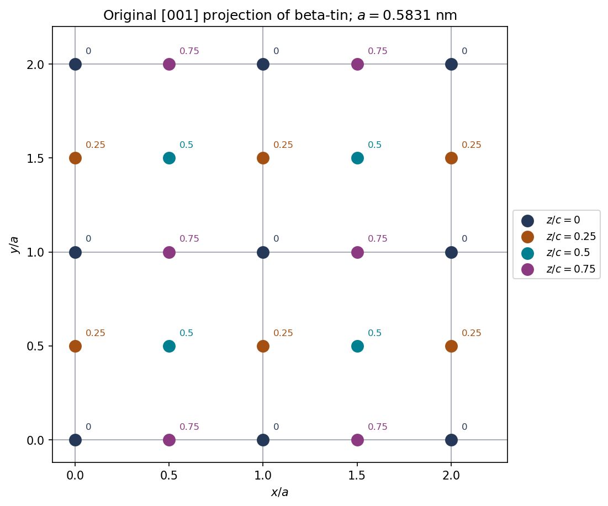

<h1 id="1/b/solution">Solution</h1>

↑ **Parent:** [B](../b.md)

The [body-centered tetragonal lattice](../../../../../body-centered-tetragonal-lattice.md) has points at $(0,0,0)$ and $(1/2,1/2,1/2)$ in the conventional cell. Add the two-atom motif to each. Reducing coordinates modulo integer translations gives

$$
\boxed{(0,0,0),\quad(0,1/2,1/4),\quad
(1/2,1/2,1/2),\quad(1/2,0,3/4).}
$$

Thus the cell contains **four atoms**, not merely the two lattice points. In projection along $[001]$, label each projected point by its fractional height $z/c$; the four sites do not all lie in the same plane.

**[Figure 1](#1/b/image-original-calculated-001-projection-of-two-by-two-conventional-beta-tin-cells-colors-and-labels-give-fractional-height-not-different-chemical-species). Original calculated $[001]$ projection of two-by-two conventional beta-tin cells; colors and labels give fractional height, not different chemical species**.

The plotted repeat is $a=0.5831\,\mathrm{nm}$ in both horizontal directions. Atoms on the outer drawing boundary are repeated images needed to show neighboring cells, rather than additional unshared atoms in the four-cell counting volume.

## ↑ Ancestors (13)

1. [B](../b.md)
2. [1](../../1.md)
3. [Paper 1](../../../paper-1-split.md)
4. [2018](../../../split.md)
5. [Past exam of the materials science course of the University of Cambridge](../../../../split.md)
6. [Materials science course of the University of Cambridge](../../../../../materials-science-course-of-the-university-of-cambridge.md)
7. [Year 1 of the natural sciences course of the University of Cambridge](../../../../../year-1-of-the-natural-sciences-course-of-the-university-of-cambridge.md)
8. [Year of the natural sciences course of the University of Cambridge](../../../../../year-of-the-natural-sciences-course-of-the-university-of-cambridge.md)
9. [Natural sciences course of the University of Cambridge](../../../../../natural-sciences-course-of-the-university-of-cambridge.md)
10. [Course of the University of Cambridge](../../../../../course-of-the-university-of-cambridge.md)
11. [University of Cambridge](../../../../../university-of-cambridge-split.md)
12. [List of universities](../../../../../list-of-universities.md)
13. [Codex Wiki](../../../../../split.md)
