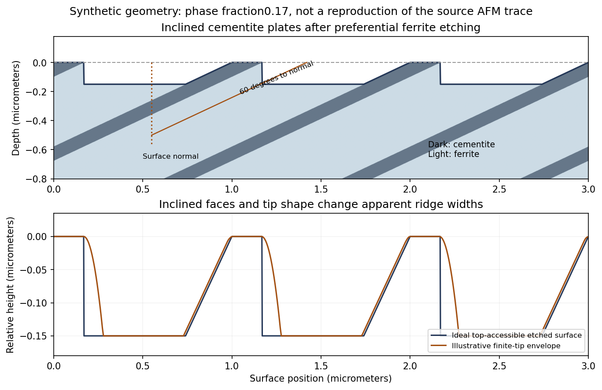

<h1 id="4/c/solution">Solution</h1>

↑ **Parent:** [C](../c.md)

The lamellar interfaces now make $60^\circ$ with the surface normal, or $30^\circ$ with the surface itself. **Draw inclined alternating plates rather than vertical stripes**, with preferentially etched [ferrite](../../../../../ferrite.md) below the more resistant [cementite](../../../../../cementite.md).

**[Figure 2](#4/c/image-original-inclined-lamella-etching-geometry-and-illustrative-afm-profile-the-synthetic-spacing-and-fractions-are-not-a-tracing-of-the-source-data). Original inclined-lamella etching geometry and illustrative AFM profile; the synthetic spacing and fractions are not a tracing of the source data**.

The upper panel shows an inclined microstructure intersecting the original plane. Differential etching can expose a shallow inclined [cementite](../../../../../cementite.md) face on one side of a ridge and an undercut or overhang on the other. The lower panel shows its accessible height profile, with additional rounding from a finite tip. It is therefore possible to obtain an asymmetric ridge even from an initially planar section through parallel lamellae.

For an ideal unetched planar cut, a plate of normal thickness $d$ has apparent surface width

$$
w=\frac{d}{\sin30^\circ}=2d.
$$

The same factor applies to the [ferrite](../../../../../ferrite.md) spacing. Inclination alone broadens all intersections together; it does not by itself change the true phase-width ratio.

## ↑ Ancestors (13)

1. [C](../c.md)
2. [4](../../4.md)
3. [Paper 1](../../../paper-1-split.md)
4. [2018](../../../split.md)
5. [Past exam of the materials science course of the University of Cambridge](../../../../split.md)
6. [Materials science course of the University of Cambridge](../../../../../materials-science-course-of-the-university-of-cambridge.md)
7. [Year 1 of the natural sciences course of the University of Cambridge](../../../../../year-1-of-the-natural-sciences-course-of-the-university-of-cambridge.md)
8. [Year of the natural sciences course of the University of Cambridge](../../../../../year-of-the-natural-sciences-course-of-the-university-of-cambridge.md)
9. [Natural sciences course of the University of Cambridge](../../../../../natural-sciences-course-of-the-university-of-cambridge.md)
10. [Course of the University of Cambridge](../../../../../course-of-the-university-of-cambridge.md)
11. [University of Cambridge](../../../../../university-of-cambridge-split.md)
12. [List of universities](../../../../../list-of-universities.md)
13. [Codex Wiki](../../../../../split.md)
