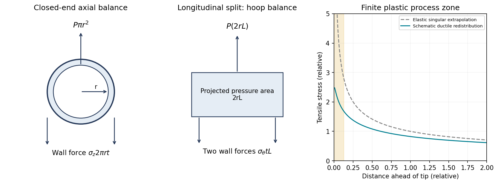

<h1 id="5/a/solution">Solution</h1>

↑ **Parent:** [A](../a.md)

Assume a thin cylindrical wall, uniform internal pressure and closed ends carrying the pressure load. The radial [stress](../../../../../stress.md) is small compared with the membrane stresses when $t\ll r$.

For an end cap, the outward pressure [force](../../../../../force-split.md) is $P\pi r^2$. The wall's axial tensile [force](../../../../../force-split.md) is $\sigma_z(2\pi rt)$. Equilibrium therefore gives

$$
\boxed{\sigma_z=\frac{Pr}{2t}.}
$$

For a longitudinally split half-cylinder of length $L$, pressure has resultant $P(2rL)$ across the projected rectangular area. Two cut wall sections each carry $\sigma_\theta tL$, so

$$
\boxed{\sigma_\theta=\frac{Pr}{t}=2\sigma_z.}
$$

Thus **[hoop stress](../../../../../hoop-stress.md) is twice the closed-end axial [stress](../../../../../stress.md)** in this model. An open-ended tube without an external end load does not acquire the same pressure-induced [axial membrane stress](../../../../../axial-membrane-stress.md).

**[Figure 3](#5/a/image-original-thin-pipe-force-balances-and-schematic-crack-tip-stress-regularization-by-plastic-deformation-the-plastic-zone-curve-is-qualitative). Original thin-pipe force balances and schematic crack-tip stress regularization by plastic deformation; the plastic-zone curve is qualitative**.

## ↑ Ancestors (13)

1. [A](../a.md)
2. [5](../../5.md)
3. [Paper 1](../../../paper-1-split.md)
4. [2018](../../../split.md)
5. [Past exam of the materials science course of the University of Cambridge](../../../../split.md)
6. [Materials science course of the University of Cambridge](../../../../../materials-science-course-of-the-university-of-cambridge.md)
7. [Year 1 of the natural sciences course of the University of Cambridge](../../../../../year-1-of-the-natural-sciences-course-of-the-university-of-cambridge.md)
8. [Year of the natural sciences course of the University of Cambridge](../../../../../year-of-the-natural-sciences-course-of-the-university-of-cambridge.md)
9. [Natural sciences course of the University of Cambridge](../../../../../natural-sciences-course-of-the-university-of-cambridge.md)
10. [Course of the University of Cambridge](../../../../../course-of-the-university-of-cambridge.md)
11. [University of Cambridge](../../../../../university-of-cambridge-split.md)
12. [List of universities](../../../../../list-of-universities.md)
13. [Codex Wiki](../../../../../split.md)
