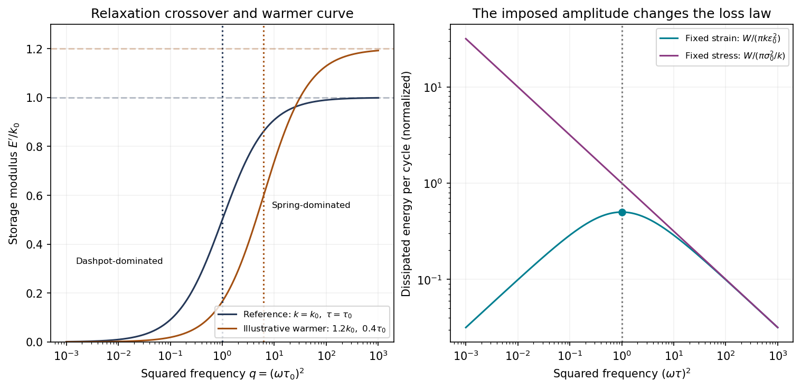

<h1 id="6/c/i/solution">Solution</h1>

↑ **Parent:** [I](../i.md)

With $s=\omega^2$, the curve is

$$
E'(s)=\frac{k\tau^2s}{1+\tau^2s},\qquad
\frac{dE'}{ds}=\frac{k\tau^2}{(1+\tau^2s)^2}>0.
$$

**It rises linearly from zero, bends downward and approaches the plateau $k$**. Its half-height occurs at $s=\tau^{-2}$.

For $\omega^2\ll\tau^{-2}$, the [dashpot](../../../../../../dashpot.md) contributes the larger [strain](../../../../../../strain.md) and dominates the compliant response. For $\omega^2\gg\tau^{-2}$, [dashpot](../../../../../../dashpot.md) deformation during a cycle is small relative to [spring](../../../../../../spring.md) [strain](../../../../../../strain.md), and the response is spring-dominated. The crossover separates these regimes rather than a discontinuous transition.

**[Figure 4](#6/c/i/image-original-maxwell-storage-curves-versus-squared-frequency-and-the-distinct-dissipation-laws-at-fixed-strain-and-fixed-stress-amplitudes-axes-use-logarithmic-spacing-to-show-both-regimes). Original Maxwell storage curves versus squared frequency and the distinct dissipation laws at fixed strain and fixed stress amplitudes; axes use logarithmic spacing to show both regimes**.

## ↑ Ancestors (14)

1. [I](../i.md)
2. [C](../../c.md)
3. [6](../../../6.md)
4. [Paper 1](../../../../paper-1-split.md)
5. [2018](../../../../split.md)
6. [Past exam of the materials science course of the University of Cambridge](../../../../../split.md)
7. [Materials science course of the University of Cambridge](../../../../../../materials-science-course-of-the-university-of-cambridge.md)
8. [Year 1 of the natural sciences course of the University of Cambridge](../../../../../../year-1-of-the-natural-sciences-course-of-the-university-of-cambridge.md)
9. [Year of the natural sciences course of the University of Cambridge](../../../../../../year-of-the-natural-sciences-course-of-the-university-of-cambridge.md)
10. [Natural sciences course of the University of Cambridge](../../../../../../natural-sciences-course-of-the-university-of-cambridge.md)
11. [Course of the University of Cambridge](../../../../../../course-of-the-university-of-cambridge.md)
12. [University of Cambridge](../../../../../../university-of-cambridge-split.md)
13. [List of universities](../../../../../../list-of-universities.md)
14. [Codex Wiki](../../../../../../split.md)
