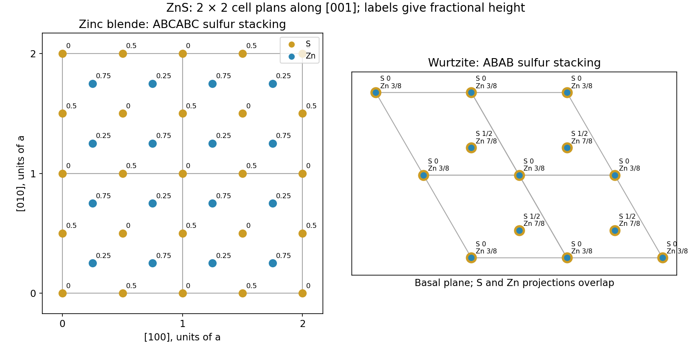
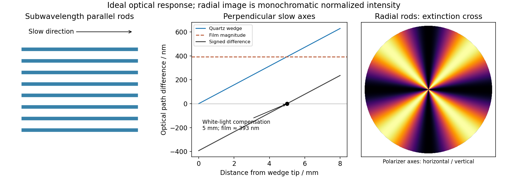
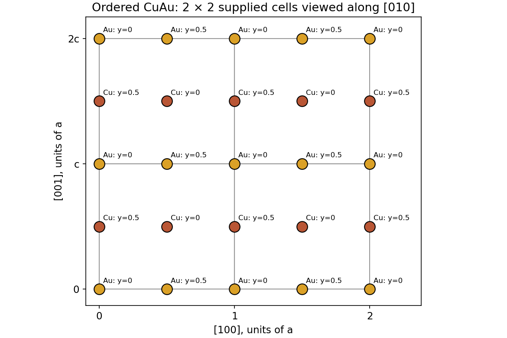
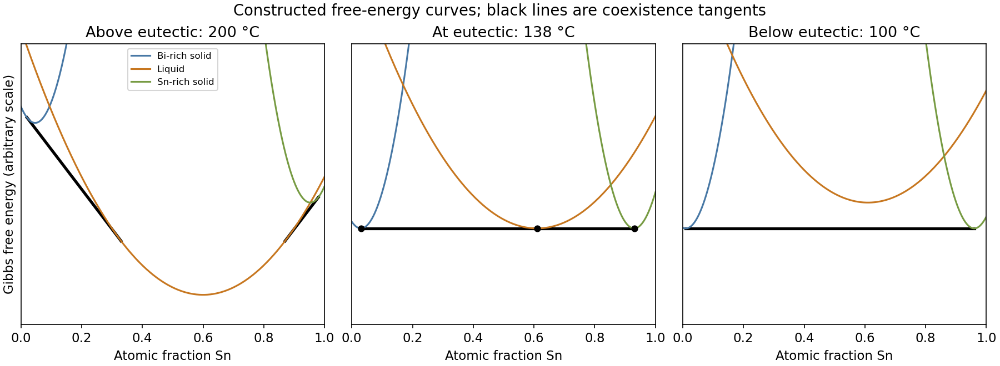
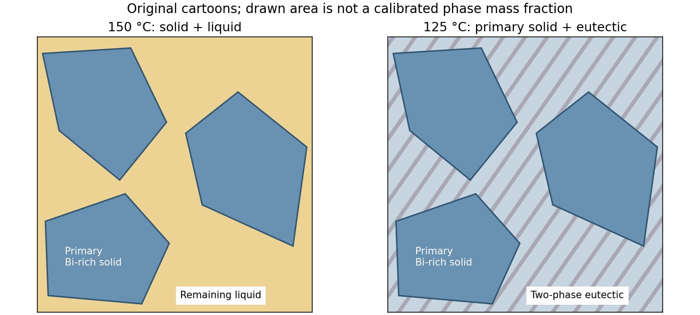
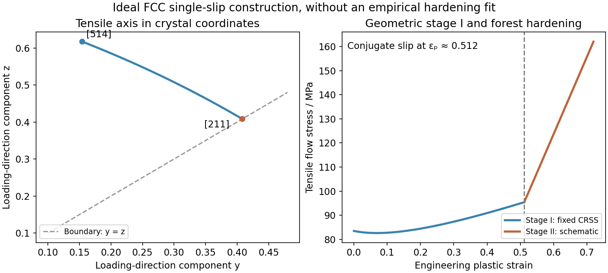
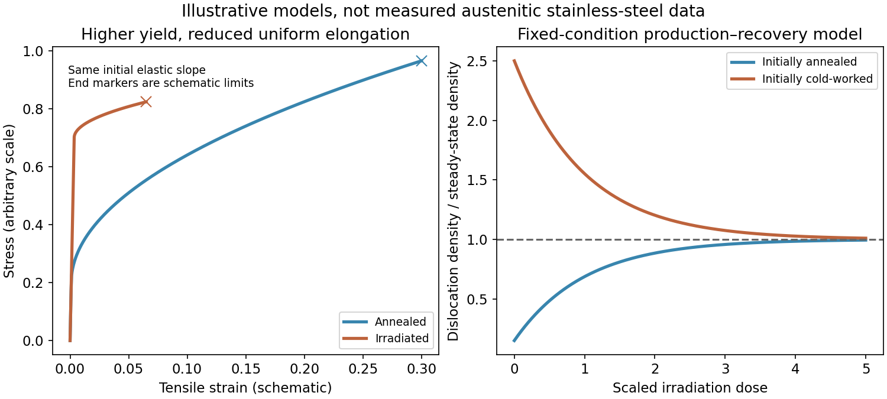

# Paper 1

↑ **Parent:** [2019](../2019.md)

[Original public paper, physical pages 34–42 of the release](https://www.whatdotheyknow.com/request/natural_sciences_tripos_part_1a/response/3284364/attach/3/FOI%202025%201239%20Hagendoorn%20materials.pdf?cookie_passthrough=1#page=34)

The original printed labels are retained; biological question 7 is deferred.

**Table of contents**

- [1](#1)
  - [a](#1/a)
    - [i](#1/a/i)
      - [Solution](#1/a/i/solution)
    - [ii](#1/a/ii)
      - [Solution](#1/a/ii/solution)
  - [b](#1/b)
    - [Solution](#1/b/solution)
  - [c](#1/c)
    - [Solution](#1/c/solution)
  - [d](#1/d)
    - [Solution](#1/d/solution)
- [2](#2)
  - [a](#2/a)
    - [Solution](#2/a/solution)
  - [b](#2/b)
    - [Solution](#2/b/solution)
  - [c](#2/c)
    - [Solution](#2/c/solution)
  - [d](#2/d)
    - [Solution](#2/d/solution)
- [3](#3)
  - [a](#3/a)
    - [Solution](#3/a/solution)
  - [b](#3/b)
    - [Solution](#3/b/solution)
  - [c](#3/c)
    - [i](#3/c/i)
      - [Solution](#3/c/i/solution)
    - [ii](#3/c/ii)
      - [Solution](#3/c/ii/solution)
    - [iii](#3/c/iii)
      - [Solution](#3/c/iii/solution)
  - [d](#3/d)
    - [Solution](#3/d/solution)
- [4](#4)
  - [a](#4/a)
    - [Solution](#4/a/solution)
  - [b](#4/b)
    - [i](#4/b/i)
      - [Solution](#4/b/i/solution)
    - [ii](#4/b/ii)
      - [Solution](#4/b/ii/solution)
    - [iii](#4/b/iii)
      - [Solution](#4/b/iii/solution)
  - [c](#4/c)
    - [i](#4/c/i)
      - [Solution](#4/c/i/solution)
    - [ii](#4/c/ii)
      - [Solution](#4/c/ii/solution)
- [5](#5)
  - [a](#5/a)
    - [Solution](#5/a/solution)
  - [b](#5/b)
    - [Solution](#5/b/solution)
  - [c](#5/c)
    - [Solution](#5/c/solution)
  - [d](#5/d)
    - [Solution](#5/d/solution)
- [6](#6)
  - [a](#6/a)
    - [i](#6/a/i)
      - [Solution](#6/a/i/solution)
    - [ii](#6/a/ii)
      - [Solution](#6/a/ii/solution)
    - [iii](#6/a/iii)
      - [Solution](#6/a/iii/solution)
    - [iv](#6/a/iv)
      - [Solution](#6/a/iv/solution)
  - [b](#6/b)
    - [Solution](#6/b/solution)
  - [c](#6/c)
    - [Solution](#6/c/solution)
  - [d](#6/d)
    - [Solution](#6/d/solution)
- [7](#7)
  - [a](#7/a)
    - [Solution](#7/a/solution)
  - [b](#7/b)
    - [Solution](#7/b/solution)
  - [c](#7/c)
    - [Solution](#7/c/solution)
  - [d](#7/d)
    - [Solution](#7/d/solution)
  - [e](#7/e)
    - [Solution](#7/e/solution)

## 1

↑ **Parent:** [Paper 1](paper-1.md)

<h3 id="1/a">a</h3>

↑ **Parent:** [1](#1)

<h4 id="1/a/i">i</h4>

↑ **Parent:** [A](#1/a)

<h5 id="1/a/i/solution">Solution</h5>

↑ **Parent:** [I](#1/a/i)

In [crystal polymorphism](../../thermodynamics.md#polymorphism-materials-science), the same [chemical composition](../../chemical-substance.md#chemical-composition) has different [crystal structures](../../physical-chemistry.md#crystal-structure); for an [chemical element](../../chemical-substance.md#chemical-element), this is a form of [allotropy](../../chemical-substance.md#allotropy). [Diamond](../../chemical-substance.md#diamond) has a three-dimensional tetrahedral network of [covalent bonds](../../covalent-bond.md), giving high [hardness](../../engineering.md#hardness) and a wide [band gap](../../bloch-s-theorem.md#band-gap). [Graphite](../../chemical-substance.md#graphite) has strongly bonded planar sheets, with weaker interactions between sheets. Sliding between sheets makes it a useful [solid](../../thermodynamics.md#solid) [lubricant](../../newtonian-mechanics.md#lubricant); mobile electronic states give good electrical conduction within the sheets. Their different properties come from different bonding and structures, despite both being [carbon](../../chemical-substance.md#carbon).

<h4 id="1/a/ii">ii</h4>

↑ **Parent:** [A](#1/a)

<h5 id="1/a/ii/solution">Solution</h5>

↑ **Parent:** [Ii](#1/a/ii)

[Barium titanate](../../chemical-substance.md#barium-titanate) has a high-temperature cubic [perovskite structure](../../physical-chemistry.md#perovskite-structure), with Ti centred in its [oxygen](../../chemical-substance.md#oxygen) octahedron on average. This phase is [paraelectric](../../electromagnetism.md#paraelectricity). Near room [temperature](../../temperature.md) the structure is tetragonal, with relative ionic displacements that give a spontaneous [electric polarization](../../electromagnetism.md#polarization-density). This phase is [ferroelectric](../../engineering.md#ferroelectricity): an applied [electric field](../../electric-field.md) can switch between differently polarized domains. Both phases have the same composition, BaTiO$_3$; the transition near $120\,{}^\circ\mathrm{C}$ changes [crystal symmetry](../../physical-chemistry.md#crystal-symmetry) and electrical response.

<h3 id="1/b">b</h3>

↑ **Parent:** [1](#1)

<h4 id="1/b/solution">Solution</h4>

↑ **Parent:** [B](#1/b)

The [zinc blende structure](../../physical-chemistry.md#zinc-blende-structure) has an FCC [sulfur](../../chemical-substance.md#sulfur) sublattice and [zinc](../../chemical-substance.md#zinc) on half its tetrahedral sites. One conventional [unit cell](../../quantum-scattering.md#unit-cell) uses S at $(0,0,0),(1/2,1/2,0),(1/2,0,1/2),(0,1/2,1/2)$ and Zn at those positions displaced by $(1/4,1/4,1/4)$, reduced modulo one. The [wurtzite structure](../../physical-chemistry.md#wurtzite) has ABAB [sulfur](../../chemical-substance.md#sulfur) layers, instead of ABCABC layers. One hexagonal-cell convention uses S at $(0,0,0),(2/3,1/3,1/2)$ and Zn at $(0,0,u),(2/3,1/3,1/2+u)$, with ideal $u=3/8$. Looking along $[001]$ superposes S and Zn in that latter coordinate convention; the height labels distinguish them.

**[Figure 1](#1/b/image-two-by-two-zinc-sulfide-unit-cell-projections-along-the-stacking-axes). Two-by-two zinc sulfide unit-cell projections along the stacking axes**. Original coordinate constructions. Heights are fractional coordinates along the viewing axis. The hexagonal plan uses basal vectors at 120 degrees.

The closest-packed [sulfur](../../chemical-substance.md#sulfur) planes are **$\{111\}$, with four distinct plane orientations**, for [zinc blende structure](../../physical-chemistry.md#zinc-blende-structure), and **$\{001\}$, with one orientation**, for [wurtzite structure](../../physical-chemistry.md#wurtzite). Opposite normals describe the same unoriented plane orientation. Hexagonal four-index notation writes the latter basal family as $\{0001\}$.

<h3 id="1/c">c</h3>

↑ **Parent:** [1](#1)

<h4 id="1/c/solution">Solution</h4>

↑ **Parent:** [C](#1/c)

**The [solid](../../thermodynamics.md#solid) trace is wurtzite; the dashed trace is [zinc](../../chemical-substance.md#zinc) blende.** The isolated strong dashed peak is the cubic $111$ reflection. The [solid](../../thermodynamics.md#solid) trace has hexagonal $100$, $002$ and $101$ reflections in this angular interval; its central $002$ peak is the one at $28.65^\circ$, while cubic $111$ occurs at $28.53^\circ$. These assignments are consistent with the absence of lower-angle reflections.

In the ideal close-packed model, the cubic $111$ and hexagonal $002$ reflections probe the same local alternating layer geometry. Their scattering strength per suitably normalized amount of material and their angular factors are therefore very similar, but [powder diffraction multiplicity](../../physical-chemistry.md#powder-diffraction-multiplicity) differs: the cubic family has eight directed normals, while hexagonal $002$ has two. This explains the approximately **fourfold greater intensity** of the dashed peak. Comparing unnormalized conventional-cell [structure factors](../../quantum-scattering.md#structure-factor) alone would be misleading because the cells contain different numbers of formula units. Peak heights additionally depend on line widths; the multiplicity argument applies most directly to integrated intensities.

<h3 id="1/d">d</h3>

↑ **Parent:** [1](#1)

<h4 id="1/d/solution">Solution</h4>

↑ **Parent:** [D](#1/d)

Taking Cu K$\alpha$ [wavelength](../../wave-equation.md#wavelength) $\lambda=0.15418\,\mathrm{nm}$, [Bragg's law](../../quantum-scattering.md#bragg-s-law) gives $d=\lambda/(2\sin\theta)$. For cubic $111$, $a=\sqrt3d_{111}$ and the nearest Zn–S separation is $\sqrt3a/4=3d_{111}/4$. For ideal [wurtzite structure](../../physical-chemistry.md#wurtzite), $c=2d_{002}$ and the nearest separation is $3c/8=3d_{002}/4$. Therefore

$$
\boxed{r_{\rm cubic}=0.2346\,\mathrm{nm},\qquad r_{\rm hexagonal}\simeq0.2337\,\mathrm{nm}.}
$$

Both have tetrahedral nearest-neighbour [coordination number](../../ionic-bonding.md#coordination-number) four, but different further-neighbour stacking and lattice relaxation can shift their equilibrium bond lengths. The hexagonal value assumes ideal $c/a=\sqrt{8/3}$ and $u=3/8$; a real distorted [wurtzite structure](../../physical-chemistry.md#wurtzite) can have unequal axial and inclined bonds. One measured $002$ spacing alone does not determine every bond length without that structural assumption.

## 2

↑ **Parent:** [Paper 1](paper-1.md)

<h3 id="2/a">a</h3>

↑ **Parent:** [2](#2)

<h4 id="2/a/solution">Solution</h4>

↑ **Parent:** [A](#2/a)

Features only a few tens of nanometres wide lie below the ordinary visible-light [diffraction limit](../../optics.md#diffraction-limit), approximately $\lambda/(2\mathrm{NA})$. The microscope cannot resolve individual rods, and unpolarized illumination does not directly reveal the orientation-dependent optical response. **[Scanning electron microscopy](../../optics.md#scanning-electron-microscope) and [atomic force microscopy](../../engineering.md#atomic-force-microscopy)** can resolve the surface pattern. [Transmission electron microscopy](../../optics.md#transmission-electron-microscopy) is another possible choice if a suitably thin specimen can be prepared.

<h3 id="2/b">b</h3>

↑ **Parent:** [2](#2)

<h4 id="2/b/solution">Solution</h4>

↑ **Parent:** [B](#2/b)

An optically [isotropic](../../continuum-mechanics.md#isotropy) film changes the phase of both transverse polarization components equally, so crossed [polarizers](../../electromagnetic-wave.md#polarizer) still extinguish the transmitted light. The etched rod-and-gap composite has **[form birefringence](../../maxwell-equations.md#form-birefringence)**: its effective [permittivity](../../permittivity.md) depends on the direction of the [electric field](../../electric-field.md), even when the constituent material is intrinsically [isotropic](../../continuum-mechanics.md#isotropy). In a simple subwavelength lamellar model,

$$
\epsilon_\parallel=f\epsilon_r+(1-f)\epsilon_g,\qquad
\epsilon_\perp=\left(\frac f{\epsilon_r}+\frac{1-f}{\epsilon_g}\right)^{-1}.
$$

The precise effective-medium formula changes with rod geometry, but the [anisotropy](../../continuum-mechanics.md#anisotropy) remains. Resolving incident light along the two principal directions produces a [phase retardation](../../maxwell-equations.md#phase-retardation). An ideal lossless specimen between crossed [polarizers](../../electromagnetic-wave.md#polarizer) transmits

$$
I=I_P\sin^2(2\alpha)\sin^2(\pi\Gamma/\lambda),\qquad\Gamma=(n_{\rm slow}-n_{\rm fast})t,
$$

where $I_P$ is the intensity after the first polarizer. Extinction occurs when a principal direction follows either polarizer; transmission is strongest near $45^\circ$.

<h3 id="2/c">c</h3>

↑ **Parent:** [2](#2)

<h4 id="2/c/solution">Solution</h4>

↑ **Parent:** [C](#2/c)

At distance $x$ from its tip, the wedge thickness is $t_q=x\tan\theta_q$. Its [optical path difference](../../physical-optics.md#optical-path-difference) is therefore

$$
\Gamma_q=\Delta n_q x\tan\theta_q
=0.009(5\times10^{-3})\tan(0.5^\circ)
=3.927\times10^{-7}\,\mathrm m.
$$

The perpendicular slow directions make the two retardances subtract. A white-light black compensation fringe is the zero-order cancellation, so **the film retardance has magnitude approximately $393\,\mathrm{nm}$**, with its slow direction along the rods. This interpretation assumes the observed fringe is the white-light compensation fringe; a single monochromatic dark fringe alone would have an integer-order ambiguity. Without the wedge, the [wavelength](../../wave-equation.md#wavelength) dependence of $\sin^2(\pi\Gamma/\lambda)$ selectively transmits visible wavelengths and gives the film its [interference colour](../../maxwell-equations.md#interference-colour).

<h3 id="2/d">d</h3>

↑ **Parent:** [2](#2)

<h4 id="2/d/solution">Solution</h4>

↑ **Parent:** [D](#2/d)

The local slow direction follows the radial rods. Between crossed [polarizers](../../electromagnetic-wave.md#polarizer), the angular factor is $\sin^2(2\varphi)$, so radial directions parallel to either polarizer are dark. The pattern is a **[Maltese cross in polarized-light microscopy](../../optical-instrument.md#maltese-cross-in-polarized-light-microscopy)**, with four bright sectors separated by dark arms parallel to the polarizer directions. Its colours depend on the local [optical path difference](../../physical-optics.md#optical-path-difference); tapering rods or changing fill fraction can make this vary with radius. The cross belongs to the local radial-axis pattern and does not imply a [conoscopic interference figure](../../optical-instrument.md#conoscopic-interference-pattern).

**[Figure 2](#2/d/image-form-birefringence-wedge-compensation-and-a-radial-extinction-cross). Form birefringence, wedge compensation and a radial extinction cross**. Original idealized optical model. The radial image shows normalized monochromatic intensity, not a simulated photograph or measured colour chart.

## 3

↑ **Parent:** [Paper 1](paper-1.md)

<h3 id="3/a">a</h3>

↑ **Parent:** [3](#3)

<h4 id="3/a/solution">Solution</h4>

↑ **Parent:** [A](#3/a)

For a disordered [face-centered cubic lattice](../../quantum-scattering.md#face-centered-cubic-lattice), equal average scattering factors on the four sites give reflections only when $h,k,l$ are all even or all odd. [Bragg's law](../../quantum-scattering.md#bragg-s-law) also requires $h^2+k^2+l^2\leq4a^2/\lambda^2$. With Fe K$\alpha$ [wavelength](../../wave-equation.md#wavelength) $\lambda\simeq0.1936\,\mathrm{nm}$, the upper bound is $15.41$. The allowed sums are $3,4,8,11,12$, giving

$$
\boxed{111,\quad200,\quad220,\quad311,\quad222.}
$$

The next allowed family, $400$, has squared-index sum $16$ and cannot satisfy the diffraction condition for this [wavelength](../../wave-equation.md#wavelength). This list assumes the full geometrically accessible angular range, rather than an instrument-specific cutoff.

<h3 id="3/b">b</h3>

↑ **Parent:** [3](#3)

<h4 id="3/b/solution">Solution</h4>

↑ **Parent:** [B](#3/b)

Successive planes normal to $[001]$ are chemically ordered Au and Cu layers. The supplied four-site cell is a convenient doubled description of the **[primitive tetragonal lattice](../../physical-chemistry.md#primitive-tetragonal-lattice)**: valid primitive translations are

$$
\mathbf a_1=\tfrac a2(1,1,0),\quad
\mathbf a_2=\tfrac a2(-1,1,0),\quad
\mathbf a_3=(0,0,c).
$$

They give a square basal cell of side $a/\sqrt2$, containing an Au basis atom at the origin and Cu at fractional $(1/2,1/2,1/2)$. That last vector exchanges chemical species and is not a Bravais translation. Thus a face-centred-looking atomic arrangement does not make the chemically ordered material an FCC [Bravais lattice](../../quantum-scattering.md#bravais-lattice). This is the [L10 crystal structure](../../physical-chemistry.md#l10-crystal-structure); the following indices retain the larger cell specified in the question.

**[Figure 3](#3/b/image-ordered-copper-gold-structure-viewed-along-the-second-basal-axis). Ordered copper-gold structure viewed along the second basal axis**. Original two-by-two projection of the supplied four-site cell. Colour gives chemical species; labels distinguish the fractional coordinate along the viewing direction.

<h3 id="3/c">c</h3>

↑ **Parent:** [3](#3)

<h4 id="3/c/i">i</h4>

↑ **Parent:** [C](#3/c)

<h5 id="3/c/i/solution">Solution</h5>

↑ **Parent:** [I](#3/c/i)

Summing phase-weighted [atomic scattering factors](../../quantum-scattering.md#atomic-scattering-factor) over the four positions gives

$$
\boxed{F_{hkl}=f_{\rm Au}[1+(-1)^{h+k}]+f_{\rm Cu}[(-1)^{h+l}+(-1)^{k+l}].}
$$

If $h,k$ have different parity, the reflection vanishes. If they have equal parity, this becomes $2[f_{\rm Au}+(-1)^{h+l}f_{\rm Cu}]$. The difference reflections reveal chemical order; they disappear when all sites instead have the same average scattering factor.

<h4 id="3/c/ii">ii</h4>

↑ **Parent:** [C](#3/c)

<h5 id="3/c/ii/solution">Solution</h5>

↑ **Parent:** [Ii](#3/c/ii)

Ordering reflections by $d_{hkl}^{-2}=(h^2+k^2)/a^2+l^2/c^2$ with $c\simeq0.9a$, the first three nonzero families are **$001$, $110$ and $111$**. The $100$ family is extinct. Their [structure factors](../../quantum-scattering.md#structure-factor) are

$$
\boxed{F_{001}=2(f_{\rm Au}-f_{\rm Cu}),\quad F_{110}=2(f_{\rm Au}-f_{\rm Cu}),\quad F_{111}=2(f_{\rm Au}+f_{\rm Cu}).}
$$

The [atomic scattering factors](../../quantum-scattering.md#atomic-scattering-factor) in each expression are evaluated at that reflection's scattering vector, so equal symbolic forms need not mean equal numerical amplitudes at different angles. In particular, the low-angle superlattice peaks need not be the strongest peaks.

<h4 id="3/c/iii">iii</h4>

↑ **Parent:** [C](#3/c)

<h5 id="3/c/iii/solution">Solution</h5>

↑ **Parent:** [Iii](#3/c/iii)

The first peak is $001$, with $d_{001}=c$; the second is $110$, with $d_{110}=a/\sqrt2$. Applying [Bragg's law](../../quantum-scattering.md#bragg-s-law) with $\lambda=0.193604\,\mathrm{nm}$ gives

$$
\boxed{c=\frac\lambda{2\sin15.30^\circ}=0.3669\,\mathrm{nm},\qquad a=b=\frac\lambda{\sqrt2\sin20.24^\circ}=0.3957\,\mathrm{nm}.}
$$

Thus $c/a=0.927$, consistent with the approximate ratio used to order the reflections. These are the lengths of the supplied larger basal cell; the primitive basal [lattice parameter](../../physical-chemistry.md#lattice-constant) is $a/\sqrt2=0.2798\,\mathrm{nm}$.

<h3 id="3/d">d</h3>

↑ **Parent:** [3](#3)

<h4 id="3/d/solution">Solution</h4>

↑ **Parent:** [D](#3/d)

At a common test [temperature](../../temperature.md) and otherwise comparable microstructure, chemical order generally raises the [yield strength](../../engineering.md#yield-strength). An ordinary FCC [dislocation](../../physical-chemistry.md#dislocation) displaced by $a\langle110\rangle/2$ can interchange Au and Cu sublattices, creating an [antiphase boundary](../../physical-chemistry.md#antiphase-boundary) behind it. This additional energy resists slip; paired [dislocations](../../physical-chemistry.md#dislocation) can restore the order after the second member passes. The disordered phase does not pay the same ordering penalty. Comparing specimens actually tested at their different phase-stability temperatures also includes temperature-dependent mobility and recovery, so the ordering argument alone does not predict a unique measured strength ratio.

## 4

↑ **Parent:** [Paper 1](paper-1.md)

<h3 id="4/a">a</h3>

↑ **Parent:** [4](#4)

<h4 id="4/a/solution">Solution</h4>

↑ **Parent:** [A](#4/a)

(Bi) and $(\beta\mathrm{Sn})$ are Bi-rich and Sn-rich [terminal solid solutions](../../chemical-substance.md#terminal-solid-solution), not intermetallic compounds. At the eutectic composition, cooling through $138\,{}^\circ\mathrm C$ gives

$$
\boxed{L\longrightarrow(\mathrm{Bi})+(\beta\mathrm{Sn}).}
$$

The two solids grow together as a fine [eutectic microstructure](../../thermodynamic-potential.md#eutectic-microstructure), commonly lamellar or rod-like. Below about $13\,{}^\circ\mathrm C$, the tin-rich component has an equilibrium tendency to transform from metallic tetragonal [white tin](../../chemical-substance.md#white-tin) to diamond-cubic [grey tin](../../chemical-substance.md#grey-tin), with a substantial volume increase. This is [tin pest](../../chemical-substance.md#tin-pest), which can disrupt the microstructure mechanically. The dashed transition does not transform the Bi-rich phase into [tin](../../chemical-substance.md#tin). Actual transformation can be slow and depend strongly on impurities and [nucleation](../../critical-phenomenon.md#nucleation); crossing the line does not guarantee immediate disintegration.

<h3 id="4/b">b</h3>

↑ **Parent:** [4](#4)

For a mixture with phase compositions $x_1,x_2$, its molar [Gibbs free energy](../../thermodynamic-potential.md#gibbs-free-energy) is the straight-line combination $g=(1-f)g_1(x_1)+fg_2(x_2)$ at overall $x=(1-f)x_1+fx_2$. Minimizing over phase compositions gives equal slopes and equal tangent intercepts: the [common-tangent construction](../../critical-phenomenon.md#common-tangent-construction) expresses equality of both component [chemical potentials](../../chemical-potential.md). The equilibrium curve is the lower [convex envelope](../../real-analysis.md#convex-envelope) of the candidate phase curves. Phase fractions follow the [lever rule](../../thermodynamic-potential.md#lever-rule).

<h4 id="4/b/i">i</h4>

↑ **Parent:** [B](#4/b)

<h5 id="4/b/i/solution">Solution</h5>

↑ **Parent:** [I](#4/b/i)

At $200\,{}^\circ\mathrm C$, moving from Bi-rich to Sn-rich composition gives **$(\mathrm{Bi})$, $(\mathrm{Bi})+L$, $L$, $L+(\beta\mathrm{Sn})$, $(\beta\mathrm{Sn})$**. Approximate [liquid](../../thermodynamics.md#liquid) coexistence compositions read from the diagram are $x_{\rm Sn}\simeq0.33$ on the left and $0.87$ on the right; the coexisting solids lie near their respective pure ends. The stable [Gibbs free energy](../../thermodynamic-potential.md#gibbs-free-energy) follows [solid](../../thermodynamics.md#solid) curves near the endpoints, two [common-tangent constructions](../../critical-phenomenon.md#common-tangent-construction) in the coexistence intervals, and the [liquid](../../thermodynamics.md#liquid) curve between them.

<h4 id="4/b/ii">ii</h4>

↑ **Parent:** [B](#4/b)

<h5 id="4/b/ii/solution">Solution</h5>

↑ **Parent:** [Ii](#4/b/ii)

At $138\,{}^\circ\mathrm C$, one line is tangent to all three [Gibbs free energy](../../thermodynamic-potential.md#gibbs-free-energy) curves at approximately $x_{\rm Sn}=0.03$ for (Bi), $0.61$ for [liquid](../../thermodynamics.md#liquid), and $0.93$ for $(\beta\mathrm{Sn})$. These three phases can coexist at the [eutectic point](../../thermodynamic-potential.md#eutectic-point). Between the two [solid](../../thermodynamics.md#solid) compositions, the equilibrium phase fractions depend on how much [liquid](../../thermodynamics.md#liquid) has already transformed; exactly at the invariant [temperature](../../temperature.md), the overall composition alone does not fix all three fractions. At the eutectic overall composition, cooling just below the [temperature](../../temperature.md) eliminates the [liquid](../../thermodynamics.md#liquid) and leaves the two solids.

<h4 id="4/b/iii">iii</h4>

↑ **Parent:** [B](#4/b)

<h5 id="4/b/iii/solution">Solution</h5>

↑ **Parent:** [Iii](#4/b/iii)

At $100\,{}^\circ\mathrm C$, the stable sequence is **$(\mathrm{Bi})$, $(\mathrm{Bi})+(\beta\mathrm{Sn})$, $(\beta\mathrm{Sn})$**. The stable two-solid [common tangent](../../calculus.md#common-tangent) lies below the [liquid](../../thermodynamics.md#liquid) curve. There is no stable [liquid](../../thermodynamics.md#liquid) interval, although a metastable extrapolated [liquid](../../thermodynamics.md#liquid) [Gibbs free energy](../../thermodynamic-potential.md#gibbs-free-energy) can still be drawn.

**[Figure 4](#4/b/iii/image-qualitative-gibbs-free-energy-envelopes-above-at-and-below-a-binary-eutectic). Qualitative Gibbs free-energy envelopes above, at and below a binary eutectic**. Original illustrative curves with constructed tangencies. Free-energy units and curvatures are arbitrary, not measured thermodynamic data for bismuth-tin.

<h3 id="4/c">c</h3>

↑ **Parent:** [4](#4)

<h4 id="4/c/i">i</h4>

↑ **Parent:** [C](#4/c)

<h5 id="4/c/i/solution">Solution</h5>

↑ **Parent:** [I](#4/c/i)

Convert atomic fractions to [mass fractions](../../mixture.md#mass-fraction) before using the diagram's weight-percent scale:

$$
w(x)=\frac{xM_{\rm Sn}}{xM_{\rm Sn}+(1-x)M_{\rm Bi}}.
$$

With $M_{\rm Sn}=118.71$ and $M_{\rm Bi}=208.98\,\mathrm{g\,mol^{-1}}$, the overall $x=0.30$ is **$19.58\,\mathrm{wt\%}$ Sn**. At $150\,{}^\circ\mathrm C$, the diagram gives approximately $x_B=0.028$ and $x_L=0.555$. These are about $1.61$ and $41.47\,\mathrm{wt\%}$ Sn. The [lever rule](../../thermodynamic-potential.md#lever-rule) gives

$$
\boxed{f_L=\frac{0.1958-0.0161}{0.4147-0.0161}\simeq0.45,\qquad f_B\simeq0.55.}
$$

The microstructure has primary Bi-rich crystals surrounded by remaining [liquid](../../thermodynamics.md#liquid). The phase compositions and fractions are approximate readings of a printed phase diagram, not exact thermodynamic values. Faster cooling generally gives finer crystals, solute segregation and departure from these equilibrium compositions.

<h4 id="4/c/ii">ii</h4>

↑ **Parent:** [C](#4/c)

<h5 id="4/c/ii/solution">Solution</h5>

↑ **Parent:** [Ii](#4/c/ii)

At $125\,{}^\circ\mathrm C$, primary Bi-rich crystals are surrounded by a transformed two-phase [eutectic microstructure](../../thermodynamic-potential.md#eutectic-microstructure). Reading approximately $x_B=0.026$ and $x_S=0.94$ gives phase compositions $1.49$ and $89.90\,\mathrm{wt\%}$ Sn. Consequently,

$$
\boxed{f_{\beta\rm Sn}\simeq\frac{0.1958-0.0149}{0.8990-0.0149}=0.205,\qquad f_{\rm Bi}\simeq0.795.}
$$

These are total **phase mass fractions**, including both primary and eutectic material. They differ from the [microconstituent](../../engineering.md#microconstituent) fractions: just before the eutectic reaction, roughly $39\%$ by mass is [liquid](../../thermodynamics.md#liquid) and subsequently becomes the eutectic constituent, with roughly $61\%$ primary Bi-rich material. Further slow cooling changes the phase compositions and allows secondary precipitation. Faster cooling usually refines the primary crystals and eutectic spacing and increases retained segregation; the equilibrium diagram does not specify the resulting nonequilibrium fractions uniquely.

**[Figure 5](#4/c/ii/image-primary-crystals-with-liquid-and-with-a-solidified-eutectic-constituent). Primary crystals with liquid and with a solidified eutectic constituent**. Original microstructure cartoons. Areas illustrate the distinction between primary material and eutectic constituent; they are not calibrated mass or volume fractions.

## 5

↑ **Parent:** [Paper 1](paper-1.md)

<h3 id="5/a">a</h3>

↑ **Parent:** [5](#5)

<h4 id="5/a/solution">Solution</h4>

↑ **Parent:** [A](#5/a)

An FCC crystal slips on $\{111\}\langle110\rangle$. For each [slip system](../../physical-chemistry.md#slip-system), [Schmid's law](../../physical-chemistry.md#schmid-s-law) gives $\tau=\sigma m$, with $m=|\hat{\mathbf l}\cdot\hat{\mathbf n}|\,|\hat{\mathbf l}\cdot\hat{\mathbf s}|$. Enumerating the twelve systems for $\mathbf l=(5,1,4)$ gives the maximum at

$$
\boxed{(1\bar11)[110].}
$$

Here $\mathbf n=(1,-1,1)$ and $\mathbf s=(1,1,0)$ are perpendicular, while $\mathbf l\cdot\mathbf n=8$, $\mathbf l\cdot\mathbf s=6$ and $|\mathbf l|^2=42$. Hence $m=48/(42\sqrt6)=0.46657$. Reversing both directed slip conventions describes the same physical system.

<h3 id="5/b">b</h3>

↑ **Parent:** [5](#5)

<h4 id="5/b/solution">Solution</h4>

↑ **Parent:** [B](#5/b)

Applying [Schmid's law](../../physical-chemistry.md#schmid-s-law) at first yield,

$$
\boxed{\tau_{\rm CRSS}=83.5\frac{48}{42\sqrt6}=38.96\,\mathrm{MPa}\simeq39.0\,\mathrm{MPa}.}
$$

This infers the [critical resolved shear stress](../../physical-chemistry.md#critical-resolved-shear-stress) for the initially active system, assuming the supplied tensile [stress](../../continuum-mechanics.md#stress) is the relevant uniaxial [stress](../../continuum-mechanics.md#stress) at yield and the twelve FCC systems have comparable initial slip resistance.

<h3 id="5/c">c</h3>

↑ **Parent:** [5](#5)

<h4 id="5/c/solution">Solution</h4>

↑ **Parent:** [C](#5/c)

Initially, one [slip system](../../physical-chemistry.md#slip-system) carries most of the deformation. Easy [dislocation glide](../../physical-chemistry.md#dislocation-glide) gives the nearly flat stage-I response, although lattice rotation and gradual [dislocation](../../physical-chemistry.md#dislocation) interactions can already change the required tensile [stress](../../continuum-mechanics.md#stress). In tension the loading direction expressed in the rotating crystal approaches the primary slip direction. Its path has the form $(5+t,1+t,4)$ until it reaches the symmetry boundary $y=z$, at $[844]=[211]$.

At that orientation, **$(1\bar11)[110]$ and $(11\bar1)[101]$** have equal [Schmid factors](../../physical-chemistry.md#schmid-factor), $1/\sqrt6$. Conjugate slip therefore becomes competitive. Intersections between the two [dislocation](../../physical-chemistry.md#dislocation) families generate obstacles, junctions and [forest hardening](../../continuum-mechanics.md#forest-hardening), giving the sharp stage-II rise in flow [stress](../../continuum-mechanics.md#stress). This is the ideal single-slip-to-conjugate-slip construction; real activation stresses can be shifted by latent hardening and imperfections.

**[Figure 6](#5/c/image-ideal-single-slip-rotation-and-the-onset-of-conjugate-slip). Ideal single-slip rotation and the onset of conjugate slip**. Original geometric construction. The stress trace before conjugate slip retains a constant critical resolved shear stress; the later hardening curve is schematic.

<h3 id="5/d">d</h3>

↑ **Parent:** [5](#5)

<h4 id="5/d/solution">Solution</h4>

↑ **Parent:** [D](#5/d)

The number and spacing of primary slip planes remain fixed, so the length projected on their normal is invariant: $l_0\cos\phi_0=l_1\cos\phi_1$. The initial and boundary loading directions are $[514]$ and $[211]$, respectively. With normal $[1\bar11]$,

$$
\cos\phi_0=\frac8{\sqrt{42}\sqrt3},\qquad
\cos\phi_1=\frac2{\sqrt6\sqrt3}.
$$

Therefore

$$
\boxed{\epsilon_p=\frac{\cos\phi_0}{\cos\phi_1}-1=\frac4{\sqrt7}-1=0.5119\simeq51.2\%.}
$$

This is engineering plastic [strain](../../continuum-mechanics.md#strain) in the ideal geometric model; its corresponding logarithmic [strain](../../continuum-mechanics.md#strain) is $\ln(4/\sqrt7)$. Elastic extension and changes in slip resistance are neglected, as required by this construction.

## 6

↑ **Parent:** [Paper 1](paper-1.md)

<h3 id="6/a">a</h3>

↑ **Parent:** [6](#6)

<h4 id="6/a/i">i</h4>

↑ **Parent:** [A](#6/a)

<h5 id="6/a/i/solution">Solution</h5>

↑ **Parent:** [I](#6/a/i)

The [nuclear fuel](../../engineering.md#nuclear-fuel) supplies nuclei whose [nuclear fission](../../physics.md#nuclear-fission) releases energy. Most of that energy becomes [heat](../../heat.md) in the fuel and neighbouring material. The reactor transfers this [heat](../../heat.md) to a working fluid; the fuel's chemical form and geometry must also remain compatible with its thermal and irradiation environment.

<h4 id="6/a/ii">ii</h4>

↑ **Parent:** [A](#6/a)

<h5 id="6/a/ii/solution">Solution</h5>

↑ **Parent:** [Ii](#6/a/ii)

[Nuclear fuel cladding](../../engineering.md#nuclear-fuel-cladding) separates the fuel and most [fission products](../../physics.md#fission-product) from the [coolant](../../engineering.md#coolant), provides mechanical containment, and transfers [heat](../../heat.md) across the fuel boundary. It must retain useful mechanical integrity and corrosion resistance during irradiation while avoiding excessive [neutron](../../neutron.md) absorption.

<h4 id="6/a/iii">iii</h4>

↑ **Parent:** [A](#6/a)

<h5 id="6/a/iii/solution">Solution</h5>

↑ **Parent:** [Iii](#6/a/iii)

[Control rods](../../physics.md#control-rod) absorb [neutrons](../../neutron.md). Changing their insertion changes the [neutron](../../neutron.md) balance and hence reactor [reactivity](../../physics.md#reactivity-nuclear-engineering); sufficiently strong insertion makes the chain reaction subcritical. They provide control and shutdown functions. Continued decay [heat](../../heat.md) means that shutdown does not remove the need for cooling.

<h4 id="6/a/iv">iv</h4>

↑ **Parent:** [A](#6/a)

<h5 id="6/a/iv/solution">Solution</h5>

↑ **Parent:** [Iv](#6/a/iv)

The [coolant](../../engineering.md#coolant) removes [heat](../../heat.md) from the fuel region and carries it to a [heat](../../heat.md) exchanger or directly to a turbine system. It can also act as a [neutron moderator](../../neutron.md#neutron-moderator) in some reactor types, but cooling and moderation are distinct functions and need not be performed by the same material.

<h3 id="6/b">b</h3>

↑ **Parent:** [6](#6)

<h4 id="6/b/solution">Solution</h4>

↑ **Parent:** [B](#6/b)

Energetic [neutron](../../neutron.md) collisions create [displacement cascades](../../engineering.md#displacement-cascade) and [Frenkel pairs](../../physical-chemistry.md#frenkel-pair): displaced atoms become [self-interstitials](../../physical-chemistry.md#self-interstitial), leaving [vacancies](../../physical-chemistry.md#vacancy). During migration, some opposite defects recombine, while others cluster or reach sinks. Interstitials can condense into extra atomic planes bounded by [dislocation loops](../../physical-chemistry.md#dislocation-loop); [vacancy](../../physical-chemistry.md#vacancy) clustering can instead give missing-plane loops. Their subsequent growth is driven by defect absorption and [dislocation climb](../../physical-chemistry.md#dislocation-climb).

Randomly oriented loops do not select a macroscopic shear direction in an initially [isotropic](../../continuum-mechanics.md#isotropy) polycrystal. That does **not** prove that every external dimension remains unchanged: interstitial and [vacancy](../../physical-chemistry.md#vacancy) loops have opposite relaxation-volume contributions, and an imbalance can change the volume. Macroscopic [void swelling](../../engineering.md#void-swelling) requires the additional vacancy-cavity mechanism; it must not be identified automatically with the mere presence of loops. Texture, stress-biased absorption and unequal loop populations can also give anisotropic dimensional change.

<h3 id="6/c">c</h3>

↑ **Parent:** [6](#6)

<h4 id="6/c/solution">Solution</h4>

↑ **Parent:** [C](#6/c)

The annealed sample initially has relatively few obstacles to [dislocation glide](../../physical-chemistry.md#dislocation-glide). After its elastic response it yields, undergoes appreciable plastic deformation and develops [strain hardening](../../continuum-mechanics.md#work-hardening). Irradiation produces [dislocation loops](../../physical-chemistry.md#dislocation-loop) and defect clusters that obstruct gliding [dislocations](../../physical-chemistry.md#dislocation), usually raising the [yield strength](../../engineering.md#yield-strength). In a simple dispersed-obstacle model the strengthening scales as $\Delta\sigma\sim M\alpha Gb\sqrt{Nd}$, with obstacle density $N$ and diameter $d$.

Irradiated material often has less uniform plastic elongation and weaker subsequent hardening because slip localizes into channels that have cleared irradiation obstacles. Earlier [necking](../../continuum-mechanics.md#necking-engineering) or fracture can then reduce ductility. The elastic slope is much less affected than the yield [stress](../../continuum-mechanics.md#stress) in this schematic comparison; the exact strength and elongation depend on dose and [temperature](../../temperature.md).

**[Figure 7](#6/c/image-irradiation-hardening-and-convergence-toward-a-dose-dependent-dislocation-steady-state). Irradiation hardening and convergence toward a dose-dependent dislocation steady state**. Original illustrative curves. Stress, strain and dose scales are schematic rather than measured stainless-steel data; the dose model uses fixed irradiation conditions.

<h3 id="6/d">d</h3>

↑ **Parent:** [6](#6)

<h4 id="6/d/solution">Solution</h4>

↑ **Parent:** [D](#6/d)

Irradiation both creates [dislocation](../../physical-chemistry.md#dislocation) loops and supplies mobile point defects that allow existing [dislocations](../../physical-chemistry.md#dislocation) to climb, rearrange and annihilate. At low initial [dislocation density](../../physical-chemistry.md#dislocation-density), net production can dominate; at high initial density, sink absorption and recovery can dominate. A simple illustrative rate equation is

$$
\frac{d\rho}{dD}=A-B\rho,\qquad
\rho(D)=\frac AB+\left(\rho_0-\frac AB\right)e^{-BD}.
$$

Thus **both initial states approach $\rho_{\rm ss}=A/B$** in this fixed-condition model. Here $D$ is irradiation dose, not a [diffusion coefficient](../../brownian-motion.md#diffusion-coefficient). The asymptote reflects a dynamic balance, not the cessation of damage. It need not be the same for different alloys, temperatures, dose rates or applied stresses.

## 7

↑ **Parent:** [Paper 1](paper-1.md)

<h3 id="7/a">a</h3>

↑ **Parent:** [7](#7)

<h4 id="7/a/solution">Solution</h4>

↑ **Parent:** [A](#7/a)

**TODO — user-deferred biology.** This biological question is intentionally left unsolved under the current scope.

<h3 id="7/b">b</h3>

↑ **Parent:** [7](#7)

<h4 id="7/b/solution">Solution</h4>

↑ **Parent:** [B](#7/b)

**TODO — user-deferred biology.** This biological question is intentionally left unsolved under the current scope.

<h3 id="7/c">c</h3>

↑ **Parent:** [7](#7)

<h4 id="7/c/solution">Solution</h4>

↑ **Parent:** [C](#7/c)

**TODO — user-deferred biology.** This biological question is intentionally left unsolved under the current scope.

<h3 id="7/d">d</h3>

↑ **Parent:** [7](#7)

<h4 id="7/d/solution">Solution</h4>

↑ **Parent:** [D](#7/d)

**TODO — user-deferred biology.** This biological question is intentionally left unsolved under the current scope.

<h3 id="7/e">e</h3>

↑ **Parent:** [7](#7)

<h4 id="7/e/solution">Solution</h4>

↑ **Parent:** [E](#7/e)

**TODO — user-deferred biology.** This biological question is intentionally left unsolved under the current scope.

## ↑ Ancestors (10)

1. [2019](../2019.md)
2. [Past exam of the materials science course of the University of Cambridge](../../past-exam-of-the-materials-science-course-of-the-university-of-cambridge.md)
3. [Materials science course of the University of Cambridge](../../university-of-cambridge.md#materials-science-course-of-the-university-of-cambridge)
4. [Year 1 of the natural sciences course of the University of Cambridge](../../university-of-cambridge.md#year-1-of-the-natural-sciences-course-of-the-university-of-cambridge)
5. [Year of the natural sciences course of the University of Cambridge](../../university-of-cambridge.md#year-of-the-natural-sciences-course-of-the-university-of-cambridge)
6. [Natural sciences course of the University of Cambridge](../../university-of-cambridge.md#natural-sciences-course-of-the-university-of-cambridge)
7. [Course of the University of Cambridge](../../university-of-cambridge.md#course-of-the-university-of-cambridge)
8. [University of Cambridge](../../university-of-cambridge.md)
9. [List of universities](../../README.md#list-of-universities)
10. [Codex Wiki](../../README.md)
